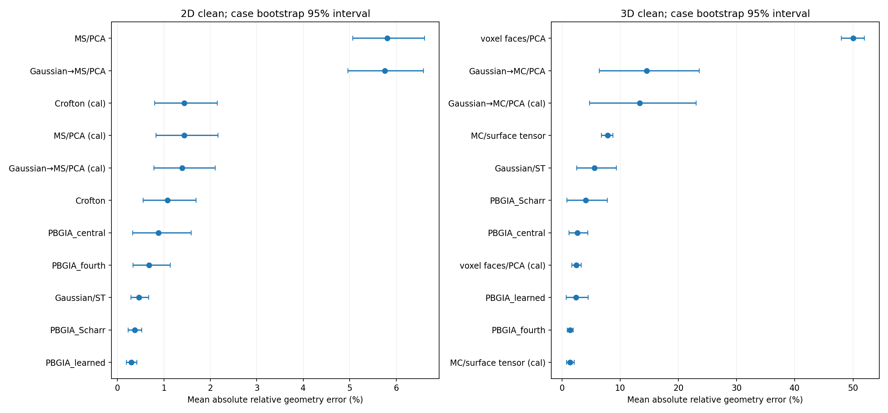

# Physics-Based Geometric Image Analysis

## Latest: fixed-iteration study

- [고정 반복횟수 연구 보고서 (한국어)](fixed_iteration/output/REPORT_KO.md) · [PDF](fixed_iteration/output/REPORT_KO.pdf)
- [Frozen N=30 configuration and kernels](fixed_iteration/output/selected_configuration.json)
- [Code, data, and reproduction instructions](fixed_iteration/README.md)

The new prototype-split study selects **N=30**: clean test geometry MARE **1.00% (2D)** and **1.40% (3D)**, approximately **1.31× faster than N=40** on the measured CPU. This uses separate data splits from the earlier convergence study below; their errors are not directly comparable. Large field caches are omitted.

Reproducible experiments for the **dynamic scalar-gradient normalized PBGIA update**, following [CODEX_TASK_KO.md](CODEX_TASK_KO.md).

```text
Hv = J * sum_neighbors(v_current) + D * grad(s_current)
Hs = J * sum_neighbors(s_current) + h * f
n_next = (Hv, Hs) / norm((Hv, Hs))
```

The binary input `f` stays fixed. Exchange is recomputed every iteration with positive axial neighbor sums. The primary algorithm uses direct normalization (alpha=1), dynamic `grad(s)`, and **no div(v)** term. Small effective fields retain the previous unit vector. All initialization uses binary-mask EDT; analytical shapes are used only for input generation and evaluation.

## Results

- Torus, sphere and capsule: primary cases stable through 2,000 updates; RMS residuals around 5e-9.
- Clean 2D length: learned measurement kernel MARE **0.30%** on this synthetic suite.
- Clean 3D area: fourth-order PBGIA MARE **1.39%**, versus **1.38%** for reference-calibrated marching cubes.
- Small-object shrinkage, unresolved strong-field walls, boundary-sensitive weak-field cases, and tensor orientation failures are retained. These results do not establish universal superiority.

Read the [research report](RESEARCH_REPORT.md), [PDF report](reports/PBGIA_Research_Report.pdf), and [reproduction guide](REPRODUCE.md).



## Reproduce

```bash
python3.12 -m venv .venv
. .venv/bin/activate
python -m pip install -r requirements.txt
python reproduce.py
```

A CPU is sufficient. Full reproduction takes several minutes and regenerates the omitted field checkpoints. Seven tests and the cross-table artifact checks passed in the recorded environment.

```bash
python -m pytest -q tests
python code/artifact_checks.py
```

## Repository contents

- `code/`: dynamic model, convergence/topology audits, kernel optimization, geometry benchmarks, and report generation.
- `tests/`: model and derivative invariants.
- `results/`: 957 measurement rows, calibration coefficients, parameter sweeps, residual histories, topology diagnostics, kernels, figures, environment and config.
- `reference/`, `pilot/`: historical source material and prior results. These are not numerical evidence for the new dynamic model; legacy projected-gradient scripts are explicitly distinguished in the report.
- `reproduce.py`, `requirements.txt`: staged reproduction CLI and pinned environment.

Full NPZ field checkpoints (roughly 246 MB in the original archive), Python caches and transient execution logs are omitted from Git. Regenerate them with `python reproduce.py`. Recorded test logs are included for validation provenance. `results/manifest.sha256` hashes the files delivered in this repository; running experiments updates generated artifacts.

The report's Gaussian baselines, calibrated conventional methods, failure cases, finite sampling, and bootstrap limitations should be read alongside headline errors. No software license has been selected by the author.

