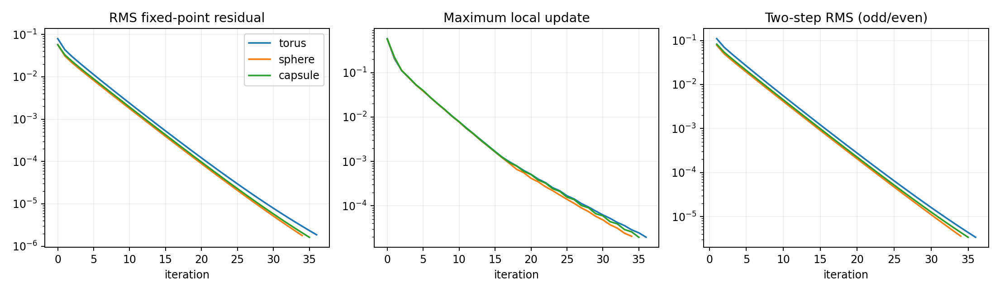
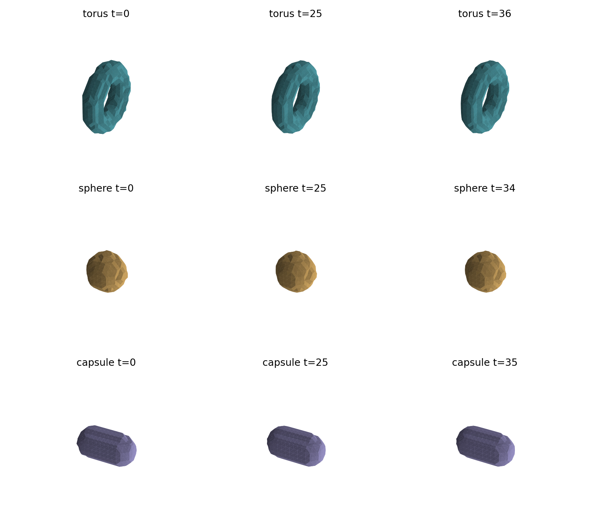
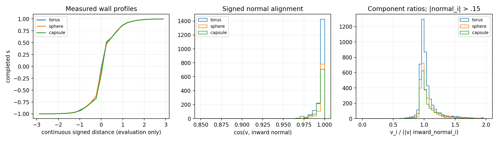
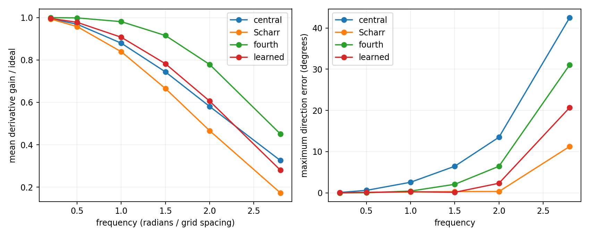
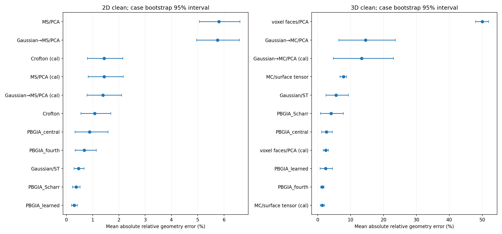

# Dynamic-normal PBGIA: executed numerical research report

Date: 2026-11-16. Authority: `CODEX_TASK_KO.md`. This is a finite synthetic numerical study, not a theorem or evidence from natural images.

## Findings

The specified dynamic-gradient normalized iteration converges on the tested main torus, sphere, and capsule. At J=1, h=2, D=1, their final RMS changes fall below 2e-6 after 34–36 updates; continued execution through 2,000 updates reaches float32 noise near 5e-9. Their binary masks have Dice 1 and Euler characteristics 0, 1, 1. Three regular targets give degree 0, 1, 1, both initially and finally, after explicitly compactifying the negative exterior collar. The scalar-field finite-difference degree is substantially biased on these thin walls and must not replace the integer calculation.

There is no universal best measurement kernel. Independent clean 2D length tests favor the learned kernel; independent 3D surface tests favor the five-point fourth-order kernel over that learned kernel. Reference-calibrated marching cubes slightly outperforms the best PBGIA kernel on clean 3D area (about 1.38% versus 1.39% MARE). Conventional methods are included alongside their raw versions, so comparisons do not give calibration exclusively to PBGIA. PCA is competitive or better for long-axis orientation. The full-field gradient tensor cannot reliably infer the center-to-center axis of separated round components. Small objects, strong fields, weak fields, and insufficient domain margins remain important failures.

## Model and provenance

For fixed binary f (inside +1), every synchronous step computes

```
Hv = J sum_axial_neighbors(v_current) + D gradient(s_current)
Hs = J sum_axial_neighbors(s_current) + h f
n_next = concatenate(Hv, Hs) / norm(concatenate(Hv, Hs))
```

The exchange uses positive 2d-neighbor sums, recomputed on every step. It is not a Laplacian replacement. The primary update has alpha=1; alpha=.5 is separately labeled damping. If |H|<=1e-12, retain the previous unit vector. No div(v) term is present. No single variational energy or monotonic-energy argument is assumed. In 3D n has four components; in 2D it has three. Stored vector components follow array axes, not display-image x/y conventions.

Initialization uses only the binary-mask Euclidean distance transform: s=tanh((EDT_inside−EDT_outside)/2.3), and v points along the gradient of that s with magnitude sqrt(1−s²). Analytical shapes generate synthetic binary inputs and evaluation normals/truth only. They do not enter initialization or updates. Analytical normals were evaluated directly from the continuous primitives. The ellipsoid implicit function is not an exact signed distance, and no width claim for ellipsoids relies on interpreting it as one.

The supplied `pbgia_dynamic_normal_test.py` was separately executed at 56³ for 600 updates (16 runs; raw `supplied_replication.csv`). Its Gaussian-smoothed fixed-grad(f) control uses a different derivative scale. The new P0 static control instead uses the same central stencil on f, providing a matched-discretization control. Neither control is the legacy projected-gradient model. The historical reference reports, pilot CSVs, and the supplied derivative parameterization guided this study; historical projected-gradient and fixed-gradient results are not pooled into new evidence. Original Colab code uses a positive convolution exchange kernel rather than exactly our axial stencil; the authoritative task explicitly specifies the neighbor-sum model studied here.

## Executed scope and convergence

P0: 29 runs on 48³; torus R=12,r=4.5 (nominal inner diameter 15, outer diameter 33), sphere R=9, capsule radius 7 with cylinder length 14 and total tip-to-tip length 28. Torus axis is initially array-axis 0; this is a coordinate permutation of the supplied z-axis torus. Parameter anchors: (h,D,J)=(2,.16,1),(2,1,1),(2,3,1),(4,1,1),(2,1,.5),(2,1,2), plus static, damping, rotation, R/r=14/3 and radius-2 cases. This is an anchored parameter sweep, not a complete Cartesian grid.

The RMS criterion is sqrt(mean_x |n_next−n|²)<2e-6. Maximum local update and the two-step residual |n_(t+1)−n_(t−1)| are recorded separately. A small two-step residual alone does not prove convergence: a true two-cycle can make it zero while one-step changes remain large. Damped trials are additionally checked against the undamped fixed-point map in supplemental runs. All 29 P0 endpoints met the RMS threshold; this does not prove stability for untested parameters.

| shape   |   iteration |   residual |   max_residual |   dice |   chi |   signed_inward_cos |   v_grad_s_cos |   profile_width |   ray_width_median |
|:--------|------------:|-----------:|---------------:|-------:|------:|--------------------:|---------------:|----------------:|-------------------:|
| torus   |          36 | 1.8643e-06 |     1.9613e-05 |      1 |     0 |             0.99633 |        0.98652 |          1.2756 |             1.3624 |
| sphere  |          34 | 1.7853e-06 |     2.0547e-05 |      1 |     1 |             0.9967  |        0.98967 |          1.2658 |             1.3896 |
| capsule |          35 | 1.625e-06  |     1.9499e-05 |      1 |     1 |             0.99503 |        0.99062 |          1.2815 |             1.2779 |



Nine supplemental runs continue through 2,000 updates, including larger 64³ domains and weak/strong-field stress cases:

| run             |   N |   h |    D |   alpha |   iteration |   residual |   undamped_residual |    dice |   chi |   integer_degree |
|:----------------|----:|----:|-----:|--------:|------------:|-----------:|--------------------:|--------:|------:|-----------------:|
| supp_00_torus   |  48 | 2   | 1    |     1   |        2000 | 5.6123e-09 |          5.6123e-09 | 1       |     0 |                0 |
| supp_01_sphere  |  48 | 2   | 1    |     1   |        2000 | 5.0725e-09 |          5.0725e-09 | 1       |     1 |                1 |
| supp_02_capsule |  48 | 2   | 1    |     1   |        2000 | 4.5157e-09 |          4.5157e-09 | 1       |     1 |                1 |
| supp_03_torus   |  64 | 2   | 1    |     1   |        2000 | 3.8654e-09 |          3.8654e-09 | 1       |     0 |                0 |
| supp_04_sphere  |  64 | 2   | 1    |     1   |        2000 | 3.2947e-09 |          3.2947e-09 | 1       |     1 |                1 |
| supp_05_torus   |  48 | 0.1 | 3    |     1   |        2000 | 7.6885e-08 |          7.6885e-08 | 0.92026 |     0 |                0 |
| supp_06_torus   |  48 | 0.1 | 3    |     0.5 |        2000 | 4.0986e-09 |          5.687e-08  | 0.92026 |     0 |                0 |
| supp_07_sphere  |  48 | 0.1 | 0.16 |     1   |        2000 | 1.2058e-07 |          1.2058e-07 | 0.51166 |     1 |                1 |
| supp_08_torus   |  48 | 8   | 0.16 |     1   |        2000 | 7.1788e-10 |          7.1788e-10 | 1       |     0 |                0 |

No persistent large-amplitude two-cycle was found in these tested runs. Float32 parity differences remain at roundoff. Exact axis-permutation covariance error is 1.19e-07. Independent 56³ tilted axes proportional to (.65,.60,.47) give:

| shape   |   R |   r |   dice |   signed_inward_cos |   residual |   integer_degree |
|:--------|----:|----:|-------:|--------------------:|-----------:|-----------------:|
| torus   |  12 | 4.5 | 1      |             0.99731 | 1.8498e-06 |                0 |
| torus   |  14 | 3   | 0.9996 |             0.99733 | 1.6423e-06 |                0 |
| capsule |   7 | 0   | 1      |             0.99786 | 1.9759e-06 |                1 |

## Topological interpretation and boundary audit

`pbgia_s3_integer_degree.py` splits each cube into six oriented Freudenthal tetrahedra and counts signed positive-ray intersections for three targets. The supplied diagnostic `near_degenerate_tetrahedra` concerns matrices rejected by a determinant threshold in target-screened cells; it is not by itself a count of zeros of the normalized interpolation. Flat constant regions are rank deficient but harmless.

A separate global audit first certifies tetrahedra whose vertices share the hemisphere defined by their sum. For every remaining tetrahedron it enumerates all active faces and computes the closest convex-hull point to the origin. This supplies a lower bound for the interpolation norm. `topology_audit.csv` records the bound, rejected hemisphere certificates, Q3_fd, raw collar values, cap magnitude and degree for each target. Primary J=1,h=2,D=1 fields have positive hemisphere certificates. Narrow-wall parameter regimes can approach the interpolation singularity much more closely; target agreement alone would miss that warning.

Periodic boundaries are used for dynamics. Raw exterior vectors are not exactly constant, particularly at initialization. Degree evaluation therefore linearly blends only the outer three-voxel negative-s collar to the south pole and normalizes; negative collar s ensures this cap itself avoids the origin. The raw boundary spread is in `p0_degree.csv`, and capped spread is zero in `topology_audit.csv`. This defines a compactified map for the reported integer, rather than claiming the uncapped finite box has a mathematically fixed boundary. No endpoint degree change was detected in the primary tests. Discrete time sampling cannot rule out an unsampled transition and return between checkpoints.

The 48³ and 64³ main torus/sphere checks agree on masks and completed-wall metrics. Weak h=.1 stress cases have broad walls and may interact with the periodic box; they are retained as boundary-sensitive stress data, not accepted as domain-independent geometry estimates. This study does not claim margin adequacy for every weak-field trial.



## Actual wall width and normal alignment

`profile_width` is a coarea proxy: 1.4 times the count of |s|<.7,|v|>.04 voxels, divided by their summed central |grad(s)|. It is grid dependent and becomes undefined physically when that wall set is empty (the raw implementation records zero, with zero wall count). `ray_width_median` is separately measured by trilinear interpolation of s along mask-EDT normal rays from the binary marching surface, using the −.7 to +.7 crossings. Quantiles and the fraction of rays with valid crossings are saved. Rays extend ±6 grid spacings; broader walls can be unresolved.

At h=2,D=1,J=1 the coarea proxy is about 1.27–1.28 voxels; h=4 reduces it to roughly .92–.94, with very few sampled wall voxels. At h=8,D=.16 the wall set is empty, so high mask Dice says little about resolved field geometry. Widths are measured from completed fields; no sqrt(2A/h) prediction from the old projected-gradient model is transferred.

Signed inward cosines are positive because grad(s) points inward for f=+1 inside. The comparison uses the original continuous surface band intersected with the current wall. The vector-to-grad(s) signed cosine is also recorded. The component-ratio plot divides v_i by |v| times the inward theoretical normal, excluding |normal_i|<=.15 to avoid division near zero.



## Kernel optimization, calibration and separation of roles

The generation kernel is central for all main benchmark fields. The measurement tensor is T_ij=sum_x,a (D_i n_a)(D_j n_a); geometry is c*trace(T), calibrated on an independent R=9 circle in 2D and R=6 sphere in 3D. A separate coefficient is fixed for each h, dimension and measurement method. Test truth never sets those coefficients. Trace(T) is a gradient-tensor measurement, not the exchange energy of this nonvariational update.

The three- and five-point central derivatives, Scharr-like separable transverse smoothing, and a trainable antisymmetric separable 5×5 kernel are compared. For p=(b,t1,t2), derivative weights at offsets ±1 are ±(.5−2b), and offsets ±2 are ±b. Transverse smoothing is (t2,t1,1−2t1−2t2,t1,t2). This enforces zero response to constants and unit response to linear functions in the interior. Fourier gain and directional error across orientations are saved in `kernel_frequency_response.csv`. Cubic covariance is verified; full continuous rotation invariance is measured, not assumed.

Training uses nine independent radius-6 2D circle/stadium/ellipse examples at three angles; test radius is 11, ring R=12,r=3. A three-weight multiobjective search balances relative geometry MSE, angle error and rotation CV. All candidates are reported as a finite Pareto set, with optimizer status. The selected training weight .05 was fixed before test evaluation. Selected p=[-0.044430528985157536, 0.11723440324007278, 0.0]. The zero outer smoothing coefficient makes this solution lie on the family boundary; it is not an unrestricted isotropic optimum.

|   weight | success   |   iterations |   geometry_mse |   angle_scaled_mse |   cv_squared | pareto_nondominated   |
|---------:|:----------|-------------:|---------------:|-------------------:|-------------:|:----------------------|
|     0.01 | True      |           81 |     1.1808e-05 |          0.0031457 |   1.3515e-06 | True                  |
|     0.05 | True      |           92 |     2.0845e-05 |          0.0026267 |   3.8277e-06 | True                  |
|     0.2  | True      |           93 |     5.5729e-05 |          0.0021709 |   2.0504e-05 | True                  |



A distinct 32-run generator-kernel sweep updates grad(s) with each kernel, thereby changing the self-consistent field; its comparison measurement is held central. All 32 completed generator trials meet the same RMS criterion. Generator geometry is not presented as calibrated test performance because that would require independent generator-specific reference coefficients. Mask topology, field degree/conditioning, normal alignment and trace are saved in `generator_kernel_sweep.csv`.

## Independent geometry benchmark

There are 87 fields: four dimension/h-specific calibration fields, nine training fields, and 74 held-out fields. Main h=2 test: 15 clean and 15 noisy 2D cases; 18 clean and 18 noisy 3D cases. Eight additional clean cases test h=4 transfer. Shapes are circle, stadium, ellipse, ring and two-object masks in 2D; sphere, capsule, torus, ellipsoid, two-object masks and radius-2 spheres in 3D. Connected fixtures and rings/tori have three rotation/subgrid-shift instances. The two-component fixture repeats the same clean mask three times, with independent seeds for noisy versions; its clean repetitions are not independent geometric samples. Noise is independent 0.2% salt-and-pepper flips restricted to an interior region with a six-voxel clean exterior margin. This is a limited noise test, not a noise-robustness claim over arbitrary corruption.

All lengths use pixel spacing 1; all 3D areas use voxel spacing squared 1. Stadium has cylinder length 2R; capsule area is 8πR². Ellipse perimeter uses the complete elliptic integral. Ellipsoid area uses deterministic 160×320 Gaussian/azimuth quadrature of the continuous surface area element, independent of voxelization. The multi-object truth is the sum of two nonoverlapping equal circle/sphere measures.

Conventional methods include Crofton, marching squares, voxel face counts, marching cubes plus surface-normal tensor, binary PCA, Gaussian sigma=1 gradient-integral plus structure tensor, and Gaussian sigma=1 thresholding followed by marching geometry and PCA. Raw and independently reference-calibrated conventional geometry are both retained. Gaussian gradient-integral is inherently reference calibrated. No sigma is selected using test truth. Conventional orientation comes from the indicated PCA or tensor, not from the measured perimeter itself.

Clean h=2 mean absolute relative error (MARE; percent), with descriptive case-bootstrap intervals:

|   dim | method                                                              |   n |   MARE_pct |   CI95_low |   CI95_high |
|------:|:--------------------------------------------------------------------|----:|-----------:|-----------:|------------:|
|     2 | Crofton                                                             |  15 |    1.0807  |    0.55391 |     1.693   |
|     2 | Crofton+reference_calibrated                                        |  15 |    1.4363  |    0.80365 |     2.1505  |
|     2 | Gaussian_sigma1+structure_tensor                                    |  15 |    0.46411 |    0.29131 |     0.66949 |
|     2 | Gaussian_sigma1_threshold+marching_squares_PCA                      |  15 |    5.7585  |    4.9593  |     6.5907  |
|     2 | Gaussian_sigma1_threshold+marching_squares_PCA+reference_calibrated |  15 |    1.3895  |    0.78606 |     2.1077  |
|     2 | PBGIA_Scharr                                                        |  15 |    0.36968 |    0.23229 |     0.52629 |
|     2 | PBGIA_central                                                       |  15 |    0.88271 |    0.32564 |     1.5863  |
|     2 | PBGIA_fourth                                                        |  15 |    0.68327 |    0.33712 |     1.1356  |
|     2 | PBGIA_learned                                                       |  15 |    0.29987 |    0.19246 |     0.41867 |
|     2 | marching_squares                                                    |  15 |    5.8073  |    5.0692  |     6.6075  |
|     2 | marching_squares+reference_calibrated                               |  15 |    1.4363  |    0.83073 |     2.1669  |
|     3 | Gaussian_sigma1+structure_tensor                                    |  18 |    5.5819  |    2.5604  |     9.3638  |
|     3 | Gaussian_sigma1_threshold+marching_cubes_PCA                        |  18 |   14.559   |    6.4024  |    23.565   |
|     3 | Gaussian_sigma1_threshold+marching_cubes_PCA+reference_calibrated   |  18 |   13.386   |    4.7532  |    23.036   |
|     3 | PBGIA_Scharr                                                        |  18 |    4.093   |    0.88371 |     7.8     |
|     3 | PBGIA_central                                                       |  18 |    2.6412  |    1.2431  |     4.4211  |
|     3 | PBGIA_fourth                                                        |  18 |    1.3872  |    0.8926  |     1.9625  |
|     3 | PBGIA_learned                                                       |  18 |    2.4162  |    0.74382 |     4.525   |
|     3 | marching_cubes+surface_tensor                                       |  18 |    7.8337  |    6.7949  |     8.7611  |
|     3 | marching_cubes+surface_tensor+reference_calibrated                  |  18 |    1.3798  |    0.79303 |     2.0999  |
|     3 | voxel_faces+PCA                                                     |  18 |   50.01    |   48.018   |    51.924   |
|     3 | voxel_faces+PCA+reference_calibrated                                |  18 |    2.4593  |    1.6725  |     3.2841  |



At 0.2% flips, errors relative to clean continuous geometry are:

|   dim | method                                                              |   n |   MARE_pct |   CI95_low |   CI95_high |
|------:|:--------------------------------------------------------------------|----:|-----------:|-----------:|------------:|
|     2 | Crofton                                                             |  15 |   24.532   |   19.449   |    29.982   |
|     2 | Crofton+reference_calibrated                                        |  15 |   25.657   |   20.583   |    31.155   |
|     2 | Gaussian_sigma1+structure_tensor                                    |  15 |    7.6764  |    6.0456  |     9.3954  |
|     2 | Gaussian_sigma1_threshold+marching_squares_PCA                      |  15 |    5.8015  |    5.0767  |     6.6206  |
|     2 | Gaussian_sigma1_threshold+marching_squares_PCA+reference_calibrated |  15 |    1.4967  |    0.96971 |     2.1313  |
|     2 | PBGIA_Scharr                                                        |  15 |    0.36565 |    0.20659 |     0.53562 |
|     2 | PBGIA_central                                                       |  15 |    1.018   |    0.46056 |     1.718   |
|     2 | PBGIA_fourth                                                        |  15 |    0.71594 |    0.33474 |     1.182   |
|     2 | PBGIA_learned                                                       |  15 |    0.31097 |    0.19526 |     0.44801 |
|     2 | marching_squares                                                    |  15 |   31.514   |   26.115   |    37.132   |
|     2 | marching_squares+reference_calibrated                               |  15 |   25.809   |   20.678   |    31.34    |
|     3 | Gaussian_sigma1+structure_tensor                                    |  18 |   48.609   |   12.874   |    90.73    |
|     3 | Gaussian_sigma1_threshold+marching_cubes_PCA                        |  18 |   14.852   |    6.0431  |    25.193   |
|     3 | Gaussian_sigma1_threshold+marching_cubes_PCA+reference_calibrated   |  18 |   13.352   |    4.069   |    24.437   |
|     3 | PBGIA_Scharr                                                        |  18 |    4.7122  |    0.78662 |     9.4131  |
|     3 | PBGIA_central                                                       |  18 |    3.3131  |    1.2528  |     6.0863  |
|     3 | PBGIA_fourth                                                        |  18 |    2.1442  |    1.1377  |     3.4421  |
|     3 | PBGIA_learned                                                       |  18 |    2.9663  |    0.61849 |     5.7862  |
|     3 | marching_cubes+surface_tensor                                       |  18 |   78.513   |   29.508   |   135.74    |
|     3 | marching_cubes+surface_tensor+reference_calibrated                  |  18 |   65.685   |   20.121   |   118.95    |
|     3 | voxel_faces+PCA                                                     |  18 |  289.12    |  115.01    |   486.51    |
|     3 | voxel_faces+PCA+reference_calibrated                                |  18 |  161.95    |   44.502   |   298.64    |

All benchmark fields reach the RMS stopping threshold. Mask fidelity to noisy input and to clean truth are separate columns. Euler validity relative to each is also separate; matching Euler alone does not establish full topology equivalence. Full raw records, normal quality, wall widths, iterations, seeds, coefficients, kernel parameters, shifts and timings are in `benchmark_raw.csv`. The bootstrap resamples case errors 3,000 times with seed 61116. These are descriptive intervals over a small, correlated synthetic suite; they are not population-level confidence guarantees, and no significance-based superiority claim is made.

Orientation MAE on elongated connected shapes only (degrees):

|   dim | method                                                              |   axis_error_deg |
|------:|:--------------------------------------------------------------------|-----------------:|
|     2 | Crofton                                                             |         0.16794  |
|     2 | Crofton+reference_calibrated                                        |         0.16794  |
|     2 | Gaussian_sigma1+structure_tensor                                    |         0.60269  |
|     2 | Gaussian_sigma1_threshold+marching_squares_PCA                      |         0.1771   |
|     2 | Gaussian_sigma1_threshold+marching_squares_PCA+reference_calibrated |         0.1771   |
|     2 | PBGIA_Scharr                                                        |         0.24259  |
|     2 | PBGIA_central                                                       |         1.4684   |
|     2 | PBGIA_fourth                                                        |         0.93064  |
|     2 | PBGIA_learned                                                       |         0.34281  |
|     2 | marching_squares                                                    |         0.16794  |
|     2 | marching_squares+reference_calibrated                               |         0.16794  |
|     3 | Gaussian_sigma1+structure_tensor                                    |         0.39471  |
|     3 | Gaussian_sigma1_threshold+marching_cubes_PCA                        |         0.1295   |
|     3 | Gaussian_sigma1_threshold+marching_cubes_PCA+reference_calibrated   |         0.1295   |
|     3 | PBGIA_Scharr                                                        |         0.19069  |
|     3 | PBGIA_central                                                       |         1.0948   |
|     3 | PBGIA_fourth                                                        |         0.61807  |
|     3 | PBGIA_learned                                                       |         0.1958   |
|     3 | marching_cubes+surface_tensor                                       |         0.6247   |
|     3 | marching_cubes+surface_tensor+reference_calibrated                  |         0.6247   |
|     3 | voxel_faces+PCA                                                     |         0.088071 |
|     3 | voxel_faces+PCA+reference_calibrated                                |         0.088071 |

The all-case summary deliberately retains the two-component tensor failure, which can yield about 90° error. Gradient tensors measure local boundary-normal distributions; separated circles/spheres have nearly isotropic local distributions even when their centers define a clear global axis. PCA measures that center distribution. Near eigenvalue degeneracy, any returned tensor axis is ill-conditioned. Spheres/circles/rings and torus orientation are not included as principal-axis truth tests.

`rotation_shift_cv.csv` reports within-fixture CV; rotations and shifts are jointly varied, so it does not isolate their individual effects. `benchmark_summary.csv` also reports h=4 transfer and runtime. Conventional timing is the total batch time for all conventional measurements on that case, repeated on each conventional row; PBGIA total is field solve plus its measurement. These are conservative descriptive CPU timings from a shared host, excluding input generation, calibration, kernel training and disk output. They are not matched per-function microbenchmarks. Conventional rows carry the associated PBGIA residual for provenance; that residual is not a convergence criterion for Crofton, PCA or marching methods.

## Failure cases and limits

- A radius-2 sphere at h=2 retains integer degree and Euler characteristic but loses foreground voxels (P0 Dice .875). Topological stability does not imply geometric fidelity.
- Weak h=.1 preserves the sampled sphere degree but shrinks its segmentation strongly; torus weak-field width and domain dependence limit geometric interpretation.
- Strong h=8,D=.16 gives an unresolved wall, nearly antipodal interpolation and unreliable coarse field-integral geometry, despite excellent binary-mask Dice. No claim of robust S³ conditioning is made there.
- A 2D-trained kernel is not the best 3D kernel in the main benchmark. Neither continuous rotational optimality nor a globally optimal learned kernel is established.
- PBGIA tensor orientation fails for separated round objects, and PCA is often more accurate even on connected elongated shapes.
- Conventional calibrations/preprocessing can close or reverse a raw-method accuracy gap. Calibrated methods and the fixed Gaussian baseline are included for that reason.
- Only one main voxel spacing, a few sizes, three orientations/shifts per family and one nonzero noise rate are tested. Larger-domain checks are margin checks, not a spatial grid-refinement convergence study. No natural images, grayscale, RGB, mesh anisotropy, or physical-unit resolution transfer were tested.

## Reproduction and artifacts

See `REPRODUCE.md`; run `python reproduce.py` in an environment installed from `requirements.txt`. Each stage writes logs. Seven tests pass: direct agreement with the specified dynamic map, immutable binary input, zero-effective-field handling, unit normalization, constant/linear derivative reproduction, axis covariance and topology smoke checks. The provided top-level invariant script was also executed separately. NPZ snapshots support continuation using `code/resume_checkpoint.py`.

Key files: `p0_metrics.csv`, `p0_history.csv`, `p0_degree.csv`, `topology_audit.csv`, `supplemental_metrics.csv`, `supplemental_history.csv`, `tilted_validation.csv`, `kernel_training.csv`, `kernels.json`, `generator_kernel_sweep.csv`, `benchmark_raw.csv`, `benchmark_summary.csv`, `rotation_shift_cv.csv`, plus PNG figures and full field snapshots. Historical data remain separately in `pilot/` and `reference/`. The report uses only current-run tables for its numerical conclusions.
