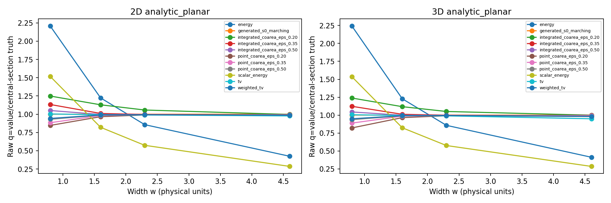
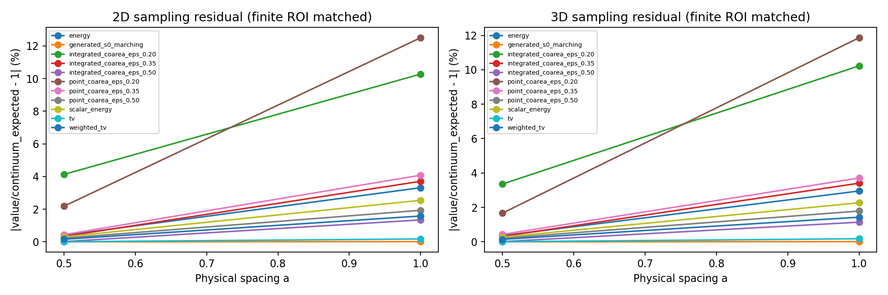
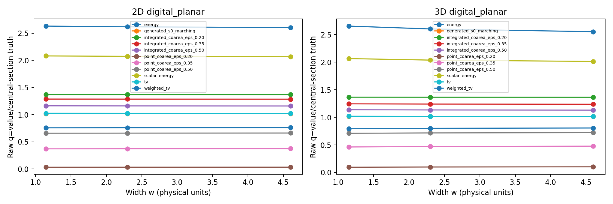
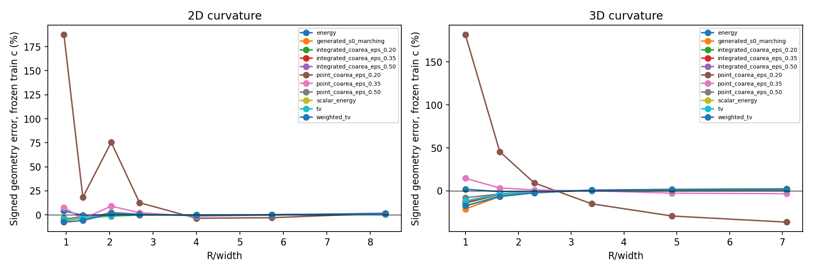
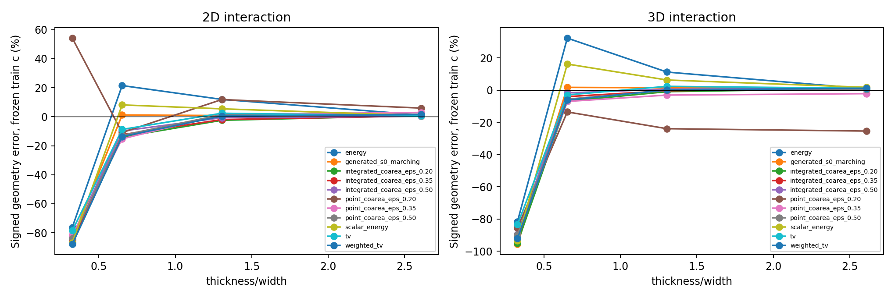
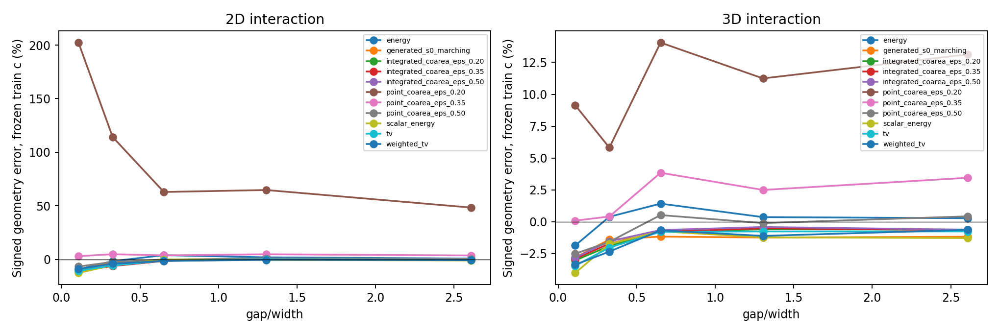
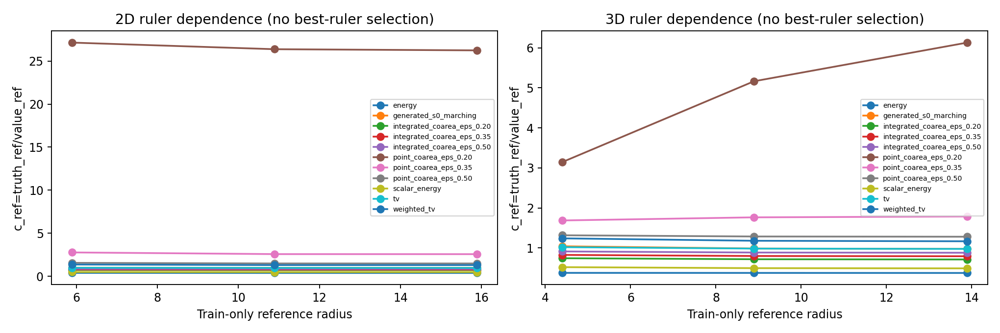
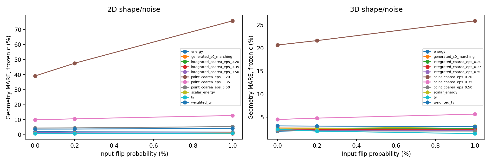
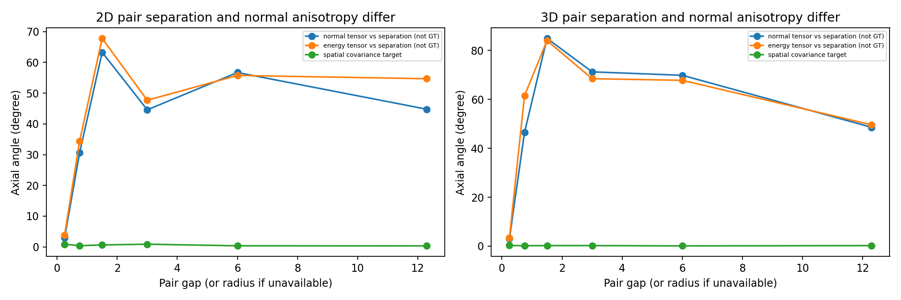
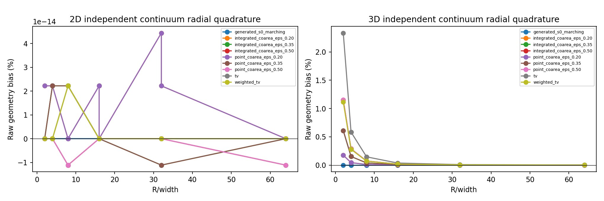

# 자구벽 기반 기하 readout의 고정 대조 연구: 2D·3D

## 1. 연구 범위와 실제 실행 결과

이번 연구는 생성 커널을 새로 훈련하지 않고 **같은 자화장에 서로 다른 기하 readout을 적용**했다. 이전 연구의 q 분산 감소가 참조 의존성·잡음 강건성 개선으로 이어지지 않았던 문제를 바탕으로, 생성장과 측정함수의 영향을 분리한다. 모든 방법·격자·참조·조건은 미리 선언된 비교이며, 가장 좋은 test 방법이나 표준자를 골라 최종 성능으로 만드는 선택 단계가 없다.

**이번 결과는 energy readout을 coarea로 일괄 교체하는 결론을 지지하지 않는다.** 같은 calibration-only 참조로 보정한 clean 형상 suite에서2D TV의MARE는0.733%,energy는1.999%였지만,3D에서는energy1.943%가TV2.368%보다작았다.3D 원/구 곡률 sweep에서는energy0.632%,TV3.581%로energy가더좋았다. 이 수치는 작은 선언된 형상군의 결과이며 보편적 우월성이나 통계적 유의성으로 확대하지 않는다.

**좁은 point-delta coarea는 현재 생성장에서 심하게 underresolve된다.** Digital 평면2D에서epsilon.20의raw MARE는약96.7%,같은 참조 보정 후에도35.3%였다. CDF를 먼저 적분한 방식은 이 실패를 줄였지만 G4의ringing으로인한과대계수편향이남았다. 연속체 coarea 항등식만으로 이산 구현의 정확성이 보장되지는 않는다.

평면 oracle field, 픽셀 입력으로 실제 생성한 평면장, 곡률, 얇은 구조·가까운 경계, 연장·복합 형상에서 실제 측정했다. 아래 차원별 행 수가 실제 3D 계산의 범위다. 이는 **3D fixed-readout 측정 실험**이며 이전의 3D 커널 최적화 미완료를 새 학습 성공으로 바꾸어 부르는 것이 아니다.

| suite           |   dim |   cases |   prototypes |   rows |
|:----------------|------:|--------:|-------------:|-------:|
| analytic_planar |     2 |      64 |            1 |    704 |
| analytic_planar |     3 |      48 |            1 |    528 |
| curvature       |     2 |      42 |            7 |    462 |
| curvature       |     3 |      36 |            6 |    396 |
| digital_planar  |     2 |      24 |            1 |    264 |
| digital_planar  |     3 |      18 |            1 |    198 |
| interaction     |     2 |     108 |           13 |   1188 |
| interaction     |     3 |     108 |           13 |   1188 |
| shape           |     2 |      36 |            3 |    396 |
| shape           |     3 |      60 |            5 |    660 |
| spacing         |     2 |       3 |            1 |     33 |
| spacing         |     3 |       3 |            1 |     33 |

대표 조건(width=2.3, spacing=1, noise=0)의 곡률/형상 결과를각suite별로제시한다. 각suite안에서는원형을같은가중치로평균했고서로다른suite를하나의전체성능점수로합치지않았다. 원형수가작으므로조건별표와원시데이터를함께읽어야한다.

| suite     |   dim | method                     |   units |   MARE_frozen_c_pct |   q_CV_pct |   raw_geometry_MARE_pct |
|:----------|------:|:---------------------------|--------:|--------------------:|-----------:|------------------------:|
| curvature |     2 | energy                     |       7 |             1.2698  |    1.4769  |                nan      |
| curvature |     2 | generated_s0_marching      |       7 |             2.0564  |    2.4161  |                  2.3758 |
| curvature |     2 | integrated_coarea_eps_0.20 |       7 |             1.8577  |    1.987   |                 36.289  |
| curvature |     2 | integrated_coarea_eps_0.35 |       7 |             1.7917  |    2.146   |                 27.626  |
| curvature |     2 | integrated_coarea_eps_0.50 |       7 |             1.5539  |    1.7149  |                 15.685  |
| curvature |     2 | point_coarea_eps_0.20      |       7 |            43.879   |   45.898   |                 94.683  |
| curvature |     2 | point_coarea_eps_0.35      |       7 |             4.4846  |    4.3071  |                 61.108  |
| curvature |     2 | point_coarea_eps_0.50      |       7 |             2.6218  |    2.3707  |                 33.899  |
| curvature |     2 | scalar_energy              |       7 |             1.7915  |    2.2171  |                nan      |
| curvature |     2 | tv                         |       7 |             1.6401  |    1.8376  |                  2.3233 |
| curvature |     2 | weighted_tv                |       7 |             3.1016  |    3.3893  |                 25.15   |
| curvature |     3 | energy                     |       6 |             0.63183 |    0.89118 |                nan      |
| curvature |     3 | generated_s0_marching      |       6 |             5.8682  |    8.5402  |                  5.8794 |
| curvature |     3 | integrated_coarea_eps_0.20 |       6 |             3.9815  |    5.6823  |                 34.539  |
| curvature |     3 | integrated_coarea_eps_0.35 |       6 |             3.7725  |    5.3991  |                 21.113  |
| curvature |     3 | integrated_coarea_eps_0.50 |       6 |             3.3514  |    4.6924  |                 10.217  |
| curvature |     3 | point_coarea_eps_0.20      |       6 |            52.858   |   59.319   |                 69.135  |
| curvature |     3 | point_coarea_eps_0.35      |       6 |             4.2762  |    5.8412  |                 41.35   |
| curvature |     3 | point_coarea_eps_0.50      |       6 |             2.4615  |    3.2162  |                 24.063  |
| curvature |     3 | scalar_energy              |       6 |             5.1256  |    7.1771  |                nan      |
| curvature |     3 | tv                         |       6 |             3.5807  |    4.8053  |                  3.6117 |
| curvature |     3 | weighted_tv                |       6 |             5.13    |    7.098   |                 19.139  |
| shape     |     2 | energy                     |       3 |             1.9994  |    0.44097 |                nan      |
| shape     |     2 | generated_s0_marching      |       3 |             0.88481 |    0.87968 |                  1.9308 |
| shape     |     2 | integrated_coarea_eps_0.20 |       3 |             0.91748 |    0.71344 |                 38.434  |
| shape     |     2 | integrated_coarea_eps_0.35 |       3 |             0.88745 |    0.60652 |                 28.818  |
| shape     |     2 | integrated_coarea_eps_0.50 |       3 |             1.3447  |    0.5934  |                 15.862  |
| shape     |     2 | point_coarea_eps_0.20      |       3 |            39.107   |    7.8864  |                 94.766  |
| shape     |     2 | point_coarea_eps_0.35      |       3 |             9.8924  |    3.3249  |                 58.165  |
| shape     |     2 | point_coarea_eps_0.50      |       3 |             4.4057  |    2.3643  |                 30.813  |
| shape     |     2 | scalar_energy              |       3 |             0.89143 |    0.92327 |                nan      |
| shape     |     2 | tv                         |       3 |             0.73279 |    0.61808 |                  2.768  |
| shape     |     2 | weighted_tv                |       3 |             3.7182  |    2.6456  |                 21.684  |
| shape     |     3 | energy                     |       5 |             1.9431  |    1.8452  |                nan      |
| shape     |     3 | generated_s0_marching      |       5 |             2.6583  |    2.7492  |                  2.4729 |
| shape     |     3 | integrated_coarea_eps_0.20 |       5 |             2.4153  |    1.4828  |                 35.062  |
| shape     |     3 | integrated_coarea_eps_0.35 |       5 |             2.2923  |    1.4831  |                 21.558  |
| shape     |     3 | integrated_coarea_eps_0.50 |       5 |             2.2465  |    1.3897  |                  9.9691 |
| shape     |     3 | point_coarea_eps_0.20      |       5 |            20.651   |   22.971   |                 71.517  |
| shape     |     3 | point_coarea_eps_0.35      |       5 |             4.4919  |    3.7536  |                 41.79   |
| shape     |     3 | point_coarea_eps_0.50      |       5 |             2.063   |    1.7435  |                 23.937  |
| shape     |     3 | scalar_energy              |       5 |             2.4266  |    2.5663  |                nan      |
| shape     |     3 | tv                         |       5 |             2.368   |    1.5081  |                  1.5612 |
| shape     |     3 | weighted_tv                |       5 |             3.0945  |    2.7077  |                 18.505  |

관측값이 비유한인 평가 행은 0개다. 비유한 값은 `nonfinite_values`, 영/음수는 `nonpositive_values`로 별도 공개하며, 불리한 형상을 재구성·위상·벽 너비·잔차 조건으로 걸러내지 않는다. 각 오차 평균의 유한값 수와 전체 행 수를 함께 기록했다. 수치 실패가 있으면 그 행을 빠뜨린 평균만으로 성공을 주장하지 않는다.

## 2. 왜 기존 gradient energy가 면적과 달라질 수 있는가

기존 readout은 I=∫|∇n|²dV다. 평면에서 n=(sech(u/w)ν,tanh(u/w)), ν가 일정한 이상적인 완전 전이 벽이라면 단위 경계면당 적분은

- 전체 gradient energy: 2/w
- scalar 성분 energy: 4/(3w)
- vector 성분 energy: 2/(3w)

이다. 따라서 energy의 물리 단위는 L^(d−2), 구하려는 둘레/면적은 L^(d−1)이다. 전체 energy가 경계 크기에 비례하려면 벽 profile 계수와 폭이 같아야 한다. **Raw energy에 raw MARE를 붙여 coarea와 직접 순위를 비교하지 않았다.** Energy도 raw q=I/GT는 기록하지만, 기하 오차는 모든 방법에 동일한 train-only 보정 정책을 적용해 별도로 비교한다.

곡면에서는 n의 법선 방향도 공간적으로 변한다. Vector energy에는 경계 크기 외에 법선 변화·곡률의 기여가 들어가고, 벽이 가까워지면 평면 단일 벽의 가정이 깨질 수 있다. 이 항을 단순 상수 보정 하나로 모든 크기와 형상에서 제거할 수 있다고 가정하지 않는다.

½∫|∇s|dV 같은 coarea readout은 완전한 단조 평면 전이에서는 폭에 무관하게 경계 크기를 돌려준다. 그러나 coarea 정리에 따르면 일반적으로 여러 s level-set의 면적을 평균하는 양이며 **항상 s=0 면적과 정확히 같은 것은 아니다.** 곡률, 유한한 ROI, 전이의 잘림, 겹치는 벽, 낮은 해상도에서 편향이 남을 수 있다. Weighted-TV/coarea readout도 그 유효 가정을 실제 데이터에서 확인해야 한다. Point coarea는 delta(s)와G4(s)를 곱하고,integrated coarea는 먼저 정규화CDF H(s)로 바꾼 뒤|G4H(s)|를 적분한다. 연속 chain rule에서는 같은 밀도지만 이산 G4에서는 같지 않다. 특히 G4는 monotone/TV-diminishing 연산자가 아니므로 후자를 underresolved wall에서도 항상 보존적인 면적이라고 부르지 않는다.

`energy_component_physics.csv`는 scalar/vector 분해를 같은 field에서 모은 결과다. 아래 분해가 이상적 2/3,1/3에서 벗어난다고 즉시 코드 오류라 판단하지 않는다. 디지털 생성장은 oracle sech/tanh profile과 다르고, 곡면의 vector 방향 변화가 추가되기 때문이다.

| suite           |   dim |   width |   spacing |   noise |   images |   units |   scalar_fraction |   vector_fraction |   total_per_truth |   scalar_per_truth |   vector_per_truth |   total_times_width_per_truth |
|:----------------|------:|--------:|----------:|--------:|---------:|--------:|------------------:|------------------:|------------------:|-------------------:|-------------------:|------------------------------:|
| analytic_planar |     2 |    0.8  |      0.5  |   0     |        8 |       1 |           0.66993 |           0.33007 |           2.4561  |            1.6454  |            0.81069 |                        1.9649 |
| analytic_planar |     2 |    0.8  |      1    |   0     |        8 |       1 |           0.68768 |           0.31232 |           2.2079  |            1.5178  |            0.69007 |                        1.7663 |
| analytic_planar |     2 |    1.6  |      0.5  |   0     |        8 |       1 |           0.66884 |           0.33116 |           1.2399  |            0.82925 |            0.41066 |                        1.9839 |
| analytic_planar |     2 |    1.6  |      1    |   0     |        8 |       1 |           0.67105 |           0.32895 |           1.2232  |            0.82081 |            0.4024  |                        1.9571 |
| analytic_planar |     2 |    2.3  |      0.5  |   0     |        8 |       1 |           0.66965 |           0.33035 |           0.86018 |            0.57595 |            0.28424 |                        1.9784 |
| analytic_planar |     2 |    2.3  |      1    |   0     |        8 |       1 |           0.67027 |           0.32973 |           0.85707 |            0.5744  |            0.28267 |                        1.9713 |
| analytic_planar |     2 |    4.6  |      0.5  |   0     |        8 |       1 |           0.67361 |           0.32639 |           0.42461 |            0.28585 |            0.13876 |                        1.9532 |
| analytic_planar |     2 |    4.6  |      1    |   0     |        8 |       1 |           0.67367 |           0.32633 |           0.42452 |            0.28581 |            0.13871 |                        1.9528 |
| analytic_planar |     3 |    0.8  |      0.5  |   0     |        6 |       1 |           0.66926 |           0.33074 |           2.4643  |            1.6493  |            0.81506 |                        1.9715 |
| analytic_planar |     3 |    0.8  |      1    |   0     |        6 |       1 |           0.68515 |           0.31485 |           2.2431  |            1.5357  |            0.70735 |                        1.7945 |
| analytic_planar |     3 |    1.6  |      0.5  |   0     |        6 |       1 |           0.66886 |           0.33114 |           1.2426  |            0.83114 |            0.41151 |                        1.9882 |
| analytic_planar |     3 |    1.6  |      1    |   0     |        6 |       1 |           0.6708  |           0.3292  |           1.2277  |            0.82354 |            0.40415 |                        1.9643 |
| analytic_planar |     3 |    2.3  |      0.5  |   0     |        6 |       1 |           0.67123 |           0.32877 |           0.86022 |            0.57733 |            0.28288 |                        1.9785 |
| analytic_planar |     3 |    2.3  |      1    |   0     |        6 |       1 |           0.67175 |           0.32825 |           0.85747 |            0.57595 |            0.28152 |                        1.9722 |
| analytic_planar |     3 |    4.6  |      0.5  |   0     |        6 |       1 |           0.6915  |           0.3085  |           0.4125  |            0.28493 |            0.12756 |                        1.8975 |
| analytic_planar |     3 |    4.6  |      1    |   0     |        6 |       1 |           0.69151 |           0.30849 |           0.41249 |            0.28493 |            0.12755 |                        1.8974 |
| curvature       |     2 |    2.3  |      1    |   0     |       14 |       7 |           0.77183 |           0.22817 |           2.6415  |            2.0378  |            0.60373 |                        6.0755 |
| curvature       |     2 |    2.3  |      1    |   0.002 |       14 |       7 |           0.76832 |           0.23168 |           2.6368  |            2.0249  |            0.61195 |                        6.0647 |
| curvature       |     2 |    2.3  |      1    |   0.01  |       14 |       7 |           0.76352 |           0.23648 |           2.6398  |            2.0146  |            0.62519 |                        6.0714 |
| curvature       |     3 |    2.3  |      1    |   0     |       12 |       6 |           0.72296 |           0.27704 |           2.6737  |            1.9321  |            0.74164 |                        6.1495 |
| curvature       |     3 |    2.3  |      1    |   0.002 |       12 |       6 |           0.71563 |           0.28437 |           2.7011  |            1.9302  |            0.77088 |                        6.2125 |
| curvature       |     3 |    2.3  |      1    |   0.01  |       12 |       6 |           0.70681 |           0.29319 |           2.7274  |            1.9228  |            0.80464 |                        6.273  |
| digital_planar  |     2 |    1.15 |      1    |   0     |        8 |       1 |           0.79243 |           0.20757 |           2.6325  |            2.0828  |            0.54971 |                        3.0274 |
| digital_planar  |     2 |    2.3  |      1    |   0     |        8 |       1 |           0.79372 |           0.20628 |           2.6193  |            2.0758  |            0.54356 |                        6.0244 |
| digital_planar  |     2 |    4.6  |      1    |   0     |        8 |       1 |           0.7953  |           0.2047  |           2.6055  |            2.0689  |            0.5366  |                       11.985  |
| digital_planar  |     3 |    1.15 |      1    |   0     |        6 |       1 |           0.78076 |           0.21924 |           2.654   |            2.0651  |            0.58892 |                        3.0521 |
| digital_planar  |     3 |    2.3  |      1    |   0     |        6 |       1 |           0.78553 |           0.21447 |           2.6024  |            2.0375  |            0.5649  |                        5.9856 |
| digital_planar  |     3 |    4.6  |      1    |   0     |        6 |       1 |           0.79133 |           0.20867 |           2.5525  |            2.0133  |            0.53918 |                       11.742  |
| interaction     |     2 |    2.3  |      1    |   0     |       36 |      13 |           0.71987 |           0.28013 |           2.4916  |            1.8566  |            0.63501 |                        5.7308 |
| interaction     |     2 |    2.3  |      1    |   0.002 |       36 |      13 |           0.71959 |           0.28041 |           2.4924  |            1.8562  |            0.6362  |                        5.7325 |
| interaction     |     2 |    2.3  |      1    |   0.01  |       36 |      13 |           0.71592 |           0.28408 |           2.4993  |            1.8474  |            0.65186 |                        5.7484 |
| interaction     |     3 |    2.3  |      1    |   0     |       36 |      13 |           0.67542 |           0.32458 |           2.5613  |            1.8276  |            0.73374 |                        5.891  |
| interaction     |     3 |    2.3  |      1    |   0.002 |       36 |      13 |           0.67276 |           0.32724 |           2.5695  |            1.8258  |            0.74364 |                        5.9098 |
| interaction     |     3 |    2.3  |      1    |   0.01  |       36 |      13 |           0.66783 |           0.33217 |           2.5724  |            1.8152  |            0.75726 |                        5.9166 |
| shape           |     2 |    2.3  |      1    |   0     |       12 |       3 |           0.77285 |           0.22715 |           2.6775  |            2.0693  |            0.60822 |                        6.1582 |
| shape           |     2 |    2.3  |      1    |   0.002 |       12 |       3 |           0.77186 |           0.22814 |           2.6745  |            2.0643  |            0.61019 |                        6.1514 |
| shape           |     2 |    2.3  |      1    |   0.01  |       12 |       3 |           0.76855 |           0.23145 |           2.6714  |            2.0531  |            0.61834 |                        6.1443 |
| shape           |     3 |    2.3  |      1    |   0     |       20 |       5 |           0.72227 |           0.27773 |           2.7046  |            1.9531  |            0.75149 |                        6.2205 |
| shape           |     3 |    2.3  |      1    |   0.002 |       20 |       5 |           0.7186  |           0.2814  |           2.7164  |            1.9516  |            0.76477 |                        6.2478 |
| shape           |     3 |    2.3  |      1    |   0.01  |       20 |       5 |           0.71267 |           0.28733 |           2.7248  |            1.9415  |            0.7833  |                        6.267  |
| spacing         |     2 |    2.3  |      0.75 |   0     |        1 |       1 |           0.76804 |           0.23196 |           3.3098  |            2.542   |            0.76775 |                        7.6124 |
| spacing         |     2 |    2.3  |      1    |   0     |        1 |       1 |           0.78046 |           0.21954 |           2.6963  |            2.1044  |            0.59194 |                        6.2015 |
| spacing         |     2 |    2.3  |      1.5  |   0     |        1 |       1 |           0.81191 |           0.18809 |           1.864   |            1.5134  |            0.35061 |                        4.2872 |
| spacing         |     3 |    2.3  |      0.75 |   0     |        1 |       1 |           0.74434 |           0.25566 |           3.3844  |            2.5192  |            0.86525 |                        7.7842 |
| spacing         |     3 |    2.3  |      1    |   0     |        1 |       1 |           0.75404 |           0.24596 |           2.6641  |            2.0089  |            0.65528 |                        6.1275 |

위 표는 첫 45행이다. 전체 46행은 대응 CSV에 있다.

이번에 실제 실행한 readout의 수식과 단위:

| method                     | physical_units   | discrete_density                          |   epsilon |
|:---------------------------|:-----------------|:------------------------------------------|----------:|
| energy                     | length^(d-2)     | sum_i,a (G4_i n_a)^2                      |    nan    |
| scalar_energy              | length^(d-2)     | sum_i (G4_i s)^2                          |    nan    |
| tv                         | length^(d-1)     | 0.5 \|G4 s\|                              |    nan    |
| weighted_tv                | length^(d-1)     | 0.75 max(0,1-s^2) \|G4 s\|                |    nan    |
| generated_s0_marching      | length^(d-1)     | native s=0 contour length / triangle area |    nan    |
| point_coarea_eps_0.20      | length^(d-1)     | delta_epsilon(s) \|G4 s\|                 |      0.2  |
| integrated_coarea_eps_0.20 | length^(d-1)     | \|G4 H_epsilon(s)\|                       |      0.2  |
| point_coarea_eps_0.35      | length^(d-1)     | delta_epsilon(s) \|G4 s\|                 |      0.35 |
| integrated_coarea_eps_0.35 | length^(d-1)     | \|G4 H_epsilon(s)\|                       |      0.35 |
| point_coarea_eps_0.50      | length^(d-1)     | delta_epsilon(s) \|G4 s\|                 |      0.5  |
| integrated_coarea_eps_0.50 | length^(d-1)     | \|G4 H_epsilon(s)\|                       |      0.5  |

## 3. 입력장·평가창·연속체 기준과 샘플링 오차

선언한 폭 파라미터는 [0.8, 1.15, 1.6, 2.3, 4.6], 물리 spacing은 [0.5, 0.75, 1.0, 1.5]다. Oracle에서는 물리적tanh profile scale이고,digital에서는EDT 초기화 폭이다. 이를 N10후에 실측한 최종 자구벽 폭으로 부르지 않는다. Oracle 평면은 분석적으로 주어진 profile을 격자에 표본화한다. Digital 평면과 닫힌 형상은 입력 binary mask의 EDT 초기장과 고정 G4 생성 미분·NN exchange·정규화 업데이트를 실제 실행한 field다. Oracle과 실제 생성장을 같은 것으로 부르지 않는다.

평면 ROI의 truth는 중앙 평면과 평가 box의 정확한 교차 크기다. ROI가 유한하면 폭이 넓은 profile이 다른 offset 평면의 단면을 함께 읽는다. 특히 3D oblique plane에서 단면적이 offset에 따라 달라질 수 있다. 따라서 geometry bias와 digitization bias를 분리하기 위해 `continuum_expected`가 있는 행은 독립 1D quadrature로 같은 유한 ROI·동일 readout의 연속 기대값을 계산했다.

- Geometry 오차: 측정 기하량 / 중앙 경계의 truth − 1.
- Sampling 오차: raw value / 같은 readout의 `continuum_expected` − 1.

두 오차는 다른 질문이다. Coarea가 유한 폭·유한 ROI 때문에 중앙 면적에서 벗어난 현상을 전부 격자화 실패로 돌리지 않는다. Energy의 sampling 오차는 같은 단위의 연속 energy와 비교하므로 유효하다.

Marching은 표본 중심의 box(side L−a)를 덮고 density 적분은 cell-volume box(side L)를 덮을 수 있다. 이 경우 method별 `truth_domain`과 그에 맞춘 정확 단면을 사용했다. 서로 다른 평가창을 같은 면적인 것처럼 단순 순위 비교하지 않는다. 닫힌 형상에서는 공통 연속 GT를 사용한다. Generated s=0 marching 면적은 **생성된 level-set의 추정치**이며 원래 연속 입력 형상의 정확 GT가 아니다.

| suite           |   dim | method                     |   width |   spacing | truth_domain      |   images |   units |   q_mean |   calibrated_MARE_pct |   raw_geometric_MARE_pct |   sampling_MARE_pct |   sampling_bias_pct |
|:----------------|------:|:---------------------------|--------:|----------:|:------------------|---------:|--------:|---------:|----------------------:|-------------------------:|--------------------:|--------------------:|
| analytic_planar |     2 | energy                     |     0.8 |         1 | cell_volume_box   |        8 |       1 |  2.2079  |              15.89    |             nan          |         11.4        |        -11.4        |
| analytic_planar |     2 | energy                     |     1.6 |         1 | cell_volume_box   |        8 |       1 |  1.2232  |              53.402   |             nan          |          1.4479     |         -1.4479     |
| analytic_planar |     2 | energy                     |     2.3 |         1 | cell_volume_box   |        8 |       1 |  0.85707 |              67.35    |             nan          |          0.38343    |         -0.38343    |
| analytic_planar |     2 | energy                     |     4.6 |         1 | cell_volume_box   |        8 |       1 |  0.42452 |              83.828   |             nan          |          0.027671   |         -0.019396   |
| analytic_planar |     2 | generated_s0_marching      |     0.8 |         1 | sample_center_box |        8 |       1 |  1.0004  |               1.8068  |               0.040011   |          0.040011   |          0.040011   |
| analytic_planar |     2 | generated_s0_marching      |     1.6 |         1 | sample_center_box |        8 |       1 |  1       |               1.8429  |               0.0046828  |          0.0046828  |          0.0032411  |
| analytic_planar |     2 | generated_s0_marching      |     2.3 |         1 | sample_center_box |        8 |       1 |  1       |               1.8453  |               0.0022957  |          0.0022957  |          0.00085768 |
| analytic_planar |     2 | generated_s0_marching      |     4.6 |         1 | sample_center_box |        8 |       1 |  1       |               1.846   |               0.00057924 |          0.00057924 |          8.1558e-05 |
| analytic_planar |     2 | integrated_coarea_eps_0.20 |     0.8 |         1 | cell_volume_box   |        8 |       1 |  1.249   |               9.2649  |              24.899      |         22.025      |         20.901      |
| analytic_planar |     2 | integrated_coarea_eps_0.20 |     1.6 |         1 | cell_volume_box   |        8 |       1 |  1.1289  |              17.986   |              12.894      |         13.02       |         13.02       |
| analytic_planar |     2 | integrated_coarea_eps_0.20 |     2.3 |         1 | cell_volume_box   |        8 |       1 |  1.0575  |              23.174   |               5.752      |          5.9395     |          5.9395     |
| analytic_planar |     2 | integrated_coarea_eps_0.20 |     4.6 |         1 | cell_volume_box   |        8 |       1 |  0.99671 |              27.592   |               0.51636    |          0.11482    |          0.11482    |
| analytic_planar |     2 | integrated_coarea_eps_0.35 |     0.8 |         1 | cell_volume_box   |        8 |       1 |  1.1334  |              12.254   |              13.337      |         13.454      |         13.454      |
| analytic_planar |     2 | integrated_coarea_eps_0.35 |     1.6 |         1 | cell_volume_box   |        8 |       1 |  1.0104  |              21.772   |               1.5193     |          1.304      |          1.304      |
| analytic_planar |     2 | integrated_coarea_eps_0.35 |     2.3 |         1 | cell_volume_box   |        8 |       1 |  0.99644 |              22.855   |               0.42298    |          0.055452   |          0.055452   |
| analytic_planar |     2 | integrated_coarea_eps_0.35 |     4.6 |         1 | cell_volume_box   |        8 |       1 |  0.99086 |              23.287   |               0.9136     |          0.014853   |          0.014853   |
| analytic_planar |     2 | integrated_coarea_eps_0.50 |     0.8 |         1 | cell_volume_box   |        8 |       1 |  1.0509  |              10.007   |               5.0939     |          5.2671     |          5.2671     |
| analytic_planar |     2 | integrated_coarea_eps_0.50 |     1.6 |         1 | cell_volume_box   |        8 |       1 |  0.99655 |              14.664   |               0.42913    |          0.063903   |          0.063903   |
| analytic_planar |     2 | integrated_coarea_eps_0.50 |     2.3 |         1 | cell_volume_box   |        8 |       1 |  0.99394 |              14.888   |               0.61519    |          0.023564   |          0.023564   |
| analytic_planar |     2 | integrated_coarea_eps_0.50 |     4.6 |         1 | cell_volume_box   |        8 |       1 |  0.98617 |              15.554   |               1.3832     |          0.011487   |          0.011487   |
| analytic_planar |     2 | point_coarea_eps_0.20      |     0.8 |         1 | cell_volume_box   |        8 |       1 |  0.84665 |            2150       |              39.422      |         40.542      |        -16.303      |
| analytic_planar |     2 | point_coarea_eps_0.20      |     1.6 |         1 | cell_volume_box   |        8 |       1 |  0.96628 |            2468       |               7.9233     |          8.0084     |         -3.2547     |
| analytic_planar |     2 | point_coarea_eps_0.20      |     2.3 |         1 | cell_volume_box   |        8 |       1 |  0.99005 |            2531.1     |               1.5168     |          1.3793     |         -0.81142    |
| analytic_planar |     2 | point_coarea_eps_0.20      |     4.6 |         1 | cell_volume_box   |        8 |       1 |  0.99531 |            2545.1     |               0.46853    |          0.067685   |         -0.024484   |
| analytic_planar |     2 | point_coarea_eps_0.35      |     0.8 |         1 | cell_volume_box   |        8 |       1 |  0.88364 |             132.07    |              14.356      |         14.438      |        -11.527      |
| analytic_planar |     2 | point_coarea_eps_0.35      |     1.6 |         1 | cell_volume_box   |        8 |       1 |  0.98272 |             158.09    |               1.7281     |          1.4676     |         -1.4676     |
| analytic_planar |     2 | point_coarea_eps_0.35      |     2.3 |         1 | cell_volume_box   |        8 |       1 |  0.99215 |             160.56    |               0.78538    |          0.37439    |         -0.37439    |
| analytic_planar |     2 | point_coarea_eps_0.35      |     4.6 |         1 | cell_volume_box   |        8 |       1 |  0.99059 |             160.15    |               0.94137    |          0.03858    |         -0.012981   |
| analytic_planar |     2 | point_coarea_eps_0.50      |     0.8 |         1 | cell_volume_box   |        8 |       1 |  0.93106 |              40.084   |               6.8944     |          6.7272     |         -6.7272     |
| analytic_planar |     2 | point_coarea_eps_0.50      |     1.6 |         1 | cell_volume_box   |        8 |       1 |  0.98812 |              48.67    |               1.1881     |          0.78064    |         -0.78064    |
| analytic_planar |     2 | point_coarea_eps_0.50      |     2.3 |         1 | cell_volume_box   |        8 |       1 |  0.99175 |              49.216   |               0.82483    |          0.19607    |         -0.19607    |
| analytic_planar |     2 | point_coarea_eps_0.50      |     4.6 |         1 | cell_volume_box   |        8 |       1 |  0.98602 |              48.354   |               1.398      |          0.023554   |         -0.0033484  |
| analytic_planar |     2 | scalar_energy              |     0.8 |         1 | cell_volume_box   |        8 |       1 |  1.5178  |              26.591   |             nan          |          8.7692     |         -8.7692     |
| analytic_planar |     2 | scalar_energy              |     1.6 |         1 | cell_volume_box   |        8 |       1 |  0.82081 |              60.302   |             nan          |          1.0939     |         -1.0939     |
| analytic_planar |     2 | scalar_energy              |     2.3 |         1 | cell_volume_box   |        8 |       1 |  0.5744  |              72.22    |             nan          |          0.28305    |         -0.28305    |
| analytic_planar |     2 | scalar_energy              |     4.6 |         1 | cell_volume_box   |        8 |       1 |  0.28581 |              86.177   |             nan          |          0.026616   |         -0.010323   |
| analytic_planar |     2 | tv                         |     0.8 |         1 | cell_volume_box   |        8 |       1 |  1.0036  |               2.358   |               0.92269    |          0.66532    |          0.66532    |
| analytic_planar |     2 | tv                         |     1.6 |         1 | cell_volume_box   |        8 |       1 |  0.99319 |               3.3723  |               0.68414    |          0.018633   |          0.018633   |
| analytic_planar |     2 | tv                         |     2.3 |         1 | cell_volume_box   |        8 |       1 |  0.98958 |               3.7238  |               1.0424     |          0.013147   |          0.013147   |
| analytic_planar |     2 | tv                         |     4.6 |         1 | cell_volume_box   |        8 |       1 |  0.97667 |               4.9799  |               2.3334     |          0.008131   |          0.008131   |
| analytic_planar |     2 | weighted_tv                |     0.8 |         1 | cell_volume_box   |        8 |       1 |  0.94229 |              23.925   |               5.7712     |          5.6064     |         -5.6064     |
| analytic_planar |     2 | weighted_tv                |     1.6 |         1 | cell_volume_box   |        8 |       1 |  0.9903  |              30.239   |               0.97008    |          0.56011    |         -0.56011    |
| analytic_planar |     2 | weighted_tv                |     2.3 |         1 | cell_volume_box   |        8 |       1 |  0.99233 |              30.506   |               0.76704    |          0.13983    |         -0.13365    |
| analytic_planar |     2 | weighted_tv                |     4.6 |         1 | cell_volume_box   |        8 |       1 |  0.98616 |              29.695   |               1.3837     |          0.018586   |          0.0001915  |
| analytic_planar |     3 | energy                     |     0.8 |         1 | cell_volume_box   |        6 |       1 |  2.2431  |              15.998   |             nan          |         10.16       |        -10.16       |
| analytic_planar |     3 | energy                     |     1.6 |         1 | cell_volume_box   |        6 |       1 |  1.2277  |              54.023   |             nan          |          1.293      |         -1.293      |
| analytic_planar |     3 | energy                     |     2.3 |         1 | cell_volume_box   |        6 |       1 |  0.85747 |              67.888   |             nan          |          0.33517    |         -0.33517    |
| analytic_planar |     3 | energy                     |     4.6 |         1 | cell_volume_box   |        6 |       1 |  0.41249 |              84.553   |             nan          |          0.029296   |          0.0038394  |
| analytic_planar |     3 | generated_s0_marching      |     0.8 |         1 | sample_center_box |        6 |       1 |  1.0004  |               0.15055 |               0.041182   |          0.041182   |          0.039599   |
| analytic_planar |     3 | generated_s0_marching      |     1.6 |         1 | sample_center_box |        6 |       1 |  1       |               0.18721 |               0.0032714  |          0.0032714  |          0.0028651  |
| analytic_planar |     3 | generated_s0_marching      |     2.3 |         1 | sample_center_box |        6 |       1 |  1       |               0.18942 |               0.00085082 |          0.00085082 |          0.00065277 |
| analytic_planar |     3 | generated_s0_marching      |     4.6 |         1 | sample_center_box |        6 |       1 |  1       |               0.19005 |               7.608e-05  |          7.608e-05  |          2.6451e-05 |
| analytic_planar |     3 | integrated_coarea_eps_0.20 |     0.8 |         1 | cell_volume_box   |        6 |       1 |  1.2384  |              10.525   |              23.838      |         23.845      |         23.845      |
| analytic_planar |     3 | integrated_coarea_eps_0.20 |     1.6 |         1 | cell_volume_box   |        6 |       1 |  1.1178  |              19.235   |              11.783      |         11.81       |         11.81       |
| analytic_planar |     3 | integrated_coarea_eps_0.20 |     2.3 |         1 | cell_volume_box   |        6 |       1 |  1.0509  |              24.07    |               5.091      |          5.1452     |          5.1452     |
| analytic_planar |     3 | integrated_coarea_eps_0.20 |     4.6 |         1 | cell_volume_box   |        6 |       1 |  0.99895 |              27.824   |               0.28679    |          0.11066    |          0.11066    |
| analytic_planar |     3 | integrated_coarea_eps_0.35 |     0.8 |         1 | cell_volume_box   |        6 |       1 |  1.123   |               9.7234  |              12.297      |         12.324      |         12.324      |
| analytic_planar |     3 | integrated_coarea_eps_0.35 |     1.6 |         1 | cell_volume_box   |        6 |       1 |  1.0114  |              18.692   |               1.3058     |          1.2427     |          1.2427     |
| analytic_planar |     3 | integrated_coarea_eps_0.35 |     2.3 |         1 | cell_volume_box   |        6 |       1 |  0.99838 |              19.739   |               0.22053    |          0.050758   |          0.050758   |
| analytic_planar |     3 | integrated_coarea_eps_0.35 |     4.6 |         1 | cell_volume_box   |        6 |       1 |  0.99117 |              20.319   |               0.88259    |          0.021493   |          0.021493   |
| analytic_planar |     3 | integrated_coarea_eps_0.50 |     0.8 |         1 | cell_volume_box   |        6 |       1 |  1.0441  |               6.961   |               4.4739     |          4.4591     |          4.4591     |
| analytic_planar |     3 | integrated_coarea_eps_0.50 |     1.6 |         1 | cell_volume_box   |        6 |       1 |  0.99845 |              11.025   |               0.23305    |          0.059427   |          0.059427   |
| analytic_planar |     3 | integrated_coarea_eps_0.50 |     2.3 |         1 | cell_volume_box   |        6 |       1 |  0.99572 |              11.268   |               0.42778    |          0.024799   |          0.024799   |
| analytic_planar |     3 | integrated_coarea_eps_0.50 |     4.6 |         1 | cell_volume_box   |        6 |       1 |  0.97966 |              12.699   |               2.0338     |          0.024041   |          0.024041   |
| analytic_planar |     3 | point_coarea_eps_0.20      |     0.8 |         1 | cell_volume_box   |        6 |       1 |  0.82146 |             258.9     |              37.453      |         37.455      |        -17.849      |
| analytic_planar |     3 | point_coarea_eps_0.20      |     1.6 |         1 | cell_volume_box   |        6 |       1 |  0.96512 |             294.01    |               8.4068     |          8.407      |         -3.462      |
| analytic_planar |     3 | point_coarea_eps_0.20      |     2.3 |         1 | cell_volume_box   |        6 |       1 |  0.99113 |             304.63    |               1.582      |          1.5283     |         -0.83303    |
| analytic_planar |     3 | point_coarea_eps_0.20      |     4.6 |         1 | cell_volume_box   |        6 |       1 |  0.99758 |             307.26    |               0.24206    |          0.059391   |         -0.026905   |
| analytic_planar |     3 | point_coarea_eps_0.35      |     0.8 |         1 | cell_volume_box   |        6 |       1 |  0.88883 |              55.739   |              13.119      |         13.094      |        -11.092      |
| analytic_planar |     3 | point_coarea_eps_0.35      |     1.6 |         1 | cell_volume_box   |        6 |       1 |  0.9853  |              71.735   |               1.4696     |          1.3678     |         -1.3678     |
| analytic_planar |     3 | point_coarea_eps_0.35      |     2.3 |         1 | cell_volume_box   |        6 |       1 |  0.99442 |              73.323   |               0.5583     |          0.34574    |         -0.34574    |
| analytic_planar |     3 | point_coarea_eps_0.35      |     4.6 |         1 | cell_volume_box   |        6 |       1 |  0.99091 |              72.711   |               0.90924    |          0.040826   |         -0.0052294  |
| analytic_planar |     3 | point_coarea_eps_0.50      |     0.8 |         1 | cell_volume_box   |        6 |       1 |  0.93712 |              21.177   |               6.288      |          6.2358     |         -6.2358     |
| analytic_planar |     3 | point_coarea_eps_0.50      |     1.6 |         1 | cell_volume_box   |        6 |       1 |  0.99073 |              28.11    |               0.92687    |          0.71256    |         -0.71256    |
| analytic_planar |     3 | point_coarea_eps_0.50      |     2.3 |         1 | cell_volume_box   |        6 |       1 |  0.99371 |              28.495   |               0.6286     |          0.18625    |         -0.17624    |

위 표는 첫 75행이다. 전체 154행은 대응 CSV에 있다.

## 4. 공정한 train-only 보정과 표준 반지름 의존성

기본 보정은 width=2.3,spacing=1에서 미리 지정한 calibration-only 원/구 참조들로 정했다. 이는split='reference'로 예약된 train 역할의 표준자이며,이번 연구에 optimizer training이 있었다는 뜻은 아니다. 각 참조 원형의 pose 평균 q_r를 같은 가중치로 사용하고 c=Σq_r/Σq_r²의 relative least squares 계수를 모든 평가 조건에 고정 전이했다. 이는 test GT나 test에서 가장 좋은 반지름을 사용한 보정이 아니다. Coarea/phase와 conventional 방법에도 같은 보정 정책을 제공했으며, 차원상 기하량인 방법의 raw 오차도 함께 공개한다.

|   dim | method                     |   coefficient |   reference_width |   reference_spacing |   reference_units | policy                                                       |
|------:|:---------------------------|--------------:|------------------:|--------------------:|------------------:|:-------------------------------------------------------------|
|     2 | energy                     |       0.38095 |               2.3 |                   1 |                 3 | prototype-balanced relative LS, train-only width2.3 spacing1 |
|     2 | generated_s0_marching      |       0.98154 |               2.3 |                   1 |                 3 | prototype-balanced relative LS, train-only width2.3 spacing1 |
|     2 | integrated_coarea_eps_0.20 |       0.72647 |               2.3 |                   1 |                 3 | prototype-balanced relative LS, train-only width2.3 spacing1 |
|     2 | integrated_coarea_eps_0.35 |       0.77421 |               2.3 |                   1 |                 3 | prototype-balanced relative LS, train-only width2.3 spacing1 |
|     2 | integrated_coarea_eps_0.50 |       0.85631 |               2.3 |                   1 |                 3 | prototype-balanced relative LS, train-only width2.3 spacing1 |
|     2 | point_coarea_eps_0.20      |      26.576   |               2.3 |                   1 |                 3 | prototype-balanced relative LS, train-only width2.3 spacing1 |
|     2 | point_coarea_eps_0.35      |       2.6263  |               2.3 |                   1 |                 3 | prototype-balanced relative LS, train-only width2.3 spacing1 |
|     2 | point_coarea_eps_0.50      |       1.5046  |               2.3 |                   1 |                 3 | prototype-balanced relative LS, train-only width2.3 spacing1 |
|     2 | scalar_energy              |       0.48364 |               2.3 |                   1 |                 3 | prototype-balanced relative LS, train-only width2.3 spacing1 |
|     2 | tv                         |       0.9729  |               2.3 |                   1 |                 3 | prototype-balanced relative LS, train-only width2.3 spacing1 |
|     2 | weighted_tv                |       1.3151  |               2.3 |                   1 |                 3 | prototype-balanced relative LS, train-only width2.3 spacing1 |
|     3 | energy                     |       0.37449 |               2.3 |                   1 |                 3 | prototype-balanced relative LS, train-only width2.3 spacing1 |
|     3 | generated_s0_marching      |       0.9981  |               2.3 |                   1 |                 3 | prototype-balanced relative LS, train-only width2.3 spacing1 |
|     3 | integrated_coarea_eps_0.20 |       0.72252 |               2.3 |                   1 |                 3 | prototype-balanced relative LS, train-only width2.3 spacing1 |
|     3 | integrated_coarea_eps_0.35 |       0.80391 |               2.3 |                   1 |                 3 | prototype-balanced relative LS, train-only width2.3 spacing1 |
|     3 | integrated_coarea_eps_0.50 |       0.89113 |               2.3 |                   1 |                 3 | prototype-balanced relative LS, train-only width2.3 spacing1 |
|     3 | point_coarea_eps_0.20      |       4.0825  |               2.3 |                   1 |                 3 | prototype-balanced relative LS, train-only width2.3 spacing1 |
|     3 | point_coarea_eps_0.35      |       1.743   |               2.3 |                   1 |                 3 | prototype-balanced relative LS, train-only width2.3 spacing1 |
|     3 | point_coarea_eps_0.50      |       1.2931  |               2.3 |                   1 |                 3 | prototype-balanced relative LS, train-only width2.3 spacing1 |
|     3 | scalar_energy              |       0.49963 |               2.3 |                   1 |                 3 | prototype-balanced relative LS, train-only width2.3 spacing1 |
|     3 | tv                         |       0.99141 |               2.3 |                   1 |                 3 | prototype-balanced relative LS, train-only width2.3 spacing1 |
|     3 | weighted_tv                |       1.1925  |               2.3 |                   1 |                 3 | prototype-balanced relative LS, train-only width2.3 spacing1 |

모든 개별 참조의 c_r=1/q_r 및 반지름 교체에 따른 오차를 공개한다. 기본 계수와 별개로 이 sweep은 민감도 진단이며 최저 test MARE를 고르는 절차가 아니다.

|   dim | method                     |   refs |   c_CV_pct |    c_min |    c_max |
|------:|:---------------------------|-------:|-----------:|---------:|---------:|
|     2 | energy                     |      3 |    0.88124 |  0.37834 |  0.38574 |
|     2 | generated_s0_marching      |      3 |    0.79902 |  0.97525 |  0.99271 |
|     2 | integrated_coarea_eps_0.20 |      3 |    0.82077 |  0.7215  |  0.73494 |
|     2 | integrated_coarea_eps_0.35 |      3 |    0.54132 |  0.7704  |  0.78008 |
|     2 | integrated_coarea_eps_0.50 |      3 |    0.20824 |  0.85401 |  0.85835 |
|     2 | point_coarea_eps_0.20      |      3 |    1.4954  | 26.242   | 27.144   |
|     2 | point_coarea_eps_0.35      |      3 |    3.553   |  2.5639  |  2.7649  |
|     2 | point_coarea_eps_0.50      |      3 |    2.2498  |  1.481   |  1.554   |
|     2 | scalar_energy              |      3 |    0.90448 |  0.48062 |  0.48991 |
|     2 | tv                         |      3 |    0.66934 |  0.96761 |  0.98215 |
|     2 | weighted_tv                |      3 |    2.2573  |  1.2946  |  1.3585  |
|     3 | energy                     |      3 |    0.26343 |  0.3733  |  0.37572 |
|     3 | generated_s0_marching      |      3 |    2.8551  |  0.97441 |  1.0396  |
|     3 | integrated_coarea_eps_0.20 |      3 |    1.8709  |  0.71071 |  0.74185 |
|     3 | integrated_coarea_eps_0.35 |      3 |    1.7976  |  0.79143 |  0.82459 |
|     3 | integrated_coarea_eps_0.50 |      3 |    1.6131  |  0.8787  |  0.91166 |
|     3 | point_coarea_eps_0.20      |      3 |   25.875   |  3.143   |  6.1325  |
|     3 | point_coarea_eps_0.35      |      3 |    2.4398  |  1.6861  |  1.7852  |
|     3 | point_coarea_eps_0.50      |      3 |    1.2252  |  1.2793  |  1.3156  |
|     3 | scalar_energy              |      3 |    2.6396  |  0.48828 |  0.5187  |
|     3 | tv                         |      3 |    1.9257  |  0.97479 |  1.0188  |
|     3 | weighted_tv                |      3 |    2.6723  |  1.1656  |  1.2387  |

대표 조건의 표준자 민감도:

| suite           |   dim | method                     | truth_domain               |   refs |   c_CV_pct |    c_min |    c_max |   MARE_median_over_refs_pct |   MARE_worst_ref_pct |
|:----------------|------:|:---------------------------|:---------------------------|-------:|-----------:|---------:|---------:|----------------------------:|---------------------:|
| analytic_planar |     2 | energy                     | cell_volume_box            |      3 |    0.88124 |  0.37834 |  0.38574 |                    67.522   |             67.573   |
| analytic_planar |     2 | generated_s0_marching      | sample_center_box          |      3 |    0.79902 |  0.97525 |  0.99271 |                     2.2961  |              2.4741  |
| analytic_planar |     2 | integrated_coarea_eps_0.20 | cell_volume_box            |      3 |    0.82077 |  0.7215  |  0.73494 |                    23.514   |             23.7     |
| analytic_planar |     2 | integrated_coarea_eps_0.35 | cell_volume_box            |      3 |    0.54132 |  0.7704  |  0.78008 |                    23.047   |             23.234   |
| analytic_planar |     2 | integrated_coarea_eps_0.50 | cell_volume_box            |      3 |    0.20824 |  0.85401 |  0.85835 |                    14.86    |             15.116   |
| analytic_planar |     2 | point_coarea_eps_0.20      | cell_volume_box            |      3 |    1.4954  | 26.242   | 27.144   |                  2511.4     |           2587.4     |
| analytic_planar |     2 | point_coarea_eps_0.35      | cell_volume_box            |      3 |    3.553   |  2.5639  |  2.7649  |                   154.89    |            174.32    |
| analytic_planar |     2 | point_coarea_eps_0.50      | cell_volume_box            |      3 |    2.2498  |  1.481   |  1.554   |                    47.099   |             54.115   |
| analytic_planar |     2 | scalar_energy              | cell_volume_box            |      3 |    0.90448 |  0.48062 |  0.48991 |                    72.392   |             72.393   |
| analytic_planar |     2 | tv                         | cell_volume_box            |      3 |    0.66934 |  0.96761 |  0.98215 |                     4.0901  |              4.2472  |
| analytic_planar |     2 | weighted_tv                | cell_volume_box            |      3 |    2.2573  |  1.2946  |  1.3585  |                    28.635   |             34.805   |
| analytic_planar |     3 | energy                     | cell_volume_box            |      3 |    0.26343 |  0.3733  |  0.37572 |                    67.889   |             67.99    |
| analytic_planar |     3 | generated_s0_marching      | sample_center_box          |      3 |    2.8551  |  0.97441 |  1.0396  |                     2.5581  |              3.9585  |
| analytic_planar |     3 | integrated_coarea_eps_0.20 | cell_volume_box            |      3 |    1.8709  |  0.71071 |  0.74185 |                    24.704   |             25.311   |
| analytic_planar |     3 | integrated_coarea_eps_0.35 | cell_volume_box            |      3 |    1.7976  |  0.79143 |  0.82459 |                    20.405   |             20.985   |
| analytic_planar |     3 | integrated_coarea_eps_0.50 | cell_volume_box            |      3 |    1.6131  |  0.8787  |  0.91166 |                    11.938   |             12.506   |
| analytic_planar |     3 | point_coarea_eps_0.20      | cell_volume_box            |      3 |   25.875   |  3.143   |  6.1325  |                   411.99    |            507.81    |
| analytic_planar |     3 | point_coarea_eps_0.35      | cell_volume_box            |      3 |    2.4398  |  1.6861  |  1.7852  |                    75.408   |             77.522   |
| analytic_planar |     3 | point_coarea_eps_0.50      | cell_volume_box            |      3 |    1.2252  |  1.2793  |  1.3156  |                    27.745   |             30.732   |
| analytic_planar |     3 | scalar_energy              | cell_volume_box            |      3 |    2.6396  |  0.48828 |  0.5187  |                    71.55    |             71.877   |
| analytic_planar |     3 | tv                         | cell_volume_box            |      3 |    1.9257  |  0.97479 |  1.0188  |                     2.7298  |              3.529   |
| analytic_planar |     3 | weighted_tv                | cell_volume_box            |      3 |    2.6723  |  1.1656  |  1.2387  |                    17.206   |             23.233   |
| curvature       |     2 | energy                     | continuous_closed_boundary |      3 |    0.88124 |  0.37834 |  0.38574 |                     1.4325  |              1.9992  |
| curvature       |     2 | generated_s0_marching      | continuous_closed_boundary |      3 |    0.79902 |  0.97525 |  0.99271 |                     2.2317  |              2.2582  |
| curvature       |     2 | integrated_coarea_eps_0.20 | continuous_closed_boundary |      3 |    0.82077 |  0.7215  |  0.73494 |                     2.01    |              2.0856  |
| curvature       |     2 | integrated_coarea_eps_0.35 | continuous_closed_boundary |      3 |    0.54132 |  0.7704  |  0.78008 |                     1.8969  |              1.9766  |
| curvature       |     2 | integrated_coarea_eps_0.50 | continuous_closed_boundary |      3 |    0.20824 |  0.85401 |  0.85835 |                     1.5498  |              1.6316  |
| curvature       |     2 | point_coarea_eps_0.20      | continuous_closed_boundary |      3 |    1.4954  | 26.242   | 27.144   |                    43.336   |             45.646   |
| curvature       |     2 | point_coarea_eps_0.35      | continuous_closed_boundary |      3 |    3.553   |  2.5639  |  2.7649  |                     5.3074  |              7.5746  |
| curvature       |     2 | point_coarea_eps_0.50      | continuous_closed_boundary |      3 |    2.2498  |  1.481   |  1.554   |                     3.2181  |              3.7779  |
| curvature       |     2 | scalar_energy              | continuous_closed_boundary |      3 |    0.90448 |  0.48062 |  0.48991 |                     2.0953  |              2.0978  |
| curvature       |     2 | tv                         | continuous_closed_boundary |      3 |    0.66934 |  0.96761 |  0.98215 |                     1.7675  |              1.8272  |
| curvature       |     2 | weighted_tv                | continuous_closed_boundary |      3 |    2.2573  |  1.2946  |  1.3585  |                     3.7568  |              3.7787  |
| curvature       |     3 | energy                     | continuous_closed_boundary |      3 |    0.26343 |  0.3733  |  0.37572 |                     0.72627 |              0.73114 |
| curvature       |     3 | generated_s0_marching      | continuous_closed_boundary |      3 |    2.8551  |  0.97441 |  1.0396  |                     6.4087  |              6.6856  |
| curvature       |     3 | integrated_coarea_eps_0.20 | continuous_closed_boundary |      3 |    1.8709  |  0.71071 |  0.74185 |                     4.3905  |              4.408   |
| curvature       |     3 | integrated_coarea_eps_0.35 | continuous_closed_boundary |      3 |    1.7976  |  0.79143 |  0.82459 |                     4.1652  |              4.187   |
| curvature       |     3 | integrated_coarea_eps_0.50 | continuous_closed_boundary |      3 |    1.6131  |  0.8787  |  0.91166 |                     3.6643  |              3.6683  |
| curvature       |     3 | point_coarea_eps_0.20      | continuous_closed_boundary |      3 |   25.875   |  3.143   |  6.1325  |                    69.398   |             90.737   |
| curvature       |     3 | point_coarea_eps_0.35      | continuous_closed_boundary |      3 |    2.4398  |  1.6861  |  1.7852  |                     4.7978  |              5.0762  |
| curvature       |     3 | point_coarea_eps_0.50      | continuous_closed_boundary |      3 |    1.2252  |  1.2793  |  1.3156  |                     2.6599  |              2.8562  |
| curvature       |     3 | scalar_energy              | continuous_closed_boundary |      3 |    2.6396  |  0.48828 |  0.5187  |                     5.6923  |              5.8479  |
| curvature       |     3 | tv                         | continuous_closed_boundary |      3 |    1.9257  |  0.97479 |  1.0188  |                     3.9896  |              4.024   |
| curvature       |     3 | weighted_tv                | continuous_closed_boundary |      3 |    2.6723  |  1.1656  |  1.2387  |                     5.746   |              5.866   |
| digital_planar  |     2 | energy                     | cell_volume_box            |      3 |    0.88124 |  0.37834 |  0.38574 |                     4.2528  |              4.3929  |
| digital_planar  |     2 | generated_s0_marching      | sample_center_box          |      3 |    0.79902 |  0.97525 |  0.99271 |                     1.8565  |              1.8863  |
| digital_planar  |     2 | integrated_coarea_eps_0.20 | cell_volume_box            |      3 |    0.82077 |  0.7215  |  0.73494 |                     2.9298  |              2.9771  |
| digital_planar  |     2 | integrated_coarea_eps_0.35 | cell_volume_box            |      3 |    0.54132 |  0.7704  |  0.78008 |                     2.491   |              3.0213  |
| digital_planar  |     2 | integrated_coarea_eps_0.50 | cell_volume_box            |      3 |    0.20824 |  0.85401 |  0.85835 |                     4.8362  |              4.8462  |
| digital_planar  |     2 | point_coarea_eps_0.20      | cell_volume_box            |      3 |    1.4954  | 26.242   | 27.144   |                    35.007   |             36.251   |
| digital_planar  |     2 | point_coarea_eps_0.35      | cell_volume_box            |      3 |    3.553   |  2.5639  |  2.7649  |                    22.478   |             24.775   |
| digital_planar  |     2 | point_coarea_eps_0.50      | cell_volume_box            |      3 |    2.2498  |  1.481   |  1.554   |                    11.08    |             12.603   |
| digital_planar  |     2 | scalar_energy              | cell_volume_box            |      3 |    0.90448 |  0.48062 |  0.48991 |                     1.4921  |              2.402   |
| digital_planar  |     2 | tv                         | cell_volume_box            |      3 |    0.66934 |  0.96761 |  0.98215 |                     1.9149  |              1.9405  |
| digital_planar  |     2 | weighted_tv                | cell_volume_box            |      3 |    2.2573  |  1.2946  |  1.3585  |                    10.257   |             11.6     |
| digital_planar  |     3 | energy                     | cell_volume_box            |      3 |    0.26343 |  0.3733  |  0.37572 |                     6.1544  |              6.2401  |
| digital_planar  |     3 | generated_s0_marching      | sample_center_box          |      3 |    2.8551  |  0.97441 |  1.0396  |                     2.2909  |              5.4406  |
| digital_planar  |     3 | integrated_coarea_eps_0.20 | cell_volume_box            |      3 |    1.8709  |  0.71071 |  0.74185 |                     4.6659  |              4.8968  |
| digital_planar  |     3 | integrated_coarea_eps_0.35 | cell_volume_box            |      3 |    1.7976  |  0.79143 |  0.82459 |                     6.1195  |              7.4732  |
| digital_planar  |     3 | integrated_coarea_eps_0.50 | cell_volume_box            |      3 |    1.6131  |  0.8787  |  0.91166 |                     8.0215  |              9.2959  |
| digital_planar  |     3 | point_coarea_eps_0.20      | cell_volume_box            |      3 |   25.875   |  3.143   |  6.1325  |                    48.656   |             68.761   |
| digital_planar  |     3 | point_coarea_eps_0.35      | cell_volume_box            |      3 |    2.4398  |  1.6861  |  1.7852  |                    27.182   |             27.453   |
| digital_planar  |     3 | point_coarea_eps_0.50      | cell_volume_box            |      3 |    1.2252  |  1.2793  |  1.3156  |                    14.435   |             14.876   |
| digital_planar  |     3 | scalar_energy              | cell_volume_box            |      3 |    2.6396  |  0.48828 |  0.5187  |                     2.0381  |              5.6874  |
| digital_planar  |     3 | tv                         | cell_volume_box            |      3 |    1.9257  |  0.97479 |  1.0188  |                     1.8724  |              3.6211  |

위 표는 첫 65행이다. 전체 132행은 대응 CSV에 있다.

q_i=value_i/GT_i이면 특정 ruler r의 보정 오차는 q_i/q_r−1이다. 평가 집합의 q-CV가 감소해도 다른 참조 집합의 q_r가 벗어나면 reference 민감성이 커질 수 있다. 또한 같은 모집단의 모든 pairwise log-ratio 제곱손실은 log-q variance의 상수배이므로, 이름만 바꾸어 추가하는 것이 새 해결책은 아니다.

## 5. 곡률·얇은 구조·벽간 간섭·noise·회전/shift

다음 표는 raw q의 원형 간 dispersion과 동일한 보정 계수의 기하 오차를 구분한다. q-CV는 원형별 평균을 먼저 구해 계산했다. 측정값0도 q-CV와−100% geometry error에 포함한다. 한 원형이라도q≤0이면log-q 분산은 정의되지 않은 것으로 남기며 양수 원형만 추려 계산하지 않는다. 원형이 한 개뿐인 조건에서 q-CV=0을 일반적인 형상 독립성의 증거로 만들지 않도록 shape-dispersion 지표를 NaN으로 남겼다. 회전/shift 내부 변동은 별도 CSV에서 평가한다.

| suite           |   dim | method                     | truth_domain               |   units |   q_CV_pct |   log_q_std |   calibrated_MARE_pct |   calibrated_bias_pct |   calibrated_p95_abs_pct |   calibrated_worst_abs_pct |   raw_geometric_MARE_pct |
|:----------------|------:|:---------------------------|:---------------------------|--------:|-----------:|------------:|----------------------:|----------------------:|-------------------------:|---------------------------:|-------------------------:|
| analytic_planar |     2 | energy                     | cell_volume_box            |       1 |  nan       | nan         |              67.35    |           -67.35      |                 68.357   |                   68.469   |             nan          |
| analytic_planar |     2 | generated_s0_marching      | sample_center_box          |       1 |  nan       | nan         |               1.8453  |            -1.8453    |                  1.8494  |                    1.8504  |               0.0022957  |
| analytic_planar |     2 | integrated_coarea_eps_0.20 | cell_volume_box            |       1 |  nan       | nan         |              23.174   |           -23.174     |                 26.35    |                   27.077   |               5.752      |
| analytic_planar |     2 | integrated_coarea_eps_0.35 | cell_volume_box            |       1 |  nan       | nan         |              22.855   |           -22.855     |                 23.888   |                   24.127   |               0.42298    |
| analytic_planar |     2 | integrated_coarea_eps_0.50 | cell_volume_box            |       1 |  nan       | nan         |              14.888   |           -14.888     |                 16.579   |                   16.855   |               0.61519    |
| analytic_planar |     2 | point_coarea_eps_0.20      | cell_volume_box            |       1 |  nan       | nan         |            2531.1     |          2531.1       |               2589.2     |                 2613       |               1.5168     |
| analytic_planar |     2 | point_coarea_eps_0.35      | cell_volume_box            |       1 |  nan       | nan         |             160.56    |           160.56      |                161.87    |                  161.87    |               0.78538    |
| analytic_planar |     2 | point_coarea_eps_0.50      | cell_volume_box            |       1 |  nan       | nan         |              49.216   |            49.216     |                 50.221   |                   50.221   |               0.82483    |
| analytic_planar |     2 | scalar_energy              | cell_volume_box            |       1 |  nan       | nan         |              72.22    |           -72.22      |                 72.728   |                   72.82    |             nan          |
| analytic_planar |     2 | tv                         | cell_volume_box            |       1 |  nan       | nan         |               3.7238  |            -3.7238    |                  6.9026  |                    7.2309  |               1.0424     |
| analytic_planar |     2 | weighted_tv                | cell_volume_box            |       1 |  nan       | nan         |              30.506   |            30.506     |                 31.372   |                   31.372   |               0.76704    |
| analytic_planar |     3 | energy                     | cell_volume_box            |       1 |  nan       | nan         |              67.888   |           -67.888     |                 68.422   |                   68.422   |             nan          |
| analytic_planar |     3 | generated_s0_marching      | sample_center_box          |       1 |  nan       | nan         |               0.18942 |            -0.18942   |                  0.19052 |                    0.19067 |               0.00085082 |
| analytic_planar |     3 | integrated_coarea_eps_0.20 | cell_volume_box            |       1 |  nan       | nan         |              24.07    |           -24.07      |                 27.363   |                   27.455   |               5.091      |
| analytic_planar |     3 | integrated_coarea_eps_0.35 | cell_volume_box            |       1 |  nan       | nan         |              19.739   |           -19.739     |                 20.07    |                   20.07    |               0.22053    |
| analytic_planar |     3 | integrated_coarea_eps_0.50 | cell_volume_box            |       1 |  nan       | nan         |              11.268   |           -11.268     |                 12.012   |                   12.013   |               0.42778    |
| analytic_planar |     3 | point_coarea_eps_0.20      | cell_volume_box            |       1 |  nan       | nan         |             304.63    |           304.63      |                314.4     |                  316.76    |               1.582      |
| analytic_planar |     3 | point_coarea_eps_0.35      | cell_volume_box            |       1 |  nan       | nan         |              73.323   |            73.323     |                 73.631   |                   73.631   |               0.5583     |
| analytic_planar |     3 | point_coarea_eps_0.50      | cell_volume_box            |       1 |  nan       | nan         |              28.495   |            28.495     |                 29.002   |                   29.003   |               0.6286     |
| analytic_planar |     3 | scalar_energy              | cell_volume_box            |       1 |  nan       | nan         |              71.223   |           -71.223     |                 71.38    |                   71.38    |             nan          |
| analytic_planar |     3 | tv                         | cell_volume_box            |       1 |  nan       | nan         |               1.884   |            -1.884     |                  3.7855  |                    3.786   |               1.0343     |
| analytic_planar |     3 | weighted_tv                | cell_volume_box            |       1 |  nan       | nan         |              18.635   |            18.635     |                 19.076   |                   19.076   |               0.51446    |
| curvature       |     2 | energy                     | continuous_closed_boundary |       7 |    1.4769  |   0.014573  |               1.2698  |             0.62871   |                  3.7455  |                    5.6441  |             nan          |
| curvature       |     2 | generated_s0_marching      | continuous_closed_boundary |       7 |    2.4161  |   0.024521  |               2.0564  |            -1.3627    |                  5.8067  |                    8.1908  |               2.3758     |
| curvature       |     2 | integrated_coarea_eps_0.20 | continuous_closed_boundary |       7 |    1.987   |   0.020107  |               1.8577  |            -0.99024   |                  4.7578  |                    6.2664  |              36.289      |
| curvature       |     2 | integrated_coarea_eps_0.35 | continuous_closed_boundary |       7 |    2.146   |   0.021759  |               1.7917  |            -1.1912    |                  5.5542  |                    6.512   |              27.626      |
| curvature       |     2 | integrated_coarea_eps_0.50 | continuous_closed_boundary |       7 |    1.7149  |   0.017329  |               1.5539  |            -0.93743   |                  4.4257  |                    5.0926  |              15.685      |
| curvature       |     2 | point_coarea_eps_0.20      | continuous_closed_boundary |       7 |   45.898   |   0.37506   |              43.879   |            41.31      |                194.58    |                  303.43    |              94.683      |
| curvature       |     2 | point_coarea_eps_0.35      | continuous_closed_boundary |       7 |    4.3071  |   0.04282   |               4.4846  |             2.1407    |                 17.732   |                   18.52    |              61.108      |
| curvature       |     2 | point_coarea_eps_0.50      | continuous_closed_boundary |       7 |    2.3707  |   0.02386   |               2.6218  |            -0.54614   |                  7.4936  |                    7.5586  |              33.899      |
| curvature       |     2 | scalar_energy              | continuous_closed_boundary |       7 |    2.2171  |   0.022435  |               1.7915  |            -1.4437    |                  5.7294  |                    6.4738  |             nan          |
| curvature       |     2 | tv                         | continuous_closed_boundary |       7 |    1.8376  |   0.018568  |               1.6401  |            -1.0796    |                  4.5506  |                    5.8861  |               2.3233     |
| curvature       |     2 | weighted_tv                | continuous_closed_boundary |       7 |    3.3893  |   0.034449  |               3.1016  |            -1.5612    |                  7.7665  |                   11.234   |              25.15       |
| curvature       |     3 | energy                     | continuous_closed_boundary |       6 |    0.89118 |   0.0088704 |               0.63183 |             0.12843   |                  1.8632  |                    2.6145  |             nan          |
| curvature       |     3 | generated_s0_marching      | continuous_closed_boundary |       6 |    8.5402  |   0.090965  |               5.8682  |            -4.1056    |                 20.979   |                   22.341   |               5.8794     |
| curvature       |     3 | integrated_coarea_eps_0.20 | continuous_closed_boundary |       6 |    5.6823  |   0.059146  |               3.9815  |            -2.7932    |                 13.999   |                   16.745   |              34.539      |
| curvature       |     3 | integrated_coarea_eps_0.35 | continuous_closed_boundary |       6 |    5.3991  |   0.056092  |               3.7725  |            -2.6364    |                 13.333   |                   15.85    |              21.113      |
| curvature       |     3 | integrated_coarea_eps_0.50 | continuous_closed_boundary |       6 |    4.6924  |   0.04845   |               3.3514  |            -2.2745    |                 11.543   |                   13.838   |              10.217      |
| curvature       |     3 | point_coarea_eps_0.20      | continuous_closed_boundary |       6 |   59.319   |   0.50376   |              52.858   |            26.005     |                180.98    |                  188.9     |              69.135      |
| curvature       |     3 | point_coarea_eps_0.35      | continuous_closed_boundary |       6 |    5.8412  |   0.056469  |               4.2762  |             2.2248    |                 14.419   |                   16.579   |              41.35       |
| curvature       |     3 | point_coarea_eps_0.50      | continuous_closed_boundary |       6 |    3.2162  |   0.032733  |               2.4615  |            -1.807     |                  7.9723  |                    8.1647  |              24.063      |
| curvature       |     3 | scalar_energy              | continuous_closed_boundary |       6 |    7.1771  |   0.075321  |               5.1256  |            -3.4675    |                 17.395   |                   19.503   |             nan          |
| curvature       |     3 | tv                         | continuous_closed_boundary |       6 |    4.8053  |   0.049482  |               3.5807  |            -2.3701    |                 11.622   |                   13.57    |               3.6117     |
| curvature       |     3 | weighted_tv                | continuous_closed_boundary |       6 |    7.098   |   0.074329  |               5.13    |            -3.5744    |                 17.36    |                   17.574   |              19.139      |
| digital_planar  |     2 | energy                     | cell_volume_box            |       1 |  nan       | nan         |               4.2754  |            -0.21717   |                  7.8681  |                    7.8681  |             nan          |
| digital_planar  |     2 | generated_s0_marching      | sample_center_box          |       1 |  nan       | nan         |               1.8651  |            -0.043983  |                  2.1757  |                    2.1896  |               1.9134     |
| digital_planar  |     2 | integrated_coarea_eps_0.20 | cell_volume_box            |       1 |  nan       | nan         |               2.9427  |            -0.46501   |                  3.683   |                    3.7211  |              37.012      |
| digital_planar  |     2 | integrated_coarea_eps_0.35 | cell_volume_box            |       1 |  nan       | nan         |               2.6222  |            -0.33403   |                  5.9126  |                    5.9131  |              28.733      |
| digital_planar  |     2 | integrated_coarea_eps_0.50 | cell_volume_box            |       1 |  nan       | nan         |               4.8346  |            -0.48276   |                  9.8781  |                   10.011   |              16.216      |
| digital_planar  |     2 | point_coarea_eps_0.20      | cell_volume_box            |       1 |  nan       | nan         |              35.272   |           -12.313     |                 93.514   |                   93.514   |              96.7        |
| digital_planar  |     2 | point_coarea_eps_0.35      | cell_volume_box            |       1 |  nan       | nan         |              22.978   |            -2.0092    |                 46.07    |                   46.07    |              62.688      |
| digital_planar  |     2 | point_coarea_eps_0.50      | cell_volume_box            |       1 |  nan       | nan         |              11.239   |            -0.55559   |                 22.337   |                   22.337   |              33.905      |
| digital_planar  |     2 | scalar_energy              | cell_volume_box            |       1 |  nan       | nan         |               1.7318  |             0.39227   |                  2.679   |                    2.679   |             nan          |
| digital_planar  |     2 | tv                         | cell_volume_box            |       1 |  nan       | nan         |               1.9222  |            -0.21396   |                  3.2286  |                    3.3557  |               2.8039     |
| digital_planar  |     2 | weighted_tv                | cell_volume_box            |       1 |  nan       | nan         |              10.406   |             0.0017116 |                 19.267   |                   19.267   |              23.962      |
| digital_planar  |     3 | energy                     | cell_volume_box            |       1 |  nan       | nan         |               6.1535  |            -2.54      |                 11.082   |                   11.082   |             nan          |
| digital_planar  |     3 | generated_s0_marching      | sample_center_box          |       1 |  nan       | nan         |               1.5363  |             1.2336    |                  4.2789  |                    4.4029  |               1.4757     |
| digital_planar  |     3 | integrated_coarea_eps_0.20 | cell_volume_box            |       1 |  nan       | nan         |               4.4244  |            -1.389     |                  5.0746  |                    5.107   |              36.482      |
| digital_planar  |     3 | integrated_coarea_eps_0.35 | cell_volume_box            |       1 |  nan       | nan         |               6.4496  |            -0.26957   |                 10.109   |                   10.14    |              24.057      |
| digital_planar  |     3 | integrated_coarea_eps_0.50 | cell_volume_box            |       1 |  nan       | nan         |               8.336   |             1.0173    |                 11.008   |                   11.039   |              13.427      |
| digital_planar  |     3 | point_coarea_eps_0.20      | cell_volume_box            |       1 |  nan       | nan         |              59.423   |           -59.423     |                 98.845   |                   98.845   |              90.061      |
| digital_planar  |     3 | point_coarea_eps_0.35      | cell_volume_box            |       1 |  nan       | nan         |              27.255   |           -17.965     |                 62.604   |                   62.604   |              52.934      |
| digital_planar  |     3 | point_coarea_eps_0.50      | cell_volume_box            |       1 |  nan       | nan         |              14.285   |            -7.2674    |                 31.979   |                   31.979   |              28.286      |
| digital_planar  |     3 | scalar_energy              | cell_volume_box            |       1 |  nan       | nan         |               2.4441  |             1.8026    |                  4.6148  |                    4.6504  |             nan          |
| digital_planar  |     3 | tv                         | cell_volume_box            |       1 |  nan       | nan         |               1.5916  |             0.84066   |                  3.3704  |                    3.4758  |               1.8941     |
| digital_planar  |     3 | weighted_tv                | cell_volume_box            |       1 |  nan       | nan         |              12.233   |            -4.4932    |                 25.089   |                   25.089   |              19.91       |
| interaction     |     2 | energy                     | continuous_closed_boundary |      13 |   33.043   |   0.54344   |              18.495   |            -6.7197    |                 76.11    |                   80.138   |             nan          |
| interaction     |     2 | generated_s0_marching      | continuous_closed_boundary |      13 |   34.947   |   0.66224   |              14.563   |           -13.617     |                 82.037   |                   90.465   |              11.925      |
| interaction     |     2 | integrated_coarea_eps_0.20 | continuous_closed_boundary |      13 |   36.434   |   0.71964   |              17.532   |           -17.149     |                 85.676   |                   91.417   |              37.469      |
| interaction     |     2 | integrated_coarea_eps_0.35 | continuous_closed_boundary |      13 |   35.464   |   0.67303   |              16.912   |           -16.681     |                 84.463   |                   89.002   |              30.187      |
| interaction     |     2 | integrated_coarea_eps_0.50 | continuous_closed_boundary |      13 |   34.216   |   0.62047   |              15.844   |           -15.622     |                 82.184   |                   86.381   |              20.193      |
| interaction     |     2 | point_coarea_eps_0.20      | continuous_closed_boundary |      13 |   38.93    |   0.35009   |              53.087   |            47.285     |                225.77    |                  256.82    |              93.922      |
| interaction     |     2 | point_coarea_eps_0.35      | continuous_closed_boundary |      13 |   34.509   |   0.61258   |              18.415   |           -12.623     |                 81.899   |                   83.63    |              64.965      |
| interaction     |     2 | point_coarea_eps_0.50      | continuous_closed_boundary |      13 |   35.023   |   0.64973   |              16.812   |           -14.976     |                 83.696   |                   86.39    |              41.006      |
| interaction     |     2 | scalar_energy              | continuous_closed_boundary |      13 |   36.714   |   0.73502   |              17.106   |           -12.638     |                 85.911   |                   90.171   |             nan          |

위 표는 첫 75행이다. 전체 132행은 대응 CSV에 있다.

전체 condition/family/noise/scale 결과는 `condition_summary.csv`, `family_summary.csv`, `noise_summary.csv`, `geometry_condition_summary.csv`에 있다. 얇은 shell과 가까운 경계는 단일 고립 자구벽 가정에 대한 stress다. 두 벽이 충분히 떨어져 있지 않으면 정상적인 profile 적분도 입력 경계 총량을 놓칠 수 있다. 이는 형상 재구성을 채점하는 실험이 아니라 readout이 어떤 feature scale에서 실패하는지 드러내는 실험이다. Width/R,thickness/width,gap/width 변수를 보고하되 이를 모델 탈락 조건으로 쓰지 않는다.

Rotation/shift의 분리는 다음과 같다. 같은 shift에서 rotation을 변화시킨 CV,같은 rotation에서 shift를 변화시킨 CV,그리고 두 변화를 함께 한 CV를 각각 기록했다. Plane ROI처럼 GT 자체가 angle에 따라 달라지면 value CV와 q CV를 구분해야 한다.

| suite           |   dim | method                     | variation               |   groups |    q_CV_pct |   value_CV_pct |
|:----------------|------:|:---------------------------|:------------------------|---------:|------------:|---------------:|
| analytic_planar |     2 | energy                     | joint_rotation_shift    |        8 |  2.2133     |      12.64     |
| analytic_planar |     2 | energy                     | rotation_at_fixed_shift |       16 |  2.1991     |      12.64     |
| analytic_planar |     2 | energy                     | shift_at_fixed_rotation |       32 |  0.12156    |       0.016246 |
| analytic_planar |     2 | generated_s0_marching      | joint_rotation_shift    |        8 |  0.007796   |      13.858    |
| analytic_planar |     2 | generated_s0_marching      | rotation_at_fixed_shift |       16 |  0.0077226  |      13.854    |
| analytic_planar |     2 | generated_s0_marching      | shift_at_fixed_rotation |       32 |  0.0033777  |       0.14268  |
| analytic_planar |     2 | integrated_coarea_eps_0.20 | joint_rotation_shift    |        8 |  1.9352     |      12.47     |
| analytic_planar |     2 | integrated_coarea_eps_0.20 | rotation_at_fixed_shift |       16 |  1.8396     |      12.373    |
| analytic_planar |     2 | integrated_coarea_eps_0.20 | shift_at_fixed_rotation |       32 |  0.6965     |       0.65078  |
| analytic_planar |     2 | integrated_coarea_eps_0.35 | joint_rotation_shift    |        8 |  1.4269     |      12.464    |
| analytic_planar |     2 | integrated_coarea_eps_0.35 | rotation_at_fixed_shift |       16 |  1.3669     |      12.434    |
| analytic_planar |     2 | integrated_coarea_eps_0.35 | shift_at_fixed_rotation |       32 |  0.25187    |       0.20093  |
| analytic_planar |     2 | integrated_coarea_eps_0.50 | joint_rotation_shift    |        8 |  1.4973     |      12.429    |
| analytic_planar |     2 | integrated_coarea_eps_0.50 | rotation_at_fixed_shift |       16 |  1.4506     |      12.421    |
| analytic_planar |     2 | integrated_coarea_eps_0.50 | shift_at_fixed_rotation |       32 |  0.22934    |       0.14876  |
| analytic_planar |     2 | point_coarea_eps_0.20      | joint_rotation_shift    |        8 | 10.105      |      21.079    |
| analytic_planar |     2 | point_coarea_eps_0.20      | rotation_at_fixed_shift |       16 |  9.5743     |      20.118    |
| analytic_planar |     2 | point_coarea_eps_0.20      | shift_at_fixed_rotation |       32 |  6.561      |       6.5858   |
| analytic_planar |     2 | point_coarea_eps_0.35      | joint_rotation_shift    |        8 |  2.9368     |      14.622    |
| analytic_planar |     2 | point_coarea_eps_0.35      | rotation_at_fixed_shift |       16 |  2.7356     |      14.24     |
| analytic_planar |     2 | point_coarea_eps_0.35      | shift_at_fixed_rotation |       32 |  1.5421     |       1.5034   |
| analytic_planar |     2 | point_coarea_eps_0.50      | joint_rotation_shift    |        8 |  1.7431     |      13.238    |
| analytic_planar |     2 | point_coarea_eps_0.50      | rotation_at_fixed_shift |       16 |  1.6202     |      13.193    |
| analytic_planar |     2 | point_coarea_eps_0.50      | shift_at_fixed_rotation |       32 |  0.49476    |       0.43393  |
| analytic_planar |     2 | scalar_energy              | joint_rotation_shift    |        8 |  1.443      |      13.238    |
| analytic_planar |     2 | scalar_energy              | rotation_at_fixed_shift |       16 |  1.4192     |      13.238    |
| analytic_planar |     2 | scalar_energy              | shift_at_fixed_rotation |       32 |  0.14782    |       0.051512 |
| analytic_planar |     2 | tv                         | joint_rotation_shift    |        8 |  1.9289     |      11.886    |
| analytic_planar |     2 | tv                         | rotation_at_fixed_shift |       16 |  1.9077     |      11.886    |
| analytic_planar |     2 | tv                         | shift_at_fixed_rotation |       32 |  0.13307    |       0.028221 |
| analytic_planar |     2 | weighted_tv                | joint_rotation_shift    |        8 |  1.3616     |      13.072    |
| analytic_planar |     2 | weighted_tv                | rotation_at_fixed_shift |       16 |  1.3256     |      13.071    |
| analytic_planar |     2 | weighted_tv                | shift_at_fixed_rotation |       32 |  0.16455    |       0.089824 |
| analytic_planar |     3 | energy                     | joint_rotation_shift    |        8 |  2.3309     |      10.253    |
| analytic_planar |     3 | energy                     | rotation_at_fixed_shift |       16 |  2.3309     |      10.253    |
| analytic_planar |     3 | energy                     | shift_at_fixed_rotation |       24 |  0.0028909  |       0.018558 |
| analytic_planar |     3 | generated_s0_marching      | joint_rotation_shift    |        8 |  0.0085355  |      10.996    |
| analytic_planar |     3 | generated_s0_marching      | rotation_at_fixed_shift |       16 |  0.0085158  |      10.996    |
| analytic_planar |     3 | generated_s0_marching      | shift_at_fixed_rotation |       24 |  0.00038362 |       0.017336 |
| analytic_planar |     3 | integrated_coarea_eps_0.20 | joint_rotation_shift    |        8 |  2.4285     |       9.0829   |
| analytic_planar |     3 | integrated_coarea_eps_0.20 | rotation_at_fixed_shift |       16 |  2.2658     |       9.0082   |
| analytic_planar |     3 | integrated_coarea_eps_0.20 | shift_at_fixed_rotation |       24 |  0.57234    |       0.57976  |
| analytic_planar |     3 | integrated_coarea_eps_0.35 | joint_rotation_shift    |        8 |  1.2432     |       9.7867   |
| analytic_planar |     3 | integrated_coarea_eps_0.35 | rotation_at_fixed_shift |       16 |  1.2254     |       9.7691   |
| analytic_planar |     3 | integrated_coarea_eps_0.35 | shift_at_fixed_rotation |       24 |  0.13807    |       0.15002  |
| analytic_planar |     3 | integrated_coarea_eps_0.50 | joint_rotation_shift    |        8 |  1.2486     |       9.8807   |
| analytic_planar |     3 | integrated_coarea_eps_0.50 | rotation_at_fixed_shift |       16 |  1.2111     |       9.8593   |
| analytic_planar |     3 | integrated_coarea_eps_0.50 | shift_at_fixed_rotation |       24 |  0.15752    |       0.17346  |
| analytic_planar |     3 | point_coarea_eps_0.20      | joint_rotation_shift    |        8 |  9.9965     |      17.899    |
| analytic_planar |     3 | point_coarea_eps_0.20      | rotation_at_fixed_shift |       16 |  7.965      |      16.319    |

위 표는 첫 50행이다. 전체 330행은 대응 CSV에 있다.

Noise는 주입 전 연속 원형을 같은 GT로 유지한 입력 오염 모형이다. 이 실험의 강건성은 그 모형에 대한 것이며 실제의 작은 구멍/돌기가 nuisance인지 신호인지 보편적으로 판정하지 않는다. Physical spacing 변화와 ROI padding도 구별해야 한다. 단순히 domain을 크게 만들었다고 continuum refinement가 되는 것은 아니다.

## 6. 방향은 무엇의 방향인가

국소 법선,전체 surface-normal anisotropy,공간적 물체의 장축,분리된 두 물체의 중심 연결축은 다른 양이다. 닫힌 물체의 법선 벡터를 단순 합하면 상쇄될 수 있으므로 nematic tensor/eigenstructure를 사용하지만,그 tensor의 축이 모든 물체의 공간 장축과 일치하는 것은 아니다.

평면 normal target에는 normal/energy tensor의 최대 고유축,공간 covariance의 최소 고유축을 사용한다. Object-major target에는 선언된 convention을 사용하며,3D에서 prolate/oblate/복합체의 의미 차이를 숨기지 않는다. 원/구의 임의 전역 장축은 정답으로 만들지 않는다. `normal_target_defined`/`orientation_defined`와 axis_role에 따라 정의된 축만 MAE 분모에 넣고,missing prediction 수는 따로 공개한다. 정의된 target에 missing prediction이 있으면 주MAE/RMSE를NaN으로 두고,유한예측만의조건부평균은별도열에만기록한다. 예측 eigengap이 작다는 이유로 불리한 행을 제거하지 않는다.

대표 형상에서의 방향 오차:

|   dim | method                     |   normal_defined_images |   normal_missing_predictions |   normal_MAE_deg |   normal_RMSE_deg |   normal_p95_deg |   spatial_defined_images |   spatial_MAE_deg |   spatial_p95_deg |   energy_defined_images |   energy_MAE_deg |
|------:|:---------------------------|------------------------:|-----------------------------:|-----------------:|------------------:|-----------------:|-------------------------:|------------------:|------------------:|------------------------:|-----------------:|
|     2 | energy                     |                       8 |                            0 |          1.3247  |           1.4194  |          2.0351  |                       12 |           0.41522 |           0.82175 |                       8 |           1.4084 |
|     2 | generated_s0_marching      |                       8 |                            0 |          0.42967 |           0.47108 |          0.75703 |                       12 |           0.24847 |           0.66564 |                       8 |           1.4084 |
|     2 | integrated_coarea_eps_0.20 |                       8 |                            0 |          0.38188 |           0.49429 |          0.78559 |                       12 |           0.27754 |           0.73708 |                       8 |           1.4084 |
|     2 | integrated_coarea_eps_0.35 |                       8 |                            0 |          0.35775 |           0.42602 |          0.68035 |                       12 |           0.28561 |           0.75393 |                       8 |           1.4084 |
|     2 | integrated_coarea_eps_0.50 |                       8 |                            0 |          0.39975 |           0.44647 |          0.68779 |                       12 |           0.37442 |           0.82408 |                       8 |           1.4084 |
|     2 | point_coarea_eps_0.20      |                       8 |                            0 |          7.9061  |           8.6034  |         13.62    |                       12 |           1.4542  |           2.9815  |                       8 |           1.4084 |
|     2 | point_coarea_eps_0.35      |                       8 |                            0 |          5.1537  |           5.517   |          8.4169  |                       12 |           0.9914  |           1.76    |                       8 |           1.4084 |
|     2 | point_coarea_eps_0.50      |                       8 |                            0 |          2.8327  |           3.03    |          4.5425  |                       12 |           0.62571 |           1.0733  |                       8 |           1.4084 |
|     2 | scalar_energy              |                       8 |                            0 |          1.196   |           1.384   |          2.1201  |                       12 |           0.31021 |           0.71302 |                       8 |           1.4084 |
|     2 | tv                         |                       8 |                            0 |          0.35329 |           0.37177 |          0.51639 |                       12 |           0.25192 |           0.68538 |                       8 |           1.4084 |
|     2 | weighted_tv                |                       8 |                            0 |          2.6713  |           2.8663  |          4.2886  |                       12 |           0.6062  |           1.1239  |                       8 |           1.4084 |
|     3 | energy                     |                      16 |                            0 |          0.75164 |           0.84563 |          1.5096  |                       20 |           0.21648 |           0.33217 |                      16 |           1.0619 |
|     3 | generated_s0_marching      |                      16 |                            0 |          0.51687 |           0.55218 |          0.81996 |                       20 |           0.16719 |           0.25237 |                      16 |           1.0619 |
|     3 | integrated_coarea_eps_0.20 |                      16 |                            0 |          0.45034 |           0.52312 |          0.8508  |                       20 |           0.22945 |           0.45181 |                      16 |           1.0619 |
|     3 | integrated_coarea_eps_0.35 |                      16 |                            0 |          0.51619 |           0.5614  |          0.84203 |                       20 |           0.28896 |           0.70414 |                      16 |           1.0619 |
|     3 | integrated_coarea_eps_0.50 |                      16 |                            0 |          0.588   |           0.62724 |          0.92489 |                       20 |           0.32705 |           0.7917  |                      16 |           1.0619 |
|     3 | point_coarea_eps_0.20      |                      16 |                            0 |          8.7274  |          12.01    |         27.973   |                       20 |           0.90702 |           1.9647  |                      16 |           1.0619 |
|     3 | point_coarea_eps_0.35      |                      16 |                            0 |          4.1244  |           4.8989  |          8.8543  |                       20 |           0.68679 |           1.4554  |                      16 |           1.0619 |
|     3 | point_coarea_eps_0.50      |                      16 |                            0 |          2.0711  |           2.3737  |          3.5924  |                       20 |           0.40769 |           0.79327 |                      16 |           1.0619 |
|     3 | scalar_energy              |                      16 |                            0 |          0.93264 |           1.0408  |          1.7962  |                       20 |           0.14417 |           0.223   |                      16 |           1.0619 |
|     3 | tv                         |                      16 |                            0 |          0.52057 |           0.55425 |          0.80105 |                       20 |           0.19449 |           0.35689 |                      16 |           1.0619 |
|     3 | weighted_tv                |                      16 |                            0 |          1.7824  |           2.0292  |          3.1043  |                       20 |           0.37372 |           0.72649 |                      16 |           1.0619 |

분리된 구/원의 쌍은 surface-normal tensor가 등방적이어도 공간 covariance에는 분리축이 존재할 수 있는 예다. 아래 normal/energy와 분리축 사이 각도는 **그 target이 식별 가능하다는 정확도 점수로 쓰지 않는 시연값**이다. Spatial covariance의 분리축 오차와 구분한다.

|   dim | family     | method                     |   cases |   normal_angle_to_pair_deg |   energy_angle_to_pair_deg |   spatial_axis_MAE_deg |
|------:|:-----------|:---------------------------|--------:|---------------------------:|---------------------------:|-----------------------:|
|     2 | near_touch | energy                     |      60 |                     39.06  |                     41.479 |                0.86615 |
|     2 | near_touch | generated_s0_marching      |      60 |                     33.464 |                     41.479 |                0.63349 |
|     2 | near_touch | integrated_coarea_eps_0.20 |      60 |                     27.726 |                     41.479 |                0.67764 |
|     2 | near_touch | integrated_coarea_eps_0.35 |      60 |                     31.024 |                     41.479 |                0.66226 |
|     2 | near_touch | integrated_coarea_eps_0.50 |      60 |                     31.995 |                     41.479 |                0.70714 |
|     2 | near_touch | point_coarea_eps_0.20      |      60 |                     34.814 |                     41.479 |                6.9358  |
|     2 | near_touch | point_coarea_eps_0.35      |      60 |                     30.652 |                     41.479 |                1.5738  |
|     2 | near_touch | point_coarea_eps_0.50      |      60 |                     33.676 |                     41.479 |                0.96299 |
|     2 | near_touch | scalar_energy              |      60 |                     36.746 |                     41.479 |                0.66002 |
|     2 | near_touch | tv                         |      60 |                     32.044 |                     41.479 |                0.84273 |
|     2 | near_touch | weighted_tv                |      60 |                     32.709 |                     41.479 |                0.81156 |
|     2 | pair_far   | energy                     |      12 |                     50.497 |                     52.975 |                0.39305 |
|     2 | pair_far   | generated_s0_marching      |      12 |                     51.537 |                     52.975 |                0.28247 |
|     2 | pair_far   | integrated_coarea_eps_0.20 |      12 |                     50.297 |                     52.975 |                0.31248 |
|     2 | pair_far   | integrated_coarea_eps_0.35 |      12 |                     49.078 |                     52.975 |                0.29828 |
|     2 | pair_far   | integrated_coarea_eps_0.50 |      12 |                     49.145 |                     52.975 |                0.34528 |
|     2 | pair_far   | point_coarea_eps_0.20      |      12 |                     58.401 |                     52.975 |                1.3062  |
|     2 | pair_far   | point_coarea_eps_0.35      |      12 |                     57.789 |                     52.975 |                0.83792 |
|     2 | pair_far   | point_coarea_eps_0.50      |      12 |                     62.796 |                     52.975 |                0.57632 |
|     2 | pair_far   | scalar_energy              |      12 |                     51.939 |                     52.975 |                0.24872 |
|     2 | pair_far   | tv                         |      12 |                     52.672 |                     52.975 |                0.39023 |
|     2 | pair_far   | weighted_tv                |      12 |                     61.357 |                     52.975 |                0.49912 |
|     3 | near_touch | energy                     |      60 |                     55.749 |                     57.096 |                0.20754 |
|     3 | near_touch | generated_s0_marching      |      60 |                     45.818 |                     57.096 |                0.19108 |
|     3 | near_touch | integrated_coarea_eps_0.20 |      60 |                     39.534 |                     57.096 |                0.21485 |
|     3 | near_touch | integrated_coarea_eps_0.35 |      60 |                     39.059 |                     57.096 |                0.19684 |
|     3 | near_touch | integrated_coarea_eps_0.50 |      60 |                     39.28  |                     57.096 |                0.19952 |
|     3 | near_touch | point_coarea_eps_0.20      |      60 |                     48.43  |                     57.096 |                1.1583  |
|     3 | near_touch | point_coarea_eps_0.35      |      60 |                     53.715 |                     57.096 |                0.40388 |
|     3 | near_touch | point_coarea_eps_0.50      |      60 |                     47.602 |                     57.096 |                0.26951 |

위 표는 첫 30행이다. 전체 44행은 대응 CSV에 있다.

## 7. 독립 연속 radial quadrature와 실제 3D 범위

|   dim |   R |   width | method                     |   value |   truth |       q | profile                                                                             |   q_raw |   raw_geometric_error_pct |
|------:|----:|--------:|:---------------------------|--------:|--------:|--------:|:------------------------------------------------------------------------------------|--------:|--------------------------:|
|     2 |   4 |     0.5 | energy                     | 306.57  |  25.133 | 12.198  | compact smooth theta, poles exactly outsideband; independent1D continuum quadrature | 12.198  |              nan          |
|     2 |   4 |     0.5 | scalar_energy              | 180.73  |  25.133 |  7.1912 | compact smooth theta, poles exactly outsideband; independent1D continuum quadrature |  7.1912 |              nan          |
|     2 |   4 |     0.5 | tv                         |  25.133 |  25.133 |  1      | compact smooth theta, poles exactly outsideband; independent1D continuum quadrature |  1      |                2.2204e-14 |
|     2 |   4 |     0.5 | weighted_tv                |  25.133 |  25.133 |  1      | compact smooth theta, poles exactly outsideband; independent1D continuum quadrature |  1      |                2.2204e-14 |
|     2 |   4 |     0.5 | generated_s0_marching      |  25.133 |  25.133 |  1      | compact smooth theta, poles exactly outsideband; independent1D continuum quadrature |  1      |                0          |
|     2 |   4 |     0.5 | point_coarea_eps_0.20      |  25.133 |  25.133 |  1      | compact smooth theta, poles exactly outsideband; independent1D continuum quadrature |  1      |                0          |
|     2 |   4 |     0.5 | integrated_coarea_eps_0.20 |  25.133 |  25.133 |  1      | compact smooth theta, poles exactly outsideband; independent1D continuum quadrature |  1      |                0          |
|     2 |   4 |     0.5 | point_coarea_eps_0.35      |  25.133 |  25.133 |  1      | compact smooth theta, poles exactly outsideband; independent1D continuum quadrature |  1      |                2.2204e-14 |
|     2 |   4 |     0.5 | integrated_coarea_eps_0.35 |  25.133 |  25.133 |  1      | compact smooth theta, poles exactly outsideband; independent1D continuum quadrature |  1      |                2.2204e-14 |
|     2 |   4 |     0.5 | point_coarea_eps_0.50      |  25.133 |  25.133 |  1      | compact smooth theta, poles exactly outsideband; independent1D continuum quadrature |  1      |               -1.1102e-14 |
|     2 |   4 |     0.5 | integrated_coarea_eps_0.50 |  25.133 |  25.133 |  1      | compact smooth theta, poles exactly outsideband; independent1D continuum quadrature |  1      |               -1.1102e-14 |
|     2 |   4 |     1   | energy                     | 154.11  |  25.133 |  6.1318 | compact smooth theta, poles exactly outsideband; independent1D continuum quadrature |  6.1318 |              nan          |
|     2 |   4 |     1   | scalar_energy              |  90.367 |  25.133 |  3.5956 | compact smooth theta, poles exactly outsideband; independent1D continuum quadrature |  3.5956 |              nan          |
|     2 |   4 |     1   | tv                         |  25.133 |  25.133 |  1      | compact smooth theta, poles exactly outsideband; independent1D continuum quadrature |  1      |                0          |
|     2 |   4 |     1   | weighted_tv                |  25.133 |  25.133 |  1      | compact smooth theta, poles exactly outsideband; independent1D continuum quadrature |  1      |                0          |
|     2 |   4 |     1   | generated_s0_marching      |  25.133 |  25.133 |  1      | compact smooth theta, poles exactly outsideband; independent1D continuum quadrature |  1      |                0          |
|     2 |   4 |     1   | point_coarea_eps_0.20      |  25.133 |  25.133 |  1      | compact smooth theta, poles exactly outsideband; independent1D continuum quadrature |  1      |                2.2204e-14 |
|     2 |   4 |     1   | integrated_coarea_eps_0.20 |  25.133 |  25.133 |  1      | compact smooth theta, poles exactly outsideband; independent1D continuum quadrature |  1      |                2.2204e-14 |
|     2 |   4 |     1   | point_coarea_eps_0.35      |  25.133 |  25.133 |  1      | compact smooth theta, poles exactly outsideband; independent1D continuum quadrature |  1      |                2.2204e-14 |
|     2 |   4 |     1   | integrated_coarea_eps_0.35 |  25.133 |  25.133 |  1      | compact smooth theta, poles exactly outsideband; independent1D continuum quadrature |  1      |                2.2204e-14 |
|     2 |   4 |     1   | point_coarea_eps_0.50      |  25.133 |  25.133 |  1      | compact smooth theta, poles exactly outsideband; independent1D continuum quadrature |  1      |                0          |
|     2 |   4 |     1   | integrated_coarea_eps_0.50 |  25.133 |  25.133 |  1      | compact smooth theta, poles exactly outsideband; independent1D continuum quadrature |  1      |                0          |
|     2 |   4 |     2   | energy                     |  78.732 |  25.133 |  3.1326 | compact smooth theta, poles exactly outsideband; independent1D continuum quadrature |  3.1326 |              nan          |
|     2 |   4 |     2   | scalar_energy              |  45.183 |  25.133 |  1.7978 | compact smooth theta, poles exactly outsideband; independent1D continuum quadrature |  1.7978 |              nan          |
|     2 |   4 |     2   | tv                         |  25.133 |  25.133 |  1      | compact smooth theta, poles exactly outsideband; independent1D continuum quadrature |  1      |                0          |
|     2 |   4 |     2   | weighted_tv                |  25.133 |  25.133 |  1      | compact smooth theta, poles exactly outsideband; independent1D continuum quadrature |  1      |                0          |
|     2 |   4 |     2   | generated_s0_marching      |  25.133 |  25.133 |  1      | compact smooth theta, poles exactly outsideband; independent1D continuum quadrature |  1      |                0          |
|     2 |   4 |     2   | point_coarea_eps_0.20      |  25.133 |  25.133 |  1      | compact smooth theta, poles exactly outsideband; independent1D continuum quadrature |  1      |                2.2204e-14 |
|     2 |   4 |     2   | integrated_coarea_eps_0.20 |  25.133 |  25.133 |  1      | compact smooth theta, poles exactly outsideband; independent1D continuum quadrature |  1      |                2.2204e-14 |
|     2 |   4 |     2   | point_coarea_eps_0.35      |  25.133 |  25.133 |  1      | compact smooth theta, poles exactly outsideband; independent1D continuum quadrature |  1      |                0          |
|     2 |   4 |     2   | integrated_coarea_eps_0.35 |  25.133 |  25.133 |  1      | compact smooth theta, poles exactly outsideband; independent1D continuum quadrature |  1      |                0          |
|     2 |   4 |     2   | point_coarea_eps_0.50      |  25.133 |  25.133 |  1      | compact smooth theta, poles exactly outsideband; independent1D continuum quadrature |  1      |                0          |
|     2 |   4 |     2   | integrated_coarea_eps_0.50 |  25.133 |  25.133 |  1      | compact smooth theta, poles exactly outsideband; independent1D continuum quadrature |  1      |                0          |
|     2 |   8 |     0.5 | energy                     | 612.31  |  50.265 | 12.182  | compact smooth theta, poles exactly outsideband; independent1D continuum quadrature | 12.182  |              nan          |
|     2 |   8 |     0.5 | scalar_energy              | 361.47  |  50.265 |  7.1912 | compact smooth theta, poles exactly outsideband; independent1D continuum quadrature |  7.1912 |              nan          |

위 표는 첫 35행이다. 전체 264행은 대응 CSV에 있다.

이 표가 있으면 격자 field를 생성한 결과가 아니라 명시된 radial profile의 독립 1D 연속 적분이다. 이 대조는compact θ(u)=π/2[1−sin(πu/(2w))],|u|≤w와그밖의정확한poles를사용한다. Tanh profile이 아니므로 평면energy의2/w 계수를 그대로 대입하지 않는다(이compact profile의평면전체energy계수는π⁴/(16w)). R>w로band가원점에닿지않는범위에서계산해원점의radial-direction 특이성을피했다. 곡률에 따른 profile readout bias를 분해하는 이론 대조이며 pixelized object의 실제 digital benchmark로 세지 않는다. 형상이 작아 profile의 완전 전이 또는 고립벽 가정이 깨지는 경우도 함께 해석한다.

이번 3D 결과는 실제 volumetric fixed-readout 실험에 한정한다. 3D generator kernel을 학습하거나 이전의 미완료 3D 학습을 완료했다고 주장하지 않는다. 수치 surface-area GT는 원/구/선언된 단순 형상에서 제공한 해석식 또는 별도 검증 기준이며,generator s=0 mesh는 GT 대체가 아니다.

## 8. 비용·재현·한계와 다음 판단

|   dim | method                     |   images |   mean_field_seconds |   mean_measurement_seconds |
|------:|:---------------------------|---------:|---------------------:|---------------------------:|
|     2 | energy                     |      277 |            0.0040474 |                  0.0012755 |
|     2 | generated_s0_marching      |      277 |            0.0040474 |                  0.0013767 |
|     2 | integrated_coarea_eps_0.20 |      277 |            0.0040474 |                  0.0015731 |
|     2 | integrated_coarea_eps_0.35 |      277 |            0.0040474 |                  0.0015771 |
|     2 | integrated_coarea_eps_0.50 |      277 |            0.0040474 |                  0.0015492 |
|     2 | point_coarea_eps_0.20      |      277 |            0.0040474 |                  0.0012729 |
|     2 | point_coarea_eps_0.35      |      277 |            0.0040474 |                  0.0012436 |
|     2 | point_coarea_eps_0.50      |      277 |            0.0040474 |                  0.0012486 |
|     2 | scalar_energy              |      277 |            0.0040474 |                  0.0012342 |
|     2 | tv                         |      277 |            0.0040474 |                  0.0012297 |
|     2 | weighted_tv                |      277 |            0.0040474 |                  0.0012434 |
|     3 | energy                     |      273 |            0.17753   |                  0.074532  |
|     3 | generated_s0_marching      |      273 |            0.17753   |                  0.072657  |
|     3 | integrated_coarea_eps_0.20 |      273 |            0.17753   |                  0.090198  |
|     3 | integrated_coarea_eps_0.35 |      273 |            0.17753   |                  0.088775  |
|     3 | integrated_coarea_eps_0.50 |      273 |            0.17753   |                  0.087571  |
|     3 | point_coarea_eps_0.20      |      273 |            0.17753   |                  0.075393  |
|     3 | point_coarea_eps_0.35      |      273 |            0.17753   |                  0.075752  |
|     3 | point_coarea_eps_0.50      |      273 |            0.17753   |                  0.074829  |
|     3 | scalar_energy              |      273 |            0.17753   |                  0.073758  |
|     3 | tv                         |      273 |            0.17753   |                  0.074233  |
|     3 | weighted_tv                |      273 |            0.17753   |                  0.074514  |

같은 field를 여러 readout이 공유하므로 field_seconds를 method별 행 수만큼 더해 전체 생성 비용으로 계산하면 안 된다. Measurement 비용은 실제 구현의 readout/mesh 연산 범위를 포함한다. Readout마다 요구하는 derivative/levelset 작업의 공유 여부에 따라 walltime이 달라질 수 있다. 정확한 process CPU/wall/RSS와 라이브러리 버전은 runner/environment 파일을 따른다. Bootstrap은 원형 단위이며 학습 참조의 불확실성을 다시 적합한 CI는 아니다. 원형 수가 작은 표는 descriptive uncertainty로 해석한다.

모든 방법은 고정된 사전 비교다. 이번 데이터에서 가장 좋은 방법을 새 모델처럼 선택하거나 같은 데이터를 새 독립 test라고 재사용하지 않는다. 복원 Dice/IoU/연결성/Euler/degree/벽 너비/잔차를 손실·수용 gate·fallback으로 사용하지 않았다. 위상 현상은 공통장의 중요한 잠재 활용이지만 이번 측정 목표의 제약은 아니다.

다음 연구의 판단은 단일 평균 순위보다 조건별 증거에 둔다. (1) 평면 sampling residual이 작으면서 width transfer가 안정적인가, (2) 실제 digital 생성장에서도 그 이점이 남는가, (3) curvature와 인접벽에서 어느 physical scale부터 깨지는가, (4) 면적과 공간 장축의 서로 다른 target을 각각 올바르게 읽는가를 확인해야 한다. Readout이 고립벽에서는 좋아도 근접벽/작은 물체에서 실패하면 이를 보편적 면적 estimator라고 부르지 않는다. 이번 디지털 결과에서energy의곡률군보정오차가작았다는점도같이보아야한다. 이상적 profile의 곡률항이 존재한다는 이론만으로 실제 생성장의 전체 오차 원인을 확정할 수 없다. 후속 비교로는G4 ringing을 피하는 양의 directional/finite-volume TV 또는 Crofton 계열의 적분이 유망하다. 이번에는 그 방법을 실행하거나새모델로선택하지 않았다.

## 9. 수치 검사·실행 비용·재현 명령

15개 수치 검사가 통과했다. G4 부호·단위·기존 동역학 일치,f불변,unit normalization,zero-H 분기,ROI후적분,해석 plane-box 교차면적,underresolved delta와ringing,곡률energy 항,두 구의법선tensor 비식별성/위치공분산을검사했다. 별도 `boundary_padding.csv`는spacing1에서같은ROI를고정하고전체domain만32격자늘리는probe다. 이는refinement가아니다. `run_cost.json`의562조건/6182행은wall180.30초,CPU179.90초,peakRSS608316KiB(약594MiB)였으며GPU는쓰지않았다.

```bash
python run_all.py --prepare --tests
python run_all.py --run
python run_all.py --diagnostics --report --paired --audit
```

기존raw.csv가있으면새실행/prepare덮어쓰기를거부한다. 새재현은output을보존용이름으로옮긴뒤시작한다. 모든generator/head/epsilon/N은고정되어있으며optimizer학습이나사후best-test선택은없다. 전수CSV와hash가제공되며대용량field checkpoint는게시하지않는다.

보조분석 `paired_readout_differences.csv`는같은원형·같은조건의보정MARE차이(readout−energy)를원형단위3000회paired bootstrap한결과다. 한원형뿐인평면조건은CI를제시하지않고,marching평면은footprint가달라paired순위비교에서제외한다. 표준자반지름·형상군이적고같은family내스케일의존성이있으므로CI를일반적모집단의보증으로해석하지않는다.

| suite     |   dim |   width |   spacing |   noise | truth_domain               | method   | baseline   |   units |   MARE_difference_pp |   CI_low |   CI_high |
|:----------|------:|--------:|----------:|--------:|:---------------------------|:---------|:-----------|--------:|---------------------:|---------:|----------:|
| curvature |     2 |     2.3 |         1 |       0 | continuous_closed_boundary | tv       | energy     |       7 |              0.37027 | -0.14298 |   0.98495 |
| curvature |     3 |     2.3 |         1 |       0 | continuous_closed_boundary | tv       | energy     |       6 |              2.9489  |  1.0101  |   5.905   |
| shape     |     2 |     2.3 |         1 |       0 | continuous_closed_boundary | tv       | energy     |       3 |             -1.2666  | -2.1323  |  -0.7082  |
| shape     |     3 |     2.3 |         1 |       0 | continuous_closed_boundary | tv       | energy     |       5 |              0.42484 | -1.42    |   2.4969  |

Spacing suite는초기물리폭2.3을고정하려고latticewidth2.3/a를사용한다. Generator와observer미분에1/a,적분에a^d를반영하지만J/h/N은그대로이므로하나의연속체PDE에대한수렴증명은아니다. 격자수를짝수로맞추면서실제domain span이조금달라질수있어actual_grid_size/actual_domain_span을원자료에남겼다. 고정ROI경계probe의padding32에따른측정변화는이번대표조건에서부동소수정밀도상0이었다. 이좁은probe를모든형상의무한domain보증으로확대하지않는다.

## 그림




















