# PBGIA 최종 통합 검증: Z₂ 입력, Sⁿ 생성장, 기하 readout과 사영 tensor

2026-11-17 · 새 계산은 `final_pbgia_study/`에만 보관한다. 이 보고서는 유한한 합성 데이터에서 실행한 수치 검증이며, 자연 영상의 일반적 성능이나 연속체 정리를 증명한 보고서가 아니다.

## 최종 판단

**PBGIA는 여러 기하 관측량을 하나의 정규화된 장으로 표현하는 프레임워크로서 제한된 범위에서 성립한다. 대규모 생성 커널 최적화는 여기서 종료하고 연구를 정리하는 것이 합리적이다.** 면적 추정의 보편적 우월성, 실제 물질 흐름의 복원, 임의 물체의 위상 보존은 성립하지 않았다. 부분공간 평균으로 얻는 것은 일반적으로 혼합 tensor이며, 고유값이 분리되는 곳에서만 사영적 방향선을 정의할 수 있었다.

동일 N=30 생성장에서 validation으로 고정한 readout은 2D TV 단독, 3D energy/TV의 절반 조합이다. 새 독립 clean 시험 MARE는 각각 **0.893%, 0.732%**다. 그러나 동일 train 기준자 보정을 허용한 전통적 방법은 **0.738%, 0.563%**로 더 좋았다. 추가 최적화가 필요한 근거로 이 결과를 과장하지 않는다. 선택한 조합의 모든 형상에 대한 개선도 없었으며, 6개 prototype을 재표본화한 불확실성 구간은 두 차원 모두 개선량 0을 포함한다.

## 1. 무엇을 재사용하고 무엇을 새로 계산했는가

| 연구 | 생성 / 반복수 | 관측 / 보정 | 확인한 사실과 이번 사용 |
|---|---|---|---|
| 기존 dynamic 연구 | current grad(s), central NN alignment, 장기 반복 | 복수 미분 관측자, 연구별 기준자 | sphere/capsule/torus 수렴과 compactified S³ degree. 기존 원시 결과는 유지하고 코드·에너지 해석을 확인 |
| fixed iteration, main `0ec340537c95…` | central 생성, N=30 | 차원별 learned 5-point 관측자, 옛 c | 과거 clean 0.997%/1.404%. 이번에 과거 2D/3D 입력 각 하나를 재실행해 저장된 N30 상태 및 측정값과 비트 단위 일치 |
| reference-invariant `cf4f99ab4e98…` | 2D 자유 5×5 생성 커널, 주 비교 N10 | 고정 G4 관측자; q 분산 목적 | q-CV 개선과 기준자/잡음 악화가 공존. 3D 학습 성능은 미완료. 새 기준 모델로 사용하지 않음 |
| readout `0dcff4b61ff4…` | G4 생성, N10 | G4 energy, TV, point/CDF coarea 등; 별도 기준자 | clean 2D TV 0.733% vs energy 1.999%; 3D energy 1.943% vs TV 2.368%. 현재 N30/learned observer 시험과 다른 조건 |

과거 q 연구의 noise-weight1은 test q-CV 1.965%→1.566%였지만 reference c-CV 1.042%→1.919%, worst-reference MARE 2.707%→4.270%, 1% noise paired log-I RMS 0.00635→0.01099로 악화됐다. 생성 커널 1차 moment도 −0.175까지 변했다. 이 결과는 자유 커널 학습을 반복하지 않을 이유다. 과거 narrow point-delta coarea의 underresolution 결과도 재사용하고 새 후보로 다시 탐색하지 않았다.

역사적 보고서 hash는 [historical_sources.json](reference/historical_sources.json), 고정 설정은 [PBGIA30_frozen.json](reference/PBGIA30_frozen.json), 재현값은 [historical_reproduction.json](output/historical_reproduction.json)에 있다. **서로 다른 데이터·반복수·생성/관측 커널의 수치를 합산하지 않았다.**

## 2. 실제 모델과 물리적 의미

2D는 n=(v₀,v₁,s)∈S², 3D는 n=(v₀,v₁,v₂,s)∈S³다. f∈{−1,+1}는 고정한다. 매번 양의 axial 2d NN 이웃합을 다시 계산하고 Hᵥ=ΣNNv+Gcentral[s], Hₛ=ΣNNs+2f, n←H/|H|로 동기식 갱신한다. J=D=1, h=2, alignment α=1이며 작은 H에서는 기존 n을 유지한다. 기본 scalar 식에는 div(v)가 없다. 초기화에는 binary EDT만 쓰며 연속 GT 거리·법선을 주입하지 않는다. 경계는 periodic이고 형상 밖 여유 영역을 둔다.

생성 미분은 중앙차분이다. 관측용 learned 미분은 축 방향 ±1,±2와 횡방향 5-point smoothing을 조합한 **2D 5×5 / 3D 5×5×5** 지지집합이다. 생성 연산과 관측 커널 크기를 혼동하지 않는다. 이번에는 커널을 학습하거나 amplitude를 다시 정규화하지 않았다. TV 관측자는 별도의 고정 G4 scalar 미분이다.

계산한 물리적 Hamiltonian은 H=−J/2 Σn·ΣNNn−hΣfs−DΣv·Gs다. 주 모델에는 이 cross 결합의 reciprocal scalar 항 −D div(v)가 없으므로 이 H의 엄밀한 gradient descent가 아니다. 동기식 완전 정렬 자체도 에너지 감소를 보장하지 않는다. 이를 분리하기 위해 reciprocal field와 tangent gradient, retraction 및 Armijo backtracking을 쓰는 비교군을 차원별 한 사례에서 40 step 실행했다. **비교군의 reciprocal 항은 기본 모델에 추가하지 않았다.**

EDT 원/구 사례에서는 두 방법 모두 전체 H가 대체로 감소했다. 별도 변분 비교군은 모든 step에서 감소했다. 그러나 최종 energy readout은 2D 66.154→67.381, 3D 1498.197→1624.718로 달라져, 더 낮은 물리적 H가 더 정확한 기하 측정을 의미하지 않았다. 동일 옛 c로 환산하면 변분군은 2D 약 1.94%, 3D 약 9.49% 오차이며, 주 모델은 약 0.08%, 0.96%다. 이 단일 비교로 변분 모델 전체의 성능을 판단하지 않는다.

더 강한 정합성 반례는 해석적 checkerboard spin이다. 기본 동기식 한 step에서 H가 site당 **+1.93936(2D), +2.31350(3D)** 증가했다. 이는 일반적인 EDT 초기 입력의 실패율을 재는 사례가 아니라, 무조건적인 에너지 감소 주장을 반박하는 수학적으로 구성한 대조다. [반례 원시값](output/synchronous_counterexample.csv), [변분 비교](output/variational_comparison.csv), [이론](MODEL_AND_PROJECTION_THEORY.md)을 참조한다.

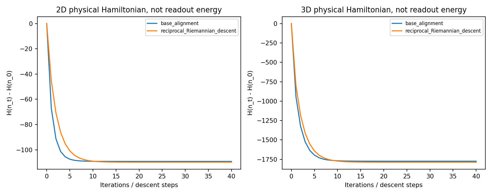

## 3. 분할·보정·제한적 선택

새 seed는 27111743이다. 각 차원에서 train/validation/test마다 서로 다른 6개 prototype을 사용했다. 기본 family는 2D circle/ellipse/stadium/ring/near-touch/pair, 3D sphere/ellipsoid/capsule/torus/near-touch/pair다. 모든 회전·이동·잡음 파생은 prototype split 안에 둔다. 과거 공개 manifest와 새 test의 (차원,family,R) 중복을 검사했다. 새 R·구조 크기와 seed를 사용했지만, 알려진 family 자체를 모두 새 family로 분리한 외부 검증은 아니다.

각 prototype은 4개 pose와 잡음 0/0.2/1%를 가진다. 합계 geometry 432개, 별도 train reference 12개, 총 444개다. 시험은 차원별 6 prototype × 12=72개, clean은 24개다. 해상도는 80²/64³다. salt-pepper flip은 외곽 7 voxel을 제외한다. GT는 잡음이 없는 연속 형상의 둘레/면적이다. 주 manifest의 pose seed에서는 회전과 이동이 함께 변하므로, 이 둘의 독립 효과는 별도 4회전×4이동의 고정 ellipse/ellipsoid 진단으로 확인했다.

기준자는 차원별 3개 반지름 × 2 pose의 원/구이며 geometry와 분리했다. 각 기준자 pose 평균 qᵣ=I/GT에 대해 c=Σqᵣ/Σqᵣ²를 train에서만 계산했다. 같은 정책을 전통적 Crofton/marching에도 제공했다. 옛 c를 그대로 쓰는 baseline, 새 c의 energy, raw TV, 보정 TV, raw generated s=0를 구분했다. Raw I_E는 차원이 길이^(d−2)이므로 둘레/면적으로 부르지 않는다.

| 차원 | c_E(train) | c_TV(train) | 선택 α | validation energy MARE | validation 선택 MARE |
|---|---:|---:|---:|---:|---:|
| 2D | 0.60787758049 | 0.96333930633 | 0 | 2.1672% | 1.1927% |
| 3D | 0.34888467214 | 0.99026698914 | 0.5 | 0.9813% | 0.7080% |

후보는 α∈{0,.25,.5,.75,1} 다섯 개뿐이다. validation 전체 MARE가 같은 c 정책의 energy보다 ≥0.10 percentage point 감소하고 모든 잡음층에서 악화가 ≤0.10 pp인 후보 중 최소 MARE를 선택했다. 없으면 α=1로 기각한다. 형태·위상·재구성·residual은 선택 gate로 사용하지 않았다. N 및 입력 생성장은 동일하다. [protocol](output/protocol.json), [validation grid](output/alpha_validation.csv), [freeze](output/model_freeze.json), [시험 audit](output/test_audit.json)에 순서를 남겼다. 시험 후 계수나 후보를 추가하지 않았다.

## 4. 둘레·표면적과 비용

아래는 같은 새 독립 시험의 clean MARE다. 숫자는 %이며 차원별 6 prototype을 같은 가중치로 집계한다.

| readout/방법 | 2D | 3D |
|---|---:|---:|
| energy, 옛 보정값 | 1.609 | 1.320 |
| energy, 새 train 보정값 | 1.483 | 0.938 |
| TV raw | 3.316 | 1.398 |
| TV, train 보정값 | 0.893 | 0.798 |
| 고정 선택 α 조합 | **0.893** | **0.732** |
| generated s=0 marching, raw | 2.354 | 1.095 |
| binary Crofton, raw | 0.752 | 해당 없음 |
| binary marching squares/cubes, raw | 5.307 | 8.350 |
| 같은 train 기준자로 보정한 Crofton/marching | **0.738** | **0.563** |

2D의 보정된 Crofton과 marching squares 수치는 이 grid mask들에서 비례 관계 때문에 같다. 이를 독립적인 두 번의 승리로 세지 않는다. 전통적 방법에도 보정을 허용하면 clean 기하 오차는 PBGIA보다 작다. TV/energy 조합은 기존 생성장을 개선한 실험이 아니라 **같은 장의 관측량 조합 실험**이다.

| noise | 선택 2D | 새 c energy 2D | 선택 3D | 새 c energy 3D |
|---|---:|---:|---:|---:|
| 0% | 0.893 | 1.483 | 0.732 | 0.938 |
| 0.2% | 0.883 | 1.541 | 0.712 | 0.844 |
| 1% | 0.929 | 1.781 | 0.639 | 0.658 |

이 salt-pepper 조건에서 PBGIA readout은 안정적이었다. 원시 binary contour는 잡음 speck까지 둘레/면적으로 세므로 1% noise에서 크게 증가한다. 이 비교를 보편적 잡음 우월성으로 해석하지 않도록, **σ=1 pixel Gaussian+threshold**의 고정 전통적 대조도 추가 계산했다. 그 raw Crofton은 2D 1.227/1.291/1.393%, raw marching cubes는 3D 5.813/5.818/5.890%다. 이것은 test로 σ를 고른 대조가 아니며, 최적 denoising 전통 방법을 대표하지 않는다. 부식·열림·Crofton 방향 수·다른 잡음 모델은 탐색하지 않았다.

전체 noise 평균에서 조합−energy MARE 차이는 2D −0.700 pp, 3D −0.119 pp다. 6 prototype 단위 20,000회 paired bootstrap 95% 구간은 각각 **[−1.749,+0.026], [−0.673,+0.358] pp**다. 소규모 사례의 평균 이득이며 통계적으로 확실한 보편적 이득은 아니다. clean family별로는 2D ring이 3.759→0.285%로 좋아졌지만 circle은 0.142→0.380%, 3D torus는 2.372→0.859%로 좋아졌지만 capsule은 0.678→1.072%, sphere는 0.495→1.035%로 나빠졌다. 시험 결과를 보고 α를 바꾸지 않았다.

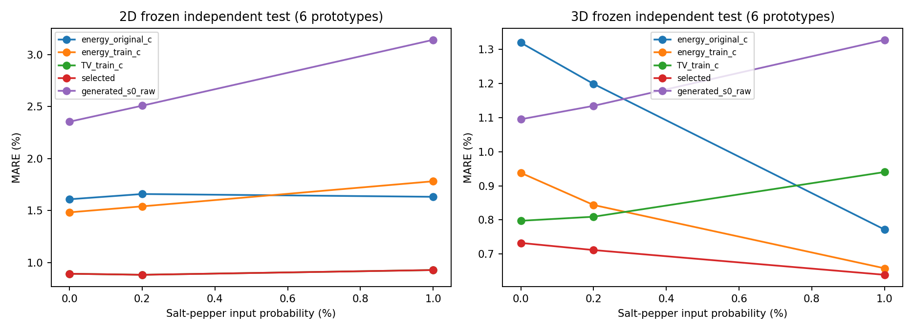
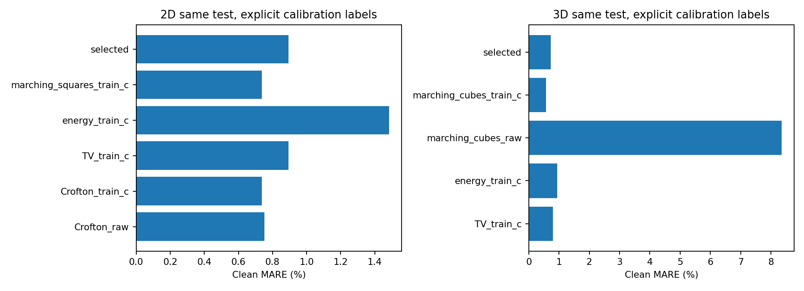

단일 CPU thread, 반복 1회 warmup 후 5회 고립 계측의 중앙값은 80² 공통장 생성·모든 tensor/energy/TV/s0 관측까지 **13.92 ms**, 64³는 **583.62 ms**였다. 같은 사례의 raw Crofton은 0.272 ms, marching squares 0.207 ms, 3D marching cubes 3.860 ms, PCA는 0.105/0.792 ms였다. PBGIA는 현 구현에서 상당히 느리다. 이 비용은 여러 readout을 함께 만드는 비용이며 단일 TV 전용 최적 구현의 비용은 아니다.

첫 독립 시험 144개의 총 wall time은 48.79 s, process peak RSS는 158.4 MiB였다. 입력 초기화/장 생성/관측은 [test_raw.csv](output/test_raw.csv)에 따로 기록했다. 관측은 2D 평균 0.87 ms(+s0 0.24 ms), 3D 37.69 ms(+s0 4.24 ms)였다. 별도 pixel 실험은 16.64 s/241.8 MiB, projection 실험은 6.52 s/160.5 MiB였다. 서로 동시 실행된 stage의 시간을 합쳐 실제 wall time으로 부르지 않는다. 깨끗한 순차 재현의 전체 시간·최대 child RSS는 [clean_reproduction_verification.json](output/clean_reproduction_verification.json)에 별도로 공개한다. GPU와 대규모 checkpoint는 사용하지 않았다.

## 5. 경계 표현·폭·반복수·해상도

digital planar 입력에서 w_init=1.15/2.3/4.6을 바꾸고 N0/10/20/30/40을 관측했다. w_eff는 동일 ray의 s=−.7,+.7 두 crossing 거리이며, 선택적으로 그 값을 2 atanh(.7)로 나눈 tanh-equivalent scale도 저장했다. **초기화 인자 w_init와 최종 w_eff는 다르다.**

N30 기본 모델에서 축 정렬 w_eff는 2D/3D 모두 약 0.886 pixel, 비스듬한 벽은 1.295/1.277 pixel이었다. 이는 선형 보간한 격자 profile 폭이며, 해상도 독립적인 물리적 자구벽 폭이 아니다. 초기화 폭 변화에 대한 최종 scalar RMS 차이는 2D ≤1.93×10⁻⁷, 3D ≤6.40×10⁻⁶였다. G4 생성 대조에서도 각각 ≤1.40×10⁻⁷/5.03×10⁻⁶였다. 이전 digital planar energy의 초기화 폭 둔감성은 이번 N30 설정에서도 정성적으로 재현됐다. 이전 N10/G4/G4 energy 수치와 동일한 수치 재현이라고 주장하지 않는다.

I_s/(I_s+I_v)는 2D 0.837–0.864, 3D 0.807–0.849였다. 따라서 전체 gradient energy에 scalar 전이 외에 vector 방향 변화가 실제로 기여한다. N30 planar one-step RMS는 2D 최대 1.22×10⁻⁶, 3D 2.74×10⁻⁵이고, two-step RMS 최대는 2.74×10⁻⁶/6.09×10⁻⁵다. N40까지 둘 다 감소했다. 이 사례에서 큰 진폭의 2-cycle은 없었으나 N30이 모든 3D 장의 수학적 고정점은 아니다. 새 시험의 unit norm 최대 오차는 1.20×10⁻⁷ 미만이다.

고정 ellipse/ellipsoid의 4회전×4이동 대조에서 I_E CV는 0.637/0.369%, TV CV는 0.705/0.401%였다. 방향·이동 안정성이 유한하며 완전한 회전 불변성은 아니다. 별도의 a=.75/1/1.5 physical-spacing 진단은 같은 물리적 원/구에서 D=1/a, 초기 폭=2.3/a를 적용했다. J,h,N이 고정되어 엄밀한 연속체 refinement가 아니다. pixel 비식별성 실험은 반대로 **동일한 dimensionless pixel 모델**을 유지하고 결과만 a^(d−1)로 환산한다. 두 해상도 정책을 합치지 않는다.

실패는 더 중요하다. 0.75 voxel shell은 2D 입력의 42 positive pixel이 N30의 3개로 줄었고, 3D 입력의 669 positive voxel은 **0개**가 되었다(s_max=−0.19984). 원시 입력도 이미 조각난 얇은 shell이지만, 이후 생성장이 양의 phase 전체를 잃는 것은 추가적인 생성 오차다. 가까운 물체는 gap=.2 등에서 raster 자체가 이미 연결되기도 했다. 이를 생성장이 두 독립 물체를 합친 것으로 잘못 설명하지 않는다. 3D gap=.6 사례는 binary와 scalar 모두 2개 component였다. 정확한 입력/생성 component 수와 profile을 [boundary_interactions.csv](output/boundary_interactions.csv)에 공개한다. 이 값은 모델 선택 gate가 아니다.

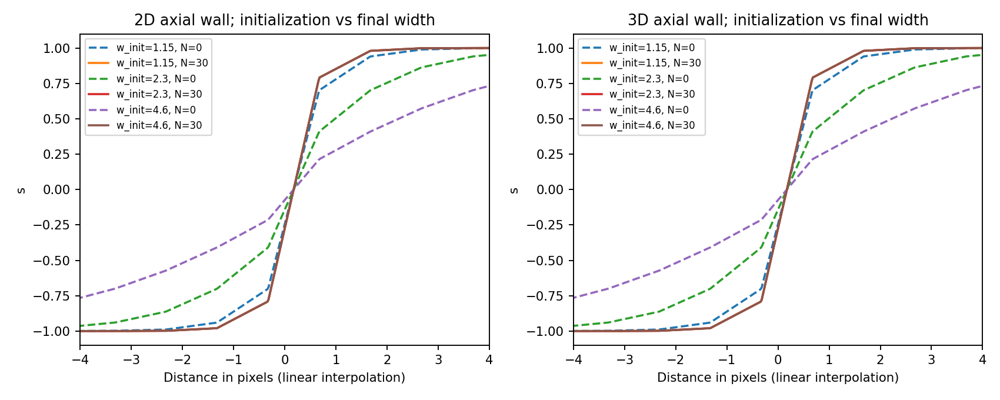
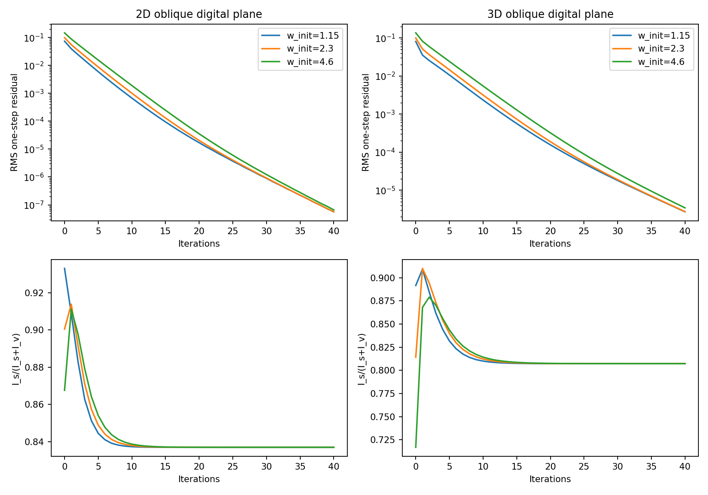
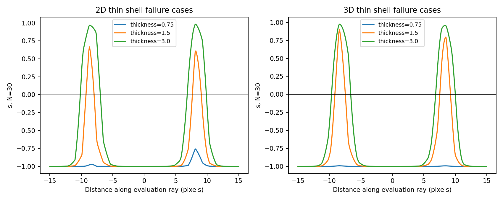

## 6. 방향: 무엇의 방향인가

새 clean 시험에서 1.5 pixel 경계 band 내 v와 연속 inward normal의 평균 cosine은 **0.99378(2D), 0.99667(3D)**였다. v가 유효한 band의 coverage도 별도 기록했다. 타원체 band의 거리 근사는 implicit-distance이며 정확한 EDT가 아니다. 이 평가는 초기화와 분리된 GT 평가다.

| clean 목표 | energy tensor 각도 오차 | 장의 공간 covariance | binary PCA |
|---|---:|---:|---:|
| 2D ellipse 장축 | 0.205° | 0.263° | 0.222° |
| 2D stadium 장축 | 0.512° | 0.245° | 0.217° |
| 3D ellipsoid 장축 | 0.332° | 0.221° | 0.128° |
| 3D capsule 장축 | 0.385° | 0.062° | 0.073° |
| 3D torus 대칭축 | 0.483° | 0.054° | 0.059° |

장축은 주어진 대칭 모델에서 normal tensor의 최소 고유벡터로, torus 대칭축은 최대 고유벡터로 평가했다. 공간 covariance는 각각 최대/최소 축이다. 원·구·동심 ring에는 정답 전역 각도를 부여하지 않았다. 텐서가 isotropic하거나 gap이 작으면 주축의 신뢰도도 낮다.

분리된 두 원/구의 중심 연결축은 법선 분포의 축과 다르다. 멀리 떨어진 pair에서 energy tensor를 그 연결축과 억지로 비교한 각도는 2D 28.99°, 3D 56.01°였지만 공간 covariance는 0.080°/0.162°였다. 전자는 유효한 ‘법선 정확도’가 아니라 **다른 관측량을 잘못 사용하는 실패 진단**이다. 같은 장에서 공간적 위치를 별도 적분해야 연결축이 나온다.

2D native v 및 3D 단면에 normal integral curves를 그렸다. inward sign은 f와 초기화 규약에서 온다. 이 선들은 법선 질서의 공간적 integral curves이며 물질 수송, 유체 속도, 시간적 tracking의 증거가 아니다. projector만으로는 ±v를 구분할 수 없으므로 signed flow를 결정할 수 없다.

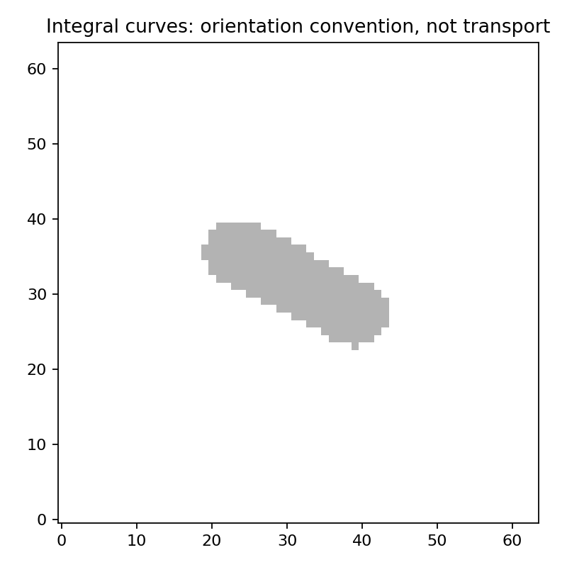
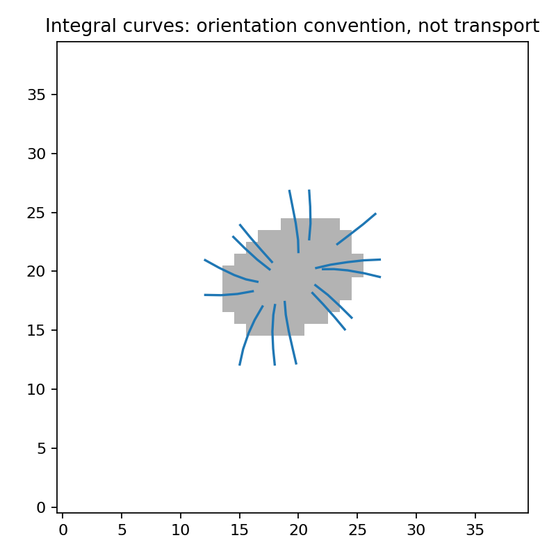

## 7. 부분공간 적분과 RP 방향장

6개 40³ 생성장(sphere/capsule/torus/pair/ellipsoid/shell)을 세 좌표축 각각으로 적분했다. local nnᵀ(full S³→RP³)와 amplitude를 유지한 vvᵀ(vector→RP²), uniform 평균과 w=1−s² wall 평균을 구분했다. vector tensor의 남은 두 공간 성분 subblock에서는 별도의 RP¹ director를 계산했다. 평균 뒤 trace로 정규화한 λ₁−λ₂>.001, 원래 trace>10⁻¹⁰일 때만 director를 표시했다. 이 threshold는 기하 성능 선택 기준이 아니다.

72개 full/vector tensor map과 파생 36개 in-plane map을 분석했다. `projection_tensors.npz`는 **2D 투영 tensor**이며 큰 3D checkpoint가 아니다. trace-normalized purity tr(Q²)<1 및 유효 rank>1은 평균이 rank-one projector가 아님을 직접 보여준다.

| 표현·가중치 | 평균 director 정의 비율 | 평균 purity(존재하는 trace에서) | refinement 안정 loop 후보 총수 |
|---|---:|---:|---:|
| full, uniform | 100% | 0.9746 | 0 |
| full, wall | 39.83% | 0.8348 | 108 |
| vector, uniform | 54.89% | 0.8687 | 9 |
| vector, wall | 39.83% | 0.8799 | 52 |
| in-plane, uniform | 54.59% | 0.9758 | 45 |
| in-plane, wall | 39.83% | 0.9738 | 52 |

full/uniform의 100% 정의 비율은 좋은 공간 방향 복원의 뜻이 아니다. 그 leading eigenvector의 scalar 성분 제곱 평균은 **0.99948**로 bulk ±s pole이 지배했다. wall/vector는 이 지배를 줄이지만, 평균 map마다 25.75–62.19%만 director가 정의되는 등 정보가 사라지는 영역도 컸다. uniform/vector와 wall/vector의 trace 범위도 다르므로 무조건 coverage로 성능 순위를 매기지 않는다.

적분 방향을 바꾸면 같은 torus의 wall in-plane 정의 비율이 62.19/52.88/48.88%, loop 후보가 9/10/6으로 달라졌다. 이는 다른 fiber가 다른 법선 혼합을 만드는 결과다. 서로 다른 좌표 평면을 같은 좌표 위치의 방향 정답처럼 비교하지 않았다.

PSD rank-one tensor를 ε·trace만큼 섞는 별도 perturbation 진단에서 gap>10ε인 영역의 map 평균 angle은 ε=.001일 때 평균 0.0263°, ε=.01일 때 0.2364°였다. map별 최대 angle의 전체 최댓값은 각각 2.011°/2.772°였다. 이는 **tensor perturbation**의 안정성이지 입력 salt-pepper noise에 대한 projection 강건성 시험은 아니다. 작거나 퇴화된 gap에서 방향 비식별성을 그대로 유지한다.

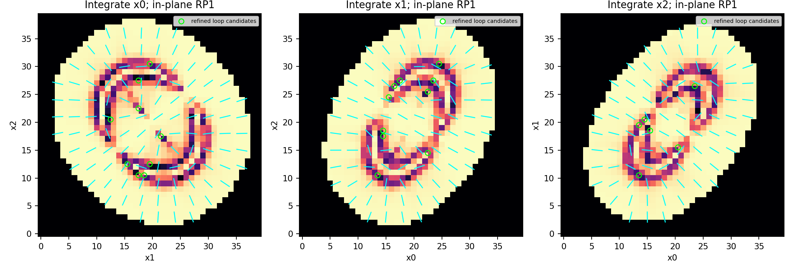

## 8. 위상량과 결함을 구분한 결과

S³ degree는 기존 Freudenthal tetrahedron count를 재사용했다. 생성장 바깥 3 voxel의 s<0를 확인하고 south pole로 cap한 별도 compactification에서 계산한다. periodic 동역학의 모든 위상량과 자동으로 같은 것은 아니다. interpolation의 nonvanishing 하한을 수치 검사하고 3개 target의 integer degree가 일치할 때만 `NUMERICALLY_SUPPORTED`로 썼다. interval arithmetic의 엄밀한 증명은 아니다.

| 생성 사례, N30 | S³ degree | 입력 Euler / component 수 | interpolation norm 하한 |
|---|---:|---:|---:|
| sphere | 1 | 1 / 1 | 0.08265 |
| capsule | 1 | 1 / 1 | 0.09378 |
| torus | 0 | 0 / 1 | 0.05012 |
| pair | 2 | 2 / 2 | 0.09916 |

해석적 hedgehog/mirror/constant 대조는 +1/−1/0이었다. 이 네 생성 사례에서 degree와 Euler가 숫자상 같다고 일반적인 동일성을 추론할 수 없다. S³ texture의 degree는 영상 connected component 수와 다른 정의이며 torus에서는 component=1, degree=0이다. 새 2D S² integer degree와 전 시점 homotopy certificate는 **NOT_TESTED**다. endpoint 검사를 모든 반복 사이의 위상 보존 증명으로 부르지 않는다.

RP¹ winding과 RP²/RP³ loop lifting은 또 다른 위상 판정이다. RP¹은 doubled angle의 정수 winding(선 방향 charge는 절반), RP² 이상은 Z₂ holonomy를 사용했다. 합성 RP¹/RP²의 8개 유효 loop 및 2개 퇴화 대조 모두 기대 판정/abstention과 일치했다. 실제 투영 map의 coarse 후보 266개는 같은 square boundary의 64/128 sample에서 모두 같은 nontrivial class를 보였다. 가장 낮은 sampled gap은 0.00451이었다. 그러나 corner/neighbor dot 및 trace/gap이 불충분한 수만 개 plaquette는 `INCONCLUSIVE`로 남겼다.

**이들은 주어진 bilinear 2D tensor 보간에서의 수치적 eigenline 결함 후보다. 원래 3D 스핀의 자기적 singularity를 검출했다고 주장하지 않는다.** gap은 loop 위에서만 검사했으며 내부 퇴화의 정확한 위치를 엄밀하게 증명하지 않았다. 연속 원래 형상의 결함 GT가 없으므로 generated map의 FP/FN은 `INCONCLUSIVE`다. 양성 대조의 오류율과 이를 섞지 않았다. native v가 0인 영역의 undefined director도 결함 성공으로 세지 않았다.

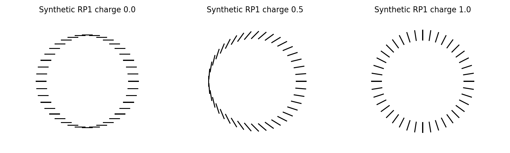
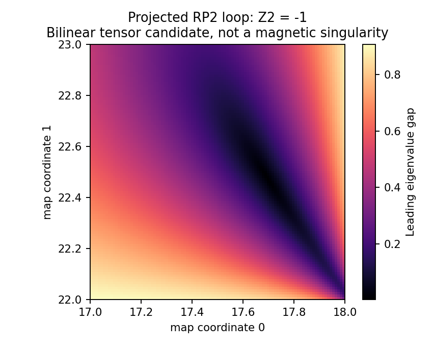

## 9. 픽셀화 비식별성과 알고리즘 오차

같은 point-sampled binary mask를 주는 두 매끈한 원/구를 실제 구성했다. 각 fixed center와 격자에서 포함된 최외곽 sample 거리와 제외된 최내곽 거리 사이에 두 반지름을 잡았다. center와 R을 동시에 바꾸는 쌍도 만들었다. a=1,.75,.5, 물리 R=2.641/4.641/8.641/12.641의 24개 기본 mask, 두 종류씩 **48쌍**이다. 2D/3D 각각 한 쌍은 전체 field 계산도 중복 실행하여 estimator 출력이 비트 단위로 같음을 확인했다.

어떤 결정론적 estimator도 같은 입력에서 두 참값을 동시에 정확히 낼 수 없다. max absolute error ≥|GT₁−GT₂|/2이며, 이 하한은 PBGIA·Crofton·marching 모두에 적용된다. 이번 매끈한 radius-interval 쌍에서 평균 GT로 정규화한 하한은 2D **0.0090–1.5339%**, 3D **0.00094–0.5370%**였다. 이 범위는 현재의 제한된 중심·반지름 표본의 값이며 보편적 최악 오차는 아니다.

예를 들어 a=1,R≈2.641의 2D mask는 둘레 16.47658와 16.84621을 구분하지 못한다(하한 0.18481). 3D R≈8.641의 한 mask에서는 매끈한 구 면적 차이에 의한 정규화 하한이 0.00804%인 반면 선택 PBGIA는 양쪽 참값에 약 0.76–0.78% 오차였다. **이 구 쌍만으로 PBGIA 오차 전부를 픽셀화 탓으로 돌릴 수 없다.** 반대로 그 한 쌍의 하한이 가능한 모든 연속 형상의 불확실성 전체를 나타내지도 않는다.

동일 ellipse mask의 장축 각도 쌍도 만들었다. angular minimax 하한은 약 0.140°와 0.152°였다. 별도의 높은 주파수 subpixel corrugation은 같은 mask에서 둘레가 circle의 2.620배까지 커졌다. 후자는 curvature를 제한하지 않은 병적인 family이고, 앞의 원/구 쌍은 유한한 최소 곡률반경을 갖는 매끈한 사례다. 두 종류를 현실적 정확도 하한 하나로 혼합하지 않았다. PCA의 위치·각도도 입력이 같으면 같은 값이며, 그것이 둘레 estimator라는 뜻은 아니다.

실험상 분리할 수 있는 것은 (i) 동일 mask 쌍의 피할 수 없는 불확실성, (ii) 같은 장에 관측자를 바꾼 readout 차이, (iii) 입력 positive phase가 생성장에서 소멸한 추가 손실, (iv) N30→40의 반복 민감도다. 일반 형상에서 pixelization/생성/곡률/관측/보정의 기여를 합이 되는 고유한 오차 분해로 식별하지는 못했다. 자세한 구성과 전체 쌍은 [PIXEL_INFORMATION_LIMIT.md](PIXEL_INFORMATION_LIMIT.md)에 있다.

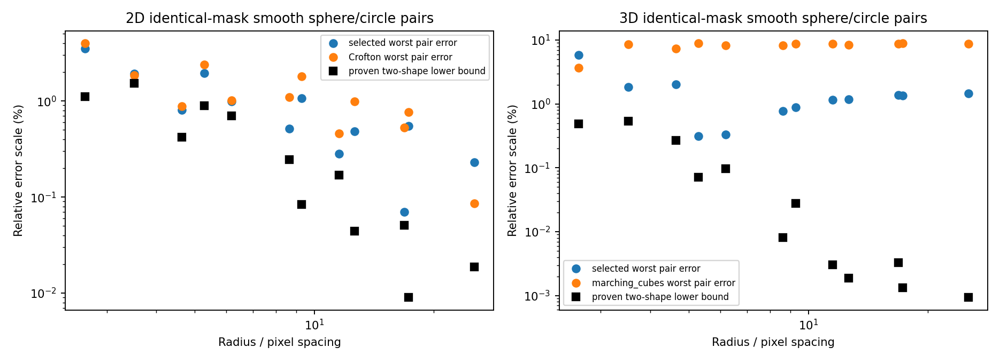
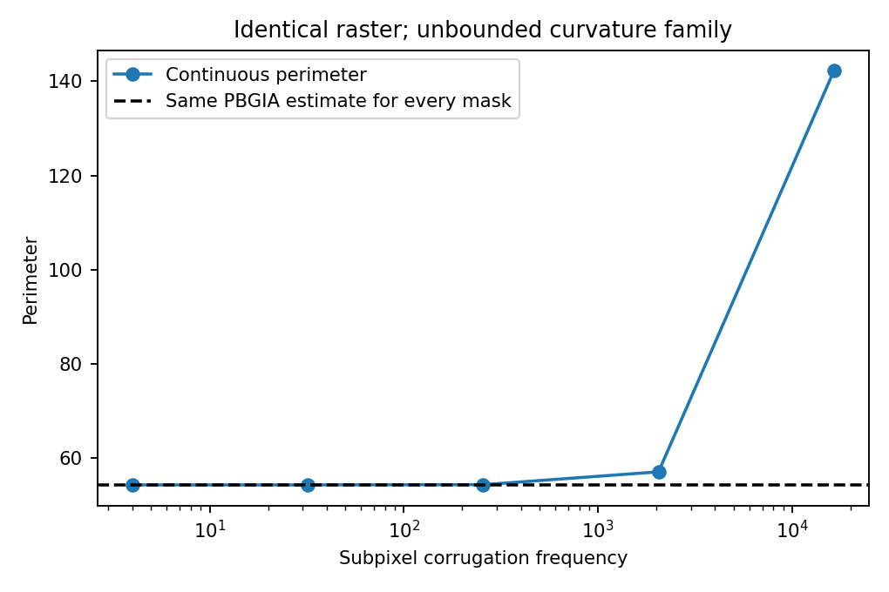

## 10. 요청된 일곱 질문에 대한 답

**Q1 — 안정된 경계 표현인가?** 충분히 큰 clean 및 이번 작은 잡음군에서는 그렇다. profile의 초기화 의존성이 작고 법선 정렬도 높았다. 얇은 shell 소멸, 격자 방향에 따른 벽 폭, 가까운 경계 상호작용은 명확한 제한이다. 임의 topology/최소 구조의 보존은 아니다.

**Q2 — 물리적 의미와 최소화의 관계는?** 외부 Z₂ field에 맞춰 공간적으로 정렬되는 단위 spin texture다. 현재 normalized alignment는 reciprocal 결합이 빠져 있고 병렬 정렬의 에너지 증가 반례도 있으므로 단일 Hamiltonian 최소화라고 부를 수 없다. 기하 gradient energy와 실제 Hamiltonian은 구별해야 한다.

**Q3 — 하나의 장에서 얼마나 얻는가?** 크기·국소 법선·일부 대칭축·공간적 축을 각각 정의한 readout으로 얻었다. 면적만을 위해서는 더 빠르고 clean 정확도가 더 높은 전통 방법이 있었다. 법선 분포 tensor 하나가 중심 연결축까지 제공하지는 않는다.

**Q4 — RP 구조와 결함의 조건은?** pointwise projector는 RP 점이다. fiber 평균은 일반 PSD tensor이며 충분한 trace와 단순한 최대 고유값이 있어야 eigenline을 정의한다. 합성 loop 판정과 실제 projected tensor 후보는 계산했지만, 원래 3D 자기적 결함 또는 signed transport를 복원한 것은 아니다. degeneracy와 미판정을 결과에 포함했다.

**Q5 — 무엇이 정확도를 제한하는가?** 입력 비식별성의 양의 하한을 직접 보였고, 동시에 thin phase 소멸과 readout/보정 차이라는 추가 오차도 보였다. 현재 자료로 모든 오차를 유일하게 분해하거나 한 원인이 항상 지배한다고 판단할 수 없다.

**Q6 — 기존 방법보다 우수하지 않아도 가치가 있는가?** 있다. 동일 spin texture에서 경계 크기, 법선 질서, 공간적 모멘트, 위상 texture 및 조건부 사영 eigenline을 함께 기술한 재현 가능한 사례는 독립적인 물리·기하 표현의 근거다. 입력 이상의 새 정보를 만든다는 뜻이나, 그 장을 반드시 사용해야 한다는 증명은 아니다.

**Q7 — 계속 최적화할 것인가?** **이번 연구는 종료하는 편이 합리적이다.** 자유 커널 탐색의 일반적 이득은 확립되지 않았고, 마지막 조합도 평균 이득과 형상별 역전이 공존한다. N30 생성장과 고정 관측자, validation으로 선택한 제한 readout을 기록 가능한 최종 구성으로 남긴다. 향후에는 명시적 응용이 요구하는 최소 구조 크기·잡음·속도 또는 물리적 consistency가 있을 때만 별도 연구를 정당화할 수 있다. 이번 의뢰에서 추가 대규모 최적화를 시작하지 않는다.

## 11. 산출물과 미검증 항목

[RESULTS_MATRIX.csv](RESULTS_MATRIX.csv)는 성공/부분성공/실패/미검증을 근거 파일과 연결한다. [이론](MODEL_AND_PROJECTION_THEORY.md), [비식별성](PIXEL_INFORMATION_LIMIT.md), [재현 명령](REPRODUCE.md), [최종 결론](FINAL_CONCLUSIONS.md)을 함께 제공한다. 원시 CSV, 투영 tensor, 그림, 고정 설정, 테스트와 hash를 포함하고 새 대규모 spin checkpoint는 제외한다.

생성 kernel 추가 학습, moment=+1 후보 탐색, 새 3D 최적화, 자연 영상·비등방 voxel·다른 잡음 분포, 2D spin degree, 모든 step의 homotopy 보존, projected defect의 연속 GT 대비 FP/FN 및 실제 signed transport는 **NOT_TESTED 또는 INCONCLUSIVE**다. 이 목록을 임의의 성공값으로 채우지 않았다. 논문화한다면 ‘단일 장의 조건부 다중 관측’, ‘평균 projector의 혼합 tensor와 식별 가능한 eigenline’, ‘픽셀화 불확실성과 생성 손실의 구분’이 핵심 메시지이며, 도메인월·thin failure·projection·동일 mask 하한 그림이 우선 후보다.
