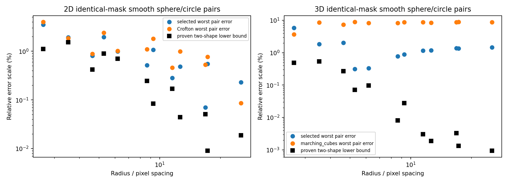
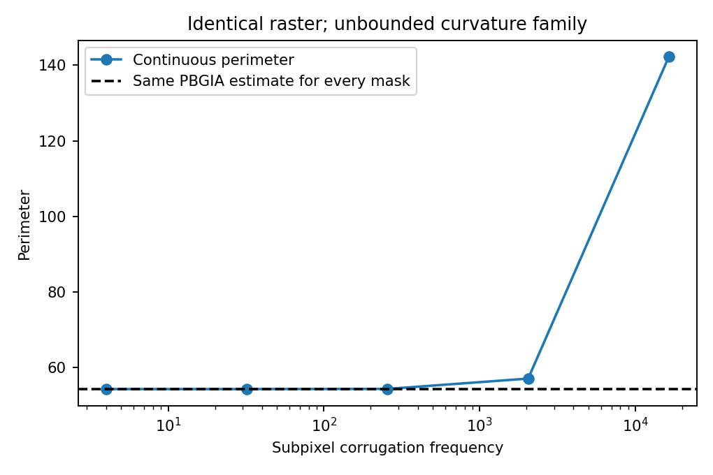

# 동일 raster의 서로 다른 연속 기하와 오차 하한

## 측정 대상과 증명

본 실험의 rasterization은 grid 중심 point sampling이다. 연속 Ω의 membership를 각 pixel/voxel 중심에서 부호화한다. 실제 센서의 area-average threshold, PSF, 회색조, 비등방 voxel까지 포함하는 정리는 아니다. 반면 같은 이진 입력에 대한 비식별성 논리는 rasterization 방식과 무관하다.

R(Ω₁)=R(Ω₂)=R인데 참 경계 크기가 P₁≠P₂이면 결정론적 estimator가 내는 값은 하나의 x=F(R)다. triangle inequality에서 |P₁−P₂|≤|x−P₁|+|x−P₂|≤2 maxₖ|x−Pₖ|이므로

```math
\max_k |F(R)-P_k|\ge {|P_1-P_2|\over2}.
```

3D area도 같다. 이것은 개별 방법의 오차율 추정이 아니라 해당 두 가능한 truth를 동시에 맞출 수 없다는 minimax 하한이다. `unavoidable_relative_percent`는 이 absolute 하한을 두 GT의 평균으로 나눈 비율이다. pixel/voxel에서 추가 gray 정보를 얻거나 곡률·최소 두께·shape prior를 제한하면 가능한 연속 형상의 집합과 하한이 달라진다.

## 매끈한 radius/center 쌍의 실제 구성

center c=(.173,−.291[, .113]), physical R∈{2.641,4.641,8.641,12.641}, spacing a∈{1,.75,.5}를 고정한다. 충분한 외곽 여유를 둔 물리 extent 48의 grid에서 dᵢ=|xᵢ−c|를 계산한다.

1. r_in=max{dᵢ:dᵢ≤R}, r_out=min{dᵢ:dᵢ>R}를 찾는다.
2. r₁=r_in+10⁻⁵(r_out−r_in), r₂=r_out−10⁻⁵(r_out−r_in)를 택한다.
3. 두 원/구의 mask가 원래 mask와 byte 단위로 같음을 검사한다. 참값은 2πr 또는 4πr²다.
4. 별도 center-radius 쌍은 margin m=minᵢ|dᵢ−R|에 대해 δ=.2m, (c−δe₀,R−δ), (c+δe₀,R+δ)다. distance 및 radius의 총 변화가 margin보다 작다. 이 경우도 실제 mask 동일성을 검사한다.

총 24개의 기본 mask에서 종류별 24쌍, 합계 **48쌍**을 계산했다. 이들은 원/구라서 모두 smooth하며 최소 곡률반경은 각 쌍의 작은 반지름이다. arbitrary subpixel 요철을 이용하지 않는다. 쌍의 파생을 서로 독립 통계 표본으로 세지 않는다.

다음 표는 spacing1 radius-interval 예다. 하한은 두 참값 평균에 대한 %다.

| 차원 | 기준 R | 참값₁ | 참값₂ | 정규화 하한 | 선택 PBGIA 추정값 |
|---|---:|---:|---:|---:|---:|
| 2D | 2.641 | 16.47658 | 16.84621 | 1.10923% | 16.26233 |
| 2D | 4.641 | 29.14519 | 29.39067 | 0.41938% | 29.15586 |
| 2D | 8.641 | 54.24417 | 54.50988 | 0.24433% | 54.22949 |
| 2D | 12.641 | 79.41325 | 79.48331 | 0.04409% | 79.09974 |
| 3D | 2.641 | 86.83839 | 87.69289 | 0.48960% | 82.64016 |
| 3D | 4.641 | 270.38281 | 271.84048 | 0.26883% | 266.33541 |
| 3D | 8.641 | 938.15973 | 938.31052 | 0.00804% | 945.45000 |
| 3D | 12.641 | 2007.98512 | 2008.06052 | 0.00188% | 2031.50022 |

전체 spacing의 radius-interval 하한은 2D 0.00904–1.53390%, 3D 0.000939–0.536969%였다. 각 R/a에서의 arithmetic 배치에 따라 변동하므로 유한 표본이 단조 감소하는 power law를 만족한다고 주장하지 않는다. 곡률반경을 pixel 단위 R/a로 표시한 그림에서 크기·해상도와 변동을 함께 볼 수 있다.



## estimator 비교와 PCA

기본 field는 N30 central pixel 모델이다. 새로 c를 fitting하지 않고 기존 c, geometry train-only c, 고정 α 선택을 그대로 사용한다. spacing a에서 같은 dimensionless pixel 모델을 실행하고 경계 크기 추정값에 a^(d−1)를 곱한다. 이는 D=1/a를 사용하는 별도의 physical-spacing 진단과 다르다. TV/contour의 물리 단위, energy 환산계수의 길이 차원도 이 정책과 일치시켰다.

같은 mask에 대해 PBGIA energy/TV/조합/s0, 2D Crofton/marching, 3D marching cubes를 계산했다. estimator를 매 쌍별로 새로 보정하지 않았다. 2D/3D 각 한 쌍에서는 full pipeline을 두 번 실행해 모든 estimator의 출력이 정확히 같음을 별도로 확인했다. 나머지 동일 mask 쌍은 같은 결정론적 배열 입력을 공유한다.

PCA는 둘레 estimator가 아니므로 area와 직접 순위를 매기지 않는다. 동일 mask center-radius 쌍에서는 binary centroid 추정이 같지만 참 center가 달라지는 오차를 기록했다. 추가로 R=4.641,8.641의 ellipse를 θ≈.437 부근에서 회전해 같은 mask를 만드는 서로 다른 두 θ를 찾았다. PCA와 PBGIA normal/spatial tensor는 같은 입력에서 같은 axis를 낸다. 두 참 axis 차이의 절반은 약 **0.14009°,0.15175°**다. `pixel_orientation_pairs.csv`는 방법별 양 endpoint 각도 오차와 동일 mask hash를 제공한다. 이 국소 interval은 가능한 모든 동일 mask ellipse 각도의 최대 범위를 찾았다는 뜻은 아니다.

## 병적 요철과 현실적 smooth 불확실성을 구별

R=8.641의 한 2D mask에서 margin m에 대해 ε=.25m=0.0019432273을 잡고 r(θ)=R+ε cos(kθ)로 perturb했다. membership가 바뀌지 않는 radial margin 안이므로 k=4,32,256,2048,16384에서 **같은 mask**임을 확인했다. 참 둘레는 정확한 arc-length 적분

```math
P_k=\int_0^{2\pi}\sqrt{(R+\epsilon\cos u)^2+(\epsilon k\sin u)^2}\,du
```

로 계산했다. 이 변수치환은 정수 k의 k개 같은 주기를 합친 것이다. k=16384에서 둘레는 142.23405, 원의 54.29300에 비해 **2.61975배**였다. binary 입력과 PBGIA 추정값 54.22949는 모두 같았다. 고주파에서 curvature와 inverse minimum feature size가 발산하므로 이 결과를 현실적 smooth object의 162% 오차 하한이라고 부르면 안 된다. curvature/최소 구조 크기 제한이 없는 가능한 집합에서는 ambiguity가 매우 커질 수 있다는 별도 예다. 3D 병적 corrugation family는 추가하지 않았다.



## 무엇이 분리되었고 무엇이 남았는가

동일 R의 쌍을 구성하면 데이터만으로 구별할 수 없는 **양의 오차 하한**을 직접 제시할 수 있다. 이 하한을 PBGIA·Crofton·marching이 넘을 수는 없다. 그러나 하한 자체가 전체 불확실성의 상한은 아니며, 그 이상인 estimator 오차를 모두 알고리즘 오차라고 확정할 수도 없다. `excess_over_two_shape_bound`는 이 두 truth만 놓고 midpoint에서 벗어난 정도에 해당하는 진단이지 전 기하 모집단의 고유한 오차 분해가 아니다.

반면 고정 binary 입력의 positive phase가 spin 생성에서 전부 사라지는 사례는 단순 raster ambiguity와 구별되는 추가 정보 손실이다. N을 바꾸거나 같은 n에서 readout을 바꾼 차이도 알고리즘 단계의 민감도로 볼 수 있다. 전체 오차를 pixelization+generation+observer+finite-N의 유일한 가산 분해로 식별하는 것은 이번 실험만으로 **INCONCLUSIVE**다.

전체 구성·GT·hash·추정값은 [pixel_pairs.csv](output/pixel_pairs.csv), [orientation](output/pixel_orientation_pairs.csv), [corrugation](output/pixel_pathological.csv), [audit](output/pixel_audit.json), 구현은 [pixel_information.py](code/pixel_information.py)에 있다. seed와 계산 정책은 고정되어 있으며, 이 실험 결과를 보고 모델을 다시 선택하지 않았다.
