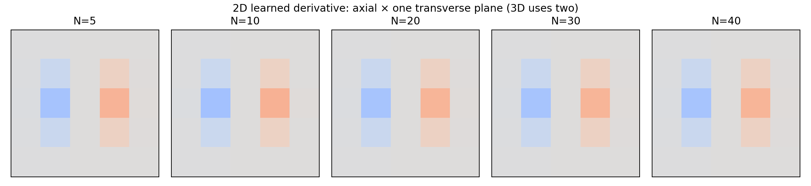
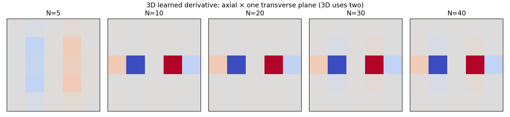
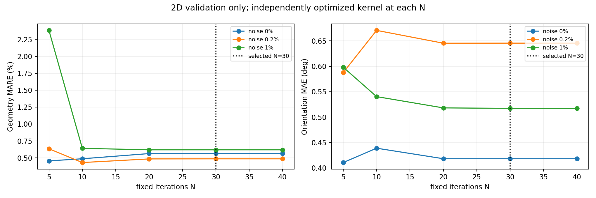
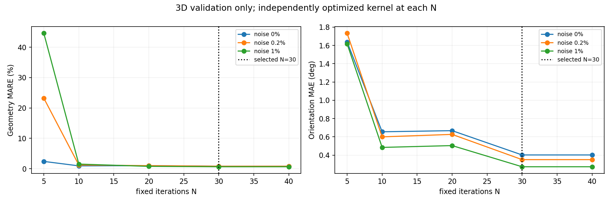
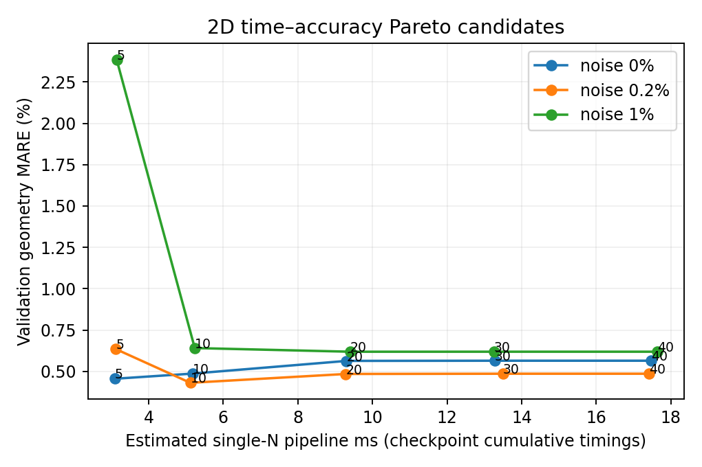
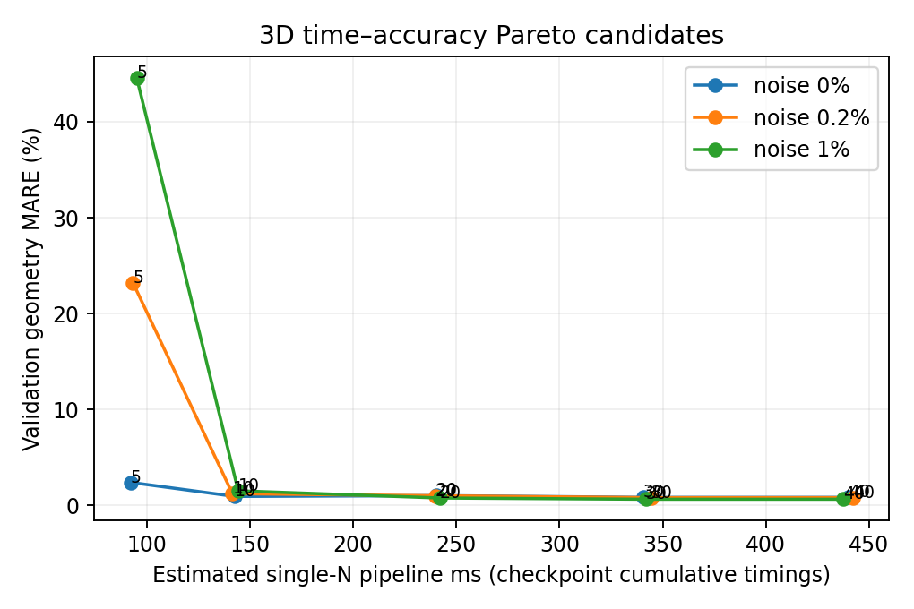
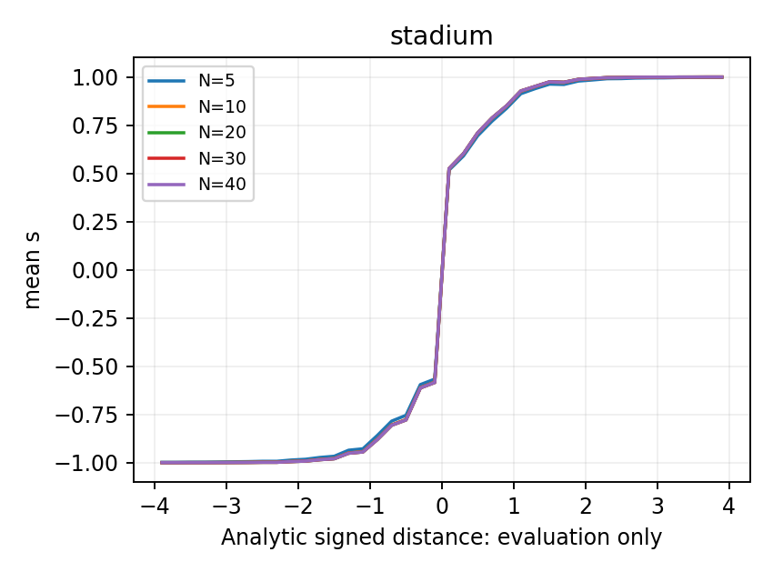
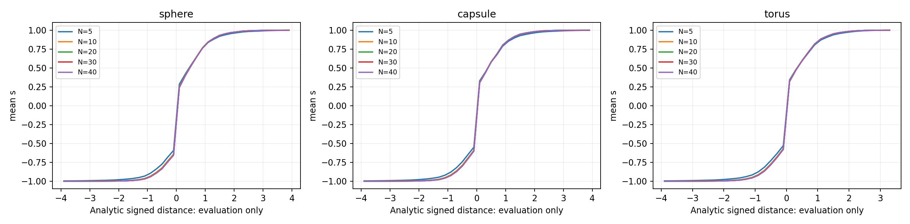
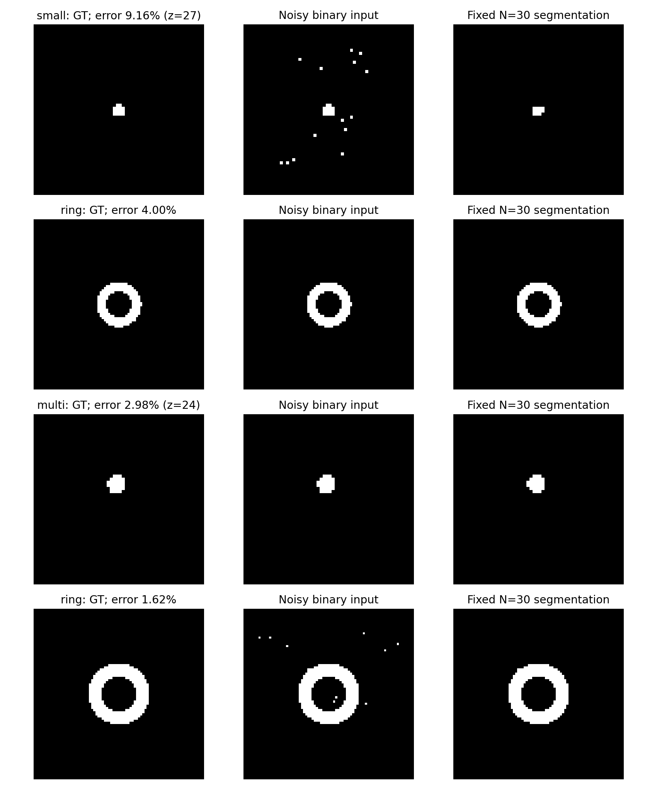

# PBGIA 고정 반복횟수–측정 커널 최적화: 실행 결과 보고서

2026-11-16 · 기준 문서: `CODEX_TASK_KO.md` · 새로운 실행 데이터만 집계.

## 결론: 고정 N*=30

사전 지정 validation 기준을 적용한 선택은 **N*=30**이다. 2D/3D는 동일 반복횟수를 사용하되, 측정용 커널은 차원별·N별로 독립 학습했다. 주 조건은 J=1,h=2,D=1, 생성 구배는 중앙차분, float32, alpha=1이다. 선택은 GT 정확도와 비용의 절충이며 고정점 수렴을 뜻하지 않는다.

선택 configuration의 clean test MARE는 2D 0.997%, 3D 1.404%이다. 별도 배포 계측 중앙값은 2D 12.79 ms, 3D 339.60 ms이다.

2D clean raw Crofton의 MARE 0.440%는 선택 PBGIA보다 작다. 3D clean reference-calibrated marching cubes는 1.769%이다. 이번 최적화는 40회 대비 비용 절감 조건을 만족하는 구성을 찾았지만 기존 기법에 대한 보편적 우월성을 입증하지 않는다.

2D 선택 커널 p=(b,t1,t2): `[0.02974750344841605, 0.21809091790113377, 0.007287870619847869]`.
3D 선택 커널 p=(b,t1,t2): `[-0.1395315714085597, 0.043532890872421834, 0.001586826052268793]`.
환산계수 c: 2D `0.611293539`, 3D `0.350251129`. 단위 격자의 둘레/면적용이며 다른 해상도에 임의 전용하지 않는다.

## 1. 모델 및 선행 결과 구분

`Hv=J Σ_axial v(t)+D grad(s(t))`, `Hs=J Σ_axial s(t)+hf`, `n(t+1)=H/|H|`의 동기식 갱신이다. f는 고정하고 div(v), grad(f) 방향장, Laplacian 교체, 적응형 종료를 사용하지 않았다. |H|<=1e-12에서는 이전 스핀을 유지한다. 비변분 정렬 알고리즘이므로 단일 에너지 감소나 tr(T)의 에너지 해석을 하지 않는다.

포함된 smoke 2D 40²/3D 24³ 데이터를 직접 다시 계산해 저장된 체크포인트와 비트 단위 일치를 검사했다. 이전 실행의 원시 코드/CSV는 현재 workspace의 `/workspace/research/PBGIA_Codex_handoff_20261116`에서 실제로 접근 가능했다. 이전 보고서와 이번 ZIP의 선행 자료를 확인했지만 이전 projected-gradient 결과와 이번 결과는 합치지 않았다. `prior_learned` 대조군은 이전 동적 모델 학습 커널의 고정 계수만 가져온 것이며 새 필드에서 새로 측정했다.

## 2. 분할과 데이터

split manifest를 학습 전에 저장했다. 한 shape family/size prototype의 모든 회전·이동·잡음 파생 영상은 같은 split이다. 같은 차원/도형에서 반지름도 split 사이에 중복하지 않는다. Train 전용 reference 원 R=5.25, 구 R=4.25는 다른 geometry와 분리한다.

| split      |   dim |   independent_units |   images |
|:-----------|------:|--------------------:|---------:|
| test       |     2 |                  10 |       60 |
| test       |     3 |                  12 |       72 |
| train      |     2 |                   9 |       49 |
| train      |     3 |                  11 |       61 |
| validation |     2 |                   4 |       24 |
| validation |     3 |                   5 |       30 |

2D: 원, stadium, 타원, 링, 분리 원 2개. 3D: 구, capsule, torus, 타원체, 분리 구 2개, 작은 구. **2D 링과 3D 타원체는 shape-family held-out test**로만 두었다. 다른 family도 test에서는 새 반지름/원형을 사용한다. 원형별 두 개의 회전·subvoxel 이동, 세 잡음률 0%,0.2%,1%를 고정했다. 3D는 기울어진 축을 포함한다. 크기는 2D 80², 3D 56³이다. 독립 geometry unit은 총 51개이고 calibration 2개를 제외하면 49개이다.

Noise는 외곽 7 voxel을 제외한 내부에서 독립 salt-and-pepper flip을 가한다. 회전/이동은 같은 geometry 파생 영상에서 유지하고 잡음 seed만 바꾼다. 초기화는 supplied binary EDT 함수뿐이며 해석적 거리장/법선은 입력 마스크 생성과 진단·평가에만 사용했다. Capsule은 원통 길이 2R, 전체 길이 4R, 면적 8πR²이다. Torus는 minor radius=.3R. 타원체 GT는 연속 면적 요소 120×240 quadrature로 계산했다.

## 3. 체크포인트와 학습의 공정성

각 고유 입력·J/h/D 조건에서 40 step을 한 번 수행하여 N=5,10,20,30,40을 저장했다. 키는 입력 bytes, shape, 생성 규칙, dtype, 초기화 코드 hash와 파라미터를 포함한다. 개별 N에 대해 과학 실험의 이완을 다섯 번 중복하지 않았다. 학습 계산은 tensor derivative의 정확한 선형 basis Gram으로 가속했으며 full-array tensor 계산과 일치를 자동 검사했다. 이 가속은 학습용이고 CLI inference는 실제 convolution 측정이다.

각 차원·N에 동일한 3차원 parameter range, 같은 초기 탐색 seed, differential evolution **270회 objective evaluation**을 제공했다. 고정 예산 종료이며 전역 최적성/optimizer 수렴을 주장하지 않는다. 측정 커널 p의 axial weights는 offset ±1에 ±(.5−2b), ±2에 ±b이고 transverse smoothing은 [t2,t1,1−2t1−2t2,t1,t2]이다. 3D에서는 두 transverse 축에 적용한다. 상수장 도함수 0, 선형장 응답 1을 만족한다. 축치환 공변성, 모든 축 response, 주파수 response를 검사했다. 연속 회전 불변성은 가정하지 않는다.

학습 목적은 geometry relative MSE + .05*(orientation_deg/10)² + 회전/이동 CV²이다. Train geometry의 noise rates도 포함한다. 각 (N,kernel,dimension,h,D)에 train reference 원/구에서만 c를 정한다. `M=trace(T)`, `T_ij=Σ_x,a D_i n_a D_j n_a`, `geometry=cM`이다. c는 test GT에서 적합하지 않는다.

|   dim |   N |        b |        t1 |        t2 |   evaluations |   objective |
|------:|----:|---------:|----------:|----------:|--------------:|------------:|
|     2 |   5 |  0.02622 | 0.2127    | 0.009985  |           270 |   0.0004889 |
|     2 |  10 |  0.02509 | 0.2004    | 0.01143   |           270 |   0.000195  |
|     2 |  20 |  0.02975 | 0.2181    | 0.007288  |           270 |   0.000194  |
|     2 |  30 |  0.02975 | 0.2181    | 0.007288  |           270 |   0.000194  |
|     2 |  40 |  0.02975 | 0.2181    | 0.007288  |           270 |   0.000194  |
|     3 |   5 |  0.02937 | 0.2999    | 0.07942   |           270 |   1.098     |
|     3 |  10 | -0.1396  | 0.0005011 | 0.0009966 |           270 |   0.001126  |
|     3 |  20 | -0.1381  | 0.000163  | 0.0004911 |           270 |   0.08218   |
|     3 |  30 | -0.1395  | 0.04353   | 0.001587  |           270 |   0.09956   |
|     3 |  40 | -0.1395  | 0.04353   | 0.001587  |           270 |   0.09921   |




## 4. Validation 선택 규칙과 결과

h=2는 사전 고정한 주 조건이다. h를 test 성능으로 조정하지 않았다. 각 dimension/noise stratum에서 독립 geometry를 동일 가중한 MARE 증가가 N=40 전용 학습 커널 대비 <=.1 percentage point, 연결 elongated object orientation MAE 증가 <=.1 degree, clean Dice<.95 또는 Euler/components mismatch 실패 수 증가 없음, 대표 degree 실패 증가 없음, 실행 비용 개선을 모두 만족하는 가장 작은 N을 선택했다. 이 기준에 적합하지 않으면 40을 유지한다. p90/p95, CV는 함께 공개하지만 추가 임의 threshold로 test 후 규칙을 바꾸지 않았다. 이번 validation에서는 N=20의 3D geometry 증가가 noise별 약 .13–.20 pp, orientation 증가가 약 .23–.28도여서 탈락했다. 이 차이는 field step뿐 아니라 N별로 독립 학습한 커널의 finite-budget 차이도 포함하므로, 30회가 모델의 본질적 최소 반복횟수라고 해석하면 안 된다.

|   N | passed   | degree_ok   |
|----:|:---------|:------------|
|   5 | False    | True        |
|  10 | False    | True        |
|  20 | False    | True        |
|  30 | True     | True        |
|  40 | True     | True        |

선택 N의 validation:

|   dim |   noise |   n_units |   geometry_MARE |   error_p90 |   error_p95 |   orientation_MAE |   rotation_shift_CV |   mask_failures |   median_seconds |
|------:|--------:|----------:|----------------:|------------:|------------:|------------------:|--------------------:|----------------:|-----------------:|
|     2 |   0     |         4 |          0.5646 |      0.861  |      0.8713 |            0.4181 |              0.3721 |               0 |          0.01328 |
|     2 |   0.002 |         4 |          0.4859 |      0.8012 |      0.8157 |            0.6455 |              0.3456 |               0 |          0.0135  |
|     2 |   0.01  |         4 |          0.6191 |      1.466  |      1.787  |            0.5172 |              0.538  |               0 |          0.01326 |
|     3 |   0     |         5 |          0.8275 |      1.778  |      1.849  |            0.4021 |              0.3019 |               0 |          0.3405  |
|     3 |   0.002 |         5 |          0.7994 |      1.72   |      1.807  |            0.3509 |              0.3821 |               0 |          0.3445  |
|     3 |   0.01  |         5 |          0.6374 |      1.255  |      1.27   |            0.2731 |              0.3927 |               0 |          0.3419  |






Tolerance .05/.1/.2/.5의 sensitivity는 `selection_sensitivity.csv`에 모든 stratum의 paired 증가와 함께 기록했다. 그림은 checkpoint cumulative update time+초기화+단일 측정으로 추정한 단일 N 비용이다. 모든 checkpoint를 저장·진단하는 연구 실행 전체 비용과 혼동하지 않는다. Pareto non-dominated 표에는 geometry/angle/CV/runtime 평균 4개 지표를 사용했고 최종 선택 규칙은 위의 더 엄격한 stratum 조건이다.

`selected_configuration.json`을 test 이전에 저장하고 SHA256 lock을 남겼다. test 단계는 이 파일이 바뀌면 중단하고, 이미 test 결과가 있으면 조용히 재평가하지 않는다. `test_audit.json`에 선택 파일 hash와 실행 완료 시각을 남겼다. Test에는 선택 N 및 사전 지정 N=40 참조와 고정 커널/기존 방법 대조만 적용했다. N=40도 GT가 아니며 실제 GT 오차를 따로 계산한다.

## 5. 최종 test 정확도와 baseline

선택 configuration test 결과(geometry 원형별 평균을 다시 평균; clean/noisy 별도):

|   dim |   noise |   n_units |   geometry_MARE |   CI95_low |   CI95_high |   error_p90 |   error_p95 |   orientation_MAE |   rotation_shift_CV |   mask_failures |
|------:|--------:|----------:|----------------:|-----------:|------------:|------------:|------------:|------------------:|--------------------:|----------------:|
|     2 |   0     |        10 |          0.9972 |     0.5667 |       1.641 |       1.677 |       3.452 |            0.4103 |              0.1158 |               0 |
|     2 |   0.002 |        10 |          0.9145 |     0.505  |       1.512 |       1.73  |       2.778 |            0.4389 |              0.1889 |               0 |
|     2 |   0.01  |        10 |          0.7749 |     0.3736 |       1.396 |       1.403 |       3.153 |            0.6056 |              0.287  |               0 |
|     3 |   0     |        12 |          1.404  |     0.7128 |       2.394 |       2.868 |       3.105 |            0.413  |              0.8046 |               2 |
|     3 |   0.002 |        12 |          1.325  |     0.6364 |       2.328 |       2.756 |       3.092 |            0.4375 |              0.8258 |               2 |
|     3 |   0.01  |        12 |          1.318  |     0.4758 |       2.55  |       2.649 |       5.62  |            0.4675 |              0.953  |               2 |

학습 원형과 다른 test family/size의 개별 오차는 `test_results.csv`, family-held-out 결과는 `test_family_summary.csv`에 분리했다. 아래는 clean의 family-held-out 결과이다.

|   dim | family    |   n_units |   MARE |   p95 |   orientation_MAE |
|------:|:----------|----------:|-------:|------:|------------------:|
|     2 | ring      |         2 |  2.549 | 3.914 |          nan      |
|     3 | ellipsoid |         2 |  0.655 | 1.074 |            0.3853 |

N=40 대비 test paired absolute-error 변화(percentage point), independent geometry unit bootstrap:

|   dim |   noise | heldout_family   |   n_units |       mean |   CI95_low |   CI95_high |
|------:|--------:|:-----------------|----------:|-----------:|-----------:|------------:|
|     2 |   0     | False            |         8 | -2.255e-05 | -3.233e-05 |  -9.231e-06 |
|     2 |   0     | True             |         2 |  9.646e-06 |  5.486e-06 |   1.381e-05 |
|     2 |   0.002 | False            |         8 | -4.637e-05 | -6.685e-05 |  -2.213e-05 |
|     2 |   0.002 | True             |         2 | -1.134e-05 | -2.703e-05 |   4.364e-06 |
|     2 |   0.01  | False            |         8 |  3.043e-05 | -0.0001136 |   0.0002126 |
|     2 |   0.01  | True             |         2 | -6.105e-05 | -0.0001032 |  -1.892e-05 |
|     3 |   0     | False            |        10 | -0.0003838 | -0.0008599 |   8.552e-05 |
|     3 |   0     | True             |         2 | -0.0007337 | -0.00145   |  -1.701e-05 |
|     3 |   0.002 | False            |        10 | -0.0001856 | -0.0005674 |   0.0002358 |
|     3 |   0.002 | True             |         2 | -0.0003468 | -0.0008578 |   0.0001643 |
|     3 |   0.01  | False            |        10 | -0.000546  | -0.001574  |   0.0002511 |
|     3 |   0.01  | True             |         2 | -4.461e-05 | -0.0002042 |   0.000115  |

Bootstrap은 원형 단위로 2,000회(summary) 또는 3,000회(paired) 재표본화하고 그 원형의 회전·위치·noise 파생 샘플을 함께 유지한다. 독립 표본이 family당 단 두 개 test 원형에 불과하므로 CI는 작은 합성 집합의 기술적 불확실성이고 모집단 우월성 보증이 아니다.

기존 방법 clean baseline(원시값과 train reference 보정값 모두 표시):

|   dim | method                           | calibrated   |   geometry_MARE |   CI95_low |   CI95_high |   orientation_MAE |   median_seconds |
|------:|:---------------------------------|:-------------|----------------:|-----------:|------------:|------------------:|-----------------:|
|     2 | Crofton                          | False        |          0.4399 |     0.2894 |      0.6206 |            0.2256 |        0.0002104 |
|     2 | Crofton                          | True         |          2.046  |     1.744  |      2.329  |            0.2256 |        0.0002104 |
|     2 | Gaussian1_gradient_ST            | False        |          0.7479 |     0.252  |      1.568  |            0.6499 |        0.0003168 |
|     2 | Gaussian1_gradient_ST            | True         |          2.034  |     1.867  |      2.191  |            0.6499 |        0.0003168 |
|     2 | Gaussian1_threshold_marching_PCA | False        |          5.437  |     5.194  |      5.646  |            0.2252 |        0.00017   |
|     2 | Gaussian1_threshold_marching_PCA | True         |          1.869  |     1.634  |      2.071  |            0.2252 |        0.00017   |
|     2 | binary_PCA                       | False        |        nan      |   nan      |    nan      |            0.2256 |        7.216e-05 |
|     2 | marching_squares                 | False        |          5.621  |     5.308  |      5.913  |            0.2256 |        0.0001922 |
|     2 | marching_squares                 | True         |          2.046  |     1.744  |      2.329  |            0.2256 |        0.0001922 |
|     3 | Gaussian1_gradient_ST            | False        |          7.074  |     4.092  |     10.66   |            0.6679 |        0.006503  |
|     3 | Gaussian1_gradient_ST            | True         |          4.576  |     2.49   |      7.566  |            0.6679 |        0.006503  |
|     3 | Gaussian1_threshold_marching_PCA | False        |         10.55   |     4.977  |     19.25   |            0.4247 |        0.002376  |
|     3 | Gaussian1_threshold_marching_PCA | True         |         11.27   |     5.946  |     19.72   |            0.4247 |        0.002376  |
|     3 | binary_PCA                       | False        |        nan      |   nan      |    nan      |            0.2474 |        0.0005104 |
|     3 | marching_cubes_surface_tensor    | False        |          7.119  |     6.353  |      7.819  |            1.043  |        0.002278  |
|     3 | marching_cubes_surface_tensor    | True         |          1.769  |     1.236  |      2.4    |            1.043  |        0.002278  |
|     3 | voxel_faces                      | False        |         50.23   |    49.06   |     51.4    |            0.2474 |        0.0006437 |
|     3 | voxel_faces                      | True         |          1.956  |     1.443  |      2.518  |            0.2474 |        0.0006437 |

Gaussian sigma=1은 사전 고정하며 test에서 튜닝하지 않았다. Crofton/marching squares의 각도는 binary PCA로 별도 측정한 값이며 그 둘레 추정 자체의 방향값이 아니다. Marching cubes 행은 surface-normal tensor 각도이다. Gaussian gradient integral은 structure tensor를 사용하고 threshold+marching은 PCA를 사용한다. PCA 단독 행에는 길이/면적을 억지로 부여하지 않았다.

## 6. 실행 시간과 배포

독립 배포 microbenchmark: 대표 test fixture별 warmup 후 5회, 선택 N 및 N=40만 따로 실행했다. 이는 배포 비용 계측용 반복이며 B1의 중복 없는 checkpoint 실험과 구분한다. 아래는 표본과 반복을 합친 중앙값 초이다. 초기화와 measurement와 field loop를 각각 실측했다.

|   dim |   N |   initialization_seconds |   field_seconds |   measurement_seconds |   total_seconds |
|------:|----:|-------------------------:|----------------:|----------------------:|----------------:|
|     2 |  30 |                0.0007649 |         0.01174 |             0.0002509 |         0.01279 |
|     2 |  40 |                0.000788  |         0.01573 |             0.000257  |         0.01681 |
|     3 |  30 |                0.02627   |         0.2984  |             0.01341   |         0.3396  |
|     3 |  40 |                0.02552   |         0.4038  |             0.01198   |         0.4443  |

세부 timing과 baseline 측정 시간은 `timing.csv`에 있다. 메인 checkpoint iteration curve의 비용은 기계 부하에 민감한 단일 측정이고, 위 warmed 결과도 shared CPU의 소규모 microbenchmark다. 파일 I/O, 합성 GT 생성, 학습·kernel 탐색·degree 진단은 배포 pipeline에서 제외했다. 개발/학습 비용을 배포 속도 개선에 포함하지 않는다. GPU는 사용하지 않았다. CPU·Python·패키지·thread 설정은 `environment.json`, 코드 commit은 `code_version.json`에 보관한다.

단일 이미지 실행:

```bash
python code/predict_fixed.py mask.npy --config output/selected_configuration.json --out prediction.json
```

mask는 2D/3D boolean 또는 0/1, ±1 `.npy`; `>0`를 내부로 본다. 출력은 geometry, tensor, eigengap, 축 경고와 timing JSON 및 NPZ다. 주어진 차원에서 고정 N만 정확히 실행한다. 단위 spacing=1, 배경 여백과 calibration 적용 범위가 전제이다.

## 7. 잔차·위상·형태 보존과 실제 wall

선택 N의 test 진단:

|   dim |   noise |   min_clean_Dice |   max_residual |   max_local_change |   unresolved |
|------:|--------:|-----------------:|---------------:|-------------------:|-------------:|
|     2 |   0     |           1      |      7.551e-07 |          9.921e-06 |            0 |
|     2 |   0.002 |           0.9977 |      4.691e-06 |          0.0001973 |            0 |
|     2 |   0.01  |           0.9913 |      0.001196  |          0.05754   |            0 |
|     3 |   0     |           0.8364 |      1.36e-05  |          0.001232  |            0 |
|     3 |   0.002 |           0.8364 |      1.49e-05  |          0.001322  |            0 |
|     3 |   0.01  |           0.7925 |      2.558e-05 |          0.002225  |            0 |

One-step residual은 **현재 checkpoint에서 다음 map을 한 번 더 평가한** RMS이다. 최대 국소 변화, 지난 update와 n(t+1)−n(t−1) two-step residual도 저장한다. 작은 two-step 변화만으로 수렴으로 오인하지 않도록 checkerboard 2-cycle smoke test를 포함했다. 짧은 고정 반복에서 geometry가 정확해도 field가 평형이라고 하지 않는다.

대표 3D sphere/capsule/torus에 모든 N에서 three-target integer degree를 측정했다. 외부 negative collar를 남극으로 연속 정규화 compactification하고, 모든 Freudenthal tetrahedron vertex가 공통 열린 hemisphere에 드는 sufficient certificate를 검사했다. 실패하면 비특이성이 인증되지 않았다고 표시하며 단순 target 일치만으로 정수 topology를 보증하지 않는다. Euler는 이진 segmentation, degree는 compactified spin map에 대한 서로 다른 관측량이다. 대표 소수의 성공을 전체 데이터의 integer topology 보증으로 일반화하지 않는다.

| family   |   N |   degree | degree_target_agreement   |   hemisphere_min_dot |   negative_collar_max_s | degree_certified   |
|:---------|----:|---------:|:--------------------------|---------------------:|------------------------:|:-------------------|
| sphere   |  30 |        1 | True                      |               0.2605 |                      -1 | True               |
| capsule  |  30 |        1 | True                      |               0.267  |                      -1 | True               |
| torus    |  30 |        0 | True                      |               0.1735 |                      -1 | True               |

Wall voxel은 |s|<.7 & |v|>.04이고 width proxy는 1.4*count/Σ|grad(s)|이다. 이것은 grid-dependent coarea proxy이며 해석적 sqrt(2A/h)가 아니다. wall_count < max(8, .02*binary-morphology-surface-voxel-count)인 heuristic unresolved flag와 normal alignment를 별도 저장했다. 이것은 실제 wall 해상도에 대한 완전한 인증은 아니다. 약한 해상도의 작은 물체와 강한 h transfer는 근거가 약하므로 geometry 평균의 개선으로 숨기지 않는다.





## 8. 전이·격자 및 여백 진단

학습한 K_N은 고정하고 h=4,D=1 및 h=2,D=.5에서 별도 train reference로 c만 다시 측정했다. 각 test 원형의 clean rep0만 사용했고 이 결과로 선택 규칙을 바꾸지 않았다.

|   dim |   h |   D |   MARE |   orientation_MAE |   max_residual |   unresolved |
|------:|----:|----:|-------:|------------------:|---------------:|-------------:|
|     2 |   2 | 0.5 | 0.788  |            0.5723 |      1.158e-05 |            0 |
|     2 |   4 | 1   | 0.7623 |            0.5384 |      5.377e-09 |           10 |
|     3 |   2 | 0.5 | 1.564  |            0.5362 |      3.344e-05 |            0 |
|     3 |   4 | 1   | 1.987  |            0.894  |      1.181e-07 |            0 |

`refinement_margin_checks.csv`: 같은 물리 sphere를 spacing=1,.75,.5로 voxelize해 grid refinement하고 각 spacing의 별도 train reference sphere로 c를 측정했다. J/h/D는 lattice 단위로 고정했으므로 물리적 wall 두께가 같지는 않다. 이는 geometry discretization 진단이며 동일 continuum dynamics 수렴을 입증하지 않는다. Torus domain 48³/64³/80³는 spacing=1을 유지한 margin check로 분리했다. 이미지 크기 확장만을 해상도 향상이라고 하지 않는다.

## 9. 한계 및 재현

- N=30 선택은 validation의 정해진 범위에 한정한다. 더 엄격한 p95 한계나 자연영상 조건은 선택을 바꿀 수 있다. test 결과를 보고 재학습하거나 N을 바꾸지 않았다.
- 작은 물체가 줄어드는 경우, unresolved wall, noise-induced mask/topology 오류는 남는다. Normal alignment, segmentation fidelity, integer topology, geometric accuracy, fixed-point convergence는 별개다.
- 전체 local-gradient tensor는 분리 구형 객체의 global center axis를 복원한다는 보장이 없다. 그런 multi fixture의 tensor orientation은 사전 undefined로 처리했다. 연결 elongated fixture만 minimum-eigenvalue 장축으로 평가하고 eigengap을 함께 기록한다. PCA는 별도 대조다.
- 2D와 3D 커널을 따로 학습했으므로 하나의 universal kernel transfer를 입증한 것이 아니다. 생성 커널은 학습하지 않았으며 measurement-only 최적화이다.
- 합성 도형, 제한된 prototype/rotation/noise율, 단일 주 h/D/J, finite optimizer budget이다. train 기준 보정과 scalar-field 주변의 nonlocal residual 효과 때문에 다른 해상도/형상에서 재보정이 필요할 수 있다.
- prior 2D learned 및 3D fourth-order 우위는 이번 분할에서 자동 보장되지 않는다. 모든 기존 커널을 새 필드에서 재평가했고 우월성을 전제하지 않았다.

`README.md`의 한 명령 실행으로 smoke, train/validation, freeze, test, transfer, timing, report를 재현한다. Train/validation/test 결과, 주요 raw CSV, 독립 geometry split, kernel JSON, 선택 lock, baseline, checkpoint metrics, paired bootstrap, figures와 cache가 저장된다. 배포 CLI는 선택된 고정 map만 사용한다. 자동 테스트에는 f 불변, 배열 크기, normalization, direct-map 일치, checkpoint 복원, split/calibration leakage, kernel moments와 정확 tensor feature 일치, 2-cycle, axis permutation, smoke bitwise 재현을 포함한다.
