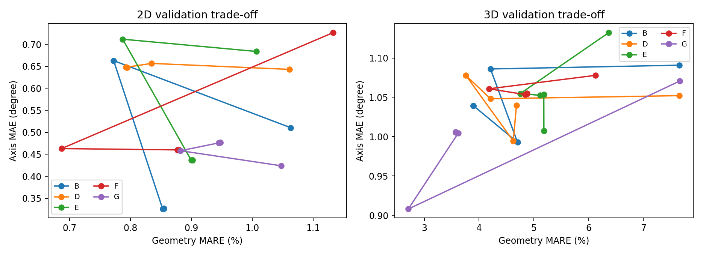
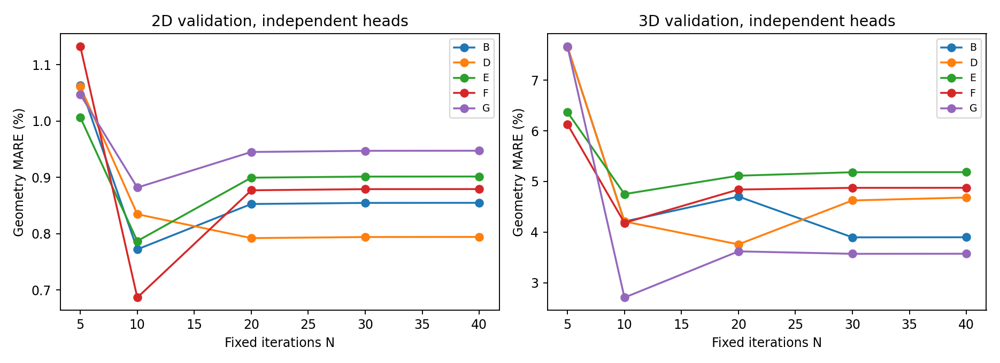
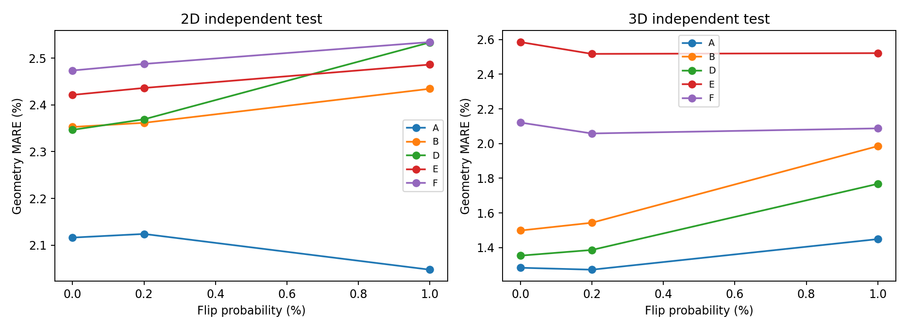
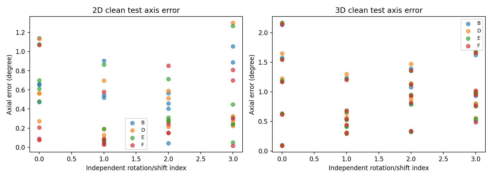
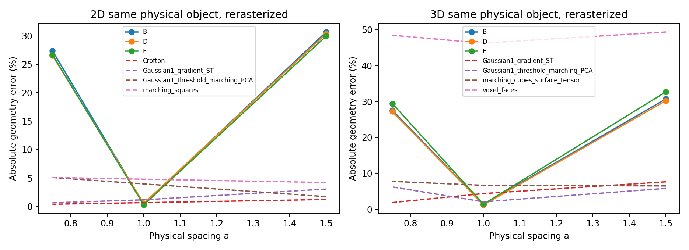
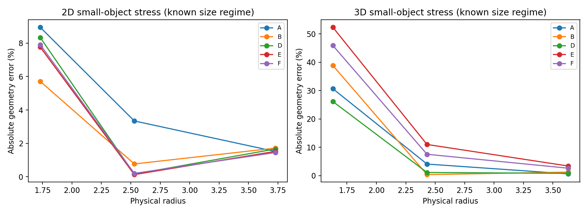
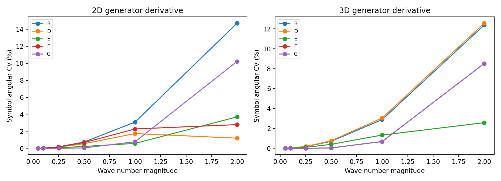
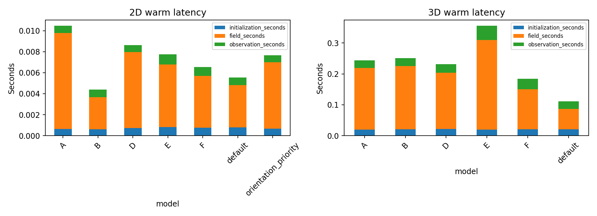

# 자화장 생성 연산자 우선 최적화: 2D·3D 재현 연구

## 1. 핵심 결론과 판정 범위

이 보고서는 신규 generator-first 의뢰서를 실제 실행한 결과다. **이번 유한 예산에서는 학습형 생성 미분의 일관된 기하 정확도 우월성이 입증되지 않았다.** 기본 선택은 두 차원 모두 학습형 G2가 아니라 고정 4차 중심차분 G1(실험 ID G), N=10이다. 이 선택에서도 관측 head는 새로 독립 학습했다. E1/E2 교환 학습의 일관된 추가 기하 이득도 확인되지 않았다.

선택된 default의 신규 test MARE는2D2.3261%,3D1.1113%이고, 원래 frozen PBGIA-30은 각각2.0958%,1.3356%다. default 각도 MAE는2D0.4350°,3D0.8128°, PBGIA-30은0.5599°,0.4794°다. 따라서 2D에서는 기하가 나빠지고 방향이 좋아졌으며,3D에서는 기하가 좋아지고 방향이 나빠지는 trade-off가 있다. '모든 측정이 개선된 새 학습 커널'이라는 결론을 지지하지 않는다.

 **동일 관측 커널·동일 N에서 생성기만 바꾼 결과**를 먼저 판단하며, 관측자 재학습과 반복횟수 변경의 효과는 분리했다. 신규 모델이 반드시 이겨야 성공이라는 전제는 두지 않았다. 아래 차이는 같은 신규 test 원형에서 계산했으며, test를 보고 계수나 N을 바꾸지 않았다.

- 2D D_fixed_B_frozen_c: B 대비 기하 MARE +0.1400 pp, 각도 MAE -0.1818°. 음수는 개선이다.
- 2D D_fixed_B_train_c: B 대비 기하 MARE +0.0099 pp, 각도 MAE -0.1818°. 음수는 개선이다.
- 2D E_fixed_B_train_c: B 대비 기하 MARE +0.0580 pp, 각도 MAE -0.1897°. 음수는 개선이다.
- 2D F_fixed_B_train_c: B 대비 기하 MARE +0.0624 pp, 각도 MAE -0.0881°. 음수는 개선이다.
- 2D D: B 대비 기하 MARE +0.0335 pp, 각도 MAE +0.0098°. 음수는 개선이다.
- 2D E: B 대비 기하 MARE +0.0650 pp, 각도 MAE +0.0365°. 음수는 개선이다.
- 2D F: B 대비 기하 MARE +0.1156 pp, 각도 MAE -0.0294°. 음수는 개선이다.
- 3D D_fixed_B_frozen_c: B 대비 기하 MARE +0.0970 pp, 각도 MAE -0.0000°. 음수는 개선이다.
- 3D D_fixed_B_train_c: B 대비 기하 MARE +0.0135 pp, 각도 MAE -0.0000°. 음수는 개선이다.
- 3D E_fixed_B_train_c: B 대비 기하 MARE +0.8781 pp, 각도 MAE -0.0241°. 음수는 개선이다.
- 3D F_fixed_B_train_c: B 대비 기하 MARE +0.7744 pp, 각도 MAE -0.0004°. 음수는 개선이다.
- 3D D: B 대비 기하 MARE -0.1730 pp, 각도 MAE +0.0323°. 음수는 개선이다.
- 3D E: B 대비 기하 MARE +0.8651 pp, 각도 MAE +0.0036°. 음수는 개선이다.
- 3D F: B 대비 기하 MARE +0.4130 pp, 각도 MAE +0.0016°. 음수는 개선이다.

같은 N·동일 관측자 결과가 생성장 자체의 증거다. D/E/F의 retuned 결과는 생성기·관측자·선택 N을 모두 포함하는 최종 시스템 비교이므로 생성기만의 우월성으로 해석하지 않는다. 작은 차이나 일부 family의 개선을 보편적 우월성으로 확대하지 않는다.

최종 validation 선택:

|   dim | preset               | model   |   N |   geometry_val |   angle_val |
|------:|:---------------------|:--------|----:|---------------:|------------:|
|     2 | default              | G       |  10 |         0.8819 |      0.4581 |
|     2 | geometry_priority    | F       |  10 |         0.6865 |      0.4629 |
|     2 | orientation_priority | D_N30   |  20 |         0.8526 |      0.3256 |
|     2 | B                    | B       |  10 |         0.7721 |      0.6627 |
|     2 | D                    | D       |  20 |         0.7921 |      0.6476 |
|     2 | E                    | E       |  10 |         0.7869 |      0.7115 |
|     2 | F                    | F       |  10 |         0.6865 |      0.4629 |
|     2 | G                    | G       |  10 |         0.8819 |      0.4581 |
|     3 | default              | G       |  10 |         2.706  |      0.9081 |
|     3 | geometry_priority    | G       |  10 |         2.706  |      0.9081 |
|     3 | orientation_priority | G       |  10 |         2.706  |      0.9081 |
|     3 | B                    | B       |  30 |         3.896  |      1.039  |
|     3 | D                    | D       |  20 |         3.757  |      1.078  |
|     3 | E                    | E       |  10 |         4.75   |      1.055  |
|     3 | F                    | F       |  10 |         4.181  |      1.061  |
|     3 | G                    | G       |  10 |         2.706  |      0.9081 |

공동 default는 validation 최저 기하 MARE의 +0.25 pp, 최저 각도 MAE의 +0.25° 안에서 가장 빠른 후보다. 두 조건의 교집합이 없으면 default를 만들지 않고 geometry_priority/orientation_priority만 제공한다. 이 조건은 reconstruction/위상/잔차 gate가 아니며 test 뒤 fallback도 없다. 실측 단일 validation rollout의 component latency를 선택에 사용했고, 별도의 warm timing은 나중에 측정했다. `validation_pareto.csv`는 기하·방향·latency Pareto를 모두 보존한다. 유한한 후보 집합에서의 선택이며 전역 최적 N이라는 뜻은 아니다.

## 2. 코드 검토·수치 모델

요청된 GitHub 참조 브랜치의 fixed_iteration checkpoint, joint core, train_joint, design 및 보고서를 직접 읽었다. 원본 SHA/URL은 `reference/github_source_review.json`에 있다. 기존 G0는 실제로 0.5*(roll(s,-1)-roll(s,+1)) 중심차분이다. 기존 screening 함수나 train_joint의 candidate_score는 가져오지 않았다. 검증된 순수 수치 함수만 복사했고 provenance를 남겼다. 과거 numerical coefficients는 A와 H 역사적 통제에만 사용하며 새로운 G/K/head의 초기값으로 복사하지 않았다. 이전 geometry-only 실행도 새 독립 study와 분리되어 있다.

H_v=J KJ*v+D Ggen*s, H_s=J KJ*s+h f, n_next=H/||H||. f는 불변, grad의 대상은 매 단계의 s, 교환도 매 단계 갱신된다. zero-H(1e-12 이하)는 이전 상태를 유지한다. div(v), grad(f), Laplacian 교환은 없다. 2D의 n은3성분, 3D는4성분이며 각 격자점에서 단위 벡터다. 기본 J=1,h=2,D=1, periodic, pinned binary EDT/tanh(width2.3) 초기화다. analytic GT distance는 초기화에 쓰지 않는다. N은 정확히5/10/20/30/40회다. 선택이나 early stopping에 잔차를 쓰지 않는다.

G의 support는 최대 5×5 및5×5×5다. separable d=[-b,-(.5-2b),0,.5-2b,b], q=[u,t,1-2t-2u,t,u]. b=t=u=0은 G0, b=-1/12,t=u=0은 G1이다. 상수 응답0, 1차 moment1, 축순열/반사 공변성을 테스트했다. E0=2d NN sum, E1=sum_i G_i**2 원소 제곱, E2=self/nearest/second/diagonal positive shell mass. E1/E2 기본합2d이며 -G†G가 아니다. raw E1은 별도로 비교했다. raw합이 alpha·2d면 normalized E1의 h/alpha,D/alpha로 모든 H의 상수배 동치가 된다. 이 동치는 수치 테스트로 확인했다.

기하 head Kgeom은 train 원형 단위 MARE만, Korient는 축 각도만 최적화했다. bond/current HJ, direct v⊗v, gradient tensor, 정규화 traceless tensor simplex ensemble과 min/max eigenaxis를 train에서 비교했다. geometry와 orientation p는 별도다. maximum eigenaxis는 같은 orientation DE 해의 대조이며 별도 DE를 배정하지 않았다. 2D half-angle/90° convention 및3D 축교환을 검사했다. 원·구·ring·torus의 장축이나 복합체에 임의 GT를 부여하지 않았다. true axis가 있는 stadium/ellipse/capsule/ellipsoid/peanut만 각도를 계산했다. 작은 eigengap의 예측도 각도 분모에서 제거하지 않았다.

## 3. 데이터·GT·누출 방지

|   dim | split      |   images |   units |
|------:|:-----------|---------:|--------:|
|     2 | test       |       96 |       8 |
|     2 | train      |       49 |       5 |
|     2 | validation |       48 |       4 |
|     3 | test       |       96 |       8 |
|     3 | train      |       49 |       5 |
|     3 | validation |       48 |       4 |

각 원형에4개의 독립 회전/shift와 clean/0.2%/1% salt-pepper 변형을 만들었다. 동일 원형의 모든 파생 영상은 같은 split이다. Train과 validation은 차원별4원형, test는 차원별8원형이며 전체 test 독립 단위는16개다. calibration 원/구2개는 train-only다. Test에는 새 크기의 seen family와 ring/ellipsoid/peanut family held-out이 포함된다. seed291116이며3D 회전은 Gaussian QR의 Haar SO(3) 표본,2D는[0,π) 균등 회전이다. 반사/축순열은 수치 테스트에서 따로 확인했다. 각4회전은 SO(3) 완전 불변성의 증명이 아니다.

과거 fixed_iteration·joint_operator·geometry_only manifest의 (차원,family,R)와 겹치지 않음을 검사했다. 종횡비·복합체의 unequal radii 및 peanut separation도 변경했다. 비슷한 형태 계열에서의 새 파라미터 표본이며 모든 family가 미지인 대규모 외부 데이터라는 주장은 하지 않는다. 작은 구 R≈1.6–3.7은 과거에 관찰한 크기 범위이므로 post-freeze stress로만 표시하고 신규 독립 test에 합치지 않았다.

둘레/면적 GT는 연속 원형의 analytic 값(원,stadium,구,capsule,torus,분리된 다중체,ring,두 원/구 합집합)이다. 타원은 완전타원적분, triaxial ellipsoid는 Gauss-Legendre120×periodic240 quadrature다. 합집합 peanut은 노출된 원호/구면 cap의 정확식이며 ellipse 근사로 바꾸지 않았다. 입력은 그 연속체를 중심에서 binary sampling한 f다. noise GT는 **잡음을 넣기 전의 원형**이므로 이 실험은 원형 측정 robustness 질문을 다룬다. salt noise가 실제 신호인지 일반적으로 판정하는 실험은 아니다.

보정은 모든 후보의 같은 train-only 참조 원/구로 정한다. A는 pinned PBGIA-30의 원래 c와 새 train reference c를 나란히 제시한다. Conventional도 raw와 같은 참조 보정 결과가 모두 있다. Test GT로 c를 정하지 않았다. `pretest_selection.json`/sha256에 N, 생성기, 각 head, convention,c,protocol/manifest/model/calibration hash를 test 전에 잠갔다. test는 한 번만 실행했고 모든 사례를 유지했다. 중복 preset이 같은 모델을 가리켜도 새로운 독립 표본으로 세지 않았다.

## 4. 실제 학습 예산과 한계

차원/주 family(axial,tied,free)당12후보,2개 시작점이며 후반6개는 앞부분 best 주위로 범위를 줄이는 탐색이다. Train proxy는4원형×2회전×clean/1% 및 참조=17영상/차원이다. 공유 G는5개 N의 평균 L=relative-MARE+0.05*(angle/90)로 학습했다. 손실 가중치0,0.2도 같은 방문 후보에서 기록했으나 각각 독립 재최적화한 연구로 주장하지 않는다. N5/10/30의 axial generator를 각각6후보로 재학습했고 고정된 D의 G에 대해 E1 및 free E2(6후보)를 비교했다. 원래 baseline 또는 fourth-order 자체가 최선이면 이를 숨기지 않는다.

|   dim | family   | scope      | fixed_gp   |   evaluations |   best_loss |   wall_seconds |
|------:|:---------|:-----------|:-----------|--------------:|------------:|---------------:|
|     2 | axial    | N_specific | False      |            18 |    0.009492 |          2.823 |
|     2 | axial    | shared     | False      |            12 |    0.01238  |          5.034 |
|     2 | free     | shared     | False      |            12 |    0.01343  |          6.913 |
|     2 | free     | shared     | True       |             6 |    0.01246  |          3.385 |
|     2 | tied     | shared     | False      |            12 |    0.01222  |          6.402 |
|     3 | axial    | N_specific | False      |            18 |    0.05574  |         55.29  |
|     3 | axial    | shared     | False      |            12 |    0.07612  |        107.6   |
|     3 | free     | shared     | False      |            12 |    0.07379  |        143.6   |
|     3 | free     | shared     | True       |             6 |    0.07325  |         76.62  |
|     3 | tied     | shared     | False      |            12 |    0.07522  |        325.9   |

각 최종 generator마다 동일 DE120평가/N/head로 관측자를 독립 재학습했다. 기하와 방향 DE는 각각 popsize4,maxiter9,polishFalse이며 대개 max-iteration 종료다. 이는 optimizer success/수렴 인증이 아니다. bounds는 G b[-.14,.04],t[0,.27],u[0,.08], E2 self[0,.6],second/diag[0,.17]이고 axial mass는 나머지다. 최종계수의 bounds 접근은 `selected_coefficients.csv`와 원 trial에서 확인 가능하다. 고차원 free에 같은 evaluations를 주는 편향과 proxy의 한 원형/family 제한이 있다. 특히3D E의 b=.04,u=.08은 상한에 도달해 parameter-space truncation 가능성이 분명하다. 이를 수렴한 최적해라고 부르지 않는다.

실제 전체 training 단계:

| stage   |   wall_seconds |   peak_rss_kb |
|:--------|---------------:|--------------:|
| train_2 |          45.37 |        131308 |
| train_3 |         967.4  |        975816 |

전체 훈련 process CPU 기록: `{"pid": 15050, "process_CPU_seconds": 1012.71, "sampling_interval_seconds": 0.1, "scope": "whole training process user+system CPU; last sample before exit, undercount at most one sample interval plus scheduling", "sample_utc": 1794842109.0453978}`. 최초 실행은 process timer wrapper 전에 시작했으므로 CPU는 /proc의 user+system 누적값을0.1초 간격으로 샘플한 마지막 값이다. 정확한 종료 시점의 CPU보다 소량 작을 수 있다. walltime은 전체 최적화 루프를 직접 측정했다. generator_trials의 seconds는 후보 rollout+읽기/점수 비용이며 observer 학습은 별도 전체 훈련 시간에 포함된다. stage runner는 이후 단계 및 재현 실행의 child CPU/RSS도 기록한다. GPU는 사용하지 않았다.

같은 측정 walltime prefix의 민감도:

|   dim | family   |   common_wall_budget |   evaluations |   best_train_loss |   best_geometry_only |   best_angle_weight_02 |
|------:|:---------|---------------------:|--------------:|------------------:|---------------------:|-----------------------:|
|     2 | axial    |                1.258 |             2 |           0.01256 |              0.01222 |                0.01356 |
|     2 | free     |                1.258 |             2 |           0.2464  |              0.246   |                0.2476  |
|     2 | tied     |                1.258 |             2 |           0.01232 |              0.01203 |                0.01317 |
|     2 | axial    |                2.517 |             5 |           0.01251 |              0.01222 |                0.01332 |
|     2 | free     |                2.517 |             4 |           0.02163 |              0.02133 |                0.02255 |
|     2 | tied     |                2.517 |             4 |           0.01232 |              0.01203 |                0.01317 |
|     2 | axial    |                5.034 |            12 |           0.01238 |              0.0121  |                0.01321 |
|     2 | free     |                5.034 |             8 |           0.02163 |              0.02133 |                0.02255 |
|     2 | tied     |                5.034 |             9 |           0.01232 |              0.01203 |                0.01317 |
|     3 | axial    |               26.91  |             2 |           0.07612 |              0.07587 |                0.07687 |
|     3 | free     |               26.91  |             2 |           0.07444 |              0.07419 |                0.07517 |
|     3 | tied     |               26.91  |             1 |           0.07613 |              0.07588 |                0.07688 |
|     3 | axial    |               53.82  |             5 |           0.07612 |              0.07587 |                0.07687 |
|     3 | free     |               53.82  |             4 |           0.07424 |              0.07399 |                0.07499 |
|     3 | tied     |               53.82  |             2 |           0.07589 |              0.07564 |                0.07664 |
|     3 | axial    |              107.6   |            12 |           0.07612 |              0.07587 |                0.07687 |
|     3 | free     |              107.6   |             8 |           0.07379 |              0.07355 |                0.07454 |
|     3 | tied     |              107.6   |             4 |           0.07529 |              0.07504 |                0.07603 |

이 표는 동일시간 예산에 들어온 실제 탐색 prefix의 best train loss다. 별도 optimizer 재시작이나 walltime 강제 종료로 훈련한 모델이 아니며 validation/test 개선을 보장하지 않는다. 자원은 stage1–3의 분리에 우선 배정했다. G3의7-point/비분리형 확장, E3, autodiff, 새로운 loss-weight별 전체 재훈련은 수행하지 않았다. 이 범위 밖 작업을 완료한 연구처럼 표시하지 않는다.

## 5. Train / validation / N별 통제

Train 요약(주 family, retuned):

|   dim | model   |   N |   geometry_MARE |   angle_MAE |   CI_low |   CI_high |   median_seconds |
|------:|:--------|----:|----------------:|------------:|---------:|----------:|-----------------:|
|     2 | B       |   5 |           1.482 |      0.6516 |   1.002  |     1.962 |         0.003248 |
|     2 | B       |  10 |           1.287 |      0.8051 |   0.7059 |     2.064 |         0.005139 |
|     2 | B       |  20 |           1.472 |      0.5632 |   0.8238 |     2.36  |         0.008769 |
|     2 | B       |  30 |           1.474 |      0.5633 |   0.828  |     2.359 |         0.01239  |
|     2 | B       |  40 |           1.474 |      0.5633 |   0.8284 |     2.359 |         0.01661  |
|     2 | D       |   5 |           1.482 |      0.6927 |   0.9921 |     1.973 |         0.003391 |
|     2 | D       |  10 |           1.35  |      0.6639 |   0.7071 |     2.25  |         0.005364 |
|     2 | D       |  20 |           1.454 |      0.6419 |   0.7812 |     2.413 |         0.00928  |
|     2 | D       |  30 |           1.457 |      0.6403 |   0.7854 |     2.412 |         0.0131   |
|     2 | D       |  40 |           1.457 |      0.6402 |   0.7858 |     2.412 |         0.01671  |
|     2 | E       |   5 |           1.429 |      0.7531 |   0.924  |     1.934 |         0.004403 |
|     2 | E       |  10 |           1.366 |      0.7531 |   0.6716 |     2.358 |         0.007177 |
|     2 | E       |  20 |           1.466 |      0.4957 |   0.8229 |     2.348 |         0.01258  |
|     2 | E       |  30 |           1.468 |      0.4946 |   0.8263 |     2.347 |         0.01813  |
|     2 | E       |  40 |           1.469 |      0.4944 |   0.8265 |     2.347 |         0.02366  |
|     2 | F       |   5 |           1.481 |      0.7403 |   1.002  |     2.009 |         0.004331 |
|     2 | F       |  10 |           1.376 |      0.4777 |   0.6093 |     2.491 |         0.007137 |
|     2 | F       |  20 |           1.523 |      0.4706 |   0.7896 |     2.544 |         0.01242  |
|     2 | F       |  30 |           1.525 |      0.4712 |   0.7934 |     2.542 |         0.01782  |
|     2 | F       |  40 |           1.525 |      0.4713 |   0.7936 |     2.542 |         0.02366  |
|     2 | G       |   5 |           1.51  |      0.6001 |   1.017  |     2.003 |         0.003295 |
|     2 | G       |  10 |           1.415 |      0.5937 |   0.7502 |     2.337 |         0.004973 |
|     2 | G       |  20 |           1.588 |      0.6021 |   0.8897 |     2.567 |         0.008707 |
|     2 | G       |  30 |           1.589 |      0.6019 |   0.8933 |     2.564 |         0.01213  |
|     2 | G       |  40 |           1.59  |      0.6019 |   0.8936 |     2.564 |         0.01573  |
|     3 | B       |   5 |          11.7   |      0.6296 |   6.932  |    16.48  |         0.08717  |
|     3 | B       |  10 |           5.828 |      0.5279 |   0.4758 |    15.53  |         0.1294   |
|     3 | B       |  20 |           6.206 |      0.4866 |   1.064  |    15.65  |         0.2007   |
|     3 | B       |  30 |           5.96  |      0.5072 |   0.8872 |    11.03  |         0.272    |
|     3 | B       |  40 |           5.962 |      0.5075 |   0.8902 |    11.03  |         0.3462   |
|     3 | D       |   5 |          11.68  |      0.6135 |   6.919  |    16.44  |         0.07818  |
|     3 | D       |  10 |           5.816 |      0.5148 |   0.5214 |    15.46  |         0.1214   |
|     3 | D       |  20 |           5.893 |      0.5231 |   0.7332 |    11.05  |         0.2109   |
|     3 | D       |  30 |           6.217 |      0.4902 |   1.208  |    15.12  |         0.2994   |
|     3 | D       |  40 |           6.232 |      0.5095 |   1.148  |    15.48  |         0.3861   |
|     3 | E       |   5 |           9.537 |      0.6335 |   5.776  |    13.3   |         0.1995   |
|     3 | E       |  10 |           6.194 |      0.5298 |   0.5185 |    16.62  |         0.3433   |
|     3 | E       |  20 |           6.707 |      0.5293 |   0.8434 |    17.35  |         0.6384   |
|     3 | E       |  30 |           6.819 |      0.5313 |   0.7321 |    17.76  |         0.9277   |
|     3 | E       |  40 |           6.823 |      0.5144 |   0.7292 |    17.77  |         1.22     |
|     3 | F       |   5 |           9.708 |      0.5857 |   5.949  |    13.47  |         0.08775  |
|     3 | F       |  10 |           5.862 |      0.5074 |   0.8982 |    14.46  |         0.1402   |
|     3 | F       |  20 |           6.449 |      0.5091 |   0.9314 |    16.48  |         0.2424   |
|     3 | F       |  30 |           6.499 |      0.5106 |   0.9139 |    16.59  |         0.3476   |
|     3 | F       |  40 |           6.502 |      0.5107 |   0.9134 |    16.6   |         0.4447   |
|     3 | G       |   5 |          11.81  |      0.6202 |   6.999  |    16.63  |         0.0705   |
|     3 | G       |  10 |           5.467 |      0.4553 |   0.5428 |    10.39  |         0.1065   |
|     3 | G       |  20 |           5.822 |      0.4782 |   0.7322 |    10.91  |         0.1708   |
|     3 | G       |  30 |           5.814 |      0.4795 |   0.716  |    10.91  |         0.2341   |
|     3 | G       |  40 |           5.816 |      0.4797 |   0.7185 |    10.91  |         0.3061   |

Validation 요약(주 family, retuned):

|   dim | model   |   N |   geometry_MARE |   angle_MAE |   CI_low |   CI_high |   median_seconds |
|------:|:--------|----:|----------------:|------------:|---------:|----------:|-----------------:|
|     2 | B       |   5 |          1.063  |      0.5104 |   0.8514 |    1.264  |         0.003385 |
|     2 | B       |  10 |          0.7721 |      0.6627 |   0.6377 |    0.8883 |         0.005485 |
|     2 | B       |  20 |          0.8526 |      0.3256 |   0.7426 |    0.9627 |         0.008826 |
|     2 | B       |  30 |          0.8546 |      0.3265 |   0.746  |    0.9632 |         0.01248  |
|     2 | B       |  40 |          0.8548 |      0.3267 |   0.7463 |    0.9632 |         0.01606  |
|     2 | D       |   5 |          1.061  |      0.6429 |   0.8497 |    1.261  |         0.003363 |
|     2 | D       |  10 |          0.8345 |      0.6565 |   0.6762 |    0.9929 |         0.005342 |
|     2 | D       |  20 |          0.7921 |      0.6476 |   0.6817 |    0.9025 |         0.00927  |
|     2 | D       |  30 |          0.794  |      0.6471 |   0.685  |    0.903  |         0.01321  |
|     2 | D       |  40 |          0.7942 |      0.6472 |   0.6853 |    0.9031 |         0.01709  |
|     2 | E       |   5 |          1.007  |      0.6836 |   0.807  |    1.181  |         0.004394 |
|     2 | E       |  10 |          0.7869 |      0.7115 |   0.6362 |    0.9376 |         0.007002 |
|     2 | E       |  20 |          0.8994 |      0.4367 |   0.7549 |    1.044  |         0.01216  |
|     2 | E       |  30 |          0.9013 |      0.4368 |   0.7582 |    1.044  |         0.01795  |
|     2 | E       |  40 |          0.9015 |      0.4369 |   0.7584 |    1.045  |         0.02318  |
|     2 | F       |   5 |          1.132  |      0.7264 |   0.809  |    1.458  |         0.004156 |
|     2 | F       |  10 |          0.6865 |      0.4629 |   0.5522 |    0.8512 |         0.00694  |
|     2 | F       |  20 |          0.877  |      0.46   |   0.7162 |    1.038  |         0.01205  |
|     2 | F       |  30 |          0.879  |      0.4593 |   0.7195 |    1.039  |         0.01753  |
|     2 | F       |  40 |          0.8792 |      0.4594 |   0.7198 |    1.039  |         0.02235  |
|     2 | G       |   5 |          1.047  |      0.4239 |   0.8601 |    1.212  |         0.003369 |
|     2 | G       |  10 |          0.8819 |      0.4581 |   0.711  |    1.053  |         0.005417 |
|     2 | G       |  20 |          0.945  |      0.4759 |   0.7861 |    1.104  |         0.009004 |
|     2 | G       |  30 |          0.9471 |      0.4766 |   0.7897 |    1.105  |         0.01266  |
|     2 | G       |  40 |          0.9473 |      0.4767 |   0.7899 |    1.105  |         0.01673  |
|     3 | B       |   5 |          7.66   |      1.091  |   5.115  |   10.75   |         0.07224  |
|     3 | B       |  10 |          4.208  |      1.086  |   0.5861 |   10.65   |         0.1112   |
|     3 | B       |  20 |          4.701  |      0.9929 |   0.5927 |   12      |         0.1783   |
|     3 | B       |  30 |          3.896  |      1.039  |   0.5806 |    8.779  |         0.2446   |
|     3 | B       |  40 |          3.897  |      1.039  |   0.5818 |    8.783  |         0.31     |
|     3 | D       |   5 |          7.658  |      1.052  |   5.13   |   10.74   |         0.08354  |
|     3 | D       |  10 |          4.208  |      1.048  |   0.6015 |   10.6    |         0.1275   |
|     3 | D       |  20 |          3.757  |      1.078  |   0.521  |    8.169  |         0.2163   |
|     3 | D       |  30 |          4.625  |      0.9945 |   0.5891 |   11.67   |         0.3059   |
|     3 | D       |  40 |          4.682  |      1.04   |   0.6078 |   11.86   |         0.3954   |
|     3 | E       |   5 |          6.369  |      1.132  |   4.794  |    8.284  |         0.2032   |
|     3 | E       |  10 |          4.75   |      1.055  |   0.5285 |   11.78   |         0.3515   |
|     3 | E       |  20 |          5.114  |      1.053  |   0.7338 |   12.7    |         0.6495   |
|     3 | E       |  30 |          5.182  |      1.054  |   0.7059 |   12.94   |         0.946    |
|     3 | E       |  40 |          5.184  |      1.007  |   0.7045 |   12.95   |         1.243    |
|     3 | F       |   5 |          6.129  |      1.078  |   4.373  |    8.105  |         0.0967   |
|     3 | F       |  10 |          4.181  |      1.061  |   0.3817 |   10.07   |         0.1494   |
|     3 | F       |  20 |          4.84   |      1.054  |   0.581  |   12.36   |         0.2578   |
|     3 | F       |  30 |          4.874  |      1.055  |   0.6103 |   12.43   |         0.3673   |
|     3 | F       |  40 |          4.875  |      1.055  |   0.611  |   12.43   |         0.478    |
|     3 | G       |   5 |          7.667  |      1.071  |   5.047  |   10.84   |         0.07154  |
|     3 | G       |  10 |          2.706  |      0.9081 |   0.2523 |    5.159  |         0.1045   |
|     3 | G       |  20 |          3.619  |      1.004  |   0.5182 |    7.999  |         0.1736   |
|     3 | G       |  30 |          3.57   |      1.006  |   0.5146 |    7.807  |         0.2416   |
|     3 | G       |  40 |          3.572  |      1.006  |   0.5157 |    7.811  |         0.3102   |

N별 재학습의 **동일 N, B 관측자, train 재보정 c** 비교:

|   dim | model   |   N |   geometry_MARE |   angle_MAE |   CI_low |   CI_high |   median_seconds |
|------:|:--------|----:|----------------:|------------:|---------:|----------:|-----------------:|
|     2 | D       |   5 |          1.028  |      0.3697 |   0.8262 |    1.202  |         0.003412 |
|     2 | D_N5    |   5 |          1.021  |      0.4262 |   0.8102 |    1.185  |         0.003553 |
|     2 | D       |  10 |          0.742  |      0.4175 |   0.6164 |    0.8603 |         0.00536  |
|     2 | D_N10   |  10 |          0.7368 |      0.6065 |   0.6083 |    0.8625 |         0.005327 |
|     2 | D       |  30 |          0.8299 |      0.3412 |   0.693  |    0.9668 |         0.01311  |
|     2 | D_N30   |  30 |          0.8546 |      0.3265 |   0.746  |    0.9632 |         0.01212  |
|     3 | D       |   5 |          7.658  |      1.091  |   5.13   |   10.74   |         0.08026  |
|     3 | D_N5    |   5 |          7.621  |      1.101  |   5.224  |   10.61   |         0.08513  |
|     3 | D       |  10 |          4.213  |      1.086  |   0.6007 |   10.62   |         0.126    |
|     3 | D_N10   |  10 |          4.208  |      1.086  |   0.5861 |   10.65   |         0.1056   |
|     3 | D       |  30 |          3.893  |      1.04   |   0.5756 |    8.701  |         0.3107   |
|     3 | D_N30   |  30 |          3.905  |      1.035  |   0.5975 |    8.849  |         0.2951   |

N별 G 재학습은 공유 G의 한계를 직접 확인하는 대조다. 한 N에서 좋은 계수가 다른 N에서도 최적이라는 가정은 하지 않았다. 최종 validation pool에는 공유 및 N별 학습 generator가 포함되므로 추가 후보 선택의 자유도도 존재한다.

Exchange와 initialization의 validation 통제(각 통제의 geometry-best N; 이 표 자체는 matched-N 인과 비교가 아니며 원본CSV에 모든N이 있다):

|   dim | model             |   N |   geometry_MARE |   angle_MAE |   CI_low |   CI_high |   median_seconds |
|------:|:------------------|----:|----------------:|------------:|---------:|----------:|-----------------:|
|     2 | F_fixedG          |  10 |          0.7349 |      0.4147 |   0.6005 |    0.8629 |         0.006865 |
|     2 | E_fixedG          |  10 |          0.7409 |      0.4137 |   0.6159 |    0.8603 |         0.007288 |
|     2 | D                 |  10 |          0.742  |      0.4175 |   0.6164 |    0.8603 |         0.00536  |
|     2 | B                 |  10 |          0.7721 |      0.6627 |   0.6377 |    0.8883 |         0.005277 |
|     2 | binary_init       |  20 |          0.8538 |      0.3279 |   0.7441 |    0.9636 |         0.007725 |
|     3 | F_fixedG          |  30 |          3.781  |      1.104  |   0.4204 |    8.257  |         0.4304   |
|     3 | binary_init       |  30 |          3.892  |      1.04   |   0.5812 |    8.769  |         0.221    |
|     3 | D                 |  30 |          3.893  |      1.04   |   0.5756 |    8.701  |         0.3107   |
|     3 | B                 |  30 |          3.896  |      1.039  |   0.5806 |    8.779  |         0.2415   |
|     3 | E_fixedG          |  30 |          3.896  |      1.039  |   0.5756 |    8.704  |         0.9597   |
|     3 | raw_tied          |   5 |          8.308  |      1.703  |   3.783  |   14.97   |         0.2019   |
|     3 | raw_scale_matched |   5 |          8.308  |      1.703  |   3.783  |   14.97   |         0.1981   |
|     2 | raw_tied          |   5 |         25.84   |      0.5571 |  18.96   |   31.09   |         0.004365 |
|     2 | raw_scale_matched |   5 |         25.84   |      0.5571 |  18.96   |   31.09   |         0.004481 |

Raw tied와 h,D 재스케일 normalized tied의 수치 동치는 위 테스트가 검증한다. 이 두 성능이 비슷하면 raw 개선을 새로운 exchange 공간형태만의 효과라 해석할 수 없다. E_fixedG/F_fixedG는 D의 G를 고정한 exchange-only 대조다. Binary init도 EDT와 혼동하지 않는다. 공유 Kgeom=Korient simplification의 validation-only 결과는 `shared_observer_validation.csv`에 있으며 선택을 다시 하지 않았다.

Validation 동일 관측자·동일 N에서 D의 기하 MARE는2D B0.772109%→D0.742041%(N10),3D B3.895707%→D3.892946%(N30)이었다. 작은 validation 이득이 아래 새 test에서 재현되지 않았다. 이 일반화 실패를 숨기지 않는다. 자원 우선순위에 따라 G3 확장은 이번 동결 연구에서는 수행하지 않았으며, 미실행 한계로 남긴다.

## 6. 새로운 독립 test: 생성기 효과와 최종 시스템

동일 B 관측자, **B의 validation 선택 N을 동일하게 적용**한 결과:

|   dim | model              |   N |   geometry_MARE |   angle_MAE |   CI_low |   CI_high |   median_seconds |
|------:|:-------------------|----:|----------------:|------------:|---------:|----------:|-----------------:|
|     2 | B                  |  10 |           2.383 |      0.6033 |   0.9432 |     4.649 |         0.004028 |
|     2 | D_fixed_B_frozen_c |  10 |           2.523 |      0.4214 |   1.103  |     4.745 |         0.004204 |
|     2 | D_fixed_B_train_c  |  10 |           2.393 |      0.4214 |   0.9335 |     4.715 |         0.004264 |
|     2 | E_fixed_B_frozen_c |  10 |           2.717 |      0.4135 |   1.299  |     4.846 |         0.00617  |
|     2 | E_fixed_B_train_c  |  10 |           2.441 |      0.4135 |   0.9504 |     4.802 |         0.006128 |
|     2 | F_fixed_B_frozen_c |  10 |           2.395 |      0.5152 |   0.9052 |     4.77  |         0.005959 |
|     2 | F_fixed_B_train_c  |  10 |           2.445 |      0.5152 |   0.9833 |     4.76  |         0.006034 |
|     2 | G_fixed_B_frozen_c |  10 |           2.111 |      0.4474 |   0.5724 |     4.611 |         0.004191 |
|     2 | G_fixed_B_train_c  |  10 |           2.311 |      0.4474 |   0.9234 |     4.495 |         0.004618 |
|     3 | B                  |  30 |           1.676 |      0.9106 |   0.808  |     2.668 |         0.2586   |
|     3 | D_fixed_B_frozen_c |  30 |           1.773 |      0.9106 |   0.8938 |     2.809 |         0.3116   |
|     3 | D_fixed_B_train_c  |  30 |           1.689 |      0.9106 |   0.8168 |     2.689 |         0.3129   |
|     3 | E_fixed_B_frozen_c |  30 |           4.179 |      0.8865 |   2.357  |     6.752 |         0.9466   |
|     3 | E_fixed_B_train_c  |  30 |           2.554 |      0.8865 |   0.9842 |     4.77  |         0.9476   |
|     3 | F_fixed_B_frozen_c |  30 |           2.308 |      0.9102 |   0.9224 |     4.378 |         0.3506   |
|     3 | F_fixed_B_train_c  |  30 |           2.45  |      0.9102 |   0.8972 |     4.682 |         0.3486   |
|     3 | G_fixed_B_frozen_c |  30 |           1.508 |      0.903  |   0.8529 |     2.265 |         0.2418   |
|     3 | G_fixed_B_train_c  |  30 |           1.646 |      0.903  |   0.784  |     2.662 |         0.2423   |

`frozen_c`는 B의 train c까지 동결한다. `train_c`는 같은 관측 커널을 유지하면서 해당 generator의 train 참조만 다시 보정한다. 둘의 차이는 generator가 원형별 기하성능을 개선했는지 단지 전체 gain을 바꾸었는지 해석하는 데 필요하다.

각 arm이 별도 관측자를 학습하고 validation에서 고른 N의 최종 시스템:

|   dim | model                |   N |   geometry_MARE |   angle_MAE |   CI_low |   CI_high |   median_seconds |
|------:|:---------------------|----:|----------------:|------------:|---------:|----------:|-----------------:|
|     2 | A                    |  30 |           2.096 |      0.5599 |   0.7757 |     3.897 |         0.009237 |
|     2 | A_train_c            |  30 |           2.161 |      0.5599 |   0.9859 |     3.664 |         0.009239 |
|     2 | B                    |  10 |           2.383 |      0.6033 |   0.9432 |     4.649 |         0.004028 |
|     2 | D                    |  20 |           2.416 |      0.613  |   0.9253 |     4.807 |         0.007288 |
|     2 | E                    |  10 |           2.448 |      0.6398 |   0.9376 |     4.853 |         0.006156 |
|     2 | F                    |  10 |           2.499 |      0.5739 |   0.9906 |     4.933 |         0.006021 |
|     2 | G                    |  10 |           2.326 |      0.435  |   0.8816 |     4.597 |         0.004113 |
|     2 | default              |  10 |           2.326 |      0.435  |   0.8816 |     4.597 |         0.004182 |
|     2 | geometry_priority    |  10 |           2.499 |      0.5739 |   0.9906 |     4.933 |         0.006166 |
|     2 | orientation_priority |  20 |           2.4   |      0.4141 |   0.931  |     4.726 |         0.006682 |
|     3 | A                    |  30 |           1.336 |      0.4794 |   0.9112 |     1.836 |         0.2576   |
|     3 | A_train_c            |  30 |           1.443 |      0.4794 |   0.8318 |     2.101 |         0.2593   |
|     3 | B                    |  30 |           1.676 |      0.9106 |   0.808  |     2.668 |         0.2586   |
|     3 | D                    |  20 |           1.503 |      0.9429 |   0.8038 |     2.277 |         0.2194   |
|     3 | E                    |  10 |           2.541 |      0.9142 |   1.207  |     4.273 |         0.3527   |
|     3 | F                    |  10 |           2.089 |      0.9122 |   0.9854 |     3.501 |         0.1449   |
|     3 | G                    |  10 |           1.111 |      0.8128 |   0.6759 |     1.582 |         0.1039   |
|     3 | default              |  10 |           1.111 |      0.8128 |   0.6759 |     1.582 |         0.1035   |
|     3 | geometry_priority    |  10 |           1.111 |      0.8128 |   0.6759 |     1.582 |         0.1037   |
|     3 | orientation_priority |  10 |           1.111 |      0.8128 |   0.6759 |     1.582 |         0.1036   |

Paired unit bootstrap(B 대비, 음수 개선):

|   dim | model              | metric      |   units |       mean |     CI_low |   CI_high |
|------:|:-------------------|:------------|--------:|-----------:|-----------:|----------:|
|     2 | D                  | geom_delta  |       8 |  0.0335    | -0.1158    |  0.1604   |
|     2 | D                  | angle_delta |       4 |  0.009767  | -0.03967   |  0.09092  |
|     2 | D_fixed_B_frozen_c | geom_delta  |       8 |  0.14      | -0.003679  |  0.2568   |
|     2 | D_fixed_B_frozen_c | angle_delta |       4 | -0.1818    | -0.3468    | -0.03794  |
|     2 | D_fixed_B_train_c  | geom_delta  |       8 |  0.009869  | -0.04816   |  0.08368  |
|     2 | D_fixed_B_train_c  | angle_delta |       4 | -0.1818    | -0.3468    | -0.03794  |
|     2 | E                  | geom_delta  |       8 |  0.06498   | -0.02183   |  0.2049   |
|     2 | E                  | angle_delta |       4 |  0.0365    | -0.06874   |  0.1144   |
|     2 | E_fixed_B_frozen_c | geom_delta  |       8 |  0.3337    |  0.009597  |  0.5747   |
|     2 | E_fixed_B_frozen_c | angle_delta |       4 | -0.1897    | -0.3219    | -0.09946  |
|     2 | E_fixed_B_train_c  | geom_delta  |       8 |  0.05805   | -0.02983   |  0.1733   |
|     2 | E_fixed_B_train_c  | angle_delta |       4 | -0.1897    | -0.3219    | -0.09946  |
|     2 | F                  | geom_delta  |       8 |  0.1156    | -0.02004   |  0.3095   |
|     2 | F                  | angle_delta |       4 | -0.02941   | -0.2829    |  0.2115   |
|     2 | F_fixed_B_frozen_c | geom_delta  |       8 |  0.01218   | -0.1258    |  0.1933   |
|     2 | F_fixed_B_frozen_c | angle_delta |       4 | -0.08809   | -0.2689    |  0.1701   |
|     2 | F_fixed_B_train_c  | geom_delta  |       8 |  0.06241   | -0.01259   |  0.1555   |
|     2 | F_fixed_B_train_c  | angle_delta |       4 | -0.08809   | -0.2689    |  0.1701   |
|     2 | G_fixed_B_frozen_c | geom_delta  |       8 | -0.2716    | -0.5833    |  0.1095   |
|     2 | G_fixed_B_frozen_c | angle_delta |       4 | -0.1559    | -0.2672    | -0.07997  |
|     2 | G_fixed_B_train_c  | geom_delta  |       8 | -0.07227   | -0.2021    |  0.03224  |
|     2 | G_fixed_B_train_c  | angle_delta |       4 | -0.1559    | -0.2672    | -0.07997  |
|     3 | D                  | geom_delta  |       8 | -0.173     | -0.4812    |  0.03038  |
|     3 | D                  | angle_delta |       5 |  0.03226   |  0.0145    |  0.05021  |
|     3 | D_fixed_B_frozen_c | geom_delta  |       8 |  0.09704   |  0.02435   |  0.1557   |
|     3 | D_fixed_B_frozen_c | angle_delta |       5 | -4.662e-05 | -0.0009783 |  0.001068 |
|     3 | D_fixed_B_train_c  | geom_delta  |       8 |  0.01354   |  0.002533  |  0.02654  |
|     3 | D_fixed_B_train_c  | angle_delta |       5 | -4.662e-05 | -0.0009783 |  0.001068 |
|     3 | E                  | geom_delta  |       8 |  0.8651    |  0.2847    |  1.742    |
|     3 | E                  | angle_delta |       5 |  0.003617  | -0.01278   |  0.01552  |
|     3 | E_fixed_B_frozen_c | geom_delta  |       8 |  2.503     |  1.009     |  4.32     |
|     3 | E_fixed_B_frozen_c | angle_delta |       5 | -0.02411   | -0.03496   | -0.01226  |
|     3 | E_fixed_B_train_c  | geom_delta  |       8 |  0.8781    |  0.07204   |  2.263    |
|     3 | E_fixed_B_train_c  | angle_delta |       5 | -0.02411   | -0.03496   | -0.01226  |
|     3 | F                  | geom_delta  |       8 |  0.413     |  0.05119   |  0.9429   |
|     3 | F                  | angle_delta |       5 |  0.001598  | -0.01783   |  0.01772  |
|     3 | F_fixed_B_frozen_c | geom_delta  |       8 |  0.6318    | -0.2817    |  1.955    |
|     3 | F_fixed_B_frozen_c | angle_delta |       5 | -0.0004389 | -0.01801   |  0.0169   |
|     3 | F_fixed_B_train_c  | geom_delta  |       8 |  0.7744    |  0.02478   |  2.175    |
|     3 | F_fixed_B_train_c  | angle_delta |       5 | -0.0004389 | -0.01801   |  0.0169   |
|     3 | G_fixed_B_frozen_c | geom_delta  |       8 | -0.1681    | -0.5265    |  0.1722   |
|     3 | G_fixed_B_frozen_c | angle_delta |       5 | -0.007621  | -0.02054   |  0.001992 |
|     3 | G_fixed_B_train_c  | geom_delta  |       8 | -0.03015   | -0.0965    |  0.01679  |
|     3 | G_fixed_B_train_c  | angle_delta |       5 | -0.007621  | -0.02054   |  0.001992 |

CI는 원형 단위3000재표본화다. 한 원형의 모든 회전/shift/noise는 함께 묶는다. 단16원형/차원별8원형이므로 descriptive uncertainty이며 일반적 우월성 또는 유의성 검정의 대체가 아니다. 같은 generator를 가진 다른 preset을 독립 복제로 취급하지 않았다. test-family/noise별 전수 MARE,RMSE,p90,p95,worst unit,bias 및 각도 RMSE/max는 `test_family_summary.csv`, `test_noise_summary.csv`에 있다. worst image도 공개하므로 평균이 큰 국소 오차를 가리지 않게 했다. angle GT가 없는 사례 수는 각 summary의 undefined_orientation이다.

Noise별 주 arm:

|   dim | model   |   N |   noise |   geometry_MARE |   angle_MAE |    p95 |   worst_image |
|------:|:--------|----:|--------:|----------------:|------------:|-------:|--------------:|
|     2 | A       |  30 |   0     |           2.116 |      0.4947 |  8.163 |         8.207 |
|     2 | A       |  30 |   0.002 |           2.124 |      0.5121 |  8.064 |         8.207 |
|     2 | A       |  30 |   0.01  |           2.047 |      0.6729 |  7.493 |         7.585 |
|     2 | B       |  10 |   0     |           2.353 |      0.5557 | 10.39  |        10.8   |
|     2 | B       |  10 |   0.002 |           2.362 |      0.5597 | 10.29  |        10.8   |
|     2 | B       |  10 |   0.01  |           2.435 |      0.6944 |  9.861 |        10.57  |
|     2 | D       |  20 |   0     |           2.347 |      0.4591 | 10.76  |        11.23  |
|     2 | D       |  20 |   0.002 |           2.369 |      0.4891 | 10.65  |        11.23  |
|     2 | D       |  20 |   0.01  |           2.534 |      0.8909 | 10.18  |        10.98  |
|     2 | E       |  10 |   0     |           2.421 |      0.4783 | 10.89  |        11.34  |
|     2 | E       |  10 |   0.002 |           2.436 |      0.4979 | 10.8   |        11.34  |
|     2 | E       |  10 |   0.01  |           2.486 |      0.9432 | 10.39  |        11.15  |
|     2 | F       |  10 |   0     |           2.474 |      0.3379 | 11.1   |        11.57  |
|     2 | F       |  10 |   0.002 |           2.488 |      0.4226 | 11     |        11.57  |
|     2 | F       |  10 |   0.01  |           2.534 |      0.9611 | 10.57  |        11.31  |
|     3 | A       |  30 |   0     |           1.284 |      0.4549 |  2.856 |         3.046 |
|     3 | A       |  30 |   0.002 |           1.273 |      0.4601 |  2.822 |         2.985 |
|     3 | A       |  30 |   0.01  |           1.449 |      0.5232 |  2.746 |         4.531 |
|     3 | B       |  30 |   0     |           1.499 |      0.9072 |  3.518 |         4.933 |
|     3 | B       |  30 |   0.002 |           1.544 |      0.9145 |  3.75  |         5.5   |
|     3 | B       |  30 |   0.01  |           1.985 |      0.9101 |  4.952 |         6.658 |
|     3 | D       |  20 |   0     |           1.354 |      0.9399 |  3.247 |         3.787 |
|     3 | D       |  20 |   0.002 |           1.387 |      0.9466 |  3.345 |         4.364 |
|     3 | D       |  20 |   0.01  |           1.768 |      0.9421 |  3.838 |         4.297 |
|     3 | E       |  10 |   0     |           2.585 |      0.9121 |  7.642 |         8.67  |
|     3 | E       |  10 |   0.002 |           2.517 |      0.9159 |  7.501 |         8.984 |
|     3 | E       |  10 |   0.01  |           2.521 |      0.9146 |  8.054 |         8.576 |
|     3 | F       |  10 |   0     |           2.121 |      0.909  |  6.218 |         7.022 |
|     3 | F       |  10 |   0.002 |           2.058 |      0.9143 |  6.087 |         7.278 |
|     3 | F       |  10 |   0.01  |           2.088 |      0.9133 |  6.453 |         6.854 |

## 7. Conventional 및 원본 Colab

|   dim | model                            | mode       |   geometry_MARE |   angle_MAE |   median_seconds |
|------:|:---------------------------------|:-----------|----------------:|------------:|-----------------:|
|     2 | Crofton                          | calibrated |          30.91  |      1.452  |        0.0002212 |
|     2 | Crofton                          | raw        |          32.14  |      1.452  |        0.0002212 |
|     2 | Gaussian1_gradient_ST            | calibrated |          10.4   |      0.9824 |        0.0002731 |
|     2 | Gaussian1_gradient_ST            | raw        |          10.47  |      0.9824 |        0.0002731 |
|     2 | Gaussian1_threshold_marching_PCA | calibrated |           1.891 |      0.1534 |        0.0002089 |
|     2 | Gaussian1_threshold_marching_PCA | raw        |           5.113 |      0.1534 |        0.0002089 |
|     2 | binary_PCA                       | raw        |         nan     |      1.452  |        8.134e-05 |
|     2 | marching_squares                 | calibrated |          31.24  |      1.452  |        0.0003404 |
|     2 | marching_squares                 | raw        |          39.46  |      1.452  |        0.0003404 |
|     3 | Gaussian1_gradient_ST            | calibrated |          24     |      0.8585 |        0.004595  |
|     3 | Gaussian1_gradient_ST            | raw        |          23.02  |      0.8585 |        0.004595  |
|     3 | Gaussian1_threshold_marching_PCA | calibrated |           5.977 |      0.4373 |        0.002075  |
|     3 | Gaussian1_threshold_marching_PCA | raw        |           5.834 |      0.4373 |        0.002075  |
|     3 | binary_PCA                       | raw        |         nan     |      3.914  |        0.0003869 |
|     3 | marching_cubes_surface_tensor    | calibrated |          42.41  |      2.097  |        0.002713  |
|     3 | marching_cubes_surface_tensor    | raw        |          53.3   |      2.097  |        0.002713  |
|     3 | voxel_faces                      | calibrated |          97.74  |      3.914  |        0.0004789 |
|     3 | voxel_faces                      | raw        |         193.4   |      3.914  |        0.0004789 |

Clean-only conventional 대조(동일 새 test의 noise=0):

|   dim | model                            | mode       |   geometry_MARE |   angle_MAE |   median_seconds |
|------:|:---------------------------------|:-----------|----------------:|------------:|-----------------:|
|     2 | Crofton                          | calibrated |          1.504  |      0.1196 |        0.0002208 |
|     2 | Crofton                          | raw        |          0.7914 |      0.1196 |        0.0002208 |
|     2 | Gaussian1_gradient_ST            | calibrated |          4.044  |      0.9375 |        0.0002858 |
|     2 | Gaussian1_gradient_ST            | raw        |          3.876  |      0.9375 |        0.0002858 |
|     2 | Gaussian1_threshold_marching_PCA | calibrated |          1.903  |      0.1489 |        0.0002066 |
|     2 | Gaussian1_threshold_marching_PCA | raw        |          5.1    |      0.1489 |        0.0002066 |
|     2 | binary_PCA                       | raw        |        nan      |      0.1196 |        8.163e-05 |
|     2 | marching_squares                 | calibrated |          1.504  |      0.1196 |        0.0002545 |
|     2 | marching_squares                 | raw        |          5.528  |      0.1196 |        0.0002545 |
|     3 | Gaussian1_gradient_ST            | calibrated |          4.561  |      0.819  |        0.004581  |
|     3 | Gaussian1_gradient_ST            | raw        |          6.049  |      0.819  |        0.004581  |
|     3 | Gaussian1_threshold_marching_PCA | calibrated |          6.039  |      0.409  |        0.00207   |
|     3 | Gaussian1_threshold_marching_PCA | raw        |          5.878  |      0.409  |        0.00207   |
|     3 | binary_PCA                       | raw        |        nan      |      0.2512 |        0.0003777 |
|     3 | marching_cubes_surface_tensor    | calibrated |          0.8677 |      1.465  |        0.002158  |
|     3 | marching_cubes_surface_tensor    | raw        |          7.463  |      1.465  |        0.002158  |
|     3 | voxel_faces                      | calibrated |          1.412  |      0.2512 |        0.0004735 |
|     3 | voxel_faces                      | raw        |         49.35   |      0.2512 |        0.0004735 |

2D에서는 train-calibrated Gaussian threshold/marching/PCA가 전체 noise 조건 합산에서도 default보다 기하·방향 오차가 작고 훨씬 빠르다.3D에서는 이 Gaussian 대조의 방향은 더 정확하지만 기하 오차는 더 크다. Raw Crofton/MC의 잡음 민감성만을 골라 PBGIA의 일반적 우월성을 주장하면 안 된다.

Crofton/marching-squares/voxel의 각도는 binary PCA이며 해당 둘레 계산 자체의 출력 방향이 아니다. marching-cubes는 surface-normal tensor, Gaussian gradient는 gradient tensor다. Gaussian sigma1은 test 전에 고정했다. binary_PCA 단독에는 임의 기하값을 붙이지 않았다. clean/noisy 합산 숫자는 위 표, 원시 noise분리는 `test_conventional.csv`에서 가능하다. 모델의 참조 보정과 raw estimator의 픽셀화 편향을 혼동하지 않는다. PBGIA가 더 느리거나 더 부정확한 조건도 그대로 해석한다.

원본 Colab의 **전체 함수**(후처리 totalAmount/tiltingAngle 포함),2D만:

|   dim | model     | mode             |   N |   geometry_MARE |   angle_MAE |   median_seconds |
|------:|:----------|:-----------------|----:|----------------:|------------:|-----------------:|
|     2 | H_length  | original_raw     |  10 |           21.07 |      0.2544 |         0.01568  |
|     2 | H_length  | train_calibrated |  10 |           15.3  |      0.2544 |         0.01568  |
|     2 | H_texture | original_raw     |   5 |         2415    |      0.2427 |         0.007632 |
|     2 | H_texture | train_calibrated |   5 |           15.44 |      0.2427 |         0.007632 |

H_texture는 binary init,wrap,h1,D1,N5이며 원본 length의5×5 numerical kernel을 역사적 통제에 사용했다. H_length는 원본 default kernel,h1,D.1,N10,symm,conversion2/37이다. raw와 train-calibrated totalAmount를 모두 보고했다. 원본 tiltingAngle의 column-x/row-y 좌표를 배열 좌표로 변환했다. 이 과정은 신규 커널 학습이 아니며 기존 numerical coefficients를 복사한 새 방법으로 제시하지 않는다. 원본3D entire algorithm은 제공되지 않아 존재하지 않는 H3D 수치를 만들지 않았다.

## 8. 해상도·작은 물체·Fourier 해석·비용

동일한 물리적 물체를 a=1.5,1,.75에서 다시 rasterize했다. domain padding만 바꾼 실험은 별도 `padding_probe`로 표시했다. 생성 미분은1/a, geometry tensor는 물리적 미분과 volume 요소를 합쳐a^(d−2)를 반영한다. EDT width2.3은 lattice 단위로 고정했으므로 refinement가 물리적 domain wall width를 동일하게 유지하는 연속체 PDE 수렴 검증은 아니다. frozen c와 같은 train 참조를 새 a에서 다시 그린 c를 나란히 측정했다. 본문의 기하 reference는 연속체 측정량이지 spin 해의 analytic 해가 아니다. 오차가 단조 감소하지 않으면 그것도 결과다. conventional/PBGIA의 연속 GT 대비 차이는 pixelization이 유력하다는 가설을 탐색하지만 pixelization만을 정확히 분리해 정량화한 증명은 아니다.

|   dim | model   | method        | mode               |   spacing |   size |   prediction |   truth |   error_pct |
|------:|:--------|:--------------|:-------------------|----------:|-------:|-------------:|--------:|------------:|
|     2 | B       | PBGIA         | frozen_c           |      1.5  |     38 |        49    |    70.7 |  -30.69     |
|     2 | B       | PBGIA         | train_rerendered_c |      1.5  |     38 |        71.35 |    70.7 |    0.9245   |
|     2 | B       | PBGIA         | frozen_c           |      1    |     56 |        70.42 |    70.7 |   -0.391    |
|     2 | B       | PBGIA         | train_rerendered_c |      1    |     56 |        70.42 |    70.7 |   -0.391    |
|     2 | B       | PBGIA         | frozen_c           |      0.75 |     75 |        90.05 |    70.7 |   27.37     |
|     2 | B       | PBGIA         | train_rerendered_c |      0.75 |     75 |        71.39 |    70.7 |    0.9683   |
|     2 | D       | PBGIA         | frozen_c           |      1.5  |     38 |        49.23 |    70.7 |  -30.37     |
|     2 | D       | PBGIA         | train_rerendered_c |      1.5  |     38 |        71.25 |    70.7 |    0.7814   |
|     2 | D       | PBGIA         | frozen_c           |      1    |     56 |        70.33 |    70.7 |   -0.5247   |
|     2 | D       | PBGIA         | train_rerendered_c |      1    |     56 |        70.33 |    70.7 |   -0.5247   |
|     2 | D       | PBGIA         | frozen_c           |      0.75 |     75 |        89.48 |    70.7 |   26.56     |
|     2 | D       | PBGIA         | train_rerendered_c |      0.75 |     75 |        71.25 |    70.7 |    0.7714   |
|     2 | F       | PBGIA         | frozen_c           |      1.5  |     38 |        49.52 |    70.7 |  -29.95     |
|     2 | F       | PBGIA         | train_rerendered_c |      1.5  |     38 |        71.71 |    70.7 |    1.432    |
|     2 | F       | PBGIA         | frozen_c           |      1    |     56 |        70.52 |    70.7 |   -0.256    |
|     2 | F       | PBGIA         | train_rerendered_c |      1    |     56 |        70.52 |    70.7 |   -0.256    |
|     2 | F       | PBGIA         | frozen_c           |      0.75 |     75 |        89.58 |    70.7 |   26.7      |
|     2 | F       | PBGIA         | train_rerendered_c |      0.75 |     75 |        71.39 |    70.7 |    0.9771   |
|     2 | B       | padding_probe | fixed_spacing      |      1    |     80 |       123.6  |   124.8 |   -0.9874   |
|     2 | B       | padding_probe | fixed_spacing      |      1    |     96 |       123.6  |   124.8 |   -0.9874   |
|     2 | D       | padding_probe | fixed_spacing      |      1    |     80 |       123.7  |   124.8 |   -0.8974   |
|     2 | D       | padding_probe | fixed_spacing      |      1    |     96 |       123.7  |   124.8 |   -0.8974   |
|     2 | F       | padding_probe | fixed_spacing      |      1    |     80 |       123.4  |   124.8 |   -1.151    |
|     2 | F       | padding_probe | fixed_spacing      |      1    |     96 |       123.4  |   124.8 |   -1.151    |
|     3 | B       | PBGIA         | frozen_c           |      1.5  |     27 |       256.6  |   370.5 |  -30.74     |
|     3 | B       | PBGIA         | train_rerendered_c |      1.5  |     27 |       370.3  |   370.5 |   -0.04802  |
|     3 | B       | PBGIA         | frozen_c           |      1    |     40 |       365.6  |   370.5 |   -1.324    |
|     3 | B       | PBGIA         | train_rerendered_c |      1    |     40 |       365.6  |   370.5 |   -1.324    |
|     3 | B       | PBGIA         | frozen_c           |      0.75 |     54 |       472.8  |   370.5 |   27.61     |
|     3 | B       | PBGIA         | train_rerendered_c |      0.75 |     54 |       370.8  |   370.5 |    0.07798  |
|     3 | D       | PBGIA         | frozen_c           |      1.5  |     27 |       258.5  |   370.5 |  -30.23     |
|     3 | D       | PBGIA         | train_rerendered_c |      1.5  |     27 |       371.2  |   370.5 |    0.192    |
|     3 | D       | PBGIA         | frozen_c           |      1    |     40 |       366    |   370.5 |   -1.209    |
|     3 | D       | PBGIA         | train_rerendered_c |      1    |     40 |       366    |   370.5 |   -1.209    |
|     3 | D       | PBGIA         | frozen_c           |      0.75 |     54 |       471.4  |   370.5 |   27.23     |
|     3 | D       | PBGIA         | train_rerendered_c |      0.75 |     54 |       371.1  |   370.5 |    0.1514   |
|     3 | F       | PBGIA         | frozen_c           |      1.5  |     27 |       249.4  |   370.5 |  -32.7      |
|     3 | F       | PBGIA         | train_rerendered_c |      1.5  |     27 |       367.3  |   370.5 |   -0.8583   |
|     3 | F       | PBGIA         | frozen_c           |      1    |     40 |       365.3  |   370.5 |   -1.413    |
|     3 | F       | PBGIA         | train_rerendered_c |      1    |     40 |       365.3  |   370.5 |   -1.413    |
|     3 | F       | PBGIA         | frozen_c           |      0.75 |     54 |       479.7  |   370.5 |   29.46     |
|     3 | F       | PBGIA         | train_rerendered_c |      0.75 |     54 |       370.6  |   370.5 |    0.009744 |
|     3 | B       | padding_probe | fixed_spacing      |      1    |     48 |      1688    |  1660   |    1.697    |
|     3 | B       | padding_probe | fixed_spacing      |      1    |     64 |      1688    |  1660   |    1.697    |
|     3 | D       | padding_probe | fixed_spacing      |      1    |     48 |      1691    |  1660   |    1.892    |
|     3 | D       | padding_probe | fixed_spacing      |      1    |     64 |      1691    |  1660   |    1.892    |
|     3 | F       | padding_probe | fixed_spacing      |      1    |     48 |      1688    |  1660   |    1.72     |
|     3 | F       | padding_probe | fixed_spacing      |      1    |     64 |      1688    |  1660   |    1.72     |

작은 원/구 stress는 학습하지 않은 frozen 모델을 적용한 설명용 결과다. 과거에 본 크기 범위이며 새로운 독립 test라고 부르지 않는다. 작은 물체의 큰 기하 오차는 실제 한계이며 shape/topology 검사로 숨기거나 탈락시키지 않았다.

Fourier symbol은 i[(1−4b)sin(k_i)+2b sin(2k_i)] × product_j qhat(k_j), qhat=1−2t−2u+2t cos(k)+2u cos(2k)이다. 저파수 전개는 ik_i[1−(1/6+2b)k_i²−(t+4u)sum_j!=i k_j²+O(k⁴)]다. fourth order는 종방향 cubic을 지우지만 실제 geometry 최적해일 필요는 없다. `fourier_symbols.csv`는 고정 seed256방향의 magnitude bias/CV와 vector error를 기록한다. lattice symmetry 공변성과 SO(3) 정확 불변성은 다르다.

실제 frozen CLI와 동일한 경로의 warm3회 timing(대표 family별):

|   dim | model                |   N |   mean_total |   median_total |   mean_field |   mean_observer |
|------:|:---------------------|----:|-------------:|---------------:|-------------:|----------------:|
|     2 | A                    |  30 |     0.01108  |       0.01045  |     0.009584 |       0.0007241 |
|     2 | B                    |  10 |     0.004619 |       0.004394 |     0.003191 |       0.0007441 |
|     2 | D                    |  20 |     0.008758 |       0.008657 |     0.007306 |       0.0007091 |
|     2 | E                    |  10 |     0.008152 |       0.0077   |     0.006359 |       0.0009397 |
|     2 | F                    |  10 |     0.006697 |       0.006742 |     0.004963 |       0.0009429 |
|     2 | default              |  10 |     0.008857 |       0.005499 |     0.00679  |       0.00103   |
|     2 | orientation_priority |  20 |     0.008106 |       0.007636 |     0.006643 |       0.0007645 |
|     3 | A                    |  30 |     0.2453   |       0.2447   |     0.199    |       0.02569   |
|     3 | B                    |  30 |     0.2594   |       0.2506   |     0.2118   |       0.02645   |
|     3 | D                    |  20 |     0.2467   |       0.2365   |     0.1919   |       0.03166   |
|     3 | E                    |  10 |     0.3571   |       0.356    |     0.2907   |       0.04664   |
|     3 | F                    |  10 |     0.1851   |       0.1841   |     0.1298   |       0.03446   |
|     3 | default              |  10 |     0.1142   |       0.1136   |     0.06701  |       0.02603   |

첫 호출도 `timings.csv`에 따로 있다. 첫 호출은 같은 process에서 해당 mask/config의 첫 inference이며 OS cache가 완전히 비어 있는 독립 process cold-start 측정은 아니다. field와 observation 비용을 분리했고 synthetic GT 생성/디스크쓰기/학습은 추론 시간에서 제외했다. warm 총 walltime과 component 합의 차이는 Python/타이머 overhead다. peak RSS는 training 및 stage timings, 실행환경은 environment.json에 있다. 비교는 CPU 단일 BLAS thread이며 연산 family별 비용이 다르다.

## 9. 최종 계수·재현·제약

|   dim | preset               |   N | G                                                                   | exchange   | E_weights                                                        | Kgeom                                                              | Korient                                                              | orientation   | axis   | mix               |      c |
|------:|:---------------------|----:|:--------------------------------------------------------------------|:-----------|:-----------------------------------------------------------------|:-------------------------------------------------------------------|:---------------------------------------------------------------------|:--------------|:-------|:------------------|-------:|
|     2 | default              |  10 | [-0.08333333333333333, 0.0, 0.0]                                    | axial      | [0.0, 0.0, 0.0]                                                  | [-0.09101824774668288, 0.006066190262161764, 0.028559515831119306] | [0.023147036100858276, 0.21631300873607534, 0.026036250495189095]    | ensemble      | min    | [0.5, 0.5, 0.0]   | 0.3911 |
|     2 | geometry_priority    |  10 | [-0.06361406177370331, 0.17930386184124877, 0.006182882827678898]   | free       | [0.10414513239165024, 0.0651450252656118, 0.13220850706757079]   | [-0.07413752375268073, 0.07065763354548464, 0.0013451777041963361] | [0.0028133453215557352, 0.2238196672283924, 0.013310674954768266]    | ensemble      | min    | [0.25, 0.75, 0.0] | 0.415  |
|     2 | orientation_priority |  20 | [0.0, 0.0, 0.0]                                                     | axial      | [0.0, 0.0, 0.0]                                                  | [-0.08171195276454514, 0.04245856545229364, 0.012619375002008684]  | [0.028946437384843274, 0.22199639031401244, 0.024980559170235082]    | ensemble      | min    | [0.75, 0.25, 0.0] | 0.4031 |
|     2 | B                    |  10 | [0.0, 0.0, 0.0]                                                     | axial      | [0.0, 0.0, 0.0]                                                  | [-0.057250792900822675, 0.03918950703348334, 0.018501125970835114] | [0.028946437384843274, 0.22199639031401244, 0.024980559170235082]    | ensemble      | min    | [0.5, 0.5, 0.0]   | 0.4369 |
|     2 | D                    |  20 | [-0.023201201099068713, 0.06357509751746827, 0.04765170181438019]   | axial      | [0.0, 0.0, 0.0]                                                  | [-0.07832317304297343, 0.05726747209551018, 0.0045139996900792345] | [0.014974448375526167, 0.23790869400478726, 0.01014332320928768]     | ensemble      | min    | [0.25, 0.75, 0.0] | 0.4073 |
|     2 | E                    |  10 | [-0.009057253401972692, 0.08489353575132688, 0.0304017904054226]    | tied       | [0.0, 0.0, 0.0]                                                  | [-0.0711296647613926, 0.019807980640759837, 0.023132268017191034]  | [0.02422145660283445, 0.24504522669164824, 0.011956379828990529]     | ensemble      | min    | [0.25, 0.75, 0.0] | 0.4196 |
|     2 | F                    |  10 | [-0.06361406177370331, 0.17930386184124877, 0.006182882827678898]   | free       | [0.10414513239165024, 0.0651450252656118, 0.13220850706757079]   | [-0.07413752375268073, 0.07065763354548464, 0.0013451777041963361] | [0.0028133453215557352, 0.2238196672283924, 0.013310674954768266]    | ensemble      | min    | [0.25, 0.75, 0.0] | 0.415  |
|     2 | G                    |  10 | [-0.08333333333333333, 0.0, 0.0]                                    | axial      | [0.0, 0.0, 0.0]                                                  | [-0.09101824774668288, 0.006066190262161764, 0.028559515831119306] | [0.023147036100858276, 0.21631300873607534, 0.026036250495189095]    | ensemble      | min    | [0.5, 0.5, 0.0]   | 0.3911 |
|     3 | default              |  10 | [-0.08333333333333333, 0.0, 0.0]                                    | axial      | [0.0, 0.0, 0.0]                                                  | [-0.11531215255354516, 0.016324711446537382, 0.007087232786504846] | [0.011122550730095299, 0.026617395007948047, 0.04543872945730001]    | gradient      | min    | [1, 0, 0]         | 0.3636 |
|     3 | geometry_priority    |  10 | [-0.08333333333333333, 0.0, 0.0]                                    | axial      | [0.0, 0.0, 0.0]                                                  | [-0.11531215255354516, 0.016324711446537382, 0.007087232786504846] | [0.011122550730095299, 0.026617395007948047, 0.04543872945730001]    | gradient      | min    | [1, 0, 0]         | 0.3636 |
|     3 | orientation_priority |  10 | [-0.08333333333333333, 0.0, 0.0]                                    | axial      | [0.0, 0.0, 0.0]                                                  | [-0.11531215255354516, 0.016324711446537382, 0.007087232786504846] | [0.011122550730095299, 0.026617395007948047, 0.04543872945730001]    | gradient      | min    | [1, 0, 0]         | 0.3636 |
|     3 | B                    |  30 | [0.0, 0.0, 0.0]                                                     | axial      | [0.0, 0.0, 0.0]                                                  | [-0.09259384409701975, 0.010131989145971493, 0.024759782618994395] | [0.010796623476333436, 0.0014312535578562546, 0.05271285428211317]   | gradient      | min    | [1, 0, 0]         | 0.3998 |
|     3 | D                    |  20 | [0.013583840571997713, 0.007872311375682842, 0.0018500567923734911] | axial      | [0.0, 0.0, 0.0]                                                  | [-0.1066866023013807, 0.018260953017790654, 0.01699529430014231]   | [0.0155299766642409, 0.0009552879180016738, 0.05314604824324768]     | ensemble      | min    | [1.0, 0.0, 0.0]   | 0.382  |
|     3 | E                    |  10 | [0.04, 0.027433993939882273, 0.08]                                  | tied       | [0.0, 0.0, 0.0]                                                  | [0.004249655153715545, 0.009621276618660857, 0.07554228892786802]  | [-0.0014478036004631212, 0.0015222242642556894, 0.04499519417655361] | gradient      | min    | [1, 0, 0]         | 0.601  |
|     3 | F                    |  10 | [-0.08333333333333333, 0.0, 0.0]                                    | free       | [0.12296355047149884, 0.14155711276753402, 0.003949013828336172] | [-0.020987253529337946, 0.00319305724027083, 0.057641559409737815] | [0.011739422556980614, 0.010448497352428865, 0.04774437748535913]    | gradient      | min    | [1, 0, 0]         | 0.5269 |
|     3 | G                    |  10 | [-0.08333333333333333, 0.0, 0.0]                                    | axial      | [0.0, 0.0, 0.0]                                                  | [-0.11531215255354516, 0.016324711446537382, 0.007087232786504846] | [0.011122550730095299, 0.026617395007948047, 0.04543872945730001]    | gradient      | min    | [1, 0, 0]         | 0.3636 |

전체 E2 shell계수,5^d 커널 배열은 `kernel_coefficients.csv`, 모든 N별 head와 generator는 `models.json`에 있다. N에 대한 적응 정지나 test-dependent fallback 없이 추론한다. CLI의 default가 없을 경우 우선순위 preset을 명시해야 하며 PBGIA-30으로 몰래 교체하지 않는다. inference의 ambiguous flag는 설명용이며 결과 탈락이나 모델 교체를 하지 않는다.

`python run_all.py --all`로 새로운 빈 output에서 smoke/tests→train→validation/freeze→single test→diagnostics→report를 실행한다. 단계별 명령과 pinned requirements는 README에 있다. 이미 test를 계산한 output은 훈련/선택/시험을 덮어쓰지 못하게 한다. 큰 field checkpoint는 게시하지 않으며 manifest/config/seed로 재생성한다. `run_logs`, calibration,trial,freeze hashes,rawCSV,figures와 source provenance를 함께 제공했다. 추가 train-only 재현에서2D/3D B모델의 N5/10/20/30/40 모든 기하·방향 head 계수와 tensor convention이 정확히 재현되었으며 `reproduction_check.json`에 실측 비용을 기록했다. 이 확인은 test를 다시 평가하거나 선택을 바꾸지 않는다.

제약: synthetic binary/isotropic spacing만, family당 train 원형1개와 매우 적은 rotation,3D orientation train은 capsule에 의존, 작은 noise 확률의 특정 주입 모형,좁은 separable family와 유한 탐색 budget,관측 head120평가의 max-iteration 종료,후보 수 증가에 따른 validation 편향이 있다. 두 weight의 추가 기록은 완전한 독립 재학습이 아니다. 별도 equal-walltime 최적화/G3/실제 영상/anisotropic spacing/GPU autodiff는 미실행이다. 모든 failure는 기하·각도·기본 수치 정합성의 의미로만 보고하며 원본 마스크 복원이나 위상 보존을 성공 기준으로 사용하지 않는다. 위상 현상은 이 공통장의 중요한 향후 활용이지만 이번 손실 제약은 아니다.
