# PBGIA 자화 생성·양의 교환·네마틱 관측 공동 최적화: 실행 보고서

2026-11-16 · 기준 `CODEX_TASK_KO.md` · 아래 recommended 플래그가 true인 차원만 strict validation을 통과했다. Test 일반화 결과는 별도로 판정한다.

## 1. 결론과 배포 정책

기존 수치를 복사해 새 알고리즘으로 부르지 않고, 생성 미분 G_gen, positive KJ, 측정 K_obs와 방향 텐서 조합, 고정 N을 새로 탐색했다. 현재 PBGIA-30은 고정된 독립 대조군으로만 사용했다. **recommended=false인 선택은 실험용 진단 후보이며 개선된 production 모델이라고 권고하지 않는다.** 기본 inference CLI는 validation 및 독립 test acceptance gate를 모두 통과하지 않은 차원에서 기존 PBGIA-30으로 fallback한다. `--experimental`은 결과를 재현하기 위한 명시적 진단 경로다.

|   dim | model         |   N | recommended   | production_accepted   | strict_feasible   |   min_clean_Dice | exchange   | observer   | which   |   calibration |
|------:|:--------------|----:|:--------------|:----------------------|:------------------|-----------------:|:-----------|:-----------|:--------|--------------:|
|     2 | observer_only |  10 | True          | True                  | True              |           1      | axial      | gradient   | min     |        0.6055 |
|     3 | observer_only |  10 | False         | False                 | False             |           0.9388 | axial      | ensemble   | min     |        0.4032 |

선택된 실제 kernel 계수:

|   dim | G_gen           | ep              | K_obs                                                              | mix             |
|------:|:----------------|:----------------|:-------------------------------------------------------------------|:----------------|
|     2 | [0.0, 0.0, 0.0] | [0.0, 0.0, 0.0] | [0.029762595125575705, 0.17171189924105815, 0.025105189808077542]  | [1, 0, 0]       |
|     3 | [0.0, 0.0, 0.0] | [0.0, 0.0, 0.0] | [-0.10076777651344011, 0.0004884541918451779, 0.03216487912118991] | [1.0, 0.0, 0.0] |

고정 N은 2D/3D에서 별도 선택했다. 평균 정확도만으로 worst-case clean Dice>=.995 목표를 완화하지 않았다. 통과 후보가 없으면 최저 손실 진단 후보를 공개하고 목표 미달을 명시한다. 이후 test를 보고 후보/N/커널/축 convention을 바꾸지 않았다.

## 2. 소스·초기 검증·이전 연구와의 경계

동기식 표준은 Hv=J(KJ*v_current)+D(G_gen*s_current), Hs=J(KJ*s_current)+hf, n_next=H/|H|이며 f는 끝까지 고정이다. div(v), 고정 grad(f) 방향장, Laplacian 대체, 변분 에너지 최소화 주장을 사용하지 않는다. h=2,D=1,J=1, float32, alpha=1이 주 조건이다. H norm<=1e-12는 이전 spin을 유지한다. main EDT 초기화는 pinned PBGIA-30 원본과 일치시키고, handoff prototype의 평탄점 axis-0 fallback은 production에 추가하지 않았다.

포함된 pytest 5개와 720-row smoke를 실행했다. Dice는 제공값과 동일하고 angle 수치 차이는 최대 약 .0004도로 환경/반올림 수준이었다. 별도 확장 테스트에는 E0 PBGIA-30 bitwise map 재현, separable와 dense convolution 일치, 반각 bond identity, v-sign/축치환/반사 공변성, f 불변, normalization, zero-H 처리, 이전 시험과 prototype 비중복, 원래 두 source 함수와의 수치 일치를 포함했다.

기존 GitHub의 pinned commit은 `0ec340537c956bf4fe333e7268ce9495eebb9527`이다. `vendor/provenance.json`에 원본 경로와 blob SHA를 기록했다. 원본 source와 configuration/report/split을 확인했으나 그 시험 샘플을 학습에 재사용하지 않았다. 예전 0.315° vs .412°는 다른 synthetic suite의 참고 정보이며 이번 결과표에 합치지 않았다. 이전 coefficient는 `PBGIA30_frozen` 및 historical control 이외의 새 G_gen/KJ/K_obs 초기값으로 사용하지 않았다.

원래 Texture 함수는 wrap boundary, binary v=0,s=f 초기화, N=5,D=1,h=1, unnormalized Hadamard KJ이다. Length 함수의 별도 source crosscheck는 symm boundary,N=10,D=.1,h=1이다. 원 함수는 마지막 HJ(t-1)과 v(t)를 사용해 Tx/Ty를 읽으므로 historical control도 그 stale-HJ 경로를 정확히 복원했다. 표준 새 bond는 **현재 v에서 계산한** HJ=KJ*v를 사용한다. 따라서 서로 다른 알고리즘을 같은 이름으로 합치지 않았다. source 함수는 AST로 정의만 읽어 원 Colab의 top-level training/plot 실행을 방지했다.

## 3. 새로운 분할·형상·노이즈

| split      |   dim |   independent_units |   images |
|:-----------|------:|--------------------:|---------:|
| test       |     2 |                  10 |       60 |
| test       |     3 |                  12 |       72 |
| train      |     2 |                   9 |       49 |
| train      |     3 |                  11 |       61 |
| validation |     2 |                   4 |       24 |
| validation |     3 |                   5 |       30 |

총 51개 independent unit, calibration 2개를 제외하면 49개 원형이다. 각 원형의 두 회전/subvoxel shift × noise 0%,.2%,1% 파생 영상은 같은 split이다. 2D circle/stadium/ellipse/ring/multi, 3D sphere/capsule/torus/ellipsoid/multi/small sphere를 포함한다. Ring(2D), ellipsoid(3D)는 family-held-out test다. 이전 GitHub split과 `(dimension,family,radius)` tuple의 교집합은 비어 있다. 이번 타원/타원체 종횡비와 3D tilt도 바꿨다. 그러나 두 개 tilt 수준과 제한된 azimuth이므로 SO(3) 전 범위 검증은 아니다.

크기 2D 80²,3D 48³; isotropic spacing=1이다. noise는 7-voxel 외곽 margin 밖에 생성하지 않는다. Ellipse/ellipsoid의 implicit boundary coordinate는 정확한 Euclidean signed distance가 아니며 profile 그림에 그렇게 표시한다. Analytical GT는 마스크 생성, 진짜 perimeter/area, 평가 normal에만 사용하고 초기화나 이완에 넣지 않았다. 초기화는 binary EDT(width=2.3)이며 binary 초기화는 별도 ablation/historical 대조다. Calibration은 train 전용 원 R=6.85, 구 R=5.85이다. Test 원형의 회전본을 train으로 삼지 않는다.

## 4. 커널 계열과 스케일 통제

G_gen/K_obs는 독립 3-parameter separable 5×5 (3D 5×5×5) correlation stencil이다. Axial derivative d=[-b,-(.5-2b),0,.5-2b,b], transverse smoothing=[t2,t1,1-2t1-2t2,t1,t2]로 정의하여 상수 미분 0, 해당 좌표의 선형 응답 1, 타축 선형 응답 0이다.

E0는 기존 2d axial positive sum이다. E1은 **계수의 Hadamard 제곱** Σ_i G_i²이며 operator composition -G†G가 아니다. raw와 ΣKJ=2d normalized를 함께 계산했다. 중앙차분에서는 normalized E1이 E0와 수학적으로 같아 내부 통제군이 된다. raw E1은 KJ 합이 달라 상대 h/D scale도 달라지므로 개선 여부를 normalized 결과와 분리한다.

E2는 독립 self/nearest/second-axial/face-diagonal positive orbit mixture다. Self weight s∈[0,.65], second q∈[0,.15], diagonal r∈[0,.15], nearest weight=1-s-q-r>=.05이다. 전체합은 2d로 고정하고 각 orbit의 inversion/axis-permutation 대칭을 지킨다. Handoff의 untrained additive free demo와 같은 수치가 아니라 새 저차원 positive family를 학습했다. Center self-coupling 자체가 map을 바꾸므로 그 효과를 숨기지 않는다.

G bounds b∈[-.12,.03],t1∈[0,.23],t2∈[0,.06]; K_obs bounds b∈[-.14,.03],t1∈[0,.3],t2∈[0,.08]. Boundary에 걸린 계수가 있을 수 있으며 unrestricted optimum이나 isotropic 최적이라고 주장하지 않는다. 각 kernel의 총합, self coefficient, second moment, nonzero count, raw tied sum은 `kernel_J_tied_vs_free.csv`에 있다.

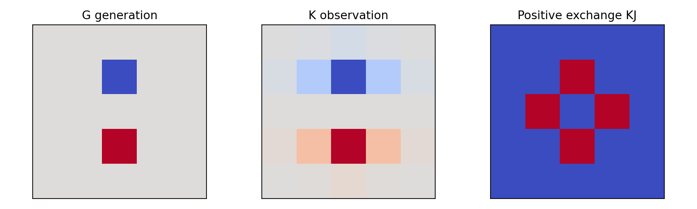
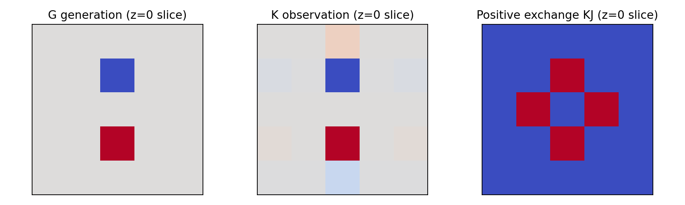
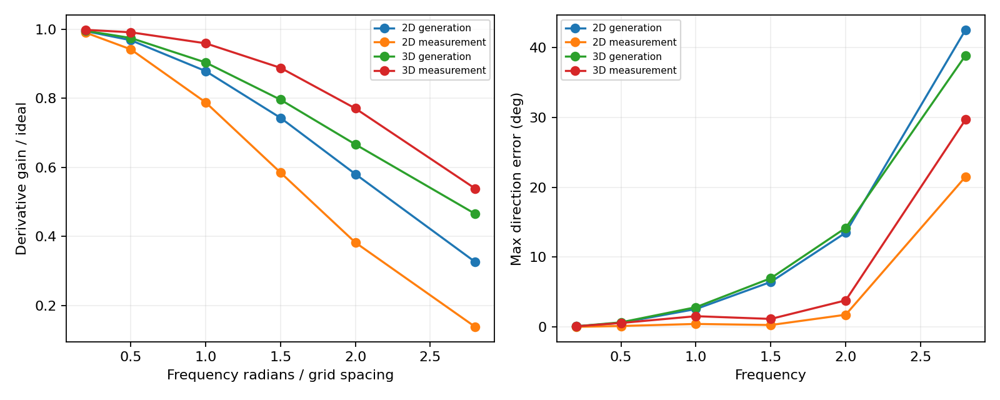

## 5. 관측량과 방향 convention

Bond는 B=sym Σ(HJ⊗v), Qbond=B-tr(B)/d I, direct는 Qdirect=Σ(v⊗v)-Σ|v|²/d I이다. 2D Qbond의 [[T0/2,T1/2],[T1/2,-T0/2]] identity와 principal half-angle 축을 unit test했다. 3D는 대칭 traceless 텐서로 일반화하되 half-angle 스칼라와 동등하다고 하지 않는다.

Gradient tensor는 TG_ij=Σ_x,a(Kobs_i*n_a)(Kobs_j*n_a), geometry=c trace(TG)이다. 이것은 비변분 관측량이며 Hamiltonian energy가 아니다. Ensemble은 각 traceless tensor의 Frobenius norm을 1로 맞춘 후 simplex weights로 합친다. Traceless tensor의 trace로 나누지 않는다. Min/max eigenvector mapping 및 ensemble은 train에서만 정해졌고 validation은 configuration 선택에만 썼다.

연결 elongated stadium/ellipse/capsule/ellipsoid만 방향 GT를 정의했다. 원/구/torus/ring/분리 구형 객체의 전체 장축은 undefined다. 특히 두 원/구 center axis를 local-gradient tensor가 복원한다고 주장하지 않는다. Confidence는 선택 eigenaxis와 이웃 eigenvalue의 gap/eigenvalue norm이며 임계값 .001은 heuristic이다. undefined/miss-rate를 저장하지만 작은 gap 오차를 aggregate에서 몰래 제거하지 않는다.

현재 E0 동일 필드에서 observer-only test (N=30):

|   dim | orientation_variant   |   angle_MAE |   angle_max |   min_Dice |   median_gap |
|------:|:----------------------|------------:|------------:|-----------:|-------------:|
|     2 | bond_max              |     88.77   |     89.88   |     1      |       1.414  |
|     2 | bond_min              |      1.23   |      3.456  |     1      |       1.414  |
|     2 | direct_max            |     88.56   |     89.85   |     1      |       1.414  |
|     2 | direct_min            |      1.445  |      3.949  |     1      |       1.414  |
|     2 | gradient_min          |      0.3322 |      0.5807 |     1      |       1.414  |
|     2 | selected              |      0.3322 |      0.5807 |     1      |       1.414  |
|     3 | bond_max              |     88.5    |     89.56   |     0.7692 |       0.4589 |
|     3 | bond_min              |      1.993  |      4.056  |     0.7692 |       0.9013 |
|     3 | direct_max            |     88.37   |     89.55   |     0.7692 |       0.4663 |
|     3 | direct_min            |      2.158  |      4.274  |     0.7692 |       0.8968 |
|     3 | gradient_min          |      0.4673 |      0.8263 |     0.7692 |       0.8699 |
|     3 | selected              |      0.4673 |      0.8263 |     0.7692 |       0.8699 |

## 6. 통제 ablation, finite-budget 공동 학습과 validation

Stage1: E0+central+EDT 동일 40-step trajectory의 N=5/10/20/30/40에서 observer와 K_obs를 새로 학습했다. Stage2: 같은 N별 K_obs/선택된 방향 관측량을 고정하고 G/KJ/normalization/binary initialization만 바꿨다. 원래 whole-path historical 대조와 이 이식 실험을 혼동하지 않는다.

Stage2 clean N=30 요약(proxy train, 독립 final test가 아님):

|   dim | model                 |   KJ_sum |   MARE |   angle_MAE |   min_Dice |   wall_width |
|------:|:----------------------|---------:|-------:|------------:|-----------:|-------------:|
|     2 | E0_EDT                |    4     | 1.162  |      0.1675 |     1      |       1.28   |
|     2 | E0_binary             |    4     | 1.162  |      0.1675 |     1      |       1.28   |
|     2 | E0_fourth             |    4     | 1.158  |      0.1637 |     1      |       1.287  |
|     2 | E1_central_normalized |    4     | 1.162  |      0.1675 |     1      |       1.28   |
|     2 | E1_central_raw        |    1     | 1.272  |      0.2036 |     1      |     nan      |
|     2 | E1_fourth_normalized  |    4     | 1.153  |      0.164  |     1      |       1.288  |
|     2 | E1_fourth_raw         |    1.806 | 1.252  |      0.1693 |     1      |       1.158  |
|     2 | E2_control            |    4     | 1.206  |      0.1619 |     1      |       1.217  |
|     3 | E0_EDT                |    6     | 0.8334 |      0.2652 |     0.9775 |       1.288  |
|     3 | E0_binary             |    6     | 0.8344 |      0.2651 |     0.9775 |       1.288  |
|     3 | E0_fourth             |    6     | 0.9416 |      0.2704 |     0.9775 |       1.298  |
|     3 | E1_central_normalized |    6     | 0.8334 |      0.2652 |     0.9775 |       1.288  |
|     3 | E1_central_raw        |    1.5   | 0.5325 |      0.5955 |     1      |       0.9653 |
|     3 | E1_fourth_normalized  |    6     | 0.9674 |      0.2695 |     0.9775 |       1.301  |
|     3 | E1_fourth_raw         |    2.708 | 0.5946 |      0.4419 |     1      |       1.061  |
|     3 | E2_control            |    6     | 0.5617 |      0.3135 |     1      |       1.172  |

Stage3: exchange family마다 두 independent LHS random streams, 두 alternating rounds, stream/round당 6개 generator candidate, 총 24개 **evaluation calls**를 동일하게 제공했다. 공통 물리 anchor가 일부 중복하므로 24개의 모두 다른 operator라는 뜻은 아니다. Round A의 best field에서 K_obs와 observer를 다시 학습하고, 그 결과로 Round B의 local G/KJ 탐색을 수행한 후 measurement를 재학습했다. 모든 family의 최종 후보를 동일 full-train/validation 데이터에서 다시 평가했다. E0 observer-only는 별도의 통제군이다.

각 차원·N의 K_obs는 differential evolution 180회 objective evaluation, 동일 bounds와 seed budget이다. 전역 optimizer 수렴을 주장하지 않는 finite-budget 종료다. 각 family에서는 G를 N 사이에 공유하되 관측 kernel/c는 N별로 다시 학습했다. 가능한 모든 G_N를 독립 학습하거나 Cartesian product 전체를 돈 것은 아니다.

비용상 generator search는 사전 선언된 train proxy(각 family의 한 clean 원형, elongated 회전 추가, 1% noisy elongated, 별도 calibration)를 썼다. **최종 full train/validation recheck**에서 proxy가 놓친 작은 물체/각도/노이즈 실패를 다시 검사했다. Geometry objective는 reference-calibrated relative MSE + .05 robust(angle/10)² + 회전 CV²이고, generator 단계는 shape violation에 큰 penalty를 주되 최종 admissibility는 엄격한 hard check다. Proxy 성공은 full-train 성공과 같지 않다.

선택 기준: full train+validation의 모든 clean image Dice>=.995, clean Euler/components 보존, noisy failure 수가 각 noise rate에서 기존 PBGIA-30보다 증가하지 않음, 대표 3D degree/certificate 통과. Feasible 후보 중 geometry MARE+orientation MAE 최소 부근(.1 pp/.1 degree)에서 빠른 고정 N을 택한다. 없으면 strict_feasible=false로 고정하고 production upgrade를 권고하지 않는다. 평균 Dice로 최악값을 숨기지 않았다.

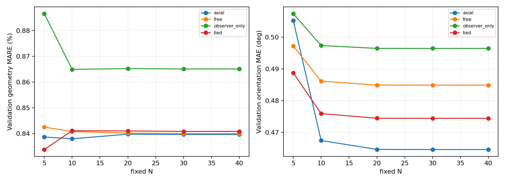
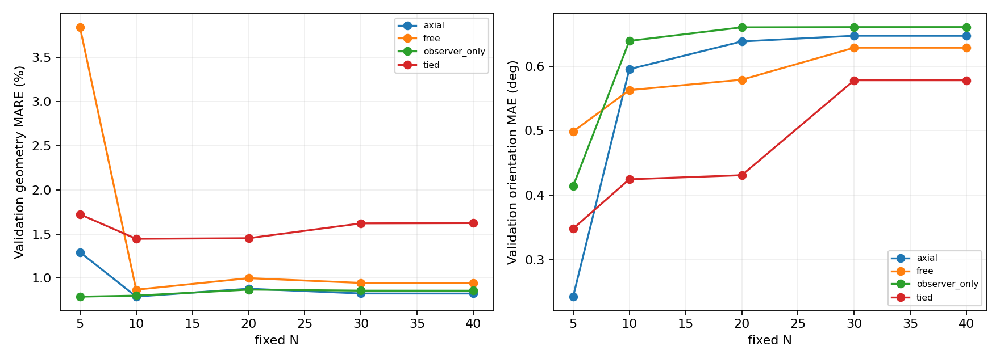
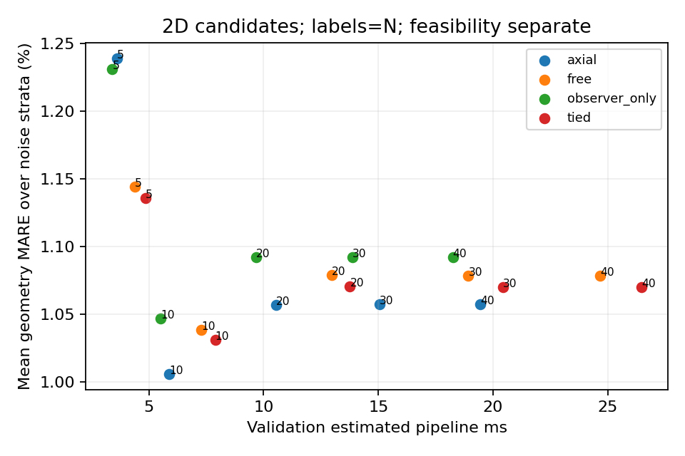
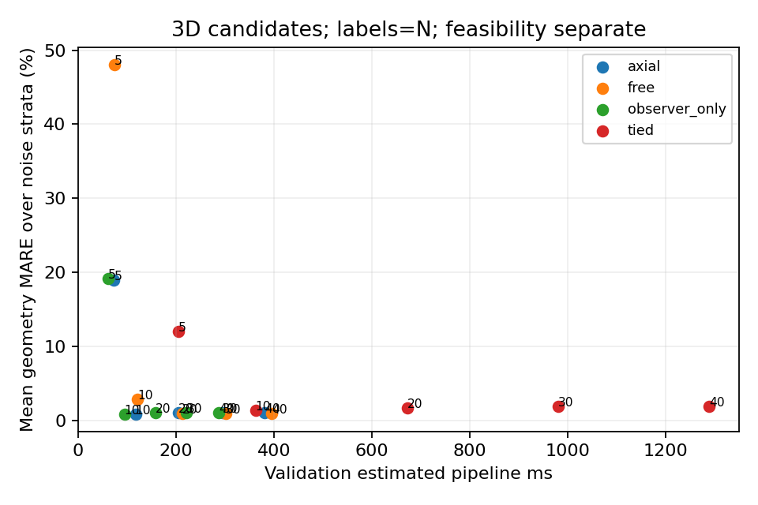

Validation Pareto와 feasibility 전부는 `joint_pareto.csv`에 보관한다. Plot의 빠른 점이 반드시 shape constraint를 통과했다는 뜻이 아니다. 독립 test에서 strict guard를 실패하면 재학습/재선택 없이 배포만 거절하는 acceptance gate를 사전 선언했다. `deployment_gate.json`은 이 판정을 별도로 기록하고 frozen parameter는 바꾸지 않는다. 선택 freeze는 `pretest_selection.json`과 SHA256에 저장했고 `test_audit.json`이 같은 hash를 재확인한다.

## 7. 독립 test: 현재 PBGIA-30 및 conventional/historical 비교

새 test의 frozen candidate vs 기존 PBGIA-30 (clean/noisy 별도, 독립 unit별 동일 가중):

|   dim | model                      |   N |   noise |   n_units |   geometry_MARE |   angle_MAE |   angle_RMSE |   angle_max |   mask_failures |   min_dice |   max_residual |
|------:|:---------------------------|----:|--------:|----------:|----------------:|------------:|-------------:|------------:|----------------:|-----------:|---------------:|
|     2 | PBGIA30_frozen             |  30 |   0     |        10 |          1.073  |      0.3704 |       0.4057 |      0.5753 |               0 |     1      |      8.824e-07 |
|     2 | PBGIA30_frozen             |  30 |   0.002 |        10 |          0.962  |      0.3958 |       0.436  |      0.7516 |               0 |     0.9958 |      1.906e-05 |
|     2 | PBGIA30_frozen             |  30 |   0.01  |        10 |          0.8742 |      0.3984 |       0.4817 |      0.965  |               5 |     0.9833 |      0.001195  |
|     2 | PBGIA30_train_recalibrated |  30 |   0     |        10 |          1.159  |      0.3704 |       0.4057 |      0.5753 |               0 |     1      |      8.824e-07 |
|     2 | PBGIA30_train_recalibrated |  30 |   0.002 |        10 |          1.331  |      0.3958 |       0.436  |      0.7516 |               0 |     0.9958 |      1.906e-05 |
|     2 | PBGIA30_train_recalibrated |  30 |   0.01  |        10 |          1.554  |      0.3984 |       0.4817 |      0.965  |               5 |     0.9833 |      0.001195  |
|     2 | joint_selected             |  10 |   0     |        10 |          1.184  |      0.3319 |       0.3701 |      0.5824 |               0 |     1      |      0.001018  |
|     2 | joint_selected             |  10 |   0.002 |        10 |          1.346  |      0.3638 |       0.4158 |      0.7645 |               0 |     0.9958 |      0.001615  |
|     2 | joint_selected             |  10 |   0.01  |        10 |          1.493  |      0.3801 |       0.4678 |      0.9289 |               5 |     0.9833 |      0.007193  |
|     3 | PBGIA30_frozen             |  30 |   0     |        12 |          0.9655 |      0.4118 |       0.4641 |      0.8398 |               2 |     0.7692 |      2.591e-05 |
|     3 | PBGIA30_frozen             |  30 |   0.002 |        12 |          0.9753 |      0.4633 |       0.5009 |      0.8779 |               2 |     0.7692 |      2.693e-05 |
|     3 | PBGIA30_frozen             |  30 |   0.01  |        12 |          0.7225 |      0.4242 |       0.4566 |      0.6541 |               4 |     0.7692 |      3.108e-05 |
|     3 | PBGIA30_train_recalibrated |  30 |   0     |        12 |          0.815  |      0.4118 |       0.4641 |      0.8398 |               2 |     0.7692 |      2.591e-05 |
|     3 | PBGIA30_train_recalibrated |  30 |   0.002 |        12 |          0.9903 |      0.4633 |       0.5009 |      0.8779 |               2 |     0.7692 |      2.693e-05 |
|     3 | PBGIA30_train_recalibrated |  30 |   0.01  |        12 |          1.263  |      0.4242 |       0.4566 |      0.6541 |               4 |     0.7692 |      3.108e-05 |
|     3 | joint_selected             |  10 |   0     |        12 |          1.012  |      0.4323 |       0.4802 |      0.8268 |               2 |     0.8696 |      0.002397  |
|     3 | joint_selected             |  10 |   0.002 |        12 |          0.8293 |      0.4274 |       0.4816 |      0.8295 |               2 |     0.8696 |      0.002845  |
|     3 | joint_selected             |  10 |   0.01  |        12 |          0.6663 |      0.4016 |       0.4379 |      0.6286 |               4 |     0.8293 |      0.00345   |

원형 unit cluster bootstrap paired 비교(candidate−PBGIA30):

|   dim |   noise | heldout_family   | metric                |      mean |   CI95_low |   CI95_high |   independent_units |
|------:|--------:|:-----------------|:----------------------|----------:|-----------:|------------:|--------------------:|
|     2 |   0     | False            | geometry_delta_pp     |  0.4195   |  0.1182    |   0.7642    |                   8 |
|     2 |   0     | False            | orientation_delta_deg | -0.03848  | -0.05467   |  -0.02024   |                   4 |
|     2 |   0     | False            | dice_delta            |  0        |  0         |   0         |                   8 |
|     2 |   0     | True             | geometry_delta_pp     | -1.124    | -1.319     |  -0.9293    |                   2 |
|     2 |   0     | True             | dice_delta            |  0        |  0         |   0         |                   2 |
|     2 |   0.002 | False            | geometry_delta_pp     |  0.7288   |  0.4751    |   1.024     |                   8 |
|     2 |   0.002 | False            | orientation_delta_deg | -0.03197  | -0.05629   |  -0.01107   |                   4 |
|     2 |   0.002 | False            | dice_delta            |  0        |  0         |   0         |                   8 |
|     2 |   0.002 | True             | geometry_delta_pp     | -0.9976   | -1.314     |  -0.681     |                   2 |
|     2 |   0.002 | True             | dice_delta            |  0        |  0         |   0         |                   2 |
|     2 |   0.01  | False            | geometry_delta_pp     |  0.9511   |  0.7181    |   1.144     |                   8 |
|     2 |   0.01  | False            | orientation_delta_deg | -0.01829  | -0.04765   |   0.01802   |                   4 |
|     2 |   0.01  | False            | dice_delta            |  0        |  0         |   0         |                   8 |
|     2 |   0.01  | True             | geometry_delta_pp     | -0.708    | -1.243     |  -0.1734    |                   2 |
|     2 |   0.01  | True             | dice_delta            |  0        |  0         |   0         |                   2 |
|     3 |   0     | False            | geometry_delta_pp     |  0.1882   | -0.2879    |   0.7178    |                  10 |
|     3 |   0     | False            | orientation_delta_deg |  0.03174  | -0.08682   |   0.1503    |                   2 |
|     3 |   0     | False            | dice_delta            |  0.009668 |  0         |   0.029     |                  10 |
|     3 |   0     | True             | geometry_delta_pp     | -0.6598   | -0.9175    |  -0.4021    |                   2 |
|     3 |   0     | True             | orientation_delta_deg |  0.009116 | -0.01119   |   0.02942   |                   2 |
|     3 |   0     | True             | dice_delta            |  0        |  0         |   0         |                   2 |
|     3 |   0.002 | False            | geometry_delta_pp     | -0.07173  | -0.3059    |   0.1425    |                  10 |
|     3 |   0.002 | False            | orientation_delta_deg | -0.03539  | -0.2134    |   0.1427    |                   2 |
|     3 |   0.002 | False            | dice_delta            |  0.009653 | -4.583e-05 |   0.029     |                  10 |
|     3 |   0.002 | True             | geometry_delta_pp     | -0.517    | -0.6535    |  -0.3804    |                   2 |
|     3 |   0.002 | True             | orientation_delta_deg | -0.03643  | -0.03688   |  -0.03598   |                   2 |
|     3 |   0.002 | True             | dice_delta            |  0        |  0         |   0         |                   2 |
|     3 |   0.01  | False            | geometry_delta_pp     | -0.06099  | -0.17      |   0.04021   |                  10 |
|     3 |   0.01  | False            | orientation_delta_deg | -0.0346   | -0.2213    |   0.1521    |                   2 |
|     3 |   0.01  | False            | dice_delta            |  0.006907 | -0.000118  |   0.02085   |                  10 |
|     3 |   0.01  | True             | geometry_delta_pp     | -0.0326   | -0.05928   |  -0.005915  |                   2 |
|     3 |   0.01  | True             | orientation_delta_deg | -0.01067  | -0.02197   |   0.0006198 |                   2 |
|     3 |   0.01  | True             | dice_delta            | -0.000179 | -0.000255  |  -0.0001031 |                   2 |

원형을 3,000회 재표본화하고 그 원형의 rotation/shift/noise 파생 영상을 묶었다. Held-out family는 별도 표시한다. Family당 test 원형이 두 개이고 전체 test unit도 작으므로 descriptive uncertainty이며 일반적 우월성이나 유의확률 검정의 대체가 아니다.

Test별 geometry/angle/fidelity 상세는 `test_results.csv`, family-held-out/novel-scale 결과는 `test_family_summary.csv`에 있다. 하위집단 실패를 전체 평균으로 덮지 않는다.

Conventional clean test:

|   dim | method                           | calibrated   |   geometry_MARE |   angle_MAE |     p95 |   median_seconds |
|------:|:---------------------------------|:-------------|----------------:|------------:|--------:|-----------------:|
|     2 | Crofton                          | False        |          0.8983 |      0.2725 |   2.787 |        0.0002003 |
|     2 | Crofton                          | True         |          2.005  |      0.2725 |   4.146 |        0.0002003 |
|     2 | Gaussian1_gradient_ST            | False        |          1.149  |      0.4384 |   4.156 |        0.0002863 |
|     2 | Gaussian1_gradient_ST            | True         |          1.428  |      0.4384 |   4.471 |        0.0002863 |
|     2 | Gaussian1_threshold_marching_PCA | False        |          4.588  |      0.2791 |   6.01  |        0.0001645 |
|     2 | Gaussian1_threshold_marching_PCA | True         |          2.231  |      0.2791 |   4.762 |        0.0001645 |
|     2 | binary_PCA                       | False        |        nan      |      0.2725 | nan     |        7.041e-05 |
|     2 | marching_squares                 | False        |          4.83   |      0.2725 |   6.231 |        0.0001907 |
|     2 | marching_squares                 | True         |          2.005  |      0.2725 |   4.146 |        0.0001907 |
|     3 | Gaussian1_gradient_ST            | False        |          5.981  |      0.7909 |  23.86  |        0.00489   |
|     3 | Gaussian1_gradient_ST            | True         |          3.813  |      0.7909 |  21.69  |        0.00489   |
|     3 | Gaussian1_threshold_marching_PCA | False        |         10.93   |      0.2012 |  61.59  |        0.001848  |
|     3 | Gaussian1_threshold_marching_PCA | True         |          9.069  |      0.2012 |  63.23  |        0.001848  |
|     3 | binary_PCA                       | False        |        nan      |      0.2111 | nan     |        0.0003683 |
|     3 | marching_cubes_surface_tensor    | False        |          7.19   |      1.501  |   8.668 |        0.002015  |
|     3 | marching_cubes_surface_tensor    | True         |          1.221  |      1.501  |   2.982 |        0.002015  |
|     3 | voxel_faces                      | False        |         48.4    |      0.2111 |  52.15  |        0.0004698 |
|     3 | voxel_faces                      | True         |          1.562  |      0.2111 |   4.568 |        0.0004698 |

Raw와 train-reference calibrated 결과를 모두 공개한다. Crofton/marching squares 행의 방향은 binary PCA이며 둘레 알고리즘 자체 방향이 아니다. 3D marching cubes의 방향은 surface-normal tensor다. Gaussian sigma=1은 사전 고정이며 test tuning하지 않았다. PCA 단독에는 임의 geometry 측정값을 부여하지 않는다. Calibration을 candidate에만 유리하게 제공하지 않았다. 선택된 2D observer는 gradient이고 3D 실험용 ensemble도 weight=[1,0,0]으로 pure gradient에 퇴화했다. 이 선택에서 bond/direct 혼합의 독립적 이득은 입증되지 않았다.

별도 historical Texture 5-step path(2D):

|   noise |   MARE |   angle_MAE |   mean_Dice |   min_Dice |   seconds |
|--------:|-------:|------------:|------------:|-----------:|----------:|
|   0     |  19.25 |      0.267  |      0.9948 |     0.9748 |   0.01174 |
|   0.002 |  19.23 |      0.2381 |      0.9937 |     0.9652 |   0.01164 |
|   0.01  |  19.3  |      0.2395 |      0.9923 |     0.9697 |   0.01168 |

같은 dataset에서 original full path가 각도에 유리해도 binary erosion과 unnormalized exchange amplitude, h=1, stale-HJ 차이를 함께 해석해야 한다. 원래 451장 회전본을 451개 독립 형상으로 세지 않았다.

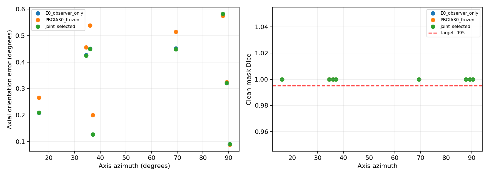
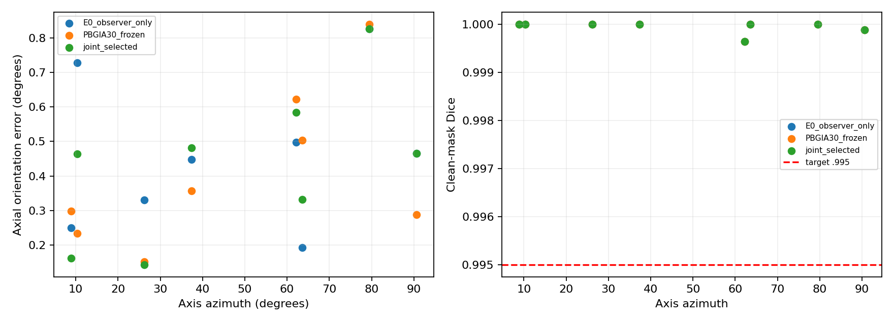
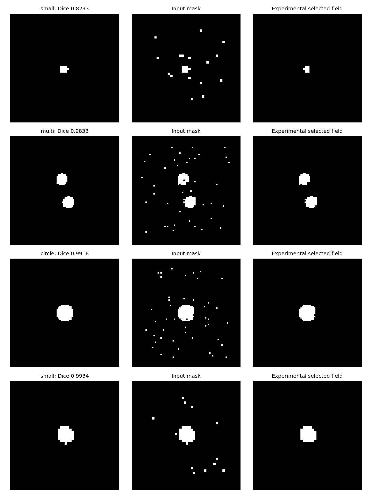

## 8. 비용·잔차·벽·topology·transfer

배포 timing은 대표 clean test family별 warmup 뒤 세 번 반복했다. 초기화/field/observation을 따로 측정하고 GPU는 사용하지 않았다. `experimental=true`는 진단 후보, false는 허용된 production 경로다. explicit_PBGIA30을 별도로 측정하여 fallback과 잘못 비교하지 않는다. 여기 total은 디스크 저장, synthetic GT 생성, training, bootstrap, degree audit를 제외한다.

|   dim | mode             | experimental   |   N |   initialization_seconds |   field_seconds |   measurement_seconds |   total_seconds |
|------:|:-----------------|:---------------|----:|-------------------------:|----------------:|----------------------:|----------------:|
|     2 | explicit_PBGIA30 | False          |  30 |                0.0008268 |        0.01236  |             0.0005076 |        0.01389  |
|     2 | joint_candidate  | False          |  10 |                0.0007884 |        0.004063 |             0.000509  |        0.005403 |
|     2 | joint_candidate  | True           |  10 |                0.0008581 |        0.004148 |             0.0004903 |        0.005626 |
|     3 | PBGIA30_fallback | False          |  30 |                0.02085   |        0.2193   |             0.01474   |        0.2543   |
|     3 | explicit_PBGIA30 | False          |  30 |                0.01922   |        0.2042   |             0.01472   |        0.24     |
|     3 | joint_candidate  | True           |  10 |                0.01985   |        0.06963  |             0.01489   |        0.1036   |

Training expense ledger는 wrapped rollout/diagnostic 및 요청된 feature 계산의 walltime이다. Observer 재학습 중의 추가 basis/optimizer 비용까지 포함한 전체 단계 walltime은 `stage_timings.json`, peak process RSS는 환경 파일에 있다. 이번 재시작 실행에서는 첫 validation import 시 비용 ledger 초기화 버그로 학습 단계 상세 160행이 덮여쓰였다. 학습 총 wall-clock은 stage_timings.json에 보존되며 숫자/커널/실험 상태에는 영향이 없다. 누락된 비용을 이전 실행 값이나 추정값으로 채우지 않았다. 코드는 append 방식으로 수정했으며 expense_logging_note.json에 기록했다. Operation family마다 한 eval의 비용이 다르므로 equal-evaluation budget을 equal-wall-time budget으로 주장하지 않는다. Main fixed-N trajectory는 40회 한 번에서 다섯 state를 읽고, diagnostics용 next-map은 state를 바꾸지 않는다. Observer 재학습으로 rollout을 다시 수행한 경우 ledger에 별도 기록했다. Deployment는 선택된 한 N만 정확히 실행하고 adaptive stop이 없다.

1-step RMS, max local change, 2-step residual을 따로 기록했다. 작은 2-step만으로 cycle을 수렴으로 오인하지 않는다. 한정된 N=40 이후 장기 안정성을 이 연구가 새로 입증한 것은 아니다. `field_conditioning.csv`에는 H의 최솟값과 near-zero count, wall voxel fraction, signed inward-normal cosine, v·grad(s) alignment, unit error가 있다. Profile width는 |s|<.7,|v|>.04 집합의 coarea proxy로 측정했고 sqrt(2A/h)를 그대로 쓰지 않았다. Underresolved wall flag도 heuristic으로 공개한다.

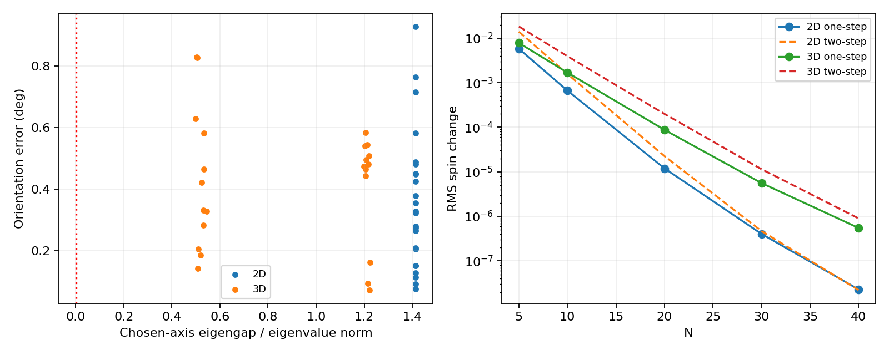
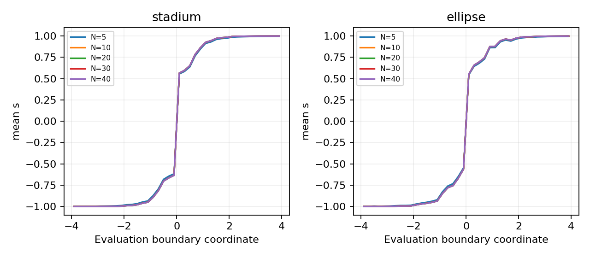
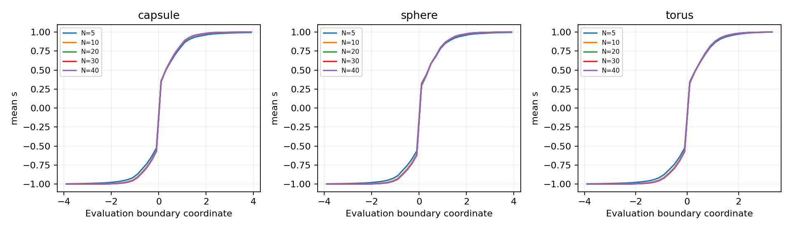

대표 3D topology audit (final test):

| model            | family   |   N |   degree | target_agreement   |   hemisphere_min_dot |   negative_collar_max_s | nonvanishing_certified   | degree_certified   |
|:-----------------|:---------|----:|---------:|:-------------------|---------------------:|------------------------:|:-------------------------|:-------------------|
| joint_selected   | sphere   |  10 |        1 | True               |               0.3179 |                 -1      | True                     | True               |
| joint_selected   | capsule  |  10 |        1 | True               |               0.3363 |                 -1      | True                     | True               |
| joint_selected   | torus    |  10 |        0 | True               |               0.2393 |                 -0.9999 | True                     | True               |
| E0_observer_only | sphere   |  30 |        1 | True               |               0.2397 |                 -1      | True                     | True               |
| E0_observer_only | capsule  |  30 |        1 | True               |               0.2509 |                 -1      | True                     | True               |
| E0_observer_only | torus    |  30 |        0 | True               |               0.1686 |                 -1      | True                     | True               |

Exterior 3-voxel collar를 negative s 범위에서 south pole로 compactify하고 6-way Freudenthal tetrahedron마다 vertex-sum open-hemisphere sufficient certificate를 검사했다. 3개 generic targets의 preimage integer를 비교했다. Certificate가 실패하면 비특이성 미인증으로 표시하며 target agreement만으로 유효 정수 degree라고 보증하지 않는다. 이는 디지털 Euler와 별개이며 대표 세 fixture 성공을 전체 데이터의 topology 보증으로 확대하지 않는다.

학습 Kobs/observer/G/KJ를 고정하고 h=4,D=1 및 h=2,D=.5에서 train reference c만 재보정한 transfer:

|   dim |   h |   D |   MARE |   angle_MAE |   min_Dice |   unresolved |
|------:|----:|----:|-------:|------------:|-----------:|-------------:|
|     2 |   2 | 0.5 |  1.29  |      0.4157 |     1      |            0 |
|     2 |   4 | 1   |  1.377 |      0.3196 |     1      |            5 |
|     3 |   2 | 0.5 |  2.73  |      0.4354 |     0.8837 |            0 |
|     3 |   4 | 1   |  2.216 |      0.845  |     1      |            1 |

이 transfer는 각 test 원형의 한 clean 회전만 사용했다. Parameter 범위 전반의 강건성 검증이 아니다. `margin_check.csv`는 같은 spacing=1에서 torus domain 48³/64³/80³를 비교했다. 이것은 domain-margin 진단이며 grid refinement/continuum convergence가 아니다. 시간 예산상 본 joint study에서 별도 physical-grid refinement는 하지 않았다.

## 9. 재현·한계·후속 작업

`python run_all.py --fresh`로 smoke/tests → source correctness → observer/controlled/joint training → full train/validation → freeze → independent test → diagnostics/report를 재현한다. 큰 checkpoint는 PR에 넣지 않지만 대표 NPZ와 모든 generator/config/seed/key로 재계산 가능하다. `vendor`는 pinned baseline provenance이고 새학습은 그 numerical coefficient를 초기값으로 복사하지 않는다. Original Colab coefficients는 historical control에서만 사용했다.

CLI:

```bash
python code/infer_joint.py mask.npy --out prediction.json
python code/infer_joint.py mask.npy --experimental --out experimental.json
```

표준 경로는 validation recommended 플래그를 따른다. 출력 confidence는 calibrated 확률이 아니며 input Dice로 clean GT topology를 증명하지 않는다. 원/구/분리된 둥근 물체에 축이 있다고 억지로 주장하지 않는다.

제약/실패: 작은 물체와 고곡률이 strict minimum Dice 목표를 어렵게 하고, noisy 잔차가 geometry가 좋아도 남을 수 있다. G와 KJ의 결합이 orientation을 개선해도 mask erosion/벽 conditioning을 악화시킬 수 있다. Free positive kernel의 self-mass는 수치 map을 바꾸며 높은 self-mass는 salt noise를 고정할 위험이 있다. 현재 유한 예산/좁은 separable family/작은 proxy에서 찾지 못한 것은 해의 비존재 증명이 아니다. Bounds에 걸린 해를 global optimal이라고 하지 않는다.

향후 연구는 제약을 명시적으로 새 protocol에서 재설정하거나, seed/scale을 늘린 nested validation, 더 풍부한 kernel orbit family, eigengap-calibrated ensemble, realistic noise/gray/RGB, physical-grid scaling을 검증해야 한다. 이번 final test를 다음 training set으로 전용하고 같은 점수를 독립 test라고 다시 부르면 안 된다. 학습이 PBGIA-30이나 Crofton/PCA보다 나쁘면 이 표의 실제 결과를 그대로 따른다. 새로움/보편성/BPS/정확한 DMI/SO(3) 불변성 주장은 하지 않는다.

## 10. Freeze 이후의 validation-only 보간 진단 (선택/테스트 재조정 없음)

3D free 후보의 full-train/validation 최소 clean Dice는 약 .99845로 .995 목표를 통과했으며, degree targets도 (sphere,capsule,torus)=(1,1,0)에 일치했다. 최초 충분조건인 vertex-sum open-hemisphere 검사만 실패했기 때문에 이를 실제 topology 붕괴라고 해석하면 안 된다. 이 점을 분리하기 위해 **이미 사용한 validation 대표 필드에만** 추가 진단을 실행했다. 미인증 tetrahedron마다 모든 active face를 열거하고 convex hull의 원점까지 최소 거리를 수치 계산했다. 나머지는 기존 hemisphere lower bound를 사용했다.

| family   |   N |   interpolation_norm_lower_bound | refined_nonvanishing   |
|:---------|----:|---------------------------------:|:-----------------------|
| sphere   |   5 |                        0.09431   | True                   |
| sphere   |  10 |                        0.002294  | True                   |
| sphere   |  20 |                        0.0004891 | True                   |
| sphere   |  30 |                        0.0006699 | True                   |
| sphere   |  40 |                        0.0005994 | True                   |
| capsule  |   5 |                        0.1022    | True                   |
| capsule  |  10 |                        5.182e-05 | True                   |
| capsule  |  20 |                        0.00312   | True                   |
| capsule  |  30 |                        0.001879  | True                   |
| capsule  |  40 |                        0.001821  | True                   |
| torus    |   5 |                        0.08329   | True                   |
| torus    |  10 |                        0.0008865 | True                   |
| torus    |  20 |                        2.984e-05 | True                   |
| torus    |  30 |                        0.000134  | True                   |
| torus    |  40 |                        9.202e-05 | True                   |

이 15개 validation checkpoint는 정밀 진단에서 양의 보간 norm lower bound를 보였다. 가장 작은 값은 수만분의 일 수준으로 conditioning이 약한 사례도 있다. 이는 최초 인증 방식이 보수적이었음을 보여 주며, 이번 free 후보의 위상이 실제로 손상됐다는 결론을 지지하지 않는다. 그러나 최종 test를 이미 본 뒤이므로 이 추가 진단을 이용해 free 후보를 다시 선택하거나 같은 test에서 새 성능을 계산하지 않았다. Frozen JSON/hash, deployment gate와 test score는 그대로 유지했다. 더 강한 인증을 selection에 쓰려면 별도 사전 protocol과 새로운 독립 holdout이 필요하다. 수치 active-face 결과는 interval-arithmetic 증명이나 모든 iteration의 연속 경로 인증이 아니다.
