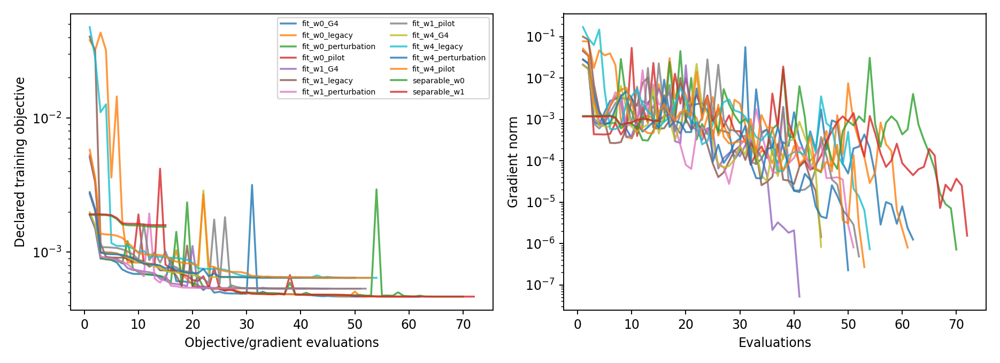
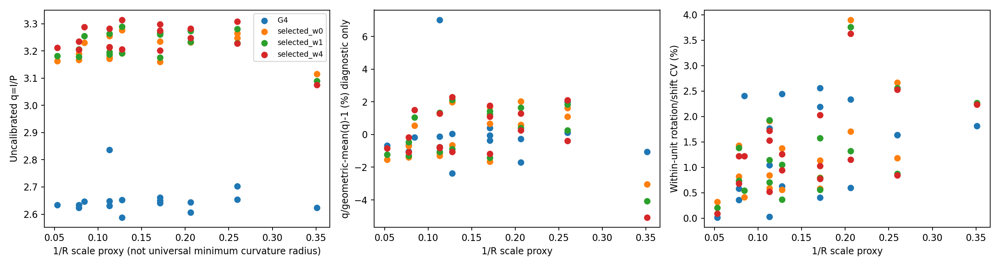
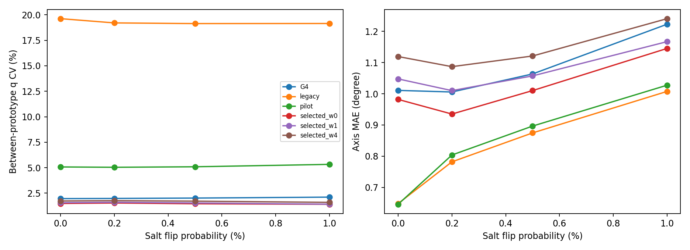
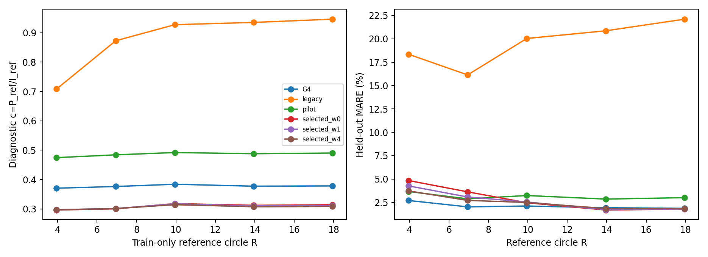
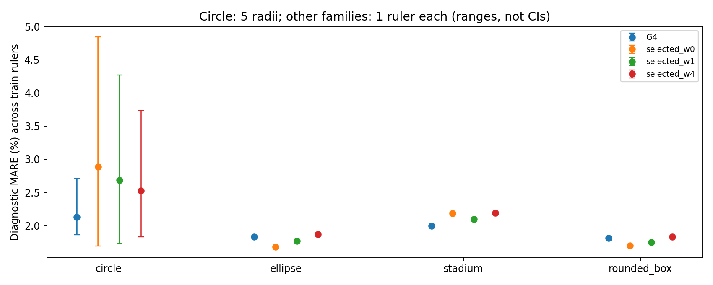
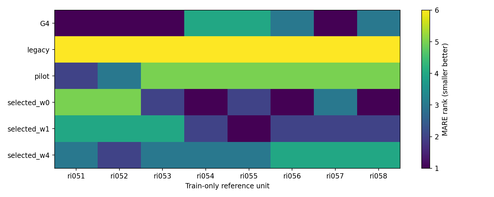
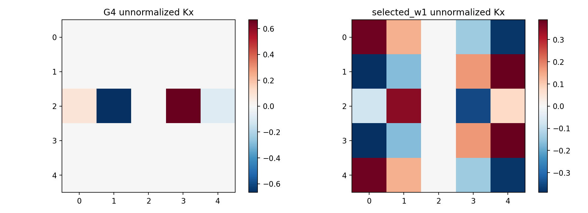
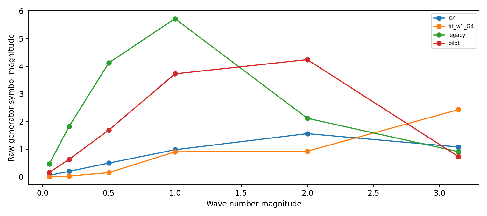
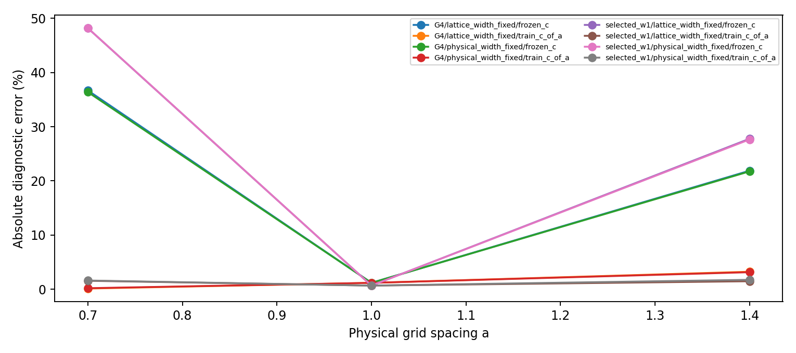

# 기준자 독립적 PBGIA 생성 커널 최적화: 실제 2D 연구와 검증된 3D 부분 구현

## 1. 결과와 연구 범위

**주 실험은2D에서 완료했다.3D는12orbit 커널 및 미분 수치 검증만 완료했으며,3D 최적화·독립 표면적 시험 결과는 없다.** 새로운 branch/directory에서 원본과 과거 결과를 바꾸지 않고 실행했다. 기준 원 하나의 보정 MARE를 학습하지 않았다. 모든 주 arm은 NN 교환합4,고정 G4 관측자,N10,같은 EDT 초기화,J1,D1,h2를 공유하며 **생성 미분6계수만** 바뀐다.

- selected_w0: test CV(q) 1.48873% (G4 1.96451%), log-q std 0.0149188 (G4 0.0191808), 각도 MAE 0.98202° (G4 1.01090°).
- selected_w1: test CV(q) 1.56556% (G4 1.96451%), log-q std 0.0157534 (G4 0.0191808), 각도 MAE 1.04775° (G4 1.01090°).
- selected_w4: test CV(q) 1.73447% (G4 1.96451%), log-q std 0.0175281 (G4 0.0191808), 각도 MAE 1.11942° (G4 1.01090°).

Noise-weight1의 q-CV 차이는−0.39895pp이지만 원형 bootstrap95% 구간[−1.72717,+1.21215]가0을 포함한다. **학습·validation에서의 q분산 감소와 달리,보편적인 기준자 독립성이 확립됐다고 결론내릴 수 없다.** Clean reference c의CV는G4의1.0422%에서학습모델1.9187%로 커졌고,참조중최악MARE는2.7066%→4.2698%로 악화됐다.1% noise의paired RMS(log I change)도0.006347→0.010990으로 악화됐다. Noise를 넣은 후 q-CV가 내려가는 현상은 원형별 오차 상쇄일 수 있으므로 이를 곧바로 noise robustness 향상으로 해석하지 않는다. Noise-weight4는학습모델내paired드리프트를줄였지만G4보다좋지는않았다.

이는 기준자 선택과 무관한 같은 신규 test의 직접 비교다. 개선 여부는 아래 train/validation/test 표와 paired 원형 bootstrap으로 판단한다. c 또는 최저 test MARE를 주는 원을 골라 이 결론을 만들지 않았다. 원형17개는 일반적인 영상 모집단을 대표하는 대규모 외부 검증이 아니며 null/negative 항목은 그대로 남긴다.

동결한 구성:

| preset       | source_model   |   N | coefficients                                                                                                                      |        m1 |   validation_objective |
|:-------------|:---------------|----:|:----------------------------------------------------------------------------------------------------------------------------------|----------:|-----------------------:|
| G4           | G4             |  10 | [0.6666666666666666, -0.08333333333333333, 0.0, 0.0, 0.0, 0.0]                                                                    |  1        |           nan          |
| legacy       | legacy         |  10 | [1.0, 0.57063894, 0.30414468, 0.33693168, 0.09205035, 0.08973684]                                                                 |  9.2807   |           nan          |
| pilot        | pilot          |  10 | [0.997721901, 0.262736838, 0.618148076, -0.053713896, 0.265501073, -0.378951811]                                                  |  3.1197   |           nan          |
| selected_w0  | fit_w0_G4      |  10 | [-0.755605291219975, 0.38541903749792716, 0.40407035980134676, 0.32089852747926245, -0.3462389957225271, -0.35087014352638374]    |  0.022018 |             0.00084498 |
| selected_w1  | fit_w1_G4      |  10 | [-0.3520673213838355, 0.07733562036507274, 0.16897191863014602, 0.38887316090283824, -0.1380434281887045, -0.3768950632141792]    | -0.17525  |             0.00085123 |
| selected_w4  | fit_w4_G4      |  10 | [0.15270942052221867, -0.28837801698822413, -0.09419035043942879, 0.5361329719756291, -0.024526185277010448, -0.4017852469175847] | -0.24818  |             0.00097793 |
| selected_N   | fit_w1_G4      |  10 | [-0.3520673213838355, 0.07733562036507274, 0.16897191863014602, 0.38887316090283824, -0.1380434281887045, -0.3768950632141792]    | -0.17525  |           nan          |
| G4_matched_N | G4             |  10 | [0.6666666666666666, -0.08333333333333333, 0.0, 0.0, 0.0, 0.0]                                                                    |  1        |           nan          |

N10의 세 noise 설정을 주 결과로 보고, 별도 selected_N은 validation의 N5/10/20/30 민감도다. G4_matched_N은 그 구성의 동일 반복수 대조다. 서로 다른 N의 결과를 생성 커널만의 인과 효과로 해석하지 않는다. 동일 source/p/N의 preset 중복을 독립 복제로 세지 않았다.

## 2. 실제 원본과 이전 결과 검토

실제 참조 branch `codex/generator-first-20261116`의 commit `54287cdc0b1e4ce3fefecb2df42467c190985355`에서 operators/engine/study/observer/data/runner/report/test_summary/pretest_selection의 byte hash를 확인했다. Source review JSON에 경로/크기가 있다. 기존 joint/fixed numerical 함수 및 Colab도 확인했으며 screening 정책은 새 실행 경로에 가져오지 않았다. 과거 pilot 코드/비교 CSV/noise/optimizers/selection과 radius sensitivity는 history only로 읽었다.

첨부 원본 TextureFilterTrain5.ipynb 저장 출력:3×3 k11≈.30414468, successTrue,nit6,nfev18;5×5 k20≈.57063894,k21≈.33693168,k22≈.08973684,k12≈.09205035,successTrue,nit19,nfev115. Notebook cell31/38의 저장 출력을 `notebook_saved_outputs.json`에 추출했다. 이것은 이번 실행에서 원본451회전 최적화를 다시 수행한 결과가 아니다.5×5 matrix 배치(cell37/39)를 명시적으로 검사했다. 원본 convolve2d의 Kx 부호는 본 correlation Kx의 반대다. k12와 k21의 위치를 바꾸지 않았으며 unit ramp/transpose/convolve 대조로 검증했다. 파일럿은 단일 원 r10.3 보정에 기반하고 두 run 모두16회 반복 상한이므로 신규 독립 test나 수렴 인증으로 사용하지 않았다. 과거 radius sensitivity에서G4의 MARE는1.192–1.621%,learned5는0.542–1.815%였고,c범위는각각0.374422–0.381067와0.479120–0.491269였다. 이는과거동일test에서표준자변경이측정순위해석을바꿀수있음을보여주지만,아래새test의수치와직접합치지않는다.

## 3. 데이터·동역학·차분과 정확한 미분

| split      | role      |   prototypes |   images |
|:-----------|:----------|-------------:|---------:|
| test       | geometry  |           17 |      408 |
| train      | geometry  |           17 |      408 |
| train      | reference |            8 |        8 |
| validation | geometry  |           17 |      408 |

Train/validation/test는 각각17개의 **서로 다른 continuous prototype**이다. 각 split에 원5크기,ellipse/stadium/rounded_box/ring/pair/peanut 각2크기·파라미터를 분산했다. Train-only 참조는 별도8개(원5반지름,타원/스타디움/rounded_box 각1)다. 모든 prototype의3회전×2독립shift×noise0/.002/.005/.01=24파생 영상을 같은 split에 둔다. Seed=17112647. 이전 fixed/joint/generator_first/geometry_only manifest 및 첨부 pilot test_specs/radius 목록을 읽고 새 prototype과 분리했다. old manifest 사본도 포함하므로 외부 환경에서 같은 검사를 재현할 수 있다. 같은 family 안의 파라미터 외삽이며 새로운 미지 family만의 검증은 아니다.

훈련 proxy는 train17원형 모두의 crossed two pose(rotation0/shift0,rotation1/shift1)다. Full validation/test의6pose와 다르며 회전 sampling이 제한된다. Noise training은4확률을 paired로 포함한다. 동일 uniform 난수장의 threshold를 사용해 오염이 nested되며, 서로 독립인 noise realization4개라고 세지 않는다. 잡음은7픽셀 collar 안쪽에 넣었다. GT는 **잡음 주입 전 연속 원형의 둘레**다. 염점이 실제 신호인지 보편적으로 판단하는 실험은 아니다.

원/타원/스타디움/ring/두 분리 원/두 원 union/rounded rectangle의 analytic boundary 또는 완전타원적분을 썼다. Peanut은 원호 노출 길이4R(π−acos(separation/(2R)))이며 타원으로 근사하지 않았다. rounded rectangle의 반장축a,b와 corner r의 둘레는4(a+b−2r)+2πr다. 일반 mask 고유의 진짜 둘레가 있다고 주장하지 않는다. test_by_curvature의1/R은 **scale proxy**이며 ellipse의 최소 곡률반경이나 peanut 교차점의 비매끄러움을 모두 나타내는 값이 아니다.

매 단계 H_v=NN(v)+G(phi)*s, H_s=NN(s)+2f, n=H/||H||. f불변, 현재 s의 동적 미분, synchronous exchange, periodic, norm≤1e−12이면 이전 상태를 유지한다. div(v)/grad(f)/Laplacian 대체는 없다. 기본 초기화는 이진 EDT/tanh width2.3 lattice이며 continuous GT distance는 유출하지 않았다.

6계수 순서는[w01,w02,w11,w12,w21,w22],x방향 홀수/y방향 짝수,Ky=Kx.T. **G4=[2/3,−1/12,0,0,0,0]를 정확히 포함한다.** 계수 bounds[−1.5,1.5] 이외에 gain/1차 moment/Σ|K| 정규화는 없다. vector 성분은 배열 row/column 순서이며 tensor 최소 고유축의 half-angle convention을 검사했다. 원/ring/pair에는 방향 GT를 부여하지 않고 ellipse/stadium/rounded_box/peanut만 평가했다. 작은 예측 gap은 CSV로 기록하며 낮은 confidence라는 이유로 사례를 제거하지 않는다.

PyTorch double precision reverse-mode autodiff + SciPy L-BFGS-B를 사용했다. 메모리 제한을 위해 chunk8의 forward I/theta를 저장하고, 작은 outer loss의 ∂L/∂I,∂L/∂theta를 구한 다음 각 chunk에서 정확한 chain rule을 역전파했다. 이는 approximation/minibatch stochastic objective가 아니다. 별도 NumPy forward-mode 정확 Jacobian과 tiny finite difference,PyTorch 직접 graph를 비교했다. 정규화의 도함수는(I−nnᵀ)dH/||H||,zero-H 분기는 이전 상태의 도함수다. Branch 경계/고유축 퇴화에서는 고전적 smoothness를 보장하지 않는다. I≤1e−14 또는 비유한 도함수는 수치 실패이지 geometry penalty가 아니다.

## 4. 기준자 없는 목적·예산·실제 최적화 종료

Clean 원형 평균q의 log variance + clean 원형 내부I의CV² +0.0001×mean((axis angle/1°)²) +w_noise×paired(log I_noisy−log I_clean)². 각 원형은 같은 가중치다. θ항은 orientation-defined 원형만 포함한다. w_noise=0,1,4를 validation 전에 선언했고 각각 네 시작값(G4,legacy,pilot,seeded perturbation)을 독립 학습했다. Clean-only는 noisy input을 전혀 읽지 않는다. **선택한 reference circle의 c나 MARE는 이 목적에 들어가지 않는다.** I의 공통 양의 배율 변화에 log-q 분산이 불변임을 테스트했다. q가 모두 같은 상수면 그 항이0이다. q절대값은 목표가 아니다.

추가 separable 5-point family는 linear moment1을 고정한2차 대조다. G4를 정확히 포함하며 동일 maxiter/maxfun으로 clean/noise1에서 학습했다. 주 비분리형 결과의 amplitude를 그에 맞추어 다시 정규화하지 않았다.

각 run은 maxiter60,maxfun100,maxls12,ftol1e−11,gtol1e−6이다. SciPy maxfun은 진행 중 line search를 끝내면서 소폭 초과할 수 있는 soft budget이며 실제 nfev를 아래에 공개한다. projected-gradient 종료와 전체 gradient norm은 다른 값이다. maxiter/maxfun 종료를 수렴이라고 쓰지 않는다. optimizer state의 계수/gradient norm/active bounds/모든 평가 trace를 보존했으며 SciPy 내부 L-BFGS history의 bitwise continuation checkpoint는 제공하지 않는다.

| model               |   initial |      final |   nit |   nfev |   njev | success   | message                                          |   gradient_norm |   active_bounds |   wall_seconds |
|:--------------------|----------:|-----------:|------:|-------:|-------:|:----------|:-------------------------------------------------|----------------:|----------------:|---------------:|
| fit_w0_G4           | 0.0018962 | 0.00046627 |    52 |     62 |     62 | True      | CONVERGENCE: NORM OF PROJECTED GRADIENT <= PGTOL |      1.2427e-06 |               0 |        30.965  |
| fit_w0_legacy       | 0.038001  | 0.0004666  |    50 |     61 |     61 | True      | CONVERGENCE: NORM OF PROJECTED GRADIENT <= PGTOL |      7.9592e-07 |               0 |        29.95   |
| fit_w0_pilot        | 0.005102  | 0.0004666  |    51 |     72 |     72 | True      | CONVERGENCE: NORM OF PROJECTED GRADIENT <= PGTOL |      1.5429e-06 |               0 |        35.716  |
| fit_w0_perturbation | 0.002718  | 0.0004666  |    50 |     70 |     70 | True      | CONVERGENCE: NORM OF PROJECTED GRADIENT <= PGTOL |      7.1155e-07 |               0 |        34.441  |
| fit_w1_G4           | 0.0019177 | 0.00053479 |    35 |     41 |     41 | True      | CONVERGENCE: NORM OF PROJECTED GRADIENT <= PGTOL |      5.1936e-08 |               0 |        79.169  |
| fit_w1_legacy       | 0.040394  | 0.00053479 |    36 |     45 |     45 | True      | CONVERGENCE: NORM OF PROJECTED GRADIENT <= PGTOL |      1.4364e-06 |               0 |        89.527  |
| fit_w1_pilot        | 0.0052758 | 0.00053479 |    40 |     52 |     52 | True      | CONVERGENCE: NORM OF PROJECTED GRADIENT <= PGTOL |      4.8375e-07 |               0 |       103.64   |
| fit_w1_perturbation | 0.0027388 | 0.00053444 |    42 |     51 |     51 | True      | CONVERGENCE: NORM OF PROJECTED GRADIENT <= PGTOL |      8.0281e-07 |               0 |       100.32   |
| fit_w4_G4           | 0.0019821 | 0.0006438  |    37 |     45 |     45 | True      | CONVERGENCE: NORM OF PROJECTED GRADIENT <= PGTOL |      8.3074e-07 |               0 |        88.411  |
| fit_w4_legacy       | 0.04757   | 0.0006438  |    43 |     54 |     54 | True      | CONVERGENCE: NORM OF PROJECTED GRADIENT <= PGTOL |      7.2689e-07 |               0 |       106.85   |
| fit_w4_pilot        | 0.0057971 | 0.0006438  |    43 |     53 |     53 | True      | CONVERGENCE: NORM OF PROJECTED GRADIENT <= PGTOL |      2.6834e-07 |               0 |       103.57   |
| fit_w4_perturbation | 0.0028012 | 0.0006438  |    44 |     50 |     50 | True      | CONVERGENCE: NORM OF PROJECTED GRADIENT <= PGTOL |      2.254e-07  |               0 |        98.761  |
| separable_w0        | 0.0018962 | 0.0015458  |    10 |     15 |     15 | True      | CONVERGENCE: NORM OF PROJECTED GRADIENT <= PGTOL |      0.00095453 |               2 |         7.5331 |
| separable_w1        | 0.0019177 | 0.001591   |    10 |     15 |     15 | True      | CONVERGENCE: NORM OF PROJECTED GRADIENT <= PGTOL |      0.00092322 |               2 |        29.034  |

전체 training 실측: `{"wall_seconds": 937.9077679440015, "CPU_seconds": 936.3256949810001, "peak_rss_kb": 408344}`. CPU1 thread이며 GPU는 쓰지 않았다. chunk화 전 대표136영상 Jacobian/autograd 비교를 먼저 실시하고 예산을 동결했다. Protocol/manifest가 첫 고비용 optimization 전에 기록되었고 smoke를 통과했다. 단계별 CPU/wall/cumulative child peak RSS는 stage_timings에 있다. 학습 시작 전 최초 smoke/hash snapshot과 최종 게시 source hash는 다른 목적이다.

## 5. Train·validation 선택과 새 test

Train/validation 모든 후보의 N10 지표:

| split      | model               |   N |   q_CV_pct |   log_q_std |       prop |   rotation |   angle |      noise |   objective_w0 |   objective_w1 |   objective_w4 |
|:-----------|:--------------------|----:|-----------:|------------:|-----------:|-----------:|--------:|-----------:|---------------:|---------------:|---------------:|
| train      | G4                  |  10 |     4.0498 |    0.038018 | 0.0014454  | 0.00030526 |  2.6476 | 2.4768e-05 |     0.0020154  |     0.0020402  |     0.0021145  |
| train      | fit_w0_G4           |  10 |     1.4446 |    0.014387 | 0.00020698 | 0.00024916 |  4.2185 | 6.9534e-05 |     0.000878   |     0.00094753 |     0.0011561  |
| train      | fit_w0_legacy       |  10 |     1.482  |    0.014771 | 0.00021819 | 0.00024074 |  4.3122 | 7.436e-05  |     0.00089015 |     0.00096451 |     0.0011876  |
| train      | fit_w0_perturbation |  10 |     1.4821 |    0.014772 | 0.0002182  | 0.00024074 |  4.3138 | 7.4448e-05 |     0.00089032 |     0.00096477 |     0.0011881  |
| train      | fit_w0_pilot        |  10 |     1.4817 |    0.014769 | 0.00021812 | 0.00024067 |  4.3151 | 7.438e-05  |     0.0008903  |     0.00096468 |     0.0011878  |
| train      | fit_w1_G4           |  10 |     1.3886 |    0.013847 | 0.00019175 | 0.00027284 |  4.1597 | 5.123e-05  |     0.00088056 |     0.00093179 |     0.0010855  |
| train      | fit_w1_legacy       |  10 |     1.3886 |    0.013847 | 0.00019173 | 0.00027273 |  4.16   | 5.1273e-05 |     0.00088047 |     0.00093174 |     0.0010856  |
| train      | fit_w1_perturbation |  10 |     1.4031 |    0.013984 | 0.00019555 | 0.00025432 |  4.1771 | 5.2913e-05 |     0.00086758 |     0.00092049 |     0.0010792  |
| train      | fit_w1_pilot        |  10 |     1.3886 |    0.013847 | 0.00019175 | 0.00027284 |  4.1597 | 5.1231e-05 |     0.00088056 |     0.00093179 |     0.0010855  |
| train      | fit_w4_G4           |  10 |     1.4261 |    0.014265 | 0.00020349 | 0.00032654 |  4.1623 | 3.2219e-05 |     0.00094626 |     0.00097848 |     0.0010751  |
| train      | fit_w4_legacy       |  10 |     1.4261 |    0.014265 | 0.0002035  | 0.00032661 |  4.1622 | 3.2209e-05 |     0.00094633 |     0.00097853 |     0.0010752  |
| train      | fit_w4_perturbation |  10 |     1.4262 |    0.014266 | 0.00020351 | 0.00032662 |  4.162  | 3.2211e-05 |     0.00094633 |     0.00097854 |     0.0010752  |
| train      | fit_w4_pilot        |  10 |     1.4262 |    0.014266 | 0.00020351 | 0.00032661 |  4.1619 | 3.2212e-05 |     0.00094632 |     0.00097853 |     0.0010752  |
| train      | legacy              |  10 |    21.931  |    0.19427  | 0.037742   | 8.1099e-05 |  1.3421 | 0.0028741  |     0.037957   |     0.040831   |     0.049454   |
| train      | pilot               |  10 |     7.7636 |    0.070143 | 0.00492    | 8.3867e-05 |  1.4766 | 0.00028309 |     0.0051515  |     0.0054346  |     0.0062839  |
| train      | separable_w0        |  10 |     3.1577 |    0.030054 | 0.00090322 | 0.00070584 |  2.9509 | 5.6614e-05 |     0.0019042  |     0.0019608  |     0.0021306  |
| train      | separable_w1        |  10 |     3.2203 |    0.030602 | 0.00093651 | 0.00064332 |  2.9019 | 5.324e-05  |     0.00187    |     0.0019233  |     0.002083   |
| validation | G4                  |  10 |     3.5296 |    0.033383 | 0.0011144  | 0.00022802 |  2.3946 | 2.2128e-05 |     0.0015819  |     0.001604   |     0.0016704  |
| validation | fit_w0_G4           |  10 |     1.6857 |    0.016674 | 0.00027803 | 0.00016972 |  3.9723 | 8.2558e-05 |     0.00084498 |     0.00092754 |     0.0011752  |
| validation | fit_w0_legacy       |  10 |     1.782  |    0.017626 | 0.00031067 | 0.00017438 |  4.1002 | 8.8056e-05 |     0.00089508 |     0.00098313 |     0.0012473  |
| validation | fit_w0_perturbation |  10 |     1.7824 |    0.01763  | 0.00031083 | 0.0001745  |  4.1016 | 8.8196e-05 |     0.00089549 |     0.00098368 |     0.0012483  |
| validation | fit_w0_pilot        |  10 |     1.7826 |    0.017633 | 0.00031091 | 0.00017456 |  4.1034 | 8.8068e-05 |     0.00089581 |     0.00098388 |     0.0012481  |
| validation | fit_w1_G4           |  10 |     1.5306 |    0.01519  | 0.00023074 | 0.00017794 |  3.8763 | 5.4912e-05 |     0.00079632 |     0.00085123 |     0.001016   |
| validation | fit_w1_legacy       |  10 |     1.5306 |    0.015189 | 0.00023071 | 0.00017788 |  3.8768 | 5.4969e-05 |     0.00079628 |     0.00085125 |     0.0010162  |
| validation | fit_w1_perturbation |  10 |     1.6192 |    0.016053 | 0.0002577  | 0.0001709  |  3.9184 | 5.7978e-05 |     0.00082044 |     0.00087841 |     0.0010523  |
| validation | fit_w1_pilot        |  10 |     1.5307 |    0.015191 | 0.00023075 | 0.00017795 |  3.8763 | 5.4913e-05 |     0.00079633 |     0.00085124 |     0.001016   |
| validation | fit_w4_G4           |  10 |     1.4988 |    0.014928 | 0.00022286 | 0.00022523 |  3.8224 | 3.69e-05   |     0.00083033 |     0.00086723 |     0.00097793 |
| validation | fit_w4_legacy       |  10 |     1.4989 |    0.014929 | 0.00022288 | 0.00022531 |  3.8224 | 3.6894e-05 |     0.00083043 |     0.00086733 |     0.00097801 |
| validation | fit_w4_perturbation |  10 |     1.4988 |    0.014929 | 0.00022286 | 0.00022532 |  3.8221 | 3.6896e-05 |     0.0008304  |     0.00086729 |     0.00097798 |
| validation | fit_w4_pilot        |  10 |     1.4988 |    0.014928 | 0.00022286 | 0.0002253  |  3.8221 | 3.6896e-05 |     0.00083037 |     0.00086727 |     0.00097796 |
| validation | legacy              |  10 |    21.464  |    0.18661  | 0.034825   | 5.7648e-05 |  1.4636 | 0.0034668  |     0.035029   |     0.038496   |     0.048896   |
| validation | pilot               |  10 |     7.2228 |    0.065257 | 0.0042584  | 3.9267e-05 |  1.7895 | 0.00019545 |     0.0044767  |     0.0046721  |     0.0052585  |
| validation | separable_w0        |  10 |     2.6244 |    0.025258 | 0.00063799 | 0.00057765 |  2.7724 | 5.6619e-05 |     0.0014929  |     0.0015495  |     0.0017193  |
| validation | separable_w1        |  10 |     2.6834 |    0.025782 | 0.0006647  | 0.00051882 |  2.7079 | 5.358e-05  |     0.0014543  |     0.0015079  |     0.0016686  |

동일 objective로 G4를 항상 anchor로 남겼다. 후보별 clean log-q variance와 해당 weight의 train/validation objective가 G4보다 나쁘면 선택하지 않는다. 허용 후보 중 validation objective 최소를 선택한다. 기하 MARE/c/reference를 보고 순위를 고르지 않는다. validation_pareto는prop/rotation/angle/noise의4목표를 기록한다. N5/10/20/30 sensitivity는 validation_summary의 모든N에 있다. test 전에 model_freeze_2d.json에 p/N/weight/observer 정의/protocol/models/manifest와참조set hash를 잠갔다. 이미 test가 존재하면 학습/선택/시험을 덮어쓸 수 없다.

독립 clean test:

| model        |   units |   q_mean |   q_CV_pct |   log_q_std |   q_CV_CI_low |   q_CV_CI_high |   angle_MAE |   angle_RMSE |   angle_p95 |   angle_count |
|:-------------|--------:|---------:|-----------:|------------:|--------------:|---------------:|------------:|-------------:|------------:|--------------:|
| G4           |      17 |   2.6517 |     1.9645 |    0.019181 |       0.5721  |         3.0253 |     1.0109  |      1.1819  |      1.9673 |            48 |
| G4_matched_N |      17 |   2.6517 |     1.9645 |    0.019181 |       0.5721  |         3.0253 |     1.0109  |      1.1819  |      1.9673 |            48 |
| legacy       |      17 |   1.2903 |    19.622  |    0.17829  |      10.162   |        23.962  |     0.648   |      0.85175 |      1.8098 |            48 |
| pilot        |      17 |   2.0952 |     5.0743 |    0.047808 |       1.2963  |         7.5061 |     0.64575 |      0.81492 |      1.6136 |            48 |
| selected_N   |      17 |   3.221  |     1.5656 |    0.015753 |       1.0114  |         2.0585 |     1.0478  |      1.3177  |      2.3999 |            48 |
| selected_w0  |      17 |   3.2129 |     1.4887 |    0.014919 |       1.092   |         1.7843 |     0.98202 |      1.2736  |      2.5175 |            48 |
| selected_w1  |      17 |   3.221  |     1.5656 |    0.015753 |       1.0114  |         2.0585 |     1.0478  |      1.3177  |      2.3999 |            48 |
| selected_w4  |      17 |   3.2401 |     1.7345 |    0.017528 |       0.99183 |         2.4385 |     1.1194  |      1.4015  |      2.5312 |            48 |

Clean/noise별:

| model        |   noise |   q_CV_pct |   log_q_std |   rotation_shift_CV_pct |   angle_MAE |   angle_p95 |   angle_count |
|:-------------|--------:|-----------:|------------:|------------------------:|------------:|------------:|--------------:|
| G4           |   0     |     1.9645 |    0.019181 |                 1.3202  |     1.0109  |      1.9673 |            48 |
| G4           |   0.002 |     1.985  |    0.019388 |                 1.3257  |     1.0058  |      2.0346 |            48 |
| G4           |   0.005 |     2.0201 |    0.019716 |                 1.3263  |     1.0637  |      2.0591 |            48 |
| G4           |   0.01  |     2.1143 |    0.020637 |                 1.5037  |     1.2231  |      2.5453 |            48 |
| G4_matched_N |   0     |     1.9645 |    0.019181 |                 1.3202  |     1.0109  |      1.9673 |            48 |
| G4_matched_N |   0.002 |     1.985  |    0.019388 |                 1.3257  |     1.0058  |      2.0346 |            48 |
| G4_matched_N |   0.005 |     2.0201 |    0.019716 |                 1.3263  |     1.0637  |      2.0591 |            48 |
| G4_matched_N |   0.01  |     2.1143 |    0.020637 |                 1.5037  |     1.2231  |      2.5453 |            48 |
| legacy       |   0     |    19.622  |    0.17829  |                 0.67919 |     0.648   |      1.8098 |            48 |
| legacy       |   0.002 |    19.204  |    0.17492  |                 1.1683  |     0.78186 |      2.0256 |            48 |
| legacy       |   0.005 |    19.138  |    0.17481  |                 1.6585  |     0.87466 |      2.3583 |            48 |
| legacy       |   0.01  |    19.148  |    0.17649  |                 3.0916  |     1.0077  |      3.0269 |            48 |
| pilot        |   0     |     5.0743 |    0.047808 |                 0.66791 |     0.64575 |      1.6136 |            48 |
| pilot        |   0.002 |     5.0412 |    0.047509 |                 0.69737 |     0.80378 |      2.2639 |            48 |
| pilot        |   0.005 |     5.0903 |    0.048021 |                 0.76964 |     0.89657 |      3.0875 |            48 |
| pilot        |   0.01  |     5.3272 |    0.050453 |                 1.3264  |     1.0276  |      3.457  |            48 |
| selected_N   |   0     |     1.5656 |    0.015753 |                 1.2807  |     1.0478  |      2.3999 |            48 |
| selected_N   |   0.002 |     1.6063 |    0.016162 |                 1.2936  |     1.0102  |      2.2613 |            48 |
| selected_N   |   0.005 |     1.5426 |    0.015519 |                 1.2554  |     1.0574  |      2.8579 |            48 |
| selected_N   |   0.01  |     1.4193 |    0.014215 |                 1.5436  |     1.1672  |      2.9553 |            48 |
| selected_w0  |   0     |     1.4887 |    0.014919 |                 1.3217  |     0.98202 |      2.5175 |            48 |
| selected_w0  |   0.002 |     1.5366 |    0.015402 |                 1.3518  |     0.93509 |      2.3858 |            48 |
| selected_w0  |   0.005 |     1.4621 |    0.014648 |                 1.3455  |     1.0103  |      2.945  |            48 |
| selected_w0  |   0.01  |     1.4101 |    0.014089 |                 1.6272  |     1.1455  |      3.1095 |            48 |
| selected_w1  |   0     |     1.5656 |    0.015753 |                 1.2807  |     1.0478  |      2.3999 |            48 |
| selected_w1  |   0.002 |     1.6063 |    0.016162 |                 1.2936  |     1.0102  |      2.2613 |            48 |
| selected_w1  |   0.005 |     1.5426 |    0.015519 |                 1.2554  |     1.0574  |      2.8579 |            48 |
| selected_w1  |   0.01  |     1.4193 |    0.014215 |                 1.5436  |     1.1672  |      2.9553 |            48 |
| selected_w4  |   0     |     1.7345 |    0.017528 |                 1.3766  |     1.1194  |      2.5312 |            48 |
| selected_w4  |   0.002 |     1.7638 |    0.017823 |                 1.3781  |     1.087   |      2.3586 |            48 |
| selected_w4  |   0.005 |     1.7187 |    0.017379 |                 1.3337  |     1.1212  |      2.2708 |            48 |
| selected_w4  |   0.01  |     1.5984 |    0.016105 |                 1.5946  |     1.2409  |      2.8476 |            48 |

Paired prototype bootstrap의 CV차이(학습−G4,음수 개선):

| model       |   noise |   CV_difference_pp |   CI_low |   CI_high |   units |
|:------------|--------:|-------------------:|---------:|----------:|--------:|
| selected_w0 |   0     |           -0.47578 |  -1.7012 |   0.9969  |      17 |
| selected_w1 |   0     |           -0.39895 |  -1.7272 |   1.2122  |      17 |
| selected_w4 |   0     |           -0.23004 |  -1.6571 |   1.5155  |      17 |
| selected_w0 |   0.002 |           -0.4484  |  -1.6671 |   1.0929  |      17 |
| selected_w1 |   0.002 |           -0.37878 |  -1.7321 |   1.2546  |      17 |
| selected_w4 |   0.002 |           -0.22119 |  -1.6755 |   1.5494  |      17 |
| selected_w0 |   0.005 |           -0.55807 |  -1.7856 |   0.96929 |      17 |
| selected_w1 |   0.005 |           -0.47754 |  -1.8272 |   1.1734  |      17 |
| selected_w4 |   0.005 |           -0.30145 |  -1.7862 |   1.4477  |      17 |
| selected_w0 |   0.01  |           -0.70414 |  -1.9802 |   0.7939  |      17 |
| selected_w1 |   0.01  |           -0.69498 |  -1.9718 |   0.89995 |      17 |
| selected_w4 |   0.01  |           -0.51584 |  -1.9816 |   1.2406  |      17 |

각 q-CV CI는17개 원형을2000회, paired 차이는3000회 재표본화했다. 모든 rotation/shift/noise 파생은 같은 원형 block에 묶는다. 작은 prototype 수와 같은 family의 크기 반복을 고려하면 descriptive uncertainty이며 실제 영상 일반성이나 유의성의 보증은 아니다. test_raw에는 모든I,q,angle,gap와finite state unit error가 있다. q는 양수지만 동일 q를 억지로 강제하는 물리적 보존 법칙이 존재한다고 주장하지 않는다. test_by_family/noise/curvature에서 subgroup 악화를 숨기지 않는다.

Paired noise drift(오차 상쇄와 실제 입력 민감성을 구분):

| model        |   noise |   mean_log_I_shift |   RMS_log_I_shift |   max_abs_log_I_shift |
|:-------------|--------:|-------------------:|------------------:|----------------------:|
| G4           |   0     |         0          |         0         |             0         |
| G4           |   0.002 |        -0.00033543 |         0.0016578 |             0.0067997 |
| G4           |   0.005 |        -0.00097678 |         0.0030834 |             0.0099243 |
| G4           |   0.01  |        -0.0011999  |         0.0063474 |             0.027251  |
| G4_matched_N |   0     |         0          |         0         |             0         |
| G4_matched_N |   0.002 |        -0.00033543 |         0.0016578 |             0.0067997 |
| G4_matched_N |   0.005 |        -0.00097678 |         0.0030834 |             0.0099243 |
| G4_matched_N |   0.01  |        -0.0011999  |         0.0063474 |             0.027251  |
| legacy       |   0     |         0          |         0         |             0         |
| legacy       |   0.002 |         0.010237   |         0.014833  |             0.040703  |
| legacy       |   0.005 |         0.029495   |         0.036303  |             0.17072   |
| legacy       |   0.01  |         0.072018   |         0.080268  |             0.22779   |
| pilot        |   0     |         0          |         0         |             0         |
| pilot        |   0.002 |         0.0014452  |         0.0024    |             0.0079273 |
| pilot        |   0.005 |         0.0045258  |         0.0065445 |             0.035457  |
| pilot        |   0.01  |         0.01332    |         0.020914  |             0.14708   |
| selected_N   |   0     |         0          |         0         |             0         |
| selected_N   |   0.002 |         0.0009544  |         0.0022451 |             0.0079274 |
| selected_N   |   0.005 |         0.0024113  |         0.0043982 |             0.012092  |
| selected_N   |   0.01  |         0.0067252  |         0.01099   |             0.042843  |
| selected_w0  |   0     |         0          |         0         |             0         |
| selected_w0  |   0.002 |         0.0014032  |         0.0028928 |             0.010961  |
| selected_w0  |   0.005 |         0.0036161  |         0.0057806 |             0.018131  |
| selected_w0  |   0.01  |         0.008949   |         0.013083  |             0.05236   |
| selected_w1  |   0     |         0          |         0         |             0         |
| selected_w1  |   0.002 |         0.0009544  |         0.0022451 |             0.0079274 |
| selected_w1  |   0.005 |         0.0024113  |         0.0043982 |             0.012092  |
| selected_w1  |   0.01  |         0.0067252  |         0.01099   |             0.042843  |
| selected_w4  |   0     |         0          |         0         |             0         |
| selected_w4  |   0.002 |         0.00065484 |         0.0018743 |             0.0065059 |
| selected_w4  |   0.005 |         0.0012716  |         0.0033971 |             0.0085844 |
| selected_w4  |   0.01  |         0.0038715  |         0.0084557 |             0.032859  |

## 6. 표준자 반지름·형상 의존성과 MARE 진단

이미 동결한 I에 train-only8참조의 c=P_ref/I_ref를 모두 적용했다. **최고 test MARE의 reference를 골라 최종 성능으로 표시하지 않는다.** 아래 median/worst는 미리 고정한 참조 집합에 대한 민감도다. MARE는 continuous prototype truth 기준이며 calibration-free CV와 다른 질문이다.

| model        |   noise |     c_CV |   c_min |   c_max |   MARE_median_over_refs |   MARE_worst_ref |   MARE_min_diagnostic_only |
|:-------------|--------:|---------:|--------:|--------:|------------------------:|-----------------:|---------------------------:|
| G4           |   0     | 0.010422 | 0.37069 | 0.38407 |                  1.9644 |           2.7066 |                     1.8112 |
| G4           |   0.002 | 0.010422 | 0.37069 | 0.38407 |                  1.9804 |           2.7327 |                     1.824  |
| G4           |   0.005 | 0.010422 | 0.37069 | 0.38407 |                  1.9677 |           2.744  |                     1.8358 |
| G4           |   0.01  | 0.010422 | 0.37069 | 0.38407 |                  2.0504 |           2.8722 |                     1.9187 |
| G4_matched_N |   0     | 0.010422 | 0.37069 | 0.38407 |                  1.9644 |           2.7066 |                     1.8112 |
| G4_matched_N |   0.002 | 0.010422 | 0.37069 | 0.38407 |                  1.9804 |           2.7327 |                     1.824  |
| G4_matched_N |   0.005 | 0.010422 | 0.37069 | 0.38407 |                  1.9677 |           2.744  |                     1.8358 |
| G4_matched_N |   0.01  | 0.010422 | 0.37069 | 0.38407 |                  2.0504 |           2.8722 |                     1.9187 |
| legacy       |   0     | 0.084708 | 0.70842 | 0.94612 |                 17.91   |          22.101  |                    14.693  |
| legacy       |   0.002 | 0.084708 | 0.70842 | 0.94612 |                 17.857  |          23.254  |                    14.469  |
| legacy       |   0.005 | 0.084708 | 0.70842 | 0.94612 |                 18.637  |          25.658  |                    14.964  |
| legacy       |   0.01  | 0.084708 | 0.70842 | 0.94612 |                 22.962  |          31.203  |                    15.789  |
| pilot        |   0     | 0.010676 | 0.47475 | 0.49212 |                  2.9534 |           3.6661 |                     2.8487 |
| pilot        |   0.002 | 0.010676 | 0.47475 | 0.49212 |                  2.9899 |           3.5555 |                     2.8597 |
| pilot        |   0.005 | 0.010676 | 0.47475 | 0.49212 |                  3.2002 |           3.6342 |                     2.964  |
| pilot        |   0.01  | 0.010676 | 0.47475 | 0.49212 |                  3.7099 |           4.5698 |                     3.3985 |
| selected_N   |   0     | 0.019187 | 0.2974  | 0.31739 |                  1.9358 |           4.2698 |                     1.7285 |
| selected_N   |   0.002 | 0.019187 | 0.2974  | 0.31739 |                  1.9534 |           4.1792 |                     1.773  |
| selected_N   |   0.005 | 0.019187 | 0.2974  | 0.31739 |                  1.862  |           4.0307 |                     1.6865 |
| selected_N   |   0.01  | 0.019187 | 0.2974  | 0.31739 |                  1.9836 |           3.6887 |                     1.8641 |
| selected_w0  |   0     | 0.021932 | 0.29639 | 0.31809 |                  1.9841 |           4.843  |                     1.6788 |
| selected_w0  |   0.002 | 0.021932 | 0.29639 | 0.31809 |                  2.0076 |           4.71   |                     1.7308 |
| selected_w0  |   0.005 | 0.021932 | 0.29639 | 0.31809 |                  1.956  |           4.4846 |                     1.6326 |
| selected_w0  |   0.01  | 0.021932 | 0.29639 | 0.31809 |                  2.1379 |           4.0608 |                     1.8643 |
| selected_w1  |   0     | 0.019187 | 0.2974  | 0.31739 |                  1.9358 |           4.2698 |                     1.7285 |
| selected_w1  |   0.002 | 0.019187 | 0.2974  | 0.31739 |                  1.9534 |           4.1792 |                     1.773  |
| selected_w1  |   0.005 | 0.019187 | 0.2974  | 0.31739 |                  1.862  |           4.0307 |                     1.6865 |
| selected_w1  |   0.01  | 0.019187 | 0.2974  | 0.31739 |                  1.9836 |           3.6887 |                     1.8641 |
| selected_w4  |   0     | 0.016404 | 0.29735 | 0.31459 |                  2.0296 |           3.7311 |                     1.8293 |
| selected_w4  |   0.002 | 0.016404 | 0.29735 | 0.31459 |                  2.0337 |           3.6729 |                     1.8595 |
| selected_w4  |   0.005 | 0.016404 | 0.29735 | 0.31459 |                  1.9632 |           3.5973 |                     1.7894 |
| selected_w4  |   0.01  | 0.016404 | 0.29735 | 0.31459 |                  2.0768 |           3.4326 |                     1.9295 |

Clean ref별 전수(반지름과 family 포함):

| model        | reference_family   |   reference_R |       c |    MARE |      bias |     p95 |   worst |   MARE_rank |
|:-------------|:-------------------|--------------:|--------:|--------:|----------:|--------:|--------:|------------:|
| G4           | circle             |         3.947 | 0.37069 |  2.7066 | -1.705    |  5.1294 |  5.1971 |           1 |
| G4           | circle             |         6.947 | 0.37644 |  2.0267 | -0.1786   |  6.6407 |  6.8307 |           1 |
| G4           | circle             |         9.947 | 0.38407 |  2.1146 |  1.8443   |  8.8018 |  8.9957 |           1 |
| G4           | circle             |        13.947 | 0.37754 |  1.9343 |  0.11233  |  6.9515 |  7.142  |           4 |
| G4           | circle             |        17.947 | 0.37842 |  1.8647 |  0.34615  |  7.2013 |  7.3923 |           4 |
| G4           | ellipse            |         6.947 | 0.38069 |  1.8276 |  0.94721  |  7.8434 |  8.0355 |           3 |
| G4           | stadium            |         4.947 | 0.38318 |  1.9945 |  1.6067   |  8.5479 |  8.7413 |           1 |
| G4           | rounded_box        |         8.947 | 0.37987 |  1.8112 |  0.73033  |  7.6117 |  7.8034 |           3 |
| G4_matched_N | circle             |         3.947 | 0.37069 |  2.7066 | -1.705    |  5.1294 |  5.1971 |           1 |
| G4_matched_N | circle             |         6.947 | 0.37644 |  2.0267 | -0.1786   |  6.6407 |  6.8307 |           1 |
| G4_matched_N | circle             |         9.947 | 0.38407 |  2.1146 |  1.8443   |  8.8018 |  8.9957 |           1 |
| G4_matched_N | circle             |        13.947 | 0.37754 |  1.9343 |  0.11233  |  6.9515 |  7.142  |           4 |
| G4_matched_N | circle             |        17.947 | 0.37842 |  1.8647 |  0.34615  |  7.2013 |  7.3923 |           4 |
| G4_matched_N | ellipse            |         6.947 | 0.38069 |  1.8276 |  0.94721  |  7.8434 |  8.0355 |           3 |
| G4_matched_N | stadium            |         4.947 | 0.38318 |  1.9945 |  1.6067   |  8.5479 |  8.7413 |           1 |
| G4_matched_N | rounded_box        |         8.947 | 0.37987 |  1.8112 |  0.73033  |  7.6117 |  7.8034 |           3 |
| legacy       | circle             |         3.947 | 0.70842 | 18.346  | -8.5961   | 36.401  | 37.205  |           6 |
| legacy       | circle             |         6.947 | 0.87258 | 16.142  | 12.584    | 67.914  | 68.999  |           6 |
| legacy       | circle             |         9.947 | 0.92742 | 20.037  | 19.66     | 78.467  | 79.62   |           6 |
| legacy       | circle             |        13.947 | 0.93511 | 20.858  | 20.652    | 79.948  | 81.11   |           6 |
| legacy       | circle             |        17.947 | 0.94612 | 22.101  | 22.073    | 82.067  | 83.243  |           6 |
| legacy       | ellipse            |         6.947 | 0.81302 | 14.693  |  4.8998   | 56.453  | 57.464  |           6 |
| legacy       | stadium            |         4.947 | 0.86304 | 15.743  | 11.354    | 66.08   | 67.153  |           6 |
| legacy       | rounded_box        |         8.947 | 0.89735 | 17.473  | 15.781    | 72.682  | 73.798  |           6 |
| pilot        | circle             |         3.947 | 0.47475 |  3.6661 | -0.52965  | 16.668  | 17.121  |           2 |
| pilot        | circle             |         6.947 | 0.48425 |  2.8802 |  1.4608   | 19.002  | 19.465  |           3 |
| pilot        | circle             |         9.947 | 0.49212 |  3.2379 |  3.1104   | 20.937  | 21.407  |           5 |
| pilot        | circle             |        13.947 | 0.48795 |  2.8572 |  2.2361   | 19.912  | 20.378  |           5 |
| pilot        | circle             |        17.947 | 0.49041 |  3.0097 |  2.7519   | 20.517  | 20.985  |           5 |
| pilot        | ellipse            |         6.947 | 0.48329 |  2.9254 |  1.2595   | 18.766  | 19.228  |           5 |
| pilot        | stadium            |         4.947 | 0.48522 |  2.8487 |  1.6645   | 19.241  | 19.704  |           5 |
| pilot        | rounded_box        |         8.947 | 0.49013 |  2.9814 |  2.6925   | 20.447  | 20.915  |           5 |
| selected_N   | circle             |         3.947 | 0.2974  |  4.2698 | -4.2084   |  6.7691 | 10.197  |           4 |
| selected_N   | circle             |         6.947 | 0.3015  |  3.0828 | -2.8876   |  5.4837 |  8.959  |           4 |
| selected_N   | circle             |         9.947 | 0.31739 |  2.5473 |  2.2308   |  5.5943 |  7.8084 |           4 |
| selected_N   | circle             |        13.947 | 0.31032 |  1.7285 | -0.045877 |  5.3586 |  6.295  |           2 |
| selected_N   | circle             |        17.947 | 0.31168 |  1.7769 |  0.39067  |  5.8188 |  5.8857 |           1 |
| selected_N   | ellipse            |         6.947 | 0.31137 |  1.7637 |  0.29292  |  5.7157 |  5.9773 |           2 |
| selected_N   | stadium            |         4.947 | 0.30582 |  2.0948 | -1.4947   |  4.128  |  7.6532 |           2 |
| selected_N   | rounded_box        |         8.947 | 0.30934 |  1.7469 | -0.36069  |  5.0268 |  6.5901 |           2 |
| selected_w0  | circle             |         3.947 | 0.29639 |  4.843  | -4.774    |  7.4527 |  9.7398 |           5 |
| selected_w0  | circle             |         6.947 | 0.30052 |  3.6305 | -3.445    |  6.1611 |  8.4801 |           5 |
| selected_w0  | circle             |         9.947 | 0.31809 |  2.4687 |  2.1995   |  5.6703 |  8.3299 |           2 |
| selected_w0  | circle             |        13.947 | 0.31241 |  1.6877 |  0.37247  |  4.8617 |  6.3933 |           1 |
| selected_w0  | circle             |        17.947 | 0.31413 |  1.7842 |  0.92763  |  4.363  |  6.9817 |           2 |
| selected_w0  | ellipse            |         6.947 | 0.31166 |  1.6788 |  0.13395  |  5.0878 |  6.1405 |           1 |
| selected_w0  | stadium            |         4.947 | 0.30665 |  2.1839 | -1.4762   |  4.4338 |  6.614  |           3 |
| selected_w0  | rounded_box        |         8.947 | 0.31077 |  1.6941 | -0.15449  |  5.3612 |  5.8347 |           1 |
| selected_w1  | circle             |         3.947 | 0.2974  |  4.2698 | -4.2084   |  6.7691 | 10.197  |           4 |
| selected_w1  | circle             |         6.947 | 0.3015  |  3.0828 | -2.8876   |  5.4837 |  8.959  |           4 |
| selected_w1  | circle             |         9.947 | 0.31739 |  2.5473 |  2.2308   |  5.5943 |  7.8084 |           4 |
| selected_w1  | circle             |        13.947 | 0.31032 |  1.7285 | -0.045877 |  5.3586 |  6.295  |           2 |
| selected_w1  | circle             |        17.947 | 0.31168 |  1.7769 |  0.39067  |  5.8188 |  5.8857 |           1 |
| selected_w1  | ellipse            |         6.947 | 0.31137 |  1.7637 |  0.29292  |  5.7157 |  5.9773 |           2 |
| selected_w1  | stadium            |         4.947 | 0.30582 |  2.0948 | -1.4947   |  4.128  |  7.6532 |           2 |
| selected_w1  | rounded_box        |         8.947 | 0.30934 |  1.7469 | -0.36069  |  5.0268 |  6.5901 |           2 |
| selected_w4  | circle             |         3.947 | 0.29735 |  3.7311 | -3.6549   |  6.5056 | 10.594  |           3 |
| selected_w4  | circle             |         6.947 | 0.30128 |  2.7165 | -2.3818   |  5.2702 |  9.4126 |           2 |
| selected_w4  | circle             |         9.947 | 0.31459 |  2.4985 |  1.9322   |  5.4603 |  6.9786 |           3 |
| selected_w4  | circle             |        13.947 | 0.30748 |  1.8446 | -0.37213  |  4.5344 |  7.5477 |           3 |
| selected_w4  | circle             |        17.947 | 0.3085  |  1.8301 | -0.042187 |  4.8681 |  7.2415 |           3 |
| selected_w4  | ellipse            |         6.947 | 0.30987 |  1.8664 |  0.40212  |  5.3342 |  6.8292 |           4 |
| selected_w4  | stadium            |         4.947 | 0.30398 |  2.1928 | -1.5062   |  4.4205 |  8.6    |           4 |
| selected_w4  | rounded_box        |         8.947 | 0.30824 |  1.8293 | -0.12563  |  4.7806 |  7.3189 |           4 |

모델별 ref 교체에 따른 순위 범위:

| model        |   noise |   min |   max |     std |
|:-------------|--------:|------:|------:|--------:|
| G4           |       0 |     1 |     4 | 1.3887  |
| G4_matched_N |       0 |     1 |     4 | 1.3887  |
| legacy       |       0 |     6 |     6 | 0       |
| pilot        |       0 |     2 |     5 | 1.1877  |
| selected_N   |       0 |     1 |     4 | 1.1877  |
| selected_w0  |       0 |     1 |     5 | 1.6903  |
| selected_w1  |       0 |     1 |     4 | 1.1877  |
| selected_w4  |       0 |     2 |     4 | 0.70711 |

순위가 바뀌는 경우 reference-dependent 측정 순위임을 뜻한다. q/주 손실은 참조와 무관하게 고정되어 있다. 첨부 historical r10.3 보정 수치를 이번 독립 결과와 직접 합치지 않았다. reference circle 반지름을 바꿀 때 c와 MARE가 달라질 수 있음은 수치 검사와 이 sweep이 보여준다. 참조 원형마다1pose만 사용했으므로 c의 radius/shape 의존성에는 각 참조의pixel phase도 섞인다. 반지름만의 완전 통제 효과라고 해석하지 않는다. Pairwise q ratios의raw CSV는 기준자 없는 원형 간 spread를 그대로 보존한다.

| model        |   noise |   ratio_min |   ratio_max |   max_abs_log_ratio |
|:-------------|--------:|------------:|------------:|--------------------:|
| G4           |   0     |     0.92462 |      1.0961 |            0.091785 |
| G4           |   0.002 |     0.92486 |      1.0985 |            0.093905 |
| G4           |   0.005 |     0.92421 |      1.0999 |            0.095205 |
| G4           |   0.01  |     0.92299 |      1.1049 |            0.099773 |
| G4_matched_N |   0     |     0.92462 |      1.0961 |            0.091785 |
| G4_matched_N |   0.002 |     0.92486 |      1.0985 |            0.093905 |
| G4_matched_N |   0.005 |     0.92421 |      1.0999 |            0.095205 |
| G4_matched_N |   0.01  |     0.92299 |      1.1049 |            0.099773 |
| legacy       |   0     |     0.54487 |      1.7737 |            0.60722  |
| legacy       |   0.002 |     0.5516  |      1.7612 |            0.59494  |
| legacy       |   0.005 |     0.55594 |      1.7375 |            0.5871   |
| legacy       |   0.01  |     0.56177 |      1.7035 |            0.57667  |
| pilot        |   0     |     0.82596 |      1.2173 |            0.19664  |
| pilot        |   0.002 |     0.82698 |      1.2174 |            0.19668  |
| pilot        |   0.005 |     0.82638 |      1.2185 |            0.1976   |
| pilot        |   0.01  |     0.82033 |      1.2245 |            0.20254  |
| selected_N   |   0     |     0.93943 |      1.0346 |            0.062481 |
| selected_N   |   0.002 |     0.93784 |      1.0353 |            0.064174 |
| selected_N   |   0.005 |     0.94141 |      1.0339 |            0.060382 |
| selected_N   |   0.01  |     0.9528  |      1.0353 |            0.048349 |
| selected_w0  |   0     |     0.95032 |      1.0374 |            0.05096  |
| selected_w0  |   0.002 |     0.94838 |      1.0374 |            0.053003 |
| selected_w0  |   0.005 |     0.95284 |      1.0359 |            0.048309 |
| selected_w0  |   0.01  |     0.9611  |      1.0406 |            0.039815 |
| selected_w1  |   0     |     0.93943 |      1.0346 |            0.062481 |
| selected_w1  |   0.002 |     0.93784 |      1.0353 |            0.064174 |
| selected_w1  |   0.005 |     0.94141 |      1.0339 |            0.060382 |
| selected_w1  |   0.01  |     0.9528  |      1.0353 |            0.048349 |
| selected_w4  |   0     |     0.92802 |      1.0341 |            0.074698 |
| selected_w4  |   0.002 |     0.927   |      1.036  |            0.075797 |
| selected_w4  |   0.005 |     0.92901 |      1.0345 |            0.073639 |
| selected_w4  |   0.01  |     0.93668 |      1.036  |            0.065411 |

## 7. Gain·noise·회전/shift·물리 spacing·비용

각 최종커널의 계수/1차 moment는 selected_coefficients와kernel_coefficients에 있으며 **아무 진폭 정규화도 하지 않았다.** NN exchange합은 항상4라서 생성 gain 변화에 따른 실효 D/h 변화는 실제 학습 공간의 일부다. hypothetical raw tied sum=Σ_i G_i²는 해석용으로만 기록했다. 실제 tied/free exchange 업데이트를 이번 주 실험에서 실행한 것처럼 주장하지 않는다. 원본처럼 K→αK라면 tied exchange→α²KJ가 되므로 legacy full algorithm과 동역학이 다르다.

fourier_symbols는 128각도의 raw complex symbol magnitude/각도CV 및m1을 기록한다. 분석에서 scale을 비교하더라도 field 계수를 renormalize하지 않았다. 학습 과정에서 일부 해의m1은0에 가까워지거나 음수가 되었다. 이를+1로 재정규화하지 않았고 자동으로 탈락시키지 않았다. 이 경우 표준적인+gradient의 저파수 일관성 또는 물리적 연속체 해석을 주장할 수 없다. I는모든벡터/스칼라 성분의 제곱 gradient 합이며 양수/유한성으로 수치 퇴화를 검사했다.

| model        |   I_min |   mean_scalar_fraction |
|:-------------|--------:|-----------------------:|
| G4           |  46.074 |                0.77721 |
| G4_matched_N |  46.074 |                0.77721 |
| legacy       |  29.927 |                0.60679 |
| pilot        |  38.348 |                0.63642 |
| selected_N   |  54.016 |                0.81362 |
| selected_w0  |  54.476 |                0.76092 |
| selected_w1  |  54.016 |                0.81362 |
| selected_w4  |  53.785 |                0.82782 |

I_scalar/I_vector 원시 분해를 추가해 m1이작아도I가0으로 붕괴하지 않았는지 확인할 수 있게 했다. m1만작다는이유로 수치적I=0과 동일시하지 않는다. Noise 악화와 고주파 응답의 상관은 가능한 설명이지 노이즈 원인을 인과적으로 증명한 것은 아니다. 분리된 rotation/shift CV는 같은 shift에서 rotation 변화,같은 rotation에서shift 변화로 계산한다. 그 각각의 각도·변위표본이 매우 적다는 한계가 있다.

Physical spacing a=.7,1,1.4에서 같은 물체를 새로 binary rasterize했다. EDT width를 lattice2.3 고정한 조건과 physical2.3 고정한 조건을 따로 비교하고 생성 미분1/a,관측tensor volume/derivative 합성 a^(2−2)=1을 적용했다. c 고정과 동일 train reference를 같은a로 재표본화한 c(a) 두 경로다. Domain padding80→112는 spacing1 고정의 boundary probe이며 refinement가 아니다. 작은 원은 post-freeze stress로 주 test 평균에 합치지 않았다. 단순 padding을 연속체 수렴이나 analytic spin 해로 부르지 않는다.

| model       |   spacing | protocol                      | calibration   |       c |       I |   truth |   error_pct |   size |       R |
|:------------|----------:|:------------------------------|:--------------|--------:|--------:|--------:|------------:|-------:|--------:|
| G4          |       0.7 | lattice_width_fixed           | frozen_c      | 0.38407 | 180.5   |  50.717 |    36.688   |    nan | nan     |
| G4          |       0.7 | lattice_width_fixed           | train_c_of_a  | 0.2814  | 180.5   |  50.717 |     0.1478  |    nan | nan     |
| G4          |       0.7 | physical_width_fixed          | frozen_c      | 0.38407 | 180.1   |  50.717 |    36.387   |    nan | nan     |
| G4          |       0.7 | physical_width_fixed          | train_c_of_a  | 0.2822  | 180.1   |  50.717 |     0.21004 |    nan | nan     |
| G4          |       1   | lattice_width_fixed           | frozen_c      | 0.38407 | 133.63  |  50.717 |     1.1966  |    nan | nan     |
| G4          |       1   | lattice_width_fixed           | train_c_of_a  | 0.38407 | 133.63  |  50.717 |     1.1966  |    nan | nan     |
| G4          |       1   | physical_width_fixed          | frozen_c      | 0.38407 | 133.63  |  50.717 |     1.1966  |    nan | nan     |
| G4          |       1   | physical_width_fixed          | train_c_of_a  | 0.38407 | 133.63  |  50.717 |     1.1966  |    nan | nan     |
| G4          |       1.4 | lattice_width_fixed           | frozen_c      | 0.38407 | 103.15  |  50.717 |   -21.885   |    nan | nan     |
| G4          |       1.4 | lattice_width_fixed           | train_c_of_a  | 0.50768 | 103.15  |  50.717 |     3.2545  |    nan | nan     |
| G4          |       1.4 | physical_width_fixed          | frozen_c      | 0.38407 | 103.31  |  50.717 |   -21.765   |    nan | nan     |
| G4          |       1.4 | physical_width_fixed          | train_c_of_a  | 0.50645 | 103.31  |  50.717 |     3.1637  |    nan | nan     |
| G4          |       1   | padding_NOT_refinement        | frozen_c      | 0.38407 | 133.63  |  50.717 |     1.1966  |     80 | nan     |
| G4          |       1   | padding_NOT_refinement        | frozen_c      | 0.38407 | 133.63  |  50.717 |     1.1966  |    112 | nan     |
| G4          |       1   | small_circle_postfreeze_probe | frozen_c      | 0.38407 |  36.636 |  12.233 |    15.022   |    nan |   1.947 |
| G4          |       1   | small_circle_postfreeze_probe | frozen_c      | 0.38407 |  51.041 |  18.517 |     5.8702  |    nan |   2.947 |
| G4          |       1   | small_circle_postfreeze_probe | frozen_c      | 0.38407 |  66.374 |  24.8   |     2.7932  |    nan |   3.947 |
| selected_w1 |       0.7 | lattice_width_fixed           | frozen_c      | 0.31739 | 236.78  |  50.717 |    48.178   |    nan | nan     |
| selected_w1 |       0.7 | lattice_width_fixed           | train_c_of_a  | 0.21758 | 236.78  |  50.717 |     1.58    |    nan | nan     |
| selected_w1 |       0.7 | physical_width_fixed          | frozen_c      | 0.31739 | 236.81  |  50.717 |    48.195   |    nan | nan     |
| selected_w1 |       0.7 | physical_width_fixed          | train_c_of_a  | 0.21765 | 236.81  |  50.717 |     1.6276  |    nan | nan     |
| selected_w1 |       1   | lattice_width_fixed           | frozen_c      | 0.31739 | 158.68  |  50.717 |    -0.69505 |    nan | nan     |
| selected_w1 |       1   | lattice_width_fixed           | train_c_of_a  | 0.31739 | 158.68  |  50.717 |    -0.69505 |    nan | nan     |
| selected_w1 |       1   | physical_width_fixed          | frozen_c      | 0.31739 | 158.68  |  50.717 |    -0.69505 |    nan | nan     |
| selected_w1 |       1   | physical_width_fixed          | train_c_of_a  | 0.31739 | 158.68  |  50.717 |    -0.69505 |    nan | nan     |
| selected_w1 |       1.4 | lattice_width_fixed           | frozen_c      | 0.31739 | 115.41  |  50.717 |   -27.779   |    nan | nan     |
| selected_w1 |       1.4 | lattice_width_fixed           | train_c_of_a  | 0.43289 | 115.41  |  50.717 |    -1.497   |    nan | nan     |
| selected_w1 |       1.4 | physical_width_fixed          | frozen_c      | 0.31739 | 115.61  |  50.717 |   -27.65    |    nan | nan     |
| selected_w1 |       1.4 | physical_width_fixed          | train_c_of_a  | 0.43098 | 115.61  |  50.717 |    -1.7559  |    nan | nan     |
| selected_w1 |       1   | padding_NOT_refinement        | frozen_c      | 0.31739 | 158.68  |  50.717 |    -0.69505 |     80 | nan     |
| selected_w1 |       1   | padding_NOT_refinement        | frozen_c      | 0.31739 | 158.68  |  50.717 |    -0.69505 |    112 | nan     |
| selected_w1 |       1   | small_circle_postfreeze_probe | frozen_c      | 0.31739 |  42.513 |  12.233 |    10.297   |    nan |   1.947 |
| selected_w1 |       1   | small_circle_postfreeze_probe | frozen_c      | 0.31739 |  61.011 |  18.517 |     4.5776  |    nan |   2.947 |
| selected_w1 |       1   | small_circle_postfreeze_probe | frozen_c      | 0.31739 |  82.948 |  24.8   |     6.1568  |    nan |   3.947 |

실제 field/observer 분리 warm timing(5family별3반복):

| model       |   median_seconds |   mean_seconds |   field_seconds |   observer_seconds |
|:------------|-----------------:|---------------:|----------------:|-------------------:|
| G4          |        0.006918  |      0.0069149 |       0.0056278 |         0.00047631 |
| selected_w1 |        0.0066702 |      0.0067943 |       0.0055139 |         0.00046511 |

first_call_in_process도 timings에 공개했다. 독립 process/OS cold cache startup을 측정한 것은 아니다. 이 속도는 NumPy/SciPy 추론 경로이고 학습은PyTorch다. tensor/GT 생성·disk쓰기/최적화 시간을 inference latency에 넣지 않았다. 같은 NN,N10,고정observer의 causal 대조이나 학습커널의 nonzero orbit 수에 따른 계산량이 달라진다. 코드에서0계수도 일반경로로 계산하므로 sparse-specialized G4 implementation보다 불리할 수 있다.

## 8. 3D 완료 상태와 미실행 항목

`{"benchmark_32cubed_N10_forward_backward_seconds": 0.4473919090014533, "peak_rss_kb": 323184, "benchmark_note": "Single synthetic32^3 I gradient, not geometry accuracy or full training runtime. No throughput extrapolation claimed.", "status": "verified_partial_3D_NOT_trained_NOT_tested", "parameters": 12, "G4_embedded": true, "N_smoke": 3, "grid": [8, 8, 8], "max_FD_gradient_absolute_error": 1.9068824030910037e-07, "finite_gradients": true, "unit_error": 2.220446049250313e-16, "seconds": 0.03183951800019713, "blocker": "No3D optimizer budget allocated: prioritize 14 full2D L-BFGS-B runs under8GiB CPU; 3D costs grow with grid volume and12 parameters. No claim of hardware impossibility.", "remaining": ["fresh3D geometry manifest", "multi-start3D training", "validation/freeze", "independent area and reference sphere sweep"]}`

12parameter의5³ orbit는 미분축 odd,두 횡축 even,횡축 교환 대칭이며 G4를 정확히 포함한다. 축순열6개/반사 및 tiny3D3-step autodiff 대 유한차분을 검사했다. **이 수치 테스트는 표면적 정확도,3D 최적화,독립 area 검증이나 표준 구 sweep의 대체가 아니다.**3D fresh manifest/optimizer/validation/freeze/test는 남아 있다.2D 숫자를3D 결과로 복제하지 않았다. 현재 blocker는2D14run 완결을 우선한 사전 예산 배정이며,8GiB CPU에서3D volumetric training의 별도 최적화 예산을 배정하지 않았다.32³,N10의 단일 합성 integral-gradient runtime/RSS probe는 status에 기록했지만 전체3D train/area accuracy 실험의 비용이나 성능을 대신하지 않는다.3D 하드웨어 불가능의 증명은 아니다.

7×7 확대,교환 학습,geometry/orientation observer 재학습도 미실행이다. ablation_fixed_observer는 실제 주 실험의 raw CSV이고 ablation_retrained_observer 파일을 만들어 미실행을 숨기지 않았다. 5×5 validation 개선을7×7 일반화 보장이라고 주장하지 않는다. 이 test를 본 후 확장 후보를 같은 test에서 다시 선택하지 않는다.

## 9. 재현·정직한 해석

README의 smoke/tests→train2d→validate2d→freeze2d→test2d→diagnostics/report2d 명령으로 재현한다. 큰 field checkpoint는 저장/게시하지 않으며 mask seeds/model/source로 재생성한다. Source SHA256,노트북/파일럿 provenance,protocol,manifest,optimizertrace,rawCSV,freeze hashes와run_logs를 함께 제공한다. 기존 report/data는 수정하지 않고 별도PR로 제출하며 merge하지 않는다. 기존 single-ruler loss를 새 데이터에서 다시 최적화하는 별도 ablation은 수행하지 않았으므로,이전 결과와 달라진 원인을 최적화 알고리즘 하나 또는 목적함수 하나로만 인과적으로 분해했다고 주장하지 않는다. 추론 CLI는 `python code/infer.py mask.npy --preset selected_w1 --out prediction.json`이며 기준자 없이 I와 axis를 출력한다. 일반 mask의 P를 모르는 상태에서 q나 둘레를 자동으로 지어내지 않는다.

한계: synthetic2D binary 입력만,17train/17validation/17test prototype,극히 제한된rotation/shift,특정salt contamination모형,proxy학습,고정bounds/목적가중치,수치 eigenaxis 근처 비평활성,reference set에 의존하는MARE진단,데이터/선택 자유도가 있다. CV개선이 실제영상모든경계에 대한 참둘레나완전회전불변성을 보장하지 않는다. 소형객체의픽셀화/큰곡률은 설명가설이며spacing/noise결과와분리해해석한다. 재구성·Dice/IoU·연결성·Euler·degree·벽너비·잔차를손실/선택/fallback으로쓰지않았다. 위상현상은공통자화장의중요한잠재응용이지만이번최적화제약은아니다. 부정적결과와3D미완료를포함하는것이이연구의실제완료범위다.
